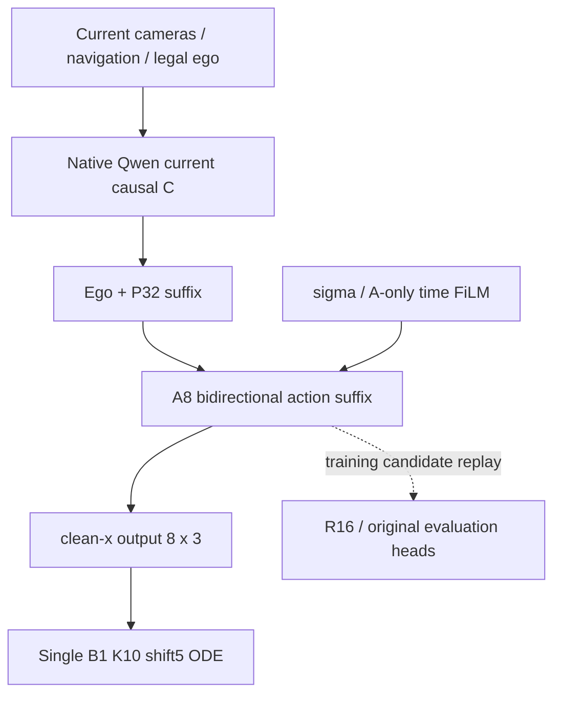

# Architecture and source audit

原Qwen3-VL-2B文本28层，hidden2048，Q16/KV8，head_dim128。保留RMSNorm/GQA/mRoPE/DeepStack及当前因果路径。部署没有C160压缩、旧StudentMemory、独立DiT、R16、文本CoT或scorer。

当前/参考共享不可变base存储；D5的动作输入输出和position、D4的训练readout先独立clone，再设可训练。可训练参数不能alias永久IL44参考。当前文本LoRA影响C/P/A，每次策略更新重构带梯度C/P前缀；只缓存冻结视觉/merger/合法输入元数据。

源分支不是可相互覆盖的整套版本：

- 四框架分支当前`c0fc1d32...`；新开发基底取实际包含D与原生RL的`84565f20...`。
- `research/qwen-world-rl-current-20261102 = 987bc614...`提供另一个World家族的FPO/rescue实现参考，但缺少本轮D模型命名空间，不能checkout覆盖D。
- D44原生 `qwen_flow_adapter.py` 与本轮基底一致，SHA256 `e95e1fcccd1aa37f8b095a83e0b134adbecc7350739b6701cd6b007042db0367`。逐文件差异见`source_audit.json`；旧D12k objective不被当成最佳配置。

复用的是原生D prefix、真实rigorous转移kernel、LoRA、canonical独立配对评分及checkpoint事务；新算法目标在`starVLA/rl/d44_native_rl`独立实现。

LoRA实际文本路径为28层q/k/v/o，共112个Linear：r16/alpha32为6,422,528参数。D5 r32文本为12,845,056；FiLM last8 rank8增量557,056；动作I/O/position30,723，总13,432,835。这些数值来自真实scope闭包，不沿用旧192张量硬编码。

## 效率资格

原始source checkpoint策略与all_off在G8/G16/G32真实非零LoRA上输出和完整参数梯度一致。G16前向反向2.324→1.395秒，峰值25.55GiB。这是单次策略重算，不是整轮训练加速比。

flat_W3在G8首次无更新joint ratio偏差约0.214，未通过1e-4资格，正式配置强制sequential。该实验fixture后续G16/G32还受到布局未重置影响，不能拿那两组数据归咎source；fixture已修复，原失败证据保留。不调整PPO阈值掩盖问题。
