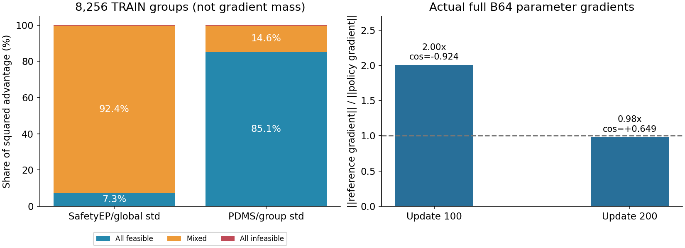

# AUG迁移的关键差异与真实训练诊断

更新时间：2026-11-04 17:54 UTC。AUG7正式训练保持；旧AUG6和更早RL不恢复。尚未证明新的RL提分。

## 最直接的发现：参考约束可以主导更新，但并非始终有害

同一已保存策略、相同fresh轨迹，完整计算每个B64场景的三组真实参数梯度：SafetyEP策略项、官方式PDMS组内标准化策略项、beta0.1参考KL。没有Adam更新或新增评分。先对64场景的梯度向量求和，再算范数/夹角；不是逐场景范数相加。

| 检查点 | 完整场景 | KL梯度/策略梯度 | 两者cos | 总梯度与策略cos | 无策略梯度场景 |
|---|---:|---:|---:|---:|---:|
| u100 | 64 | 2.0036 | -0.9240 | -0.7433 | 19 |
| u200 | 64 | 0.9781 | +0.6495 | +0.9103 | 24 |

u100的参考项反转了总体梯度相对奖励项的方向；u200则与奖励方向一致。两者均有大量无奖励梯度场景继续贡献参考约束。**不能称参考项始终阻碍训练，也不能仅凭两次batch证明最终PDMS原因。** 这是减小beta的直接实验依据。两次全部fresh ratio误差为0，排除了本次保存策略与重评分不同步。

AUG8_NATIVE_KL001已注册：同IL46、新Adam0，beta由0.1降至官方动作配置0.001；优势、探索、FP32路径、B64/G16/M2、LR/曝光调度不变。为保留评测资源采用4rank，每rank16场景；与AUG7的16rank相比，rank RNG和浮点归约不同，不称逐采样严格配对消融。原8/16/32rank限制已对该新identity显式扩展至4，必须通过真实中途恢复后才从IL正式启动。禁止迁移AUG7权重或Adam。

## 优势分配改变了实际学习重点

完整覆盖AUG6全部129 collection、8256不同TRAIN场景、132096候选。全安全7318组，混合858组，全不安全80组。混合组仅占10.39%，但占SafetyEP/global标准化后约92.4%的优势平方权重；官方式PDMS/group标准化把约85.1%权重分给全安全组。该统计是优势权重，**不是参数梯度贡献**。

- 159组官方PDMS有差异而SafetyEP为零；1347候选在两种优势规则下符号不同。
- 54个全PDMS零分组中51个没有SafetyEP信号。这51组均存在真实碰撞/TTC事件时间或越界持续比例差异。
- 时间风险可以提供排序信号，但不证明存在安全可达解，也不证明学完会提高PDMS。组内可行候选的严格优先关系仍需保留。
- 两个完整B64的SafetyEP与PDMS组标准化整体梯度cos分别0.722、0.786；改变优势并非只改变一个学习率倍数。

## 官方实现与当前D迁移不是同一个完整系统

[原论文](https://arxiv.org/html/2610.16985v1) · [固定版本源码](https://github.com/haha-yuki-haha/AUGUstus/tree/edf3422304e4b2987e839a9212cf1176782e7380) · [官方权重](https://huggingface.co/yuki-hahaha/AUGUstus)

| 项目 | 官方公开实现 | 当前D AUG7 |
|---|---|---|
| 观测 | 4历史帧、2Hz；三相机裁剪拼接2048×512；历史ego轨迹入文本 | 当前帧三相机＋ego/nav；无四帧历史输入 |
| 主干 | Qwen3.5-2B；全层AdaRMSNorm动作时间条件 | Qwen3VL-2B；D自身动作/预测token结构 |
| 可训练范围 | 文本主干和动作机制；视觉冻结 | 约701万参数：注意力LoRA、末8层time LoRA、动作接口/位置 |
| 动作优势 | Stage I动作5×PDMS组内sample std；公开YAML split_advantage=true | SafetyEP组内中心化、全batch population std、cap5 |
| 动作参考KL | 0.001 | 0.1 |
| CoT | 单独预测奖励、token GRPO；KL0.01 | 无CoT RL目标；当前D父权重未携带可直接复用的官方CoT头 |
| 阶段二 | endpoint/可行性门控等课程 | 当前未复现 |
| 采样 | 3步linear；独立随机根；归一化噪声[.05,.05,.02] | 原生K10/shift5前7步确定性＋末3步JaT；同场景共享部署根；物理尺度对齐 |
| B/G/M | 公开Stage I B32/G8；ppo minibatch32 | B64/G16/M2 |
| 数值 | 公开模型BF16路径；FSDP混合精度 | 真实微更新跳变后改FP32文本/动作、冻结视觉BF16 |

论文消融：SFT90.6，动作JaT92.6，但NC/DAC/TTC由99.0/97.9/96.4降至98.0/97.6/94.1，EP84.2→91.8。完整Stage I94.0、Stage II94.6不能全部归功于动作JaT。它也面对安全与效率的张力。以上是作者报告的成绩，不是我们本地复现。

论文与代码还存在说明差异：论文写共享奖励优势，公开Stage I/II YAML使用分头优势；论文描述平滑噪声，固定源码sample_noise为独立正态。对照实验以实际执行代码为准并记录差异，不据此断言论文错误。

## 本地官方对照状态

已下载固定源码，隔离安装Qwen3.5/transformers环境；八个合法TRAIN场景的4历史帧、官方裁剪/JPEG/libx264视频和ego历史文本已准备。历史位置从原始NAVSIM重建，尚未断言与另行发布的P3 JSON舍入完全一致；不伪造CoT标签。

SFT和Stage I两个完整模型各6.315GB，固定HF revision与SHA；网络存在TLS中断和签名URL过期，下载恢复只接受逐range完成记录，最终整文件SHA正确才加载。**权重尚未完成验证，官方模型推理/实际Adam更新尚未执行。** official_probe直接调用官方模型、diffusion adapter、JaT核；不执行源码中清理Ray进程的launcher。它最多一个TRAIN动作更新，不冒充全CoT-GRPO复现；启动仍需资源准入。

## 最新完整结果的含义

u400相同FP32起点的44物理log配对95%区间为[−0.01999,+0.12406] PDMS，包含0；零分修复8个、新增7个，原高分转零4个。收益尚不可靠，零分问题也未实质解决。

相同数值u0配对资料见 [u200](AUG7_U200_VS_NUMERIC_U0.json) 和 [u400](AUG7_U400_VS_NUMERIC_U0.json)。

## 训练长度也不能忽略

u400只相当于12800/103288≈0.124个场景曝光epoch；公开Stage I配置为10 epochs。当前早期分数不足以判定D或JaT的最终上限。AUG7继续原先注册训练，AUG8检验约束机制；不能用资格测试或几百步代替充分训练结论。

## 接下来怎么判断

1. AUG7 u200完整单条ODE=89.53839404，相同数值u0=89.51048770，净增仅0.02790635。u400完整89.56281536，相同起点+0.05232766；NC/TTC略降、EP/DAC略升，未突破安全效率拉扯。没有实质性提分证据。
2. 自动执行AUG8真实资格与pending-inner恢复，再从IL46/Adam0独立正式训练；保留AUG7为对照。每100更新保存，最近10份及最佳/评测固定。
3. 比较完整分数、零分修复/新增零分、安全和EP，同时看KL与PG真实梯度；不要用KL变小替代提分证据。
4. 优势分配与时间风险作为下一条独立改进候选，不能把本次反事实权重分析写成训练收益。
5. 官方完整模型和输入对照用于识别主干/历史信息/CoT差异；不从官方模型向D迁移RL权重，不把NAVTEST反馈返回TRAIN。
