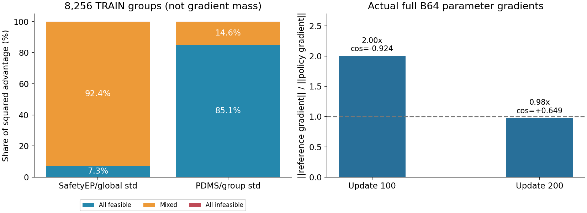
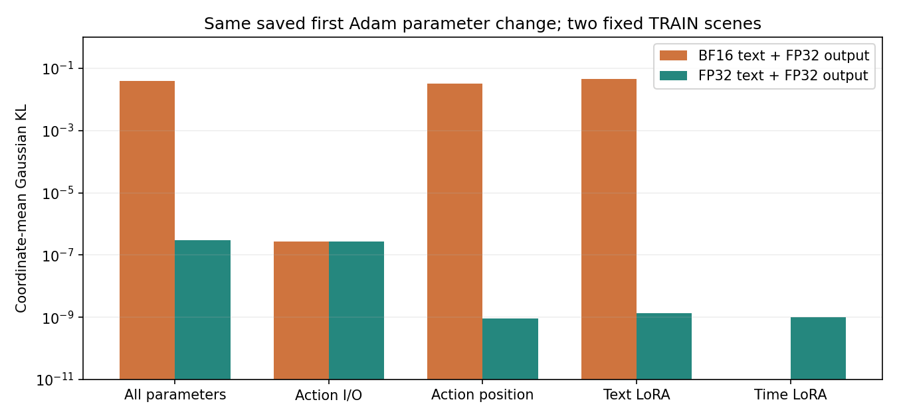
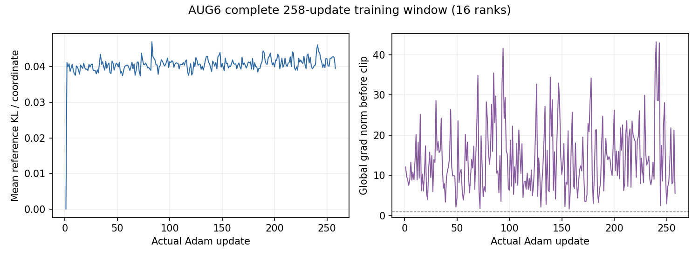

# 当前研究进展与核心发现

更新：2026-11-04 17:54 UTC。AUG7正常训练，u200全量分数89.53839404，相同数值u0仅+0.02790635；u400完整89.56281536，相同数值u0累计+0.05232766，仍无实质性提升。新数值u0完整PDMS **89.51048770**（12146场景、44logs、invalid0），不是RL增益。

完整64场景梯度两次回放表明参考KL影响很大：u100为策略梯度2.004倍且近反向，u200为0.978倍且同向。已开发独立 **AUG8_NATIVE_KL001**（同IL46，beta0.1→0.001）；资格/恢复/正式启动由后台排队，在现有u200/u400完整评测后执行，不能将配置就绪称作已训练。

详见 [关键发现、官方源码对比与下一步](OFFICIAL_COMPARISON.md)、[全batch梯度汇总](FULL_BATCH_GRADIENTS.json)、[全TRAIN优势分析](CREDIT_COUNTERFACTUAL.json)。当前D最高完整成绩仍为历史FPO1711的90.35363365；项目IL70/SafetyEP91.45359756是不同父模型。

此前数值修正、AUG6结果与设计记录

# D46 AUG迁移修正

当前主线为 `AUG7_NATIVE_FP32`，修复在真实TRAIN回放中发现的BF16文本／动作数值跳变。AUG6在258次更新保存停训；不恢复已终止的历史AUG/FPO。

2026-11-04 15:15 UTC：AUG7两节点16卡正式训练已全rank提交17次更新、576次场景曝光，fresh Adam0和原生中途恢复均通过；u0完整评测进行中，已产生577/12146条真实评分，仅报告进度。见 [当前启动与数值状态](CURRENT.json)。实时进度继续读HTML。

## 最新完整结果与判断

| 完整单轨迹评测 | PDMS | 相原IL46 | 相本实验数值u0 |
|---|---:|---:|---:|
| 原始D IL46 | 89.49552098 | — | — |
| AUG6 u0（仅动作投影FP32） | 89.48375428 | −0.01176670 | 0 |
| AUG6 u200 | **89.54346127** | +0.04794030 | +0.05970699 |
| AUG7（文本和动作FP32） | 待完整评测 | — | 必须重新评测u0 |

全部已发布点均为12146场景、44物理logs、invalid0、单条ODE K10/shift5/seed2101。AUG6相自身u0的配对95%区间为 **[−0.00220,+0.12689] PDMS**，仍跨0，不能称为可靠提分。相同数值基线下修复10个零分、新增5个零分；原高分（≥0.9）场景对总分的净贡献为−0.03582。完整证据见 [AUG6_U200_SUMMARY.json](AUG6_U200_SUMMARY.json)、[同数值配对分析](AUG6_U200_VS_NUMERIC_U0.json)。

D系列历史最高完整结果仍为FPO1711的90.35363365；其权重此前已按用户要求删除。IL70/SafetyEP的91.45359756使用不同父模型，不能作为D同起点收益。

## 本次定位与修复

第一步实际LR只有7.7453e-9，参数最大变化约1.49e-8，但BF16路径产生0.002–0.005的clean-x跳变。相同权重重复计算误差为0；拆分真实首步参数更新后，文本LoRA和动作位置参数的微小更新都能触发跳变。仅将最终动作线性层改为FP32不足以解决。

固定相同两条TRAIN场景、相同首步参数变化，FP32文本C/P与动作前向将JaT坐标KL均值从0.0394859降为2.99221e-7。FP16测试产生非有限值，未采用。**这证明了这两场景的数值连续性改善，不是全量部署提分证据，也不能解释此前所有退化。** 四场景拆分与两场景精度对照的范围见 [MIGRATION_REVIEW.json](MIGRATION_REVIEW.json)。

修复复用原Parameter、原state_dict及同一动作坐标；训练actor、永久IL reference和部署加载器一致切换文本／动作FP32，冻结视觉保持原BF16。官方JaT probability/KL公式、采样协方差、全局优势标准差和官方评分均保持。新训练独立从IL46及Adam0开始，不继承AUG6或资格测试权重。

## 全部已训练场景的信号分析

完整扫描AUG6的129个collection、2064份rank反馈：**8256个不同TRAIN场景，132096条候选**，并非抽样估计。

| 候选组类别 | 场景数 | 有非零优势的场景数 |
|---|---:|---:|
| 全部安全可行 | 7318 | 4868 |
| 安全／不安全混合 | 858 | 858 |
| 全部不安全 | 80 | 10 |
| 全部PDMS为零（与上表类别重叠） | 54 | 3 |

51个全零组没有策略梯度指导。这是值得解决的算法信号缺口；当前仅曝光约0.080E、没有重复访问这些场景，不能称为永久零分。G16 strict-high覆盖86.09%，但本轮没有TRAIN真实B1探针，不能把候选覆盖当成确定性策略吸收率。下一步在精度修正的完整结果基础上研究真实安全事件的细分反馈，保持安全可行候选优先；不将测试场景或分数返入训练。详见 [全TRAIN分析](AUG6_ALL_TRAIN_COLLECTIONS.json)。

梯度图中的角色分量位于全局裁剪之后，不代表Adam实际参数更新贡献；真实文本LoRA梯度及参数更新均非零，不能据此声称只训练了动作头。

主报告：`/mnt/project/qwen-world-performance-rl-20261103/report.html`。
本轮独立报告：`/mnt/project/d46-aug-migration-20261104/report.html`。
后台控制器：`tools/d46_aug_migration/owner.py`。真实阶段与完整成绩以报告/运行账本为准；本文件不把已派发当作已取得收益。

## 方法

复用官方 pinned JaT 采样、重评分和损失内核；复用本项目原生D actor、分布式trainer、官方PDM评分与checkpoint体系。

| 项目 | 本轮实际设置 |
|---|---|
| 父模型 | 同一完整D IL46，SHA `386a0a27bd197cb002501bcb90c343659001d2e6d4f7bad0cbd5e31a91f8477d`；新Adam0 |
| 场景/候选/更新 | B64/G16/M2；两节点16卡，每rank4个不同场景 |
| 实际采样链 | K10 shift5；7步确定性前缀，末3步官方lambda_t JaT探索 |
| 根噪声 | 和正式评测相同namespace/seed2101/scene token，CPU生成，同场景G共享根 |
| 探索尺度 | 全103288合法TRAIN的逐航点q01/q99范围映射到原IL坐标；采样、ratio、KL统一8×3协方差 |
| 输出精度 | AUG7文本C/P与动作前向FP32，冻结视觉BF16；actor/reference/部署一致，保留原Parameter与state_dict键 |
| 优势 | SafetyEP局部信用，所有有效64×16候选统一population std，cap5，padding不计 |
| 优化 | LR1e-6，AdamW(.9,.95)，clip0.2，JaT参考KL系数0.1，max_grad_norm1 |
| 调度 | 曝光warmup.08E/hold.60E/cosine4E/floor.05；先登记3E，再据效果延长 |
| 参数范围 | 共享文本attention LoRA及原生动作/时间接口，共7,010,307可训练参数；视觉冻结 |
| 保存 | 每100更新完整状态；最近10份，额外保留u0、最佳和正在评测的点 |

这是本地D适配，不声称完整复现CoT-GRPO、预测奖励或论文Stage II。部署路径保持/教师吸收留作后续独立改进，此轮不混入。动作坐标与官方评分代码不变。

FP32可能改变u0输出，不能把所有增益算作RL效果。预定完整NAVTEST：u0/200/400/800、0.5/1/2/3E；B1 K10/shift5/seed2101，12146场景、44物理logs、invalid0。既报相原IL46 89.49552098，也比较本轮FP32 u0。测试标签不流入训练；最终模型选择标记NAVTEST_SELECTED。

## 资格与正式任务分开

AUG7真实两节点16卡资格和第1次更新中途恢复均已通过：第2次Adam从原pending material继续，Adam、scheduler、16rank RNG和冻结权重检查通过；fresh ratio误差0，峰值显存约18.8GB。两节点正式进程已启动，从相同IL46重新建立Adam0，没有使用资格测试权重。纯反向／优化阶段约8秒，不包括采样评分，不能当作端到端每步耗时。

CPU测试覆盖真实tiny文本前缀／动作后缀dtype与LoRA梯度、两次inner更新、严格数值协议、精度差异标注、调度及资源共用。新增评测元数据明确标注FP32文本／动作；只有显式允许时才能与原BF16 IL配对，并标记该差异不是纯RL收益。资格与正式源的训练／推理数学代码逐文件相同，后者补充评测元数据和准入；收据记录在`QUALIFICATION_TO_FORMAL_SOURCE.json`。唯一后台控制器事件触发评测与报告；日常30分钟更新、完整结果立即更新。

实际命令、进程、资格和完整结果写入 `/mnt/project/d46-aug-migration-20261104/operations/`，不将大体积临时验证文件推入Git。

## 旧任务清理

旧FPO成熟/Verified最终停在3323/643更新，相关27个训练/评测job均EXIT0。按用户授权，删除D44/D46共21个旧run下225个checkpoint；删除前这些文件去重分配字节合计207,784,361,984（不是独立测量的文件系统释放量）。代码、配置、日志、逐场景评测与分析保留，D IL和IL46父权重保留。

清理收据：`/mnt/project/d46-fpo-two-routes-20261104/operations/TERMINATE_OLD_RL_20261104/COMPLETE.json`。
旧FPO 1E评测被取消，保留其部分结果，但不发布不完整平均分。七个已完成点的最终归档见 [OLD_RL_FINAL_RESULTS.json](OLD_RL_FINAL_RESULTS.json)。

资源只使用本任务五容器白名单；本机D IL不抢占，无法归属的Tsh2 GPU负载不处理。AUG7训练WMzt+Tshzt；Tsh5用于并行完整评测。已有其它项目的冻结TRAIN筛查进程保留，仅在精确命令／源哈希核对、足够显存及每卡最多2个已知进程的条件下共用，不终止外部任务。

