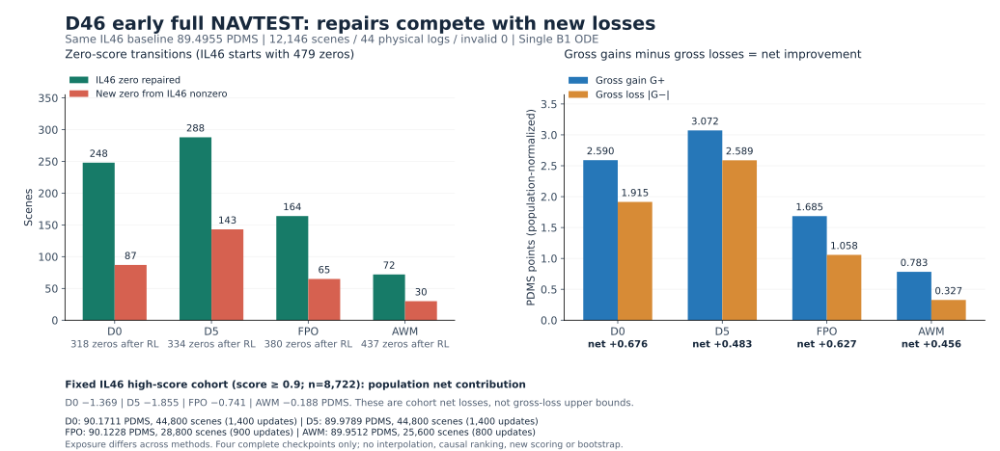
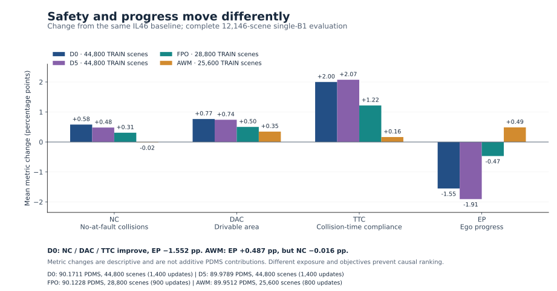

# D46：完整早评结果、优先级与可恢复训练证据

**当前补充（2026-11-03 13:26 UTC）：D系列实际在训5条、48卡。** D0双节点16卡、FPO/D2/AWM/D5各8卡；D1保留资源hold。两台原占用节点后来通过79000MiB整机八卡空闲准入，AWM/D5已从自己的native状态恢复，[实际准入与新更新回执](results/operations_v7/ACTUAL_RELEASES.json)保留；没有清理未知进程。D0新的1800-step checkpoint已通过[全部16rank原生材料/RNG校验](results/world16_formal_v2/NATIVE1800_VALIDATION.json)。

D0完整训练周期实测 **43.77→21.12秒，2.07倍加速**，B64/G16/M2保持；[窗口、统计与复算方法](THROUGHPUT_WORLD16.md)。后文3条路线的13:09表述和12:46训练表是历史快照。

**最新运行补充（2026-11-03 13:09:28 UTC）：D0 已从自己的1714 READY无回滚迁移到正式双节点16卡，16rank实际1736+；FPO、D2各保留8卡，合计3条主线32卡。** AWM在1194 READY合作保存后临时让位，原6E预算保留；D1/D5与旧I亦为资源保留。[正式16卡部署与真实更新证据](FORMAL_WORLD16_DEPLOYMENT.md)。下文12:46/12:52的训练表为保留的历史快照。

本轮D46最高完整分 **D0 90.17112884**；全系历史最高为另一IL70起点的 **SafetyEP Control10k 91.45359756**。新16卡训练尚无新的完整NAVTEST成绩，不把吞吐扩大算作分数提升。

本页结果/运行快照截至 **2026-11-03 12:46:38 UTC**；运维与机制补充回执更新至 **12:52:56 UTC**。运行根为 `/mnt/project/d46-priority-rl-20261103`；这里是固定快照，不代表后续实时状态。
用户指定同一份 **D 框架 IL46k 部署策略**作为六条独立 fresh RL 的起点，未从 D44 RL、资格更新后的权重或其它算法初始化。

## 四份完整结果与研究判断

基线 IL46 为 **89.49552098 PDMS**。下列四份均完成 **12,146 NAVTEST 场景、44 物理 log、invalid=0**，统一真实单候选 B1 clean-x ODE K10/shift5/seed2101，无 oracle 或重排。CI 直接复用原有 44-log paired bootstrap，不新计算。

| 路线 | 完整 PDMS | 相对 IL46 | 已有95% CI（PDMS增益） | 评测点实际更新 | TRAIN场景曝光 | 曝光epoch |
|---|---:|---:|---:|---:|---:|---:|
| D0 | **90.17112884** | **+0.67560786** | [+0.1458, +1.3385] | 1,400 | 44,800 | 0.43374 |
| D3_FPO | **90.12278094** | **+0.62725996** | [+0.1774, +1.1350] | 900 | 28,800 | 0.27883 |
| D5 | 89.97889876 | +0.48337778 | [−0.0798, +1.1529] | 1,400 | 44,800 | 0.43374 |
| D3_AWM | 89.95115511 | +0.45563413 | [+0.3000, +0.6548] | 800 | 25,600 | 0.24785 |

**D0 与 FPO 双优先继续观察。** D0 当前完整分最高；FPO 在较少场景曝光下得到相近分数，固定高分队列损失也较小。两者曝光、目标及每更新算量不同，不能据此宣称因果优越、GPU效率或长期上限；这些 CI 是各自对 IL46，不是方法之间的显著性检验。

- **D0：安全修复明显，进度与高分保持抵消收益。** 修复248个原零分、新增87个零分；总体 G+=2.590471、|G−|=1.914863 PDMS。NC/DAC/TTC均值分别提高0.580/0.766/2.001pp，EP下降 **1.551854pp**。固定 IL46 score≥.9 的8,722场景队列净贡献为 **−1.368811 PDMS**。
- **FPO：修复较少，回退也较少。** 修复164、新增65；固定高分队列净损失−0.740797 PDMS，EP下降0.468990pp。这是当前完整评测的描述，不意味着更多训练必然保持此优势。
- **D5：更多修复被更多回退抵消。** 修复288最多，但新增143、gross loss 2.588862及高分队列净损失1.855083也较大，EP下降1.905190pp。扩大scope并未自动转成更大净收益；不能把资源暂存写成算法无效。
- **AWM：更偏保持与进度，低分修复较弱。** EP提高 **0.486705pp**，原高分队列8,660/8,722保持≥.9（99.29%），该队列净损失仅0.187708 PDMS；修复72、新增30。NC变化−0.016466pp，不能笼统称所有安全指标改善。

这些高分贡献均是**同一 IL46 固定队列的带符号总体净贡献**，不是gross loss上界或可实现的repair收益。采用 [FACTS](plots/D46_EARLY_FULL_FACTS.json) 中的≥.9口径8,722，不能混用旧 `SUMMARY.paired.baseline_high_denominator=11199`。NAVTEST只用于已披露的研究诊断/模型选择，任何ID或逐场景标签不进入训练。

同图另有 PNG。两幅均为四个真实完整点，不画插值学习曲线；图注列出了各自更新与曝光。指标变化不是PDMS的可相加分解。

## 当前训练与工程状态

[固定运行快照](analysis/COMPLETED_RESULTS_RUN_STATE_SNAPSHOT.json) 只读 NAS 的真实八rank journal与原生 seal，未做SSH/GPU动作：

| 路线 | 12:46 UTC八rank共同最新更新 | 已封存更新 | 当时状态 |
|---|---:|---:|---|
| D0 | 1,676 | 1,614 READY | 当时Tsh5与旧I共享，从自己1614恢复后已实际更新；后续I合作退出让D0独占 |
| FPO | 1,310 | 1,300 READY | Tsh3继续原生训练 |
| AWM | 1,170 | 1,100 READY | WM4继续原生训练 |
| D2 | 1,618 | 1,614 READY | attempt003从自己1614恢复，已真实增加4更新 |
| D1 | 1,614 | 1,614 READY | 资源hold；第二阶段尚未启用，不判无效 |
| D5 | 1,647 | 1,647 inner1 | EXIT0合作保存后资源hold，不判无效 |

未封存的journal更新不能直接当恢复点。`RUNNING.json` 是原始receipt，进程退出后仍可能保留；真实完成应同时看RESULT、最新seal和进程身份，不能只读旧RUNNING字段。

### 0.5 epoch评测请求目录故障已与数值故障分开

D0/D1/D2/D5原attempt001均先完成 **native1614 READY** 的atomic保存，随后rank0写 `evaluation_requests/epoch0.5.json` 时因父目录缺失退出1。四run全部payload SHA、identity/原科学source、八rank原生 `Boundary` 与跨rank校验均PASS，Adam所有step=1614、scheduler=1614、RNG与场景游标完整。真实code1和日志保留，没有伪造EXIT0。

Root已[创建六run目录并回填丢失请求](results/recovery/DIRECTORIES_AND_GATE_BACKFILL.json)，科学源码未变。CP中 `evaluation_gates` 已含.5，单纯resume不会重新生成请求，回填是必要步骤。详见 [原生恢复审计](results/recovery/RECOVERY_AUDIT.json)。

D2 attempt002随后在原90秒Gloo启动控制collective超时，**0次新增Adam更新**，自己1614 CP保持完整。Root保留失败，做一次相同科学配置/同CP的warm-cache重试attempt003；本快照已看到八rank1618。见 [D2启动超时审查](results/recovery/D2_STARTUP_TIMEOUT_REVIEW.json)。

后续[机制激活实证](results/recovery/D2_RESUMED_RESCUE_ACTIVE.json)显示：原source、同1614祖先、Adam未重置，八rank已真实更新至 **1628** 且post-.5E verified-rescue辅助项非零；该日志快照累计 **448 TRAIN B1查询、800个adaptive额外候选**，计数后续会增加。这只证明恢复与机制激活，不是部署提分、逐场景激活率或新的NAVTEST成绩，不能将八rank复制的全局计数再乘8。

### world16资格通过，尚未宣称正式长训或提速收益

[真实两节点 pending-resume 资格](analysis/ACTUAL_WORLD16_PENDING_RESUME_PASS.json) 已PASS：world16、B64/G16/M2，真实新增4次Adam更新，native中途inner恢复、RNG及pending材料保留；恢复已有pending时无额外PDM query。资格权重从未作为正式初始化。

这份PASS只证明有限资格任务正确执行，**不等于world16正式长训已部署，也不是最终分数或吞吐优势证明**。当前D0恢复仍属原world8 lineage；多节点正式应用另需精确迁移收据与实际部署证据。

WMzt/TSH2曾出现NVML无owner但实际仍有显存/利用率，保持排除；[严格旧job孤儿审查](results/recovery/ORPHAN_PROCESS_AUDIT.json) 没有找到足以cleanup的自有孤儿。未绕过未知占用、清锁、reset GPU或影响D IL。

### 最新运维补充：精确等模型评测引用与旧I临时让位

Root已提交运维 `46cdd79`（22项CPU检查通过），以 `operations_v6` CPU owner **217718** 接管；旧206151合作退出，已有GPU任务和科学 `formal_v1` 不变。见[owner交接](results/operations_v6/OWNER_HANDOFF.json)。[精确等模型引用表](results/operations_v6/EVALUATION_EQUIVALENCE.json)只绑定D0/D1/D2各自原生0.5E的已验证相同部署策略：实际评D0一次，D1/D2显式引用，不能当三份独立结果，也不把等价假设扩展到机制启用后的未来checkpoint。

旧IL70综合I已按[资源优先级临时暂停意图](results/old_I_resource_hold/RESOURCE_PRIORITY_PAUSE.json)，在自己的 **4877_inner1** 合作保存，八rank CP一致、真实 **EXIT0**；[退出回执](results/old_I_resource_hold/NATIVE_SAVE_EXIT0.json)明确保留原minimum/target **10000** 预算，后续必须从自己的最新完整Adam/RNG/pending恢复。这是资源hold，**不是算法终止或科学无效判定**。Root随后实读确认Tsh5仅余8个D0 NVML进程、D0独占；本次归档不另作SSH/GPU探测。

## 六条路线的实际机制与启用边界

| 路线 | 实际优化机制 | 关键启用点 |
|---|---|---|
| D0 | 原生W3 joint24 Gaussian PPO、clip0.1、自适应reference KL | 从更新0 |
| D3_FPO | clean-x CFM-energy ratio代理、clip0.01、MC4 | 从更新0；不是trajectory likelihood |
| D3_AWM | 正优势加权flow matching与clean-x参考保持 | 从更新0；没有PPO-clipped目标 |
| D5 | 文本LoRA r32、末8层Time-FiLM LoRA、动作I/O与position | 从更新0；scope与各role LR均改变 |
| D1 | 两阶段信用，后期加入TRAIN endpoint与comfort质量 | 正式2 epoch，当前尚未启用 |
| D2 | 真正优于本场景B1的安全候选，clean-x及真实B1末步吸收 | 正式0.5 epoch；早评u1400尚未启用 |

D0/D1/D2在u1400的实际参数payload及部署签名完全一致，因此四份早评只包含四个不同策略。D1/D2可引用D0的等参数结果，不能伪造两份独立评测，也不能据此否定其尚未启用机制。

默认B64/G16/M2、同IL46 fresh Adam/seed42、完整NAVTRAIN103288。按有效场景曝光调度LR：warmup .08 epoch、hold .60、cosine到4、floor .05；初始6 epoch，8/12/20需后续授权与完整结果。文本LR通常2e−6，AWM3e−6；D5的FiLM1e−5、动作接口3e−6、position1e−6。任何队列/放置变动不重置原生Adam/RNG。

已有[优化健康摘要](analysis/EARLY_OPTIMIZATION_HEALTH_COMPACT_20261103.json)显示：FPO/AWM小梯度不等于无更新，实际LoRA_B位移仍显著；FPO真正 `fpo_clip_fraction` 与额外Gaussian诊断必须分开。标量、梯度范数和采样oracle都不能替代完整单B1部署成绩。

## 起点策略及可追溯来源

原full native46k与阶段pin已被历史IL保留策略移除。本轮保护的是经过完整NAVTEST和native/export逐值一致验证的**完整部署策略**，实际模型SHA为 `386a0a27bd197cb002501bcb90c343659001d2e6d4f7bad0cbd5e31a91f8477d`。11文件均为硬链接，没有额外复制8.76GB。

部署C/P、Qwen、action与Time-FiLM参数严格恢复；被裁剪的R16 query/readout没有伪装成仍可用。六臂绑定[v2父合同](results/PARENT_CONTRACT_v2.json)；D4/D6原训练辅助头依赖路线未按旧版本启动。随机新辅助头可行性仅见[独立边界审查](results/D46_FRESH_AUX_FEASIBILITY.json)，不是当前六条之一。

科学冻结源 `formal_v1@ff3013c`；原FPO/AWM资格同机加载OOM与原native0均保留，启动预留/48GiB修复是运维调整，不改变算法。六条fresh初始化见[真实资格与正式起点证明](results/ACTUAL_QUALIFICATION_AND_FRESH_FORMAL_PROOF.json)。旧D44代码、结果与完整原生状态[保存保留](results/D44_ACTUAL_NATIVE_SAVED.json)，未用作D46初始化。D IL继续，不据资源审计回收其它任务。

[本次来源清单](SOURCE_ARCHIVE_COMPLETED_20261103.json)绑定每份拷贝的NAS绝对路径、实际文件SHA和字节数。四份SUMMARY、PAIRED及IL46对照在 `results/early_full/`；图和简明中文结论在 `plots/`。本次新增证据拷贝共约0.75MB，不归档模型/optimizer、逐场景ledger或重复大型运行账本。

图重建源码：[plots/builder.py](plots/builder.py)，只读其固定NAS封印summary输入，不重跑场景/模型/评分。归档器：[archive_completed_review.py](archive_completed_review.py)，仅写此reports目录，不stage或commit。

实时HTML：`/mnt/project/qwen-world-performance-rl-20261103/report.html`；历史总报告：`/mnt/project/qwen-world-rl-optimization-20261030/report.html`。本页只覆盖上述UTC时刻的固定研究证据。
