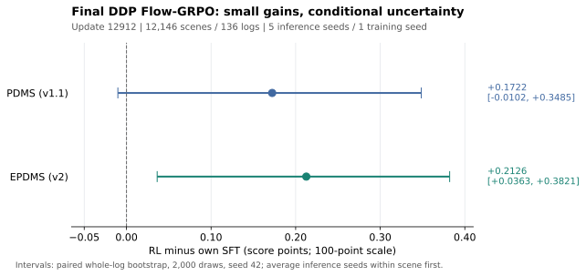

# DriveDreamer-Policy Flow-GRPO 强化学习开发与结果报告

整理日期：2026-10-13（UTC）。本报告汇总 2026-09-17 至 09-20 的 DDP（DriveDreamer-Policy）强化学习开发记录，并补齐最终 update12912 的五推理 seed 结果。最终评估于 **2026-09-20 10:47:03 UTC** 完成；本次整理仅核对已存在的日志和分数。

**结论：早期方案出现退化；最终方案取得小幅均分收益，但尚未证明稳定的综合提升。** 完整 Navtest 上，PDMS 提高 **0.1722 分**，95% 配对 log-bootstrap 区间跨零；EPDMS 提高 **0.2126 分**，该区间为正。同时碰撞合规、TTC 分项下降，新增零分场景多于恢复场景。因此，“完全没有任何提升”不准确，“强化学习已获得稳定全面提升”也超出了证据。

工程上，冻结编码器、缓存特征、训练完整 action head，以及批量计算已保存的去噪转移，已经实际实现并验证。这套方案提高了训练效率；后续研究仍需解决奖励信号、探索与安全退化问题。

## 1. 最终结果与统计口径

固定终点为 **update12912**，对照是其自身原始 **F-SFT：action-only / frozen_visual / step100000**。每个模型按相同协议评估全部 **12,146 场景、136 logs**，推理 seeds 为 **42、43、44、45、46**。推理保持原始单候选、十步 ODE 和后处理。

以下均为百分制分数，变化量单位为“分”，不是相对百分比。

| 指标 | 原始 SFT | 最终 RL | 配对变化 | 变化的 95% log-bootstrap 区间 |
|---|---:|---:|---:|---:|
| NAVSIM v1.1 PDMS | 88.8863 | 89.0586 | **+0.1722** | **[−0.0102, +0.3485]** |
| NAVSIM v2 one-stage EPDMS | 88.2502 | 88.4628 | **+0.2126** | **[+0.0363, +0.3821]** |



统计先对每个场景的五次推理分数取平均，再以完整 log 为单位进行 2,000 次 bootstrap，随机种子 42；每次保留抽中 log 的全部场景，并按场景数计算均分。没有把 60,730 个“场景 × seed”当作独立样本，也没有先算每个 log 均分再等权平均。

**只有一个训练 seed（42）**，五个 seed 是同一组权重的推理噪声种子。区间描述给定模型和这五个推理 seed 下的 log 抽样不确定性，未覆盖多训练 seed 的稳定性，也未作多指标比较校正。PDMS 的区间仍容许微小负收益；EPDMS 的正区间支持本次固定对照下的小幅收益。

### 各推理 seed 的完整结果

| 推理 seed | SFT PDMS | RL PDMS | Δ PDMS | SFT EPDMS | RL EPDMS | Δ EPDMS |
|---|---:|---:|---:|---:|---:|---:|
| 42 | 88.8644 | 89.1196 | +0.2552 | 88.2378 | 88.5355 | +0.2977 |
| 43 | 88.8675 | 89.0462 | +0.1788 | 88.2608 | 88.4083 | +0.1475 |
| 44 | 88.8986 | 89.0609 | +0.1623 | 88.3009 | 88.4883 | +0.1874 |
| 45 | 88.9338 | 89.0217 | +0.0879 | 88.2372 | 88.4250 | +0.1878 |
| 46 | 88.8675 | 89.0445 | +0.1769 | 88.2145 | 88.4571 | +0.2425 |

五个点估计均为正，但并非每个单 seed 的区间都为正。逐 seed 区间及零分变化见 [per_seed_metrics.csv](per_seed_metrics.csv)。主结论采用预定五 seed 汇总，不挑选最高分 seed。

### 总分收益伴随哪些退化

下表由最终五 seed 的原始评分 CSV 重新汇总；各分项均是越高越好。

| 协议 / 分项 | SFT | RL | 变化（分） |
|---|---:|---:|---:|
| v1 / ego progress | 82.9673 | 84.0670 | **+1.0996** |
| v1 / no-at-fault collisions | 98.1681 | 97.8536 | **−0.3145** |
| v1 / TTC within bound | 95.0370 | 94.3339 | **−0.7031** |
| v1 / drivable-area compliance | 96.9488 | 97.0904 | +0.1416 |
| v2 / ego progress | 87.7212 | 88.9950 | **+1.2737** |
| v2 / no-at-fault collisions | 98.1665 | 97.8528 | **−0.3137** |
| v2 / TTC within bound | 97.5531 | 97.3110 | **−0.2421** |

完整 14 项均值见 [final_component_metrics.csv](final_component_metrics.csv)。这些是描述性分项变化，未单独计算显著性，也不能相加得到非线性总分变化；模拟碰撞/TTC 分数不等于真实道路事故率。相邻帧 `two_frame_extended_comfort` 需要结合可用性和有效权重，本次没有将其直接平均为一个新分项；官方最终 EPDMS 已保留其原有聚合语义。

| 场景事件 | PDMS | EPDMS |
|---|---:|---:|
| SFT 零分 → RL 非零 | 30 | 30 |
| SFT 非零 → RL 零分 | **53** | **57** |
| SFT 高分场景出现下降 | 143 | 616 |

这里先对场景的五 seed 分数取平均，再判断事件；计数不是五次评估事件数之和。“高分”指 SFT 场景均分 ≥ 90，下降指任意负差值，未设置最小下降幅度。对应逐 seed 计数另见 CSV。

## 2. 开发过程：哪些方案已经尝试过

早期开发集是 **1,696 场景 / 16 logs / 推理 seed42**，可能被源 SFT 见过。其 93–94 分与完整 Navtest 的 88–89 分属于不同数据范围，不能连成一条性能曲线。

| 阶段 | 实测结果（百分制） | 结论与开发记录 |
|---|---|---|
| F/U 配对训练，step200 | F：PDMS 93.4827 → 91.8825，EPDMS 93.6295 → 91.8215；U：94.0752 → 90.3394，94.1867 → 91.3599 | 两条路线均出现均分退化。[step200 诊断](../ddp_flow_grpo_world16/step200_diagnosis/README.md) |
| F-only，G16，8 次更新 | group：93.6650 / 93.8066；global_batch：93.5749 / 93.7281；F-SFT：93.4827 / 93.6295 | 短训小幅正收益，global_batch 未展示更好的均分；不足以推断长训。[G16 对照](../ddp_flow_grpo_frozen_improvement/README.md) |
| 相关噪声 Flow / noisy-Euler，8 次更新 | 相关 Flow：93.6826 / 93.8122；原 G16：93.6650 / 93.8066；noisy-Euler：93.5942 / 93.7874 | 能扩大候选差异，但没有证明优于原 G16；noisy-Euler 的 PDMS 对该对照退化。[探索实验](../ddp_flow_grpo_correlated_exploration/README.md) |
| 去噪步骤 credit，主终点 step64 | uniform：92.3644 / 92.7790；γ=0.6：92.3543 / 92.9757；F-SFT：93.4827 / 93.6295 | 两组都低于 SFT；γ=0.6 的 step32 曾达到 93.9416 / 93.8649，不能替代预定 step64 结果。[阶段报告](../ddp_flow_grpo_denoising_credit/discount64_completed/README.md)、[两组完成结果](evidence/denoising_credit_step64.json) |
| 冻结编码器 + 完整 action head + 特征缓存 | 可训练参数由 2,233,120,260 降至 819,503,620；完成真实更新、缓存等价、恢复及导出验证 | 此阶段证明工程可用，效果须看后续配对评估。[实现记录](../ddp_flow_grpo_action_head/README.md) |
| 批量计算保存的去噪转移 | 单机 8 卡短窗约 5.86 秒 / update | 为限定数值配置完成工程验收，随后完成全量训练。[数值与吞吐报告](../ddp_flow_grpo_transition_batch/README.md) |
| 完整 Navtest，中间 step8700 / seed42 | PDMS 88.8644 → 89.0109；EPDMS 88.2378 → 88.5025 | PDMS 区间跨零，已有安全分项和零分退化；checkpoint 在看到分数前固定。[中期报告](../ddp_flow_grpo_transition_batch/intermediate_step8700/README.md) |
| 完整 Navtest，最终 step12912 / 五推理 seed | PDMS 88.8863 → 89.0586；EPDMS 88.2502 → 88.4628 | 最终仍是弱收益；以本报告第 1 节为准。 |

F/U 是各自相对自身 SFT 的对照。源 SFT 训练步数和评估 attention backend 也不同，不能把 F/U 差异归因于视觉模块是否解冻。早期 F-only 实验训练 672 个非视觉参数张量；最终方案训练 359 个 action-head 张量，两者不是同一参数合同。

去噪 credit 的最终 JSON 使用历史键名 `group` / `batch`，分别代表 **uniform step credit / gamma0.6 raw step credit**；这里的 `batch` 不代表 global-batch advantage。旧阶段文档中“uniform 仍在运行”是当时快照，本报告已纳入两组 step64 完成数据。

## 3. 最终方案的模型、预算与效率

配置见 [frozen_action_head_batched_single8_epoch1.yaml](../../configs/flow_grpo/frozen_action_head_batched_single8_epoch1.yaml)。

| 项目 | 实际方案 |
|---|---|
| 起点 | 原始 F-SFT，action-only frozen_visual step100000；从 SFT 开始，不承接旧串行 RL 的优化器历史 |
| 训练范围 | 完整 `action_model`，包含 `qwen_proj`；359 张量 / 819,503,620 参数；未使用 LoRA |
| 冻结和缓存 | 冻结 action head 之外的编码器；缓存 `qwen_proj` 之前的 8 个归一化 Qwen action-token states |
| 训练奖励 | 官方 NAVSIM v2 单场景 reward；不含相邻帧 two-frame comfort |
| 采样与更新 | G=16，K=10，noise=0.1，组内 advantage 标准化；clip=0.02，inner epochs=2，denoising discount=1 |
| 保持项 | 原 action SFT replay 系数 0.1；独立原始 SFT reference；KL 初始系数 0.04，自适应目标 0.02 |
| 学习率 | 最大 1e−6；warmup 388 updates，cosine 总长 12,912，最小比例 0.1 |
| 数据预算 | 103,288 个唯一 Navtrain 场景；6,456 个新 behavior batches；12,912 次优化器更新 |
| 曝光与候选 | 103,296 次新场景曝光，含 8 次确定性 padding；1,652,736 条候选；206,592 次 SFT replay 场景曝光 |
| 执行配置 | 单机 8×A800 80GB；全局场景 batch16；BF16 参数存储、原 FP32 action 运算、ZeRO-2 FP32 梯度和优化器状态 |
| 更新加速 | `flat_saved_chain` 批量重算已保存的 B/G/K 转移；rollout 的十步时间依赖仍顺序执行 |

### 吞吐是实测短窗口，不是最终墙钟

| 历史执行配置 | 秒 / optimizer update |
|---|---:|
| 旧串行 action-head 更新，两机 16 卡 | 约 39.7（最后 20 个记录 update） |
| 保存转移批量计算，两机 8 卡 | 约 11.97 |
| 保存转移批量计算，单机 8 卡 | **约 5.86（updates5–8）** |

5.86 秒包含新 rollout 和官方奖励评分按两个 inner epochs 摊销的成本，不含启动和保存；其中 forward/backward/optimizer 约 1.2–1.5 秒。旧报告“约 23 小时 / 一 epoch”是短窗推算，不能写成最终训练实测耗时。不同拓扑和执行方式同时变化，也不能把全部速度差只归因于减少可训练参数。

数值验收仅适用于已登记的配置：缓存等价、全部 359 个真实 RL 梯度、原生 Adam/master、固定 behavior 复用、同配置完整状态恢复和原推理接口导出有对应证据。**历史 BF16 candidate chunk / 串行与 flat 布局比较的失败仍然有效**；没有跨任意布局、精度或卡数的精确等价保证。具体失败与限定放行依据见 [numerical_protocol.md](../ddp_flow_grpo_transition_batch/numerical_protocol.md)。

## 4. 为什么提升弱：观察与解释分开

最有支持的描述是：**候选主要提供局部微扰，组内有效奖励差异大量来自 progress，训练后的策略普遍轻微前移；总分的小幅收益同时伴随安全分项退化。** 这还不是一个已经隔离所有变量的因果结论。

| 已有证据 | 适用范围 | 可以支持的判断 |
|---|---|---|
| 36.204% 的候选组奖励完全相同；至少 71.461% 的有效组只有 progress 能产生奖励差异 | 完整训练日志 update9–12912；同一 behavior 的第二个 inner epoch 不重复计数；前 8 次 pilot 未混入 | 大量场景没有 GRPO 优势，非零信号也偏向局部 progress 排序；71.461% 是保守下界 |
| 候选两两 ADE 中位数再对场景平均约 0.1245 m；XY 有效秩均值 2.792 / 16；组内 reward std 中位数 0.001477 | update9–8700 的诊断窗口 | 存在随机差异，但尚未显示丰富的让行/避让行为差异；加大 G 不自动改善探索质量 |
| 97.7935% 场景的 RL 终点更靠前，均值 +0.2025 m；61 个新增 EPDMS 零分场景全部更靠前 | **中间 step8700 / seed42**，同 token、同噪声配对轨迹 | 前移与退化相关；这些轨迹比例不是最终 step12912 的测量，也不能单独证明前移导致碰撞 |
| 最终 v1/v2 progress 提高，碰撞合规和 TTC 下降 | **最终 step12912 / 五推理 seed**，见第 1 节 | 最终分项方向与中期诊断一致，但不把中期机制比例外推为最终实测 |

训练与轨迹原始分析见 [弱收益诊断](../ddp_flow_grpo_transition_batch/weak_gain_analysis/README.md)，其中保留了完整日志摘要、压缩逐更新数据和配对轨迹统计。

以下仍是待验证机制：

1. **组内标准化的场景权重。** 小幅 progress 差异也可被标准化为较大优势，可能影响更新方向；已有 global-batch 短训没有证明改缩放就能解决问题。
2. **训练和评估目标的差异。** 训练使用随机 SDE、v2 单场景 reward；推理为原十步 ODE，正式 EPDMS 包含相邻场景聚合，PDMS 又采用 v1.1。早期 step200 的可用 two-frame comfort 明显下降，但遗漏该项不能解释所有退化。
3. **RL、KL、SFT replay 与各去噪步骤的梯度竞争。** KL 系数约升至 0.13–0.14、条件 KL 约 0.02，仅凭 loss 数值不能断言 RL 被压住。还缺各项梯度范数、夹角和按时间步归因；γ=0.6 的既有主终点实验也未获得正收益。

已有真实梯度和优化器证据不支持把问题直接解释成“没有反传”。完整 action head 约 0.82B 参数，也没有依据把弱收益归因于 LoRA 或参数量过少。完整训练日志中第二 inner epoch 的 ratio 越界率仅约 0.0717%，现有证据同样不支持把 PPO clipping 过强当作主要解释。`clip=0.02` 针对 dimension-mean surrogate，不能解读为整条最终轨迹只能改变 2%。

## 5. 对后续强化学习与 base 选择的影响

**可以复用的工程路径**是冻结稳定的条件编码器、缓存其输出、训练完整 action head、批量计算已保存转移，并保留同配置更新/恢复/导出验证。此次研究已走过这条路径，所以“只要冻结编码器、改训 action head 就会提升效果”不能作为新的性能结论。

**下一轮首先需要验证奖励与探索是否提供正确的学习方向。** 在固定非 Navtest 诊断集上，先测候选相对原 ODE 的收益上限、安全分项的组内差异、RL/KL/replay 及各去噪步骤的梯度；再用小规模对照改变一个因素。总分、零分、碰撞合规和 TTC 应联合检查，通过后再扩大训练预算。现有证据不支持直接增加 epoch、无限扩大 G 或放松约束就能得到显著提升。

本报告的起点是旧 DDP F-SFT，不能把这里的 RL 收益直接归到当前 C/S/V/A/G 系列任一 checkpoint。后续 base 应结合当前系列在同一评估协议下的性能与实际 rollout/reward/update 成本决定。迁移缓存方案时必须为新权重、processor、输入资产和数值配置建立新的缓存身份；旧 F-SFT 的特征缓存不能直接供新 base 使用。

## 6. 证据、身份与复核

| 文件 | 内容 |
|---|---|
| [final_metrics.csv](final_metrics.csv) | 最终五 seed 汇总、区间和场景事件计数 |
| [per_seed_metrics.csv](per_seed_metrics.csv) | 两种协议 × 五推理 seed 的均分、配对区间和零分变化 |
| [final_component_metrics.csv](final_component_metrics.csv) | 从最终原始评分表计算的 14 项分项均值 |
| [evidence/final_result.json](evidence/final_result.json) | 原始完成记录：训练 PASS、update12912、各评估目录及完成时间 |
| [evidence/final_paired_performance.json](evidence/final_paired_performance.json) | 原始最终配对统计，原样归档 |
| [evidence/final_scene_scores.csv.gz](evidence/final_scene_scores.csv.gz) | 60,730 行，按 seed/token/log 配对的 v1/v2 SFT/RL 分数及上述分项，保留原 CSV 数值字符串；约 3.4 MiB |
| [evidence/denoising_credit_step64.json](evidence/denoising_credit_step64.json) | uniform / γ=0.6 两组主终点完成记录，原样归档 |
| [evidence/manifest.json](evidence/manifest.json) | 20 份原始评分 CSV、3 份原始 JSON 的来源与 SHA256，以及归档数据的 SHA256 |
| [verify_results.py](verify_results.py)、[verification.txt](verification.txt) | 不依赖历史绝对路径的只读统计复核脚本及本次运行输出 |

最终评分取各协议的 `score`：v1 来自真实 v1.1 scorer，v2 来自官方 one-stage 聚合；没有用 v2 CSV 的 `pdm_score` 冒充 v1 PDMS。20 张原始评分表均有 12,146 个唯一 token、136 logs，全部 valid 且分数有限；同 seed 的 SFT/RL 和两个协议完全对齐。归档保留原 JSON 中的历史绝对路径用于溯源，复核不要求这些路径仍存在，也不承诺旧 checkpoint 目前仍可用。

在仓库根目录执行以下命令即可重新计算主表、12 组配对统计及 14 项分项均值；只需 NumPy 和 pandas，不启动推理或官方评分，也不写入训练目录：

```bash
python reports/ddp_flow_grpo_final_report_20261013/verify_results.py
```

复核要求归档 SHA256 一致、无缺失/重复、场景和 log 对齐，均分/差值/区间与原记录在原始 0–1 尺度绝对误差 ≤ 1e−12，整数事件计数完全相等。图的源数据为 `final_metrics.csv`；可用 [plot_results.py](plot_results.py) 重新生成 SVG 和 PNG。

关键历史身份：

- 开发记录归档起点 commit：`68233fd187b6635fdb1d34681acde0f2317c7356`。
- F-SFT 权重 SHA256：`9a26685aa3838a2e1b89ab2d92997664afde4b259fed6683851f42781ad16eb4`。
- 最终原生训练执行摘要：`ee9900c64c4b10486a32fe312efc37e2d6f78dc01ca2eebe077f5d96f5ccd874`。
- step200 退化记录 commit：`4162481`；去噪 credit 主终点记录：`6c9e175`；action-head / cache 实现：`2e7d022`。

本次提交增加结果归档、统计复核和报告索引，保留历史阶段报告。训练内核、模型、奖励、原始评估协议和已运行实验配置未修改。
