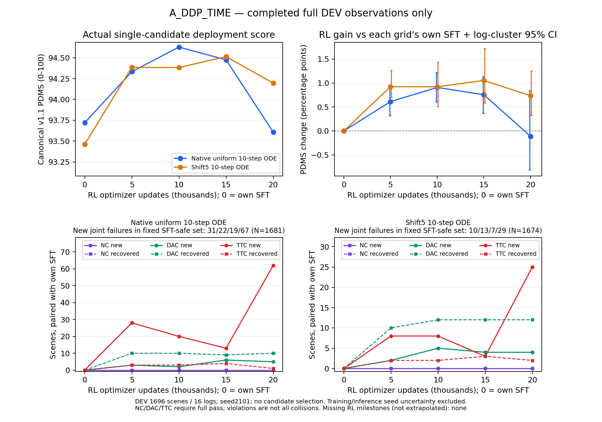

# A组20k RL终点：原生ODE中期增益未保持，TTC退化扩大

2026-10-17 00:43 UTC左右，A_DDP_TIME完成固定20,000次RL更新；随后完成1696场景/16 logs的完整DEV和512场景/343 logs的固定TRAIN诊断。八rank原生终点、192个Adam状态的step=20000、scheduler=20000和训练进程退出已实际核验。两人口16个评价worker全部完成并退出，完整分母、原始观测入口检查及成本账本齐全。

**终点DEV原生ODE PDMS为93.607389，相对自己的SFT为−0.112703个百分点，配对区间跨零；shift5为94.195811，相对自己的SFT为+0.735501个百分点，区间高于零。原生新增TTC违规62个、恢复1个，shift5新增25个、恢复2个。** 不能将中期94.6分作为固定20k终点，也不能用shift5替换原生部署主协议。A已完成本轮RL训练与DEV观察；B仍在SFT，最终Navtest和整个A/B比较尚未完成。



[可导出PDF](A_RL_DEV_through_20k.pdf)与[绘图来源/hash](A_RL_DEV_through_20k.json)只使用已有完整结果，新增推理和评分均为0。原15k图和报告保持，不将其当作当前终点状态。图例位置为显示适配，不影响分析或模型。

## 完整单候选结果

训练seed42，推理seed2101；原始图像/导航/合法状态进入原VLAAgent，10步ODE输出单条轨迹，无逐步探索噪声、候选筛选、GT选择或scorer。两个网格均使用canonical NAVSIM v1.1。分数为0–100，差值为百分点；区间按log聚类，保留场景权重，不包含训练/推理seed的不确定性。

| 人口/网格 | 自身SFT | RL5k | RL10k | RL15k | **RL20k终点** | 20k−SFT，95%区间 |
|---|---:|---:|---:|---:|---:|---|
| DEV 原生 | 93.720093 | 94.332347 | 94.627902 | 94.474666 | **93.607389** | **−0.112703** [−0.814363,+0.847607] |
| DEV shift5 | 93.460310 | 94.384140 | 94.381735 | 94.513221 | **94.195811** | **+0.735501** [+0.325300,+1.252437] |
| TRAIN诊断 原生 | 81.835774 | 84.254122 | 86.575159 | 85.890533 | 85.317268 | +3.481494 [+1.245297,+5.779922] |
| TRAIN诊断 shift5 | 80.607056 | 83.998308 | 86.701362 | 85.443626 | 85.972317 | +5.365261 [+2.442072,+8.378271] |

TRAIN诊断包含定向困难场景，不是完整TRAIN无偏估计；其较大增益不能替代DEV泛化。DEV仅保证未用于RL更新，原基模可能见过。

相对15k，DEV原生−0.867277个百分点，区间[−1.454571,+0.072877]；shift5−0.317410，区间[−0.632942,−0.035632]。TRAIN原生−0.573264、shift5+0.528691，两个区间跨零。原生终点与SFT接近、两网格相对15k均下降是实际观察；有限16个DEV logs限制了区间精度。

同一20k权重的原生−shift5为−0.588422个百分点，区间[−1.029264,+0.060189]。两个网格的起点也不同，不能把终点两列的差全部算成RL收益；更不能取best-of-two。源时间网格影响部署表现值得继续检查，但仅此不能断言网格是全部问题。

## 安全与进度：零分减少不代表安全保持

| DEV分项，0–100 | SFT原生 | 15k原生 | 20k原生 | SFT shift5 | 15k shift5 | 20k shift5 |
|---|---:|---:|---:|---:|---:|---:|
| NC | 100.000000 | 100.000000 | 100.000000 | 100.000000 | 100.000000 | 100.000000 |
| DAC | 99.292453 | 99.469340 | 99.587264 | 99.056604 | 99.528302 | 99.528302 |
| TTC | 99.764151 | 99.233491 | **96.167453** | 99.587264 | 99.587264 | **98.231132** |
| EP | 86.142845 | 88.319388 | 89.138866 | 86.050026 | 87.975597 | 88.617116 |
| Comfort | 99.882075 | 99.823113 | 99.823113 | 99.823113 | 99.823113 | 99.705189 |
| DDC | 98.879717 | 98.879717 | 98.850236 | 98.879717 | 98.909198 | 98.850236 |

下表均相对自己的SFT。NC/DAC/TTC分别等于1才算完全通过；TTC违规不等于实际碰撞。

| 人口/网格 | NC新增/恢复 | DAC新增/恢复 | TTC新增/恢复 | 非零→零/零→非零 | 固定SFT-safe中新联合违规 |
|---|---|---|---|---|---|
| DEV 原生 | 0/0 | 5/10 | **62/1** | 5/10 | **67/1681** |
| DEV shift5 | 0/0 | 4/12 | **25/2** | 4/12 | **29/1674** |
| TRAIN诊断 原生 | 8/0 | 5/26 | 22/3 | 9/26 | 25/440 |
| TRAIN诊断 shift5 | 6/0 | 12/42 | 19/5 | 15/42 | 30/432 |

DEV原生从15k到20k新增52个TTC违规、恢复0个；DAC恢复2个，零分9→7，而联合安全场景1674→1624。shift5新增24个TTC违规、恢复1个，零分仍为8，联合安全1681→1658。**只看零分会漏掉这轮主要退化。** TRAIN终点也出现新的NC不完全通过，不能把DEV的NC=100外推为全人口安全。

DEV原生G+=27.302114、G−=29.213564；shift5为26.437563/13.963461，单位是原始0–1分差的场景求和。原生达到±0.005实用幅度的改善/退化为524/68，shift5为488/31；任意负差100/51不是事故计数。固定SFT-safe新违规贡献原生G−的99.33%、shift5的97.49%。

只读既有请求轨迹和模拟后果，原生62个新增TTC来自6个logs，61个首次事件发生在物理3.4–4.0秒，另1个在1.2秒；shift5的25个也来自6个logs。全部新增TTC场景的NC通过。在同一首次违规时刻，原生62/62、shift5 25/25相对SFT前进更多且之前0.1秒段速度更高：配对均值分别为+0.945799/+0.838001米，+0.682912/+0.622262米/秒。物理时间不映射为Flow生成步骤。

同时，513/472个两策略均安全的场景PDMS至少提高0.005，其模拟终点前进量平均增加0.855293/0.692040米。更多前进在部分场景有用，问题是不能在原安全场景保留必要的减速/等待。

对同一反馈重读10:5:2源奖励，完整DEV原生平均仍提高0.801627个百分点，而canonical下降0.112703；shift5源奖励提高1.274204个百分点，canonical提高0.735501。两种奖励对收益/损失的幅度权衡已经影响总体结论。所有新增TTC场景的源奖励也下降，未发现“该场景源奖励提高、canonical下降”的符号翻转。因此不能解释成这些具体失败被源奖励直接打成更好，也不能据此排除组内排序、共享参数泛化和训练人口偏好。

## 有效更新、完整预算与数值边界

- 完整20,000次全局AdamW更新、5,000份fresh全局rollout、40,000次scene曝光、320,000条实际新候选；每份链四次inner复用，不算四份新数据。
- 全部21,367个固定困难场景/1064 logs已覆盖。18,633次重复曝光由1次源末批补齐和18,632次正常第二epoch重访组成；40,000个组的链摘要均不同。困难清单95%左右是SFT安全但低分场景，不能把其更新效率当全TRAIN均匀人口统计。
- 39,821/40,000组有PG，即99.5525%。179个等分组为32全满分、43全零分、104其他等分；全局anchor-only更新0。各rank局部无PG计数不代表全局漏更新。
- progress-only组26,699（66.7475%），安全分项有差异的组9,935（24.8375%）。正优势候选174,763个完全安全、898个仍违规，后者中703个同组有安全替代。非零优势多不等于安全学习充分。
- 192个Adam状态全部step=20000，scheduler.last_epoch=20000。第一inner重算ratio最大误差及clip比例均为0；后续第2/3/4个inner平均clip为0.307813%/2.490208%/6.205313%。未放宽clip或修改源概率代理。
- 困难训练人口随机策略平均canonical82.944566、源奖励78.939093；G8有限安全候选上界90.786007仅在39,865个有安全候选组中定义。这些不是部署成绩。

终点第5000份已保存批次，inner4后权重的梯度分解：

| Flow步骤 | PG norm | beta50 anchor norm | cosine | 当前相对旧概率PPO clip |
|---|---:|---:|---:|---:|
| 7 | 0.013885 | 0.001128 | −0.248198 | 0% |
| 8 | 0.039585 | 0.003459 | −0.315162 | 0% |
| 9 | 0.058412 | 0.036622 | −0.488487 | 31.25% |

最后一步anchor约为PG norm的62.7%，但这是一个已保存批次，不能将其代表整个训练，不能仅据loss/梯度大小认定anchor导致退化。分解与源总loss梯度最大差5.95e−10，adapter保持不变，未新增rollout、评分或更新。Gaussian与源clamped dimension-mean仍分别记录，不宣称完整混合链无偏梯度或精确轨迹概率比。

## 成本与执行身份

完整训练循环wall为16,814.393秒（4.671小时），模型/DDP准备rank0为31.985秒另计；吞吐1.18946 updates/s。rank0更新10,216.897秒、rollout2599.241秒、旧概率812.184秒、评分等待622.615秒、保存98.890秒。当前主要开销是模型更新，不能继续将评分视为最大瓶颈。scorer elapsed302.843秒不是CPU核秒；各计时可能重叠，未覆盖时间不伪分配给某个算子。

八worker累计wall含准备134,771.040秒，保存worker累计791.100秒；这些是重叠的共享worker时间，不是端到端wall或独占GPU计算时间。全部8份调用账本正常关闭，无已记录aborted/unclosed调用；实际生成/评分均320,000。历史SFT、筛选和验收成本在对应报告单列，不算进本次RL循环吞吐，也不视为免费。

| 20k评价 | 两网格逻辑候选 | 实际推理含入口检查 | job wall秒 | 累计worker wall秒 |
|---|---:|---:|---:|---:|
| DEV | 3392 | 3400 | 374.352 | 2980.734 |
| TRAIN诊断 | 1024 | 1032 | 203.245 | 1612.043 |

两项分别在tsinghua-zt与vla-zt并行，新增/复用分别为全部新增/0，完整成本可追溯；16项原观测入口检查通过。保存批次诊断另用38.518秒、峰值7,387,997,696 bytes。没有为本阶段手工释放占卡进程，其他真实和未知任务保持。

训练源码仍为`225b9af660cb0210208e2c46fc4216d0f151275b`，数值评价仍为`45d2318d2dec265583860a26f891d8b79bb6068a`，保存批次诊断为`fd440275edc3fdf40b2aaa46c38da1d038068902`。没有热改正式配方。终点原生`update020000_inner0`为world8、phase COMPLETE；文件清单SHA256为`298b0ebcd152ae79872984e493cdab872cdf7afd8ea1a3fb0591b7eae68d3412`。

合并部署权重SHA256为`2654698ded1e05e05908d2570a60a246ec047b445ad5b5db70c4579b554f7f20`，96个attention投影改变，冻结前缀精确保持。合并导出仅用于部署，原生LoRA/Adam/RNG/数据游标均保留，不将merged权重当精确恢复点。已达到固定20k，不自动延长或改用中期权重作为终点。

## 当前判断与剩余工作

本路线证明原DDP动作头能通过此配方获得中期单候选ODE增益，也证明更长的有效更新不保证收益保持。终点原生部署没有确认正增益，shift5保有平均增益但安全退化，两者均未达到“提分同时安全保持”的目标。高PG比例已解决大量等分组浪费的问题，但没有解决进度偏好、原安全人口退化和部署网格敏感性。

下一步先完成已登记B的SFT→自身筛选/验收→同配方RL，分离架构路线与自身IL→RL增量，再进行锁定终点Navtest。若完整对照仍显示过度前进，优先考虑同代码同预算、仅改变纵向anchor权重的单因素后续；本轮不启动、不据DEV修改现有配方。源10:5:2与canonical的总体背离也需与已完成的旧匹配实验一起判断，不能把本A/B路线冒充reward消融。

本报告发布时B约59.4k/100k SFT，最近含保存的2000步约2.274 updates/s，余下SFT粗估4.95小时；该估计不含后续筛选、真实验收和20k RL。B50k DEV原生/shift5为93.465822/93.602993，尚无正式B RL收益。24/36项固定阶段评价完成，最终Navtest尚未启动，DEV超过92不代表Navtest目标完成。

## 已执行入口与证据

[DEV对自身SFT](A_RL_update020000_DEV_vs_own_SFT.json)、[DEV对15k](A_RL_update020000_DEV_vs15k.json)、[TRAIN对自身SFT](A_RL_update020000_TRAIN_DIAGNOSTIC_vs_own_SFT.json)、[TRAIN对15k](A_RL_update020000_TRAIN_DIAGNOSTIC_vs15k.json)、[DEV安全转移](A_RL_update020000_DEV_safety_transitions.json)、[TRAIN安全转移](A_RL_update020000_TRAIN_DIAGNOSTIC_safety_transitions.json)、[网格差](A_RL20k_DEV_native_minus_shift5.json)、[完整训练](A_RL_complete_training.json)、[人口审计](A_RL_update020000_population.json)、[保存批次梯度](A_RL_update020000_saved_batch.json)、[完成/退出/optimizer/hash与成本证据](A_RL20k_execution.json)。四个人口/网格的独立分析均值、收益损失和安全转移核对一致，容差1e−12。

下列命令均实际执行，已有输出不可覆盖；重复只读分析需另设输出身份。TRAIN分析使用对应`TRAIN_DIAGNOSTIC`路径。保存批次诊断只调用一次，训练完成汇总由既有终点等待任务调用；无权重、原始轨迹、数据/cache或场景图上传。

```bash
python -m scripts.analysis.fm_transfer.analyze_evaluation --evaluation /mnt/project/fm-transfer-20261016/evaluations/A_DDP_TIME_RL_update020000_DEV --reference /mnt/project/fm-transfer-20261016/evaluations/A_DDP_TIME_SFT_update020000_DEV --output /mnt/project/fm-transfer-20261016/analysis/A_DDP_TIME_RL_update020000_DEV_paired_own_SFT.json
python -m scripts.analysis.fm_transfer.analyze_evaluation --evaluation /mnt/project/fm-transfer-20261016/evaluations/A_DDP_TIME_RL_update020000_DEV --reference /mnt/project/fm-transfer-20261016/evaluations/A_DDP_TIME_RL_update015000_DEV --output /mnt/project/fm-transfer-20261016/analysis/A_DDP_TIME_RL_update020000_DEV_vs15k.json
python -m scripts.analysis.fm_transfer.analyze_safety_transitions --evaluation /mnt/project/fm-transfer-20261016/evaluations/A_DDP_TIME_RL_update020000_DEV --reference /mnt/project/fm-transfer-20261016/evaluations/A_DDP_TIME_SFT_update020000_DEV --output /mnt/project/fm-transfer-20261016/analysis/A_DDP_TIME_RL_update020000_DEV_safety_transitions.json
python -m scripts.analysis.fm_transfer.analyze_grid_gap --evaluation /mnt/project/fm-transfer-20261016/evaluations/A_DDP_TIME_RL_update020000_DEV --output /mnt/project/fm-transfer-20261016/analysis/A_RL20k_DEV_native_minus_shift5.json
python -m scripts.analysis.fm_transfer.plot_rl_progress --variant A_DDP_TIME --output /mnt/project/fm-transfer-20261016/analysis/A_RL_DEV_through_20k_v2.png
python /mnt/project/fm-transfer-20261016/resources/verify_A_RL20k_completion.py
```

实际完成检查脚本副本：[reproduce_A_RL20k_completion.py](reproduce_A_RL20k_completion.py)。它写独立验收记录，不改checkpoint；重跑应使用新记录位置。历史正常训练、采样和评分合同没有因本次结果变化。
