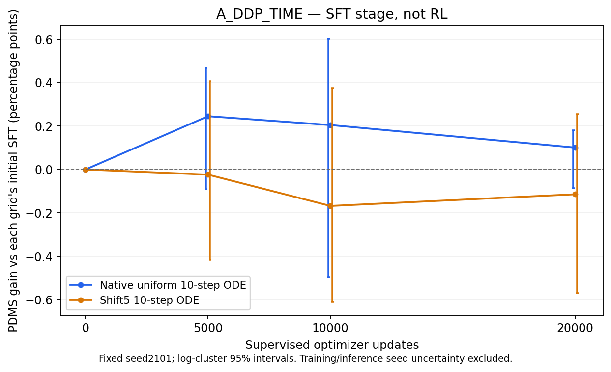

# A组SFT终点：建立后续RL的新基线

A_DDP_TIME已经完成登记的20k监督训练，以及完整DEV1696场景/16 logs、固定TRAIN诊断512场景/343 logs的双网格评价。以下全部是seed2101单候选、原始观测入口、canonical NAVSIM v1.1，无搜索、GT选轨或best-of-two。后续RL以这个20k终点为永久SFT reference和配对部署基线，不选中期最高点。

## 完整DEV的监督学习轨迹

| 网格 | 原F-SFT初始化 | 5k | 10k | 固定20k终点 | 终点减初始化，百分点 | log-cluster 95%区间，百分点 |
|---|---:|---:|---:|---:|---:|---|
| 原生均匀10步ODE | 93.619237 | 93.864513 | 93.823873 | 93.720093 | +0.100856 | [-0.086273, +0.181135] |
| shift5十步ODE | 93.574749 | 93.550878 | 93.406747 | 93.460310 | -0.114439 | [-0.570348, +0.255265] |

图的起点为相对自身初始网格的零差；误差棒各偏移80步以免重叠，不改变观察点。所有区间均按log聚类，先保留场景权重；不包含训练seed或推理seed不确定性。

原生ODE保留小幅正向均值，shift5没有呈现收益；两者区间均跨零。A同时增加了640000次监督场景曝光，不能把差值全部归因于时间采样或时间加权。当前结果不足以证明迁移时间配方本身带来显著部署改进，更不能直接证明后续Flow-GRPO有效或无效。

## 安全与进度

| 人口/网格 | PDMS | NC | DAC | TTC | EP | Comfort | DDC |
|---|---:|---:|---:|---:|---:|---:|---:|
| DEV native | 93.720093 | 100.000000 | 99.292453 | 99.764151 | 86.142845 | 99.882075 | 98.879717 |
| DEV shift5 | 93.460310 | 100.000000 | 99.056604 | 99.587264 | 86.050026 | 99.823113 | 98.879717 |
| TRAIN诊断 native | 81.835774 | 100.000000 | 90.234375 | 95.703125 | 74.452733 | 99.804688 | 98.828125 |
| TRAIN诊断 shift5 | 80.607056 | 100.000000 | 89.062500 | 95.312500 | 73.535060 | 99.804688 | 99.023438 |

所有分项显示为0–100。下表的转移相对同网格原F-SFT；“完全通过”为NC/DAC/TTC分别等于1。

| 人口/网格 | NC新增/恢复 | DAC新增/恢复 | TTC新增/恢复 | 非零→零/零→非零 | 原联合安全人口中新违规 |
|---|---|---|---|---|---|
| DEV native | 0/0 | 0/1 | 3/0 | 0/1 | 3/1683 |
| DEV shift5 | 0/0 | 5/3 | 4/1 | 5/3 | 8/1678 |
| TRAIN诊断 native | 0/0 | 12/20 | 4/3 | 12/20 | 16/434 |
| TRAIN诊断 shift5 | 0/0 | 10/18 | 3/3 | 10/18 | 13/425 |

DEV native没有新增零分，并恢复1个原零分，但新增3个TTC违规，联合安全人口总数由1683降至1681。因此“零分减少”不等于安全全面改善。shift5的DAC/TTC均出现净新增违规，不能因它匹配训练时间网格就预设更适合部署。

DEV native的G+=3.345325、G-=1.634808，shift5分别为5.572612、7.513501；均为原始0–1逐场景差值求和，除场景数后才是均分变化。native任意正差/负差为883/203个，达到0.005原始score幅度的改善/退化为104/21个；shift5分别为741/352和105/56。任意负差数不能解释成事故数。

TRAIN诊断相对初始化的native变化为+1.504181个百分点，区间[-0.520204,+3.772701]；shift5为+1.497118，区间[-0.517270,+3.480519]。其DAC都有净恢复，TTC分别小幅净退化/持平，不能概括为所有安全分项下降。这个切片有定向成分，不是完整TRAIN无偏估计；不能仅由其与DEV差异判定泛化失败。

## 同权重的网格对照

固定20k权重、场景和root noise，DEV native减shift5为+0.259783个百分点，95%区间[-0.094438,+0.595825]。这仍不能排除零差。该比较只反映网格/时间编码执行的差异，不是RL收益，未增加推理或评分。

## 成本与后续边界

| 人口 | 两网格逻辑单候选读出 | 实际推理含入口检查 | job wall秒 | 累计worker wall秒 |
|---|---:|---:|---:|---:|
| DEV | 3392 | 3400 | 367.863 | 2902.316 |
| TRAIN诊断 | 1024 | 1032 | 192.944 | 1535.795 |

监督训练本身的640000次场景曝光、6081.059秒rank0训练wall、完整Adam/RNG终点见[训练核算](A_SFT_complete_training.md)。worker时间之和不等于端到端wall或独占GPU计算时间；筛选与RL资格成本另记。

A组实际20k权重已经用于三机24卡全量TRAIN筛选，困难阈值固定canonical<0.9。筛选全量完成并核查payload后，才固定困难清单、完成真实八卡RL学习/恢复/合并/原部署验收，然后从此SFT重新初始化LoRA开展20k R_SOURCE。资格权重不用于正式初始化。B组继续既定100k SFT。

该阶段没有Navtest结果，也没有正式RL终点。原生DEV已超过92是该开发人口的水平，不能用来宣称最终RL/Navtest达到目标。

原生终点model SHA256：`ac52e9346080ce0e6bf27441935ac9aa6acbff239330b316bee36b560486579a`；原入口导出SHA256：`8da410eb75c1560c0c935214b946a45a65e16cd744b674d6df2d78d65e0d9005`。

机器可读结果：[DEV](A_SFT_update020000_DEV.json)、[TRAIN诊断](A_SFT_update020000_TRAIN_DIAGNOSTIC.json)、[网格差](A_SFT20k_DEV_native_minus_shift5.json)、[完整图形来源与hash](A_SFT_DEV_complete.json)。旧5k/10k报告及图形均保留。
