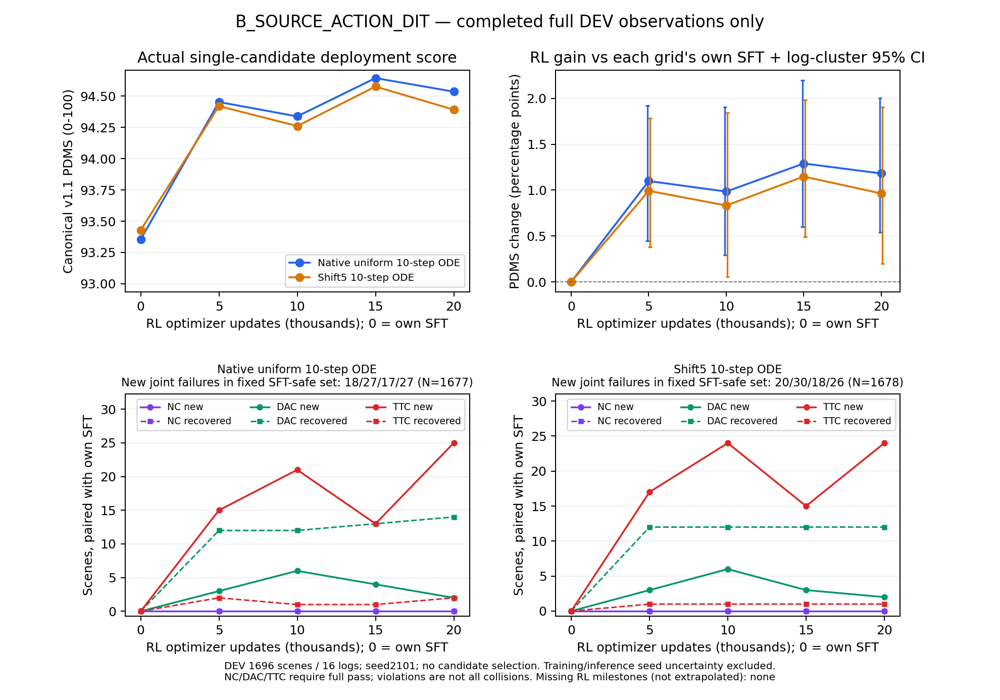

# B组20k RL终点与完整阶段证据

B_SOURCE_ACTION_DIT已完成自己的100k SFT、完整TRAIN筛选、八卡学习/恢复验收和固定20,000次RL更新。终点的480份Adam状态与scheduler均为20000，八rank COMPLETE且训练进程退出；5,000份fresh rollout、40,000次scene曝光、320,000条新候选均已核验。没有追加训练、换seed或选择中期最高点。

**以下是已登记的完整DEV与固定TRAIN诊断结果，不是Navtest。** 2026-10-17 23:41 UTC，A/B的SFT与RL四个固定端点已重新派发完整Navtest。原生均匀10步和shift5两种单候选ODE分开报告；同一请求轨迹分别用官方v1.0与canonical v1.1评分。B换头后是否损失性能、RL能否在Navtest提分，仍等待该完整结果。

## 固定终点评价

训练seed42、推理seed2101，canonical v1.1。DEV为1696场景/16 logs；TRAIN诊断为512场景/343 logs，包含定向困难人口，不能视为完整TRAIN的无偏估计。下表分数为0–100，增量和区间为百分点；按log聚类的区间不包含训练seed或推理seed不确定性。

| 人口/网格 | 自身SFT | RL20k | RL−SFT | 配对95%区间 |
|---|---:|---:|---:|---|
| DEV 原生 | 93.354165 | 94.535779 | +1.181614 | [0.539892, 2.002983] |
| DEV shift5 | 93.428631 | 94.391862 | +0.963232 | [0.199038, 1.905097] |
| TRAIN诊断 原生 | 85.860558 | 89.811999 | +3.951442 | [1.680389, 6.230760] |
| TRAIN诊断 shift5 | 86.131558 | 90.430632 | +4.299073 | [2.365188, 6.245719] |



[PDF](B_RL_DEV_through_20k.pdf)和[绘图来源](B_RL_DEV_through_20k.json)使用已有完整结果，没有追加策略推理。固定20k终点低于15k的DEV均分，报告保留该变化，不以15k替代终点。

| 人口/网格 | NC新增/恢复 | DAC新增/恢复 | TTC新增/恢复 | 非零→零/零→非零 | 原SFT-safe新增联合违规 |
|---|---|---|---|---|---|
| DEV 原生 | 0/0 | 2/14 | 25/2 | 2/14 | 27/1677 |
| DEV shift5 | 0/0 | 2/12 | 24/1 | 2/12 | 26/1678 |
| TRAIN诊断 原生 | 4/0 | 7/26 | 17/5 | 9/26 | 22/466 |
| TRAIN诊断 shift5 | 1/0 | 2/22 | 16/6 | 2/22 | 17/467 |

NC/DAC/TTC必须等于1才计为完全通过，TTC违规不等于实际碰撞。DEV原生G+=31.774509、G−=11.734327；shift5为27.781459/11.445045，单位为原始0–1分差的场景求和。均分增益与新的安全失败同时存在，不能只报零分恢复。

## 更新有效性与实现边界

40,000个实际场景组中39,812组有PG，比例99.53%；188个等分组分别为60满分、32零分、96其他等分。没有全局anchor-only更新。26,945组为progress-only（67.3625%），9,253组有安全分项差异。固定困难清单21,836场景/1056 logs全部覆盖；4次曝光来自源末批补齐，18,160次来自正常第二epoch重访，40,000份链摘要不同。

正优势候选中176,451条完全安全，692条仍违规，后者548条同组存在完全安全候选。非零PG比例高证明更新信号充足，不能证明其方向已经安全。困难清单中约96%为SFT安全但低分场景，训练人口的这种偏好保留且明示。

第一inner的old/current ratio最大误差和PPO clip比例均为0。第二、三、四inner平均clip比例分别约0.047083%、0.685000%、2.121250%，属于实际更新后的统计；没有放宽0.005 clip。永久SFT、LoRA范围、源clamped dimension-mean概率、部分随机步骤、global reward std、beta50均值锚定和10:5:2训练reward均保持。

终点保存批次的逐生成步骤分解如下；它只代表第5000份batch，不能据此认定整个训练的anchor过强。

| 生成步骤 | PG梯度norm | beta50 anchor梯度norm | cosine | 当前相对旧概率clip比例 |
|---|---:|---:|---:|---:|
| 7 | 0.008084 | 0.000865 | −0.356036 | 0% |
| 8 | 0.016000 | 0.002720 | −0.424251 | 0% |
| 9 | 0.046547 | 0.027659 | −0.431136 | 4.6875% |

该只读诊断的adapter保持不变，新增候选、评分和optimizer更新均为0。源部分随机步骤与概率裁剪仍是经验代理，不宣称完整混合生成链的无偏策略梯度。通过数值/恢复验收与取得部署增益是两个独立判断。

## 成本与身份

完整RL训练循环36,211.043秒（10.0586小时），0.552318 updates/s；八worker累计wall含准备289,868.653秒，保存累计1275.012秒。八份调用账本均正常关闭，实际生成与评分各320,000条。记录中的rollback开销未知项保留为null，不伪造为0。

各阶段最大rank累计wall：更新25,177.607秒、rollout6209.619秒、old probability1942.348秒、评分等待648.732秒。更新占训练循环约69.5%，评分等待约1.8%；这些是可能重叠的wall区间，不是独占GPU/CPU计算时间。本轮首先判断Navtest上的学习效果，不因这些计时另开效率实验。

20k DEV双网格共3392条逻辑单候选评价，另8条原始入口检查，job wall695.036秒、累计worker wall5497.506秒。TRAIN诊断相应为1024+8条、253.097秒、2000.350秒。共享worker时间不能相加后当端到端wall。既有SFT、TRAIN筛选、验收与辅助失败成本在对应记录单列。

训练源码`225b9af660cb0210208e2c46fc4216d0f151275b`，数值评价`45d2318d2dec265583860a26f891d8b79bb6068a`保持不变。原生终点文件清单SHA256为`7a3eb2f471f05fceeae97176209c721076a2ca7c20c94c15545748d3992a770b`，合并部署权重为`943c774e13f8c2b72889e37f64eeccee00f92c71358ab76b21004b1741eaa622`。合并导出不是精确训练恢复点，未合并LoRA、Adam、RNG、数据进度和原生终点继续保留。

## 证据与已执行命令

[终点执行与独立交叉核验](B_RL20k_execution.json)、[完整训练](B_RL_complete_training.json)、[人口审计](B_RL_update020000_population.json)、[保存批次](B_RL_update020000_saved_batch.json)、[DEV配对](B_RL_update020000_DEV_vs_own_SFT.json)、[TRAIN配对](B_RL_update020000_TRAIN_DIAGNOSTIC_vs_own_SFT.json)、[DEV安全转移](B_RL_update020000_DEV_safety_transitions.json)、[TRAIN安全转移](B_RL_update020000_TRAIN_DIAGNOSTIC_safety_transitions.json)已整理。四个人口/网格的独立分析交叉核对通过，容差1e−12。

以下命令已实际执行成功，只整理已完成证据，不新增模型计算。重新运行需使用新的输出目录。

```bash
python -m scripts.analysis.fm_transfer.package_rl_endpoint \
  --variant B_SOURCE_ACTION_DIT \
  --output /mnt/project/fm-transfer-20261016/qualification/B_RL20k_publication_review_v1
```

当前证据支持B在固定DEV上吸收了平均收益，同时出现TTC退化。它不支持Navtest达到92，也不证明动作头替换没有损失。下一步是四个固定端点的完整Navtest及自身SFT配对，随后只选一项有证据支持的改进，不追加算法矩阵。
