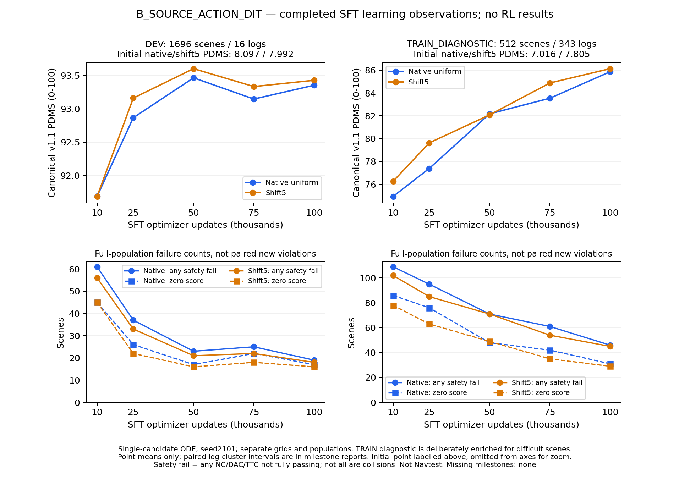

# B组100k SFT终点：完整双网格基线，继续自身Flow-GRPO

B_SOURCE_ACTION_DIT完成固定100k SFT，以及DEV1696场景/16 logs和TRAIN诊断512场景/343 logs的完整评价。**DEV原生ODE PDMS为93.354165，shift5为93.428631。** 相对75k分别+0.206631/+0.094018个百分点，两个log聚类配对区间均跨零。原生零分22→17，shift5为18→16；仍有新增安全违规。

这是B自己的固定SFT起点，尚无本组正式RL增量或最终Navtest结论。保留Qwen、原输入及8×4动作，动作专家是从seed42随机初始化训练的standalone ActionDiT，没有Wan/MoT。未以中途较高的50k替代100k终点。



[PDF](B_SFT_learning_through_100k.pdf)与[绘图证据/hash](B_SFT_learning_through_100k.json)包含全部0/10k/25k/50k/75k/100k固定观察点。初始化分数单列、曲线从10k放大展示；图中是点均值，不是置信区间。下排为整个人口的失败总数，不是新增违规。绘图坐标逐项核对且已目视检查，新增模型推理/评分为0。

## 单候选规划表现

原始图像/导航/合法状态输入，seed2101，单候选10步ODE，canonical NAVSIM v1.1。native uniform与shift5分别报告，不取best-of-two。均分为0–100，差值为百分点。区间按log重采样、保留scene权重；不包含训练seed或推理seed不确定性。

| 人口/网格 | 50k | 75k | 100k终点 | 100k−75k，95%区间 |
|---|---:|---:|---:|---|
| DEV 原生 | 93.465822 | 93.147534 | **93.354165** | +0.206631 [−0.106005,+0.472951] |
| DEV shift5 | 93.602993 | 93.334612 | **93.428631** | +0.094018 [−0.393770,+0.420330] |
| TRAIN诊断 原生 | 82.171598 | 83.540222 | **85.860558** | +2.320336 [+0.597407,+4.096684] |
| TRAIN诊断 shift5 | 82.077723 | 84.876014 | **86.131558** | +1.255544 [−0.690144,+3.309182] |

定向TRAIN诊断继续提高，只有原生的此次配对区间高于零；不能用它替代完整TRAIN或DEV泛化估计。DEV终点恢复了75k回落的一部分，但点均值仍略低于50k。有限16个DEV logs、定向TRAIN人口和初始化差异，不支持仅据曲线确诊过拟合或宣称源ActionDiT优于原DDP。

同一100k权重的原生−shift5为−0.074466个百分点，区间[−0.209031,+0.156665]，跨零。不能只选较高网格，也不能把采样网格差当作RL收益。后续B的全部RL配对基线固定为这里的100k权重和相应网格。

## 安全、低分与实际行为

| 100k人口/网格 | NC | DAC | TTC | EP | Comfort | DDC | 零分 | 联合安全 |
|---|---:|---:|---:|---:|---:|---:|---:|---:|
| DEV 原生 | 100.000000 | 98.997642 | 99.882075 | 85.641977 | 99.823113 | 98.850236 | 17 | 1677/1696 |
| DEV shift5 | 100.000000 | 99.056604 | 99.882075 | 85.738147 | 99.823113 | 98.850236 | 16 | 1678/1696 |
| TRAIN诊断 原生 | 100.000000 | 93.945312 | 96.875000 | 77.549713 | 99.804688 | 98.925781 | 31 | 466/512 |
| TRAIN诊断 shift5 | 100.000000 | 94.335938 | 96.679688 | 77.848552 | 99.804688 | 98.925781 | 29 | 467/512 |

DEV原生/shift5的PDMS第1百分位为55.416667/58.333333，第5百分位为83.486750/83.484654，第10百分位为85.676301/85.806882，均为0–100单位。定向TRAIN诊断的第5百分位在两网格均为0，第10百分位为79.632105/79.890626；均分提高没有消除其失败低尾。

NC/DAC/TTC全部为1才定义为联合安全，TTC违规不等于实际碰撞。以下转移全部相对75k；这些75k参考集合只用于本次SFT比较，不是未来B RL的100k参考集合。

| 人口/网格 | NC新增/恢复 | DAC新增/恢复 | TTC新增/恢复 | 非零→零/零→非零 | 固定75k安全人口中新联合违规 |
|---|---|---|---|---|---|
| DEV 原生 | 0/0 | 0/5 | 1/3 | 0/5 | 1/1671 |
| DEV shift5 | 0/0 | 3/5 | 1/3 | 3/5 | 4/1674 |
| TRAIN诊断 原生 | 0/0 | 4/15 | 3/7 | 4/15 | 7/451 |
| TRAIN诊断 shift5 | 0/0 | 11/17 | 2/5 | 11/17 | 13/458 |

DEV两个网格的TTC失败总数均从4降到2，NC保持100；DAC净恢复，但shift5仍新增3次违规。DEV G+/G−分别为5.782149/2.277684和6.318313/4.723763，单位是原始0–1分差的scene求和。任意下降870/838个，其中达到−0.005实用幅度的只有44/43个，不能将任意微小负差称为事故。达到+0.005的改善为14/15个，其中两模型均安全的改善各7个；本次平均增益包含失败恢复，不宜描述为普遍进度提升。

保存轨迹分析显示，新TTC各1例，分别首次发生在物理1.3秒和2.6秒，NC均通过；它们不是同一scene，但100k两个网格最终剩余的2个TTC失败scene相同。样本太少，不能归纳统一机制。原生新例在事件时前进+0.0083米、此前0.1秒段速度+0.0164 m/s；shift5新例反而前进−0.0359米、速度−0.0040 m/s。不要将A终点的过度前进解释直接套到B的每个边界失败。

完整DEV的模拟终点前进量相对75k平均下降0.077741/0.063845米，平均段速度下降0.021391/0.017753 m/s。请求点jerk RMS为0.394921/0.436713 m/s³，只是请求轨迹描述，不能替代官方Comfort。对相同反馈重读10:5:2奖励的均分变化为+0.152980/+0.049491个百分点；这只是反事实读出，实际本阶段仍是FM监督目标，不是使用该奖励训练了RL。

## 评价与分析成本、身份

| 评价 | 两网格逻辑单候选 | 正式实际推理 | 入口诊断推理 | 含诊断实际推理 | job wall秒 | 累计worker wall秒 |
|---|---:|---:|---:|---:|---:|---:|
| DEV | 3392 | 3392 | 8 | 3400 | 631.177 | 4868.122 |
| TRAIN诊断 | 1024 | 1024 | 8 | 1032 | 274.152 | 2128.581 |

八份/人口的调用账本均完整，无复用场景。DEV/诊断分别在tsinghua-zt4/zt运行，16个实际worker已核验退出，16项原始观测入口检查通过。原rank字段`physical_predictions`不含另记的`diagnostic_predictions`，本表和v2执行证据显式相加；旧私有receipt保留并用hash关联，没有重跑推理。模型加载累计为1118.171/919.498秒，生成累计3343.834/1009.773秒，评分等待累计211.920/76.029秒。这些为共享worker elapsed，不是独占GPU compute或CPU核秒，两个并行job wall不能相加为端到端时间。

本次部分评价与完整TRAIN筛选共享资源，不能把与75k的耗时差直接解释为模型速度变化。SFT训练、筛选和后续RL的成本独立记录；SFT预算见[原生完成及完整成本](B_SFT100k_completion_and_handoff.md)。新增配对、安全分析与绘图没有模型推理、评分或参数更新，CPU分析并未统一记录全部进程开销，不伪造该项精确总耗时。

评价数值源码仍为`45d2318d2dec265583860a26f891d8b79bb6068a`，此次只读分析/绘图快照为`8dbd2bb2c82026d3a8a0b4b96c9b0ba211248f81`。部署权重SHA256为`548e122b7c1fad10cc8dbf0e2dbf5bc97efe7a242e0f9d4684b18b3f65fff91a`。原始、配对、安全分析的四个人口/网格均值、G+/G−和事件数量互相核对，均分容差1e−12，详见[发布核对](B_SFT100k_report_validation.json)。

## 当前判断与下一阶段

B已形成完整、可部署的自身SFT基线；仍未证明替换ActionDiT能解决Flow-GRPO的安全保持问题。按登记继续完整TRAIN单候选筛选、固定困难清单、真实八卡RL验收及20k R_SOURCE，之后衡量自身IL→RL增量。固定100k单seed安全参考人口为DEV原生1677、shift5 1678，不是所有噪声下的安全保证。继续重点检查原安全场景新增违规，不能只看均分和零分净减少。

两组已有28/36项固定阶段评价完成。A的RL20k已结束，B的正式RL与最终Navtest仍待完成；DEV超过92不代表Navtest目标已达成。没有因本次结果改reward、LoRA、时间网格、anchor、训练seed或预算。

## 已执行入口与结果

[DEV](B_SFT_update100000_DEV.json)、[DEV对75k](B_SFT_update100000_DEV_vs75k.json)、[TRAIN诊断](B_SFT_update100000_TRAIN_DIAGNOSTIC.json)、[TRAIN对75k](B_SFT_update100000_TRAIN_DIAGNOSTIC_vs75k.json)、[DEV安全转移](B_SFT100k_DEV_safety_transitions.json)、[TRAIN安全转移](B_SFT100k_TRAIN_DIAGNOSTIC_safety_transitions.json)、[同权重网格差](B_SFT100k_DEV_native_minus_shift5.json)、[worker退出与成本](B_SFT100k_evaluation_execution.json)。

下面DEV命令及其TRAIN_DIAGNOSTIC对应命令均已实际执行，使用上述8dbd快照、CPU-only环境。已有输出不覆盖，重算需另设输出身份。

```bash
python -m scripts.analysis.fm_transfer.analyze_evaluation --evaluation /mnt/project/fm-transfer-20261016/evaluations/B_SOURCE_ACTION_DIT_SFT_update100000_DEV --reference /mnt/project/fm-transfer-20261016/evaluations/B_SOURCE_ACTION_DIT_SFT_update075000_DEV --output /mnt/project/fm-transfer-20261016/analysis/B_SOURCE_ACTION_DIT_SFT_update100000_DEV_vs75k.json
python -m scripts.analysis.fm_transfer.analyze_safety_transitions --comparison-kind sft_milestones --evaluation /mnt/project/fm-transfer-20261016/evaluations/B_SOURCE_ACTION_DIT_SFT_update100000_DEV --reference /mnt/project/fm-transfer-20261016/evaluations/B_SOURCE_ACTION_DIT_SFT_update075000_DEV --output /mnt/project/fm-transfer-20261016/analysis/B_SOURCE_ACTION_DIT_SFT_update100000_DEV_safety_vs75k.json
python -m scripts.analysis.fm_transfer.analyze_grid_gap --evaluation /mnt/project/fm-transfer-20261016/evaluations/B_SOURCE_ACTION_DIT_SFT_update100000_DEV --output /mnt/project/fm-transfer-20261016/analysis/B_SFT100k_DEV_native_minus_shift5.json
python -m scripts.analysis.fm_transfer.plot_supervised_progress --variant B_SOURCE_ACTION_DIT --view learning --output /mnt/project/fm-transfer-20261016/analysis/B_SFT_learning_through_100k.png
```
