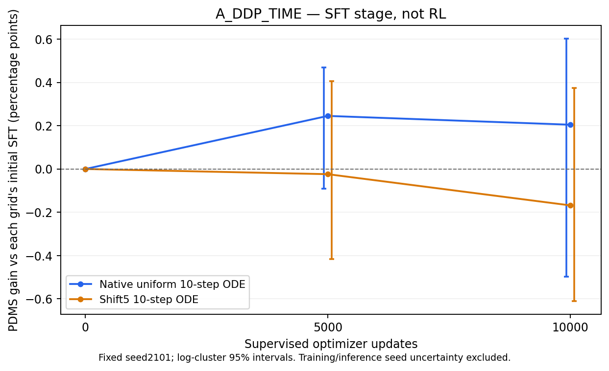

# A组监督迁移10k：原生ODE小幅正向，shift5仍未显示收益

这是`A_DDP_TIME`的监督训练中期结果，不是RL结果。权重从同一原F-SFT继续监督训练；完整RL_DEV为1696场景/16 logs，固定TRAIN诊断为512场景/343 logs。两种网格均为seed2101单候选、原始观测入口、canonical v1.1；不选两种网格中较好的结果作为新策略。

10k模型导出SHA256：`b53221044af147f86886300e2abf028aa047b92052da5dd012e56194848fa61a`。正式SFT仍按20k终点运行，未因5k/10k分数调整学习率、时间采样或预算。

## 完整DEV

| 单候选协议 | 初始化 | 5k SFT | 10k SFT | 10k相对初始化，百分点 | log-cluster 95%区间，百分点 |
|---|---:|---:|---:|---:|---|
| 原生均匀10步ODE | 93.619237 | 93.864513 | 93.823873 | +0.204636 | [-0.496605, +0.602733] |
| shift5十步ODE | 93.574749 | 93.550878 | 93.406747 | -0.168002 | [-0.609781, +0.373360] |



图仅包含已完成观察点；0表示相对各自初始化的零差，不是新评价。两种误差棒在横轴上各偏移80步以便区分；实际观察点仍为5k、10k。没有外推20k。区间不包含训练seed或推理seed不确定性。

| 10k协议 | NC新增/恢复 | DAC新增/恢复 | TTC新增/恢复 | 非零→零/零→恢复 | 固定起点联合安全人口的新违规 |
|---|---|---|---|---|---|
| 原生ODE | 0/0 | 4/6 | 3/1 | 4/6 | 7/1683 |
| shift5 | 0/0 | 7/4 | 4/0 | 7/4 | 11/1678 |

原生ODE的正向总增益G+=8.721339、负向总退化G-=5.250705，都是原始0–1分数的跨场景求和；净值除1696后才是平均增益。任意负差场景192个，其中达到0.005原始score下降的13个；不能把192个任意负差解释成192次严重事故。相较5k，任意负差场景减少，但新增零分由1增至4，G-由3.242增至5.251。因此不能凭负差场景数减少宣布安全改善。

shift5的G+=6.651261、G-=9.500577；DAC和TTC均有净新增违规。两个网格的配对区间都跨零，目前不足以证明稳定总体收益。

## 固定TRAIN诊断与网格差异

| 协议 | 10k PDMS | 相对初始化，百分点 | 95%区间，百分点 | NC新增/恢复 | DAC新增/恢复 | TTC新增/恢复 |
|---|---:|---:|---|---|---|---|
| 原生ODE | 81.569899 | +1.238306 | [-0.871121, +3.469064] | 1/0 | 14/21 | 5/3 |
| shift5 | 80.437809 | +1.327871 | [-1.130307, +3.798793] | 0/0 | 16/21 | 4/7 |

TRAIN原生ODE有一个NC从完全通过变为0.5的场景，不计作完全安全。TRAIN的shift5在DAC/TTC上都有净恢复，不能概括成所有人口、所有安全分项都下降。该固定诊断切片有定向成分，不能代替完整TRAIN无偏均分；其与DEV的人口差异也不能单独证明过拟合。

复用同一10k权重、相同场景及root noise做网格对照：DEV原生ODE减shift5为+0.417126个百分点，95%区间[-0.411250,+0.864881]。这是同权重下网格/时间编码执行的对照，不是额外RL收益，也没有统计上排除零差。没有增加推理或评分调用。

A相对原F-SFT的变化同时包括额外监督曝光与迁移的时间配方；本轮没有“同等额外SFT但不改时间”的第三组，因此不把全部差值归因于时间加权。下一步保持既定A20k终点，再用自己的新SFT建立RL参照；继续分别评价原生和shift5。

## 已发生的评价成本

| 人口 | 逻辑单候选读出 | 实际推理含入口诊断 | job wall秒 | 累计worker wall秒 |
|---|---:|---:|---:|---:|
| DEV1696×两网格 | 3392 | 3400 | 370.099 | 2929.884 |
| TRAIN512×两网格 | 1024 | 1032 | 217.893 | 1734.253 |

八个worker时间之和不是端到端wall，也不是独占GPU计算时间；模型加载、生成及评分等待分项保存在JSON账本。训练成本由独立训练invocation累计，不能由此表推算。

机器可读证据：[DEV](A_SFT_update010000_DEV.json)、[TRAIN](A_SFT_update010000_TRAIN_DIAGNOSTIC.json)、[固定权重网格差](A_SFT10k_DEV_native_minus_shift5.json)、[图形来源与hash](A_SFT_DEV_through_10k.json)。已有全人口分析核查存储payload及评价分母；这里仅新增派生分析，没有新策略rollout。

实际执行的分析入口如下；输出必须使用新的路径以保留旧证据：

```bash
python -m scripts.analysis.fm_transfer.plot_supervised_progress --variant A_DDP_TIME --output NEW_FIGURE.png
python -m scripts.analysis.fm_transfer.analyze_grid_gap --evaluation /mnt/project/fm-transfer-20261016/evaluations/A_DDP_TIME_SFT_update010000_DEV --output NEW_GRID_ANALYSIS.json
```

该结果来自DEV和固定TRAIN；没有启动本轮Navtest，也不能用DEV超过92宣布最终RL目标已达成。
