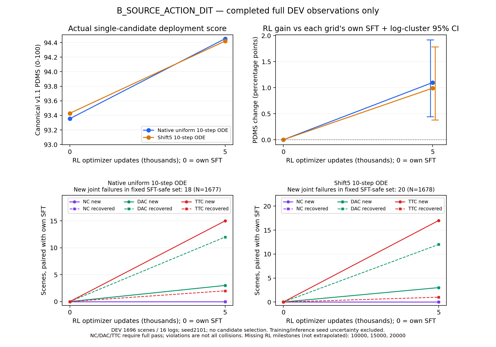

# B组首个5k RL：双网格单候选均分提高，TTC保持仍未解决

2026-10-17，B_SOURCE_ACTION_DIT完成首个固定5,000次RL更新观察点，以及全部DEV 1696场景/16 logs、TRAIN诊断512场景/343 logs的评价。16个评价worker均正常结束并实际核验退出。B继续原定20k训练；本报告不是训练终点或Navtest结果。

**DEV原生10步ODE从自身SFT的93.354165升至94.453098，增加1.098933个百分点；shift5从93.428631升至94.420257，增加0.991626个百分点。两个log聚类配对区间均高于零。** 原生新增TTC违规15个、恢复2个，shift5新增17个、恢复1个；NC保持100。新动作专家已获得真实部署均分增益，但安全保持尚未实现，不能以DEV超过92宣布目标完成。



[可导出PDF](B_RL_DEV_through_5k.pdf)与[绘图来源](B_RL_DEV_through_5k.json)仅使用已完成观察点，没有外推10k/15k/20k。绘图及下面的配对分析没有新推理、评分或参数更新。

## 单候选规划结果

训练seed42、推理seed2101，canonical NAVSIM v1.1；当前图像/导航/合法ego状态通过原部署入口，单条ODE轨迹，无训练SDE噪声、候选筛选、GT选择或scorer。native uniform10与shift5_10分别报告，不取较高者。基线固定为B自身完整100k SFT，不使用A或旧DDP的分数替代。

| 人口/网格 | 自身100k SFT | RL5k | RL−SFT，百分点 | 按log配对95%区间 |
|---|---:|---:|---:|---|
| DEV 原生 | 93.354165 | **94.453098** | **+1.098933** | [+0.444156,+1.922196] |
| DEV shift5 | 93.428631 | **94.420257** | **+0.991626** | [+0.379743,+1.785245] |
| TRAIN诊断 原生 | 85.860558 | 89.263857 | +3.403300 | [+1.447816,+5.515106] |
| TRAIN诊断 shift5 | 86.131558 | 89.614886 | +3.483328 | [+1.573056,+5.503805] |

分数为0–100，差为百分点。bootstrap先保留每个场景的单seed结果，再按log聚类，2000次重采样；其seed42是统计重采样设置，没有新增训练seed。区间不包含训练/推理seed不确定性；DEV只有16个logs。DEV只称RL更新未见，原基模可能见过。定向TRAIN诊断不能当完整训练人口的无偏均值。

同一RL5k权重下，原生−shift5为+0.032841个百分点，区间[−0.055919,+0.158553]，跨零。两个网格都相对各自SFT提高；目前不支持将B的收益解释为仅换了部署网格，也不能由一次相近结果断言采样迁移问题彻底消失。

## 安全收益与退化同时存在

| DEV分项，0–100 | SFT原生 | RL5k原生 | SFT shift5 | RL5k shift5 |
|---|---:|---:|---:|---:|
| NC | 100.000000 | 100.000000 | 100.000000 | 100.000000 |
| DAC | 98.997642 | 99.528302 | 99.056604 | 99.587264 |
| TTC | 99.882075 | **99.115566** | 99.882075 | **98.938679** |
| EP | 85.641977 | 88.303001 | 85.738147 | 88.318521 |
| Comfort | 99.823113 | 99.823113 | 99.823113 | 99.823113 |
| DDC | 98.850236 | 98.850236 | 98.850236 | 98.879717 |

| 人口/网格 | NC新增/恢复 | DAC新增/恢复 | TTC新增/恢复 | 非零→零/零→非零 | 固定SFT-safe中新联合违规 |
|---|---|---|---|---|---|
| DEV 原生 | 0/0 | 3/12 | **15/2** | 3/12 | **18/1677** |
| DEV shift5 | 0/0 | 3/12 | **17/1** | 3/12 | **20/1678** |
| TRAIN诊断 原生 | 3/0 | 5/22 | 16/5 | 7/22 | 19/466 |
| TRAIN诊断 shift5 | 3/0 | 4/22 | 18/6 | 6/22 | 20/467 |

NC/DAC/TTC均等于1才算完全通过，NC=0.5不算通过；TTC违规不是实际碰撞计数。DEV零分从17/16降至8/7，但联合安全场景从1677/1678降至1673/1671，说明只看零分恢复会漏掉TTC退化。TRAIN诊断中新增3个NC不完全通过场景，不能将DEV的NC=100外推到全部人口。

DEV原生G+=27.710096、G−=9.072190，shift5为26.705534/9.887557，单位为原始0–1分差的场景求和。达到±0.005实用幅度的改善/退化分别为543/19和548/21。任意负差63/68个不等于63/68次事故。固定SFT-safe新违规分别贡献97.75%/97.94%的G−。

保存的请求轨迹与模拟后果显示，DEV原生15个新增TTC来自4个logs，shift5的17个也来自4个logs；15例为两个网格共有。首次事件为物理2.9–4.0秒，原生13/15、shift5 15/17在3.7–4.0秒；全部NC通过。在相同首次违规时刻，所有新增TTC轨迹都比各自SFT前进更多、此前0.1秒段速度更高：原生平均+0.565396米/+0.379297 m/s，shift5为+0.575179米/+0.435712 m/s。物理驾驶时间不能对应为Flow生成步骤。

同时，两策略均安全且PDMS提高至少0.005的DEV场景有529/535个。推进更多在部分场景有用；当前不足是没有同时保留所有原安全场景所需的减速/等待。上述是结果条件下的描述，不是架构或单个loss的因果证明。

同一仿真反馈按10:5:2读取，DEV源奖励分别增加1.558372/1.458905个百分点，幅度大于canonical增益，但此次没有出现逐场景“源奖励提高而canonical下降”的符号翻转。不能因此将新增TTC解释成该轨迹被源奖励直接评为优于SFT，也不能排除组内排序、共享参数泛化和困难人口偏好。R_SOURCE的10:5:2、anchor和其他配方均未中途修改。

## 有效更新与人口

- 实际5,000次全局AdamW更新，1,250份fresh全局rollout，10,000次场景曝光，80,000条新候选。四次inner复用同一份采样，不能计为四倍新数据。
- 已覆盖10,000个独立困难场景/992 logs，当前没有场景重访或源末批padding；10,000组链摘要不同。固定困难清单仍为21,836场景，约96.06%是自身SFT安全但低分场景，未根据RL结果变更。
- 9,957/10,000组有PG，即**99.57%**。43个等分组分为9全满分、10全零分、24其他等分。全局anchor-only更新0；某rank局部无PG不等于全局没有RL更新。
- progress-only组6,799（67.99%），安全分项有差异的组2,345（23.45%），分母均为全部10,000组。正优势候选43,736个完全安全、190个仍违规；后者中169个同组有安全替代。非零优势多不等于安全排序已充分解决。
- 480个LoRA Adam状态全部step=5000，scheduler=5000，Adam一、二阶状态均FP32。第一inner ratio误差和PPO clip比例均为0；第2/3/4个inner平均clip为0.028333%/0.577500%/1.995833%。源逐维logprob relative clamp命中率0.032529%，与PPO clipping分开。

| 已采集困难人口的随机策略统计 | 数值，0–100 |
|---|---:|
| canonical随机候选均分 | 83.386301 |
| 10:5:2训练奖励均分 | 79.310402 |
| 联合安全候选比例 | 93.122500 |
| G8有限安全候选最高分的场景均值 | 90.695576 |

最后一项只在9,976个含安全候选的组上定义，是有限候选机会，**不是单候选部署分数**。这些随机策略统计跨越不同训练窗口和场景，不能直接与DEV或自身固定ODE基线相减解释学习收益。

## 保存批次梯度与数值证据

第1,250份保存批次使用5k的inner4后参数分析，old行为版本为update4996，没有新rollout、评分或optimizer更新。

| Flow生成步骤 | PG norm | beta50 anchor norm | cosine | inner4后相对old的PPO clip |
|---|---:|---:|---:|---:|
| 7 | 0.018340 | 0.000709 | +0.408316 | 0% |
| 8 | 0.029995 | 0.002390 | −0.306920 | 0% |
| 9 | 0.051309 | 0.022395 | −0.478665 | 12.5% |

末步anchor norm约为PG的43.65%，但只有一个保存批次，不能据此认定anchor普遍过强或无效。分解与实际源总loss梯度最大差1.26e−9，LoRA参数精确保持；正式第一inner的ratio一致性与这里四次更新后的clipping是不同检查。

240个attention投影的480个A/B张量为本B架构的准确训练集合；不是沿用A的96投影断言。LoRA合并后240个attention权重改变，冻结上游精确保持。源部分随机步骤、创新裁剪和逐维概率裁剪仍是经验代理，不宣称完整混合链的无偏策略梯度。

## 成本与执行边界

5k训练循环wall为8,855.054秒（2.460小时），模型/DDP准备rank0为22.554秒另计；实测0.564649 updates/s。rank0模型更新6,094.747秒（68.83%）、rollout1,475.842秒、旧概率452.460秒、评分等待162.001秒（1.83%）、保存41.321秒。评分服务elapsed75.946秒不是CPU核秒；计时可能重叠，未覆盖时间不任意归因。主要瓶颈仍是模型更新，未为提速改变G/K、概率布局、精度、源配方或数据人口。

此处是封存5k边界及精确保存成本快照，训练调用仍未结束；后续训练、失败/回滚如有发生均由持续invocation账本记录，不能把活跃账本的最新候选计数混入5k逻辑预算。八worker累计更新时间48,764.615秒是共享worker elapsed，不是独占GPU计算时间。按该窗口从5k到20k估计还需7.38小时，评价、共享资源波动另计，不作为完成承诺。

| 本次评价 | 两网格逻辑单候选数 | 实际推理含入口检查 | job wall秒 | 累计worker wall秒 |
|---|---:|---:|---:|---:|
| DEV | 3392 | 3400 | 599.036 | 4650.939 |
| TRAIN诊断 | 1024 | 1032 | 257.266 | 2042.635 |

均为新增、复用0；16份调用账本完整关闭，16项原始观测入口检查通过。两任务分别在授权tsinghua-zt4/zt共享运行，其他真实任务保持。多个worker时间不能当端到端wall，两个并行job wall也不能直接相加。保存批次诊断另用62.389秒，峰值显存10,608,101,888 bytes，新增候选/评分/更新均0。SFT、筛选和八卡验收的历史成本见各自报告，不视为免费。

训练源码仍为`225b9af660cb0210208e2c46fc4216d0f151275b`，数值评价为`45d2318d2dec265583860a26f891d8b79bb6068a`；本次仅分析和发布证据。原生`update005000_inner0`为world8、phase READY、next_inner0，文件清单SHA256为`f67a0430962103afc1b4b2a193192582ddf1734624c3606e33db6e9fed237769`。部署权重SHA256为`5a841462dd85fd0002f8faa7106a40f0051d411e7411ac4dfa65c4dbb22b2551`；原生LoRA/Adam/RNG/游标保留，合并导出不代替精确恢复点。

## 当前判断与剩余工作

B的首个匹配观察点支持“真实策略更新已转化为原生ODE和shift5的DEV规划增益”，不只是候选库、训练reward或best-of-N提高。安全保持仍不合格，且只有5k中期证据；A也曾中期提高、终点退化，不能据此保证B20k。

两路线的初始化、SFT预算、动作专家及自身困难人口不同；不能把B的增益单独归因于换了ActionDiT，也不能把原DDP的困难简单归因于某一个时间网格。继续已登记10k/15k/20k观察，保留固定20k终点和两个网格，等两组终点及必要DEV完成后再锁定最终Navtest。当前30/36项固定阶段评价完成，最终Navtest仍未打开。没有新增seed、算法、reward改动或预算扩展。

## 已执行命令与证据

[DEV配对](B_RL_update005000_DEV_vs_own_SFT.json)、[TRAIN配对](B_RL_update005000_TRAIN_DIAGNOSTIC_vs_own_SFT.json)、[DEV安全转移](B_RL_update005000_DEV_safety_transitions.json)、[TRAIN安全转移](B_RL_update005000_TRAIN_DIAGNOSTIC_safety_transitions.json)、[网格差](B_RL5k_DEV_native_minus_shift5.json)、[训练前缀](B_RL_update005000_training_prefix.json)、[人口核对](B_RL_update005000_population.json)、[保存批次梯度](B_RL_update005000_saved_batch.json)、[执行与成本核验](B_RL5k_execution.json)。四个人口/网格的两套独立分析在均值、G+/G−和安全转移上核对一致，容差1e−12。公开文件保留汇总与hash，省略单条私有scene/behavior记录；原始证据保留本地，没有上传权重、缓存、数据或私有场景图。

以下入口均实际执行；现有输出禁止覆盖，复核需独立输出身份。配对分析由既有milestone controller调用，未重复推理。

```bash
# 源8dbd2bb：读取已有评价
python -m scripts.analysis.fm_transfer.analyze_safety_transitions --evaluation /mnt/project/fm-transfer-20261016/evaluations/B_SOURCE_ACTION_DIT_RL_update005000_DEV --reference /mnt/project/fm-transfer-20261016/evaluations/B_SOURCE_ACTION_DIT_SFT_update100000_DEV --output /mnt/project/fm-transfer-20261016/analysis/B_SOURCE_ACTION_DIT_RL_update005000_DEV_safety_transitions.json
python -m scripts.analysis.fm_transfer.analyze_grid_gap --evaluation /mnt/project/fm-transfer-20261016/evaluations/B_SOURCE_ACTION_DIT_RL_update005000_DEV --output /mnt/project/fm-transfer-20261016/analysis/B_RL5k_DEV_native_minus_shift5.json
python -m scripts.analysis.fm_transfer.analyze_rl_population --run /mnt/project/fm-transfer-20261016/runs/B_SOURCE_ACTION_DIT_R_SOURCE_seed42_v1 --manifest /mnt/project/fm-transfer-20261016/hard_manifests/B_SOURCE_ACTION_DIT_SFT_update100000.json --updates 5000 --output /mnt/project/fm-transfer-20261016/analysis/B_SOURCE_ACTION_DIT_RL_update005000_population.json
python -m scripts.analysis.fm_transfer.plot_rl_progress --variant B_SOURCE_ACTION_DIT --output /mnt/project/fm-transfer-20261016/analysis/B_RL_DEV_through_5k.png
# 源fd440275：同一已保存批次的真实梯度，无新采样
python -m scripts.analysis.fm_transfer.diagnose_saved_batch --run /mnt/project/fm-transfer-20261016/runs/B_SOURCE_ACTION_DIT_R_SOURCE_seed42_v1 --checkpoint /mnt/project/fm-transfer-20261016/runs/B_SOURCE_ACTION_DIT_R_SOURCE_seed42_v1/checkpoints/update005000_inner0 --collection 1250 --hard-manifest /mnt/project/fm-transfer-20261016/hard_manifests/B_SOURCE_ACTION_DIT_SFT_update100000.json --sft-screen /mnt/project/fm-transfer-20261016/screens/B_SOURCE_ACTION_DIT_SFT_update100000 --output /mnt/project/fm-transfer-20261016/analysis/B_SOURCE_ACTION_DIT_RL_update005000_saved_batch.json
# 前缀复用d58485b汇总；退出/原生状态核验复用8dbd2bb
python /mnt/project/fm-transfer-20261016/resources/analyze_B_RL_5k_prefix.py
python /mnt/project/fm-transfer-20261016/resources/verify_B_RL5k_completion.py
```

两项实际审计脚本副本：[训练前缀](reproduce_B_RL5k_training_prefix.py)、[完成核验](reproduce_B_RL5k_completion.py)。历史报告和运行源码保持原样。
