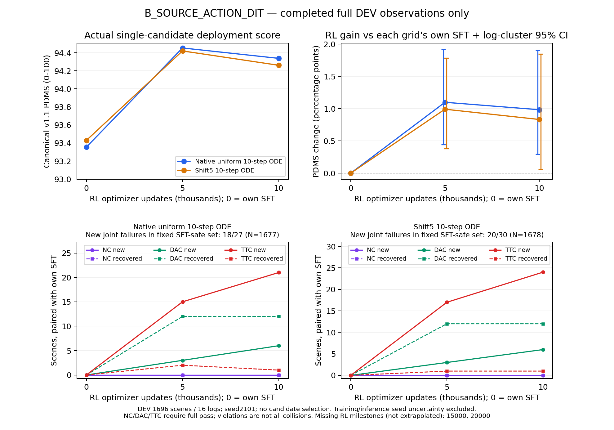

# B组10k RL：部署增益仍在，5k之后安全退化增加

2026-10-17 12:10 UTC前后，B_SOURCE_ACTION_DIT的固定10,000次RL更新观察完成：完整DEV 1696场景/16 logs、TRAIN诊断512场景/343 logs，两种单候选ODE网格均完成；16个评价worker已退出。原生checkpoint、480份Adam状态和scheduler均为10k，全部恢复与评价证据已核对。B继续既定20k训练，本报告不是终点或Navtest结论。

**DEV原生PDMS为94.338021，相对自身100k SFT增加0.983856个百分点；shift5为94.261171，增加0.832541个百分点。两者仍有正向配对区间，但相对5k分别下降0.115077/0.159085个百分点。** 这两个阶段差的区间跨零，不能单凭均分小幅下降断言确定退化趋势；与此同时，固定SFT-safe人口的新增联合违规由5k的18/20增至10k的27/30，安全保持问题确实仍在。



[PDF](B_RL_DEV_through_10k.pdf)及[绘图输入身份](B_RL_DEV_through_10k.json)仅使用已完成观察点，不外推15k/20k。没有新增诊断rollout、评分或参数更新。

## 单候选规划结果

训练seed42，评价seed2101，canonical NAVSIM v1.1，原始图像/导航/合法ego状态入口。原生uniform10与shift5_10分别报告；没有训练SDE噪声、搜索、GT选轨或best-of-two。所有RL增量均相对B自己的100k SFT。

| 人口/网格 | 自身SFT | RL5k | RL10k | 10k−SFT，百分点 | 按log配对95%区间 |
|---|---:|---:|---:|---:|---|
| DEV 原生 | 93.354165 | 94.453098 | **94.338021** | **+0.983856** | [+0.294409,+1.907381] |
| DEV shift5 | 93.428631 | 94.420257 | **94.261171** | **+0.832541** | [+0.056635,+1.846792] |
| TRAIN诊断 原生 | 85.860558 | 89.263857 | 89.412718 | +3.552160 | [+1.322950,+5.873320] |
| TRAIN诊断 shift5 | 86.131558 | 89.614886 | 88.651530 | +2.519972 | [+0.155023,+4.771576] |

10k−5k的DEV配对区间：原生[−0.319314,+0.166537]、shift5[−0.412405,+0.205814]个百分点。TRAIN诊断原生变化+0.148860、shift5−0.963356，两个区间也跨零。定向TRAIN诊断不能作为全TRAIN无偏估计，更不能代替DEV泛化。

固定10k权重的原生−shift5为+0.076850个百分点，区间[−0.003678,+0.154474]，跨零。两个网格相对各自SFT都有收益，目前不能把收益仅解释为换部署网格，也不能宣布全部采样迁移问题已解决。

bootstrap按log聚类并保留场景权重，2000次重采样；统计seed42不是新增训练seed。区间不包含训练或推理seed不确定性，DEV仅16个logs。DEV只称RL更新未见，基模可能见过；历史Navtest使用事实不变，本轮最终Navtest尚未启动。

## 安全收益、退化与物理行为

| DEV分项，0–100 | SFT原生 | RL10k原生 | SFT shift5 | RL10k shift5 |
|---|---:|---:|---:|---:|
| NC | 100.000000 | 100.000000 | 100.000000 | 100.000000 |
| DAC | 98.997642 | 99.351415 | 99.056604 | 99.410377 |
| TTC | 99.882075 | **98.702830** | 99.882075 | **98.525943** |
| EP | 85.641977 | 88.710779 | 85.738147 | 88.620679 |
| Comfort | 99.823113 | 99.764151 | 99.823113 | 99.764151 |
| DDC | 98.850236 | 98.850236 | 98.850236 | 98.879717 |

| 人口/网格 | NC新增/恢复 | DAC新增/恢复 | TTC新增/恢复 | 非零→零/零→非零 | 固定SFT-safe中新联合违规 |
|---|---|---|---|---|---|
| DEV 原生 | 0/0 | 6/12 | **21/1** | 6/12 | **27/1677** |
| DEV shift5 | 0/0 | 6/12 | **24/1** | 6/12 | **30/1678** |
| TRAIN诊断 原生 | 3/0 | 8/25 | 19/6 | 10/25 | 25/466 |
| TRAIN诊断 shift5 | 3/0 | 11/23 | 19/6 | 13/23 | 28/467 |

NC/DAC/TTC均等于1才算完全通过，NC=0.5不是完全安全；TTC违规不能称为碰撞次数。DEV零分由SFT的17/16变为11/10，但联合安全场景由1677/1678变为1663/1661。相对5k，原生新增TTC 8、恢复1，shift5新增10、恢复3；新增DAC分别5/4、恢复2/1。只看零分净恢复会遗漏这些安全损失。TRAIN诊断两个网格各有3个新增NC不完全通过，不能把DEV的NC=100外推到全部场景。

DEV原生G+=30.881142、G−=14.194940；shift5为29.513588/15.393697，单位均为原始0–1分差的场景求和。原生相对5k的G+和G−都增加，G−增长更快。达到±0.005实用幅度的改善/退化为706/28和669/31；任意负差49/45不等于事故次数。固定SFT-safe的新违规贡献98.75%/98.86%的G−，而两策略均安全且改善至少0.005的场景仍有693/656个。

保存的模拟后果显示，DEV新增TTC原生21例来自6个logs，shift5 24例来自7个logs，全部NC通过。原生18/21首次事件在3.7–4.0秒，shift5为23/24；物理驾驶时间不能映射为Flow生成步骤。在同一首次事件时刻，每例都比各自SFT前进更多、前一0.1秒段速度更高：原生平均+0.694438米/+0.459686 m/s，shift5为+0.708543米/+0.503704 m/s。这支持继续关注场景相关的减速/等待保持，但不是某个loss的因果证明。

全DEV请求终点前进距离平均增加0.383859/0.307993米，模拟终点增加0.591661/0.546760米；模拟平均段速度增加0.151711/0.140571 m/s。请求点的有限差分jerk RMS从0.394921/0.436713升至1.292783/1.806750 m/s³。这是请求轨迹离散平滑性诊断，不是官方Comfort，也不是模拟车身的连续jerk；官方Comfort只小幅下降，二者不能混称。各自路径90%到达时间不是同一空间目标的到达时间，不能单独据此推断更快或更慢到达。

## 源训练reward与canonical表现

同一份DEV反馈按10:5:2重组，相对自身SFT的源奖励增加1.597076/1.435479个百分点，canonical增量为0.983856/0.832541。**原生网格从5k到10k，源读出增加约0.038704个百分点，但canonical减少0.115077个百分点。** 聚合层面的目标偏离已出现，不能用训练reward继续上涨替代规划结论。

相对SFT，逐场景没有出现源奖励正差、canonical负差的符号翻转；这与上述聚合方向不同不矛盾。源10:5:2、共享参数更新、弱纵向anchor及固定困难人口尚未被单因素隔离，不能把全部TTC退化单独归因于其中一个。本轮保持原配方，不据中间分数修改reward、sigma、LR或anchor。

## 有效更新、人口与数值

- 10,000次全局optimizer更新，2,500份fresh全局rollout，20,000次场景曝光，160,000条新候选。四次inner复用同一份采样，不能计为四倍新数据。
- 覆盖20,000个不同困难场景/1,050 logs，尚无重访或epoch padding；20,000组chain摘要不同。固定困难清单21,836场景保持不变，其中约96.06%是自身SFT联合安全但低分的场景。
- **19,906/20,000组有PG，99.53%**。94个等分组为25全满分、19全零分、50其他等分；全局anchor-only更新0。局部rank无PG不等于全局更新无PG。
- progress-only组13,542（67.71%），安全分项有差异4,692（23.46%），分母均为全部组。正优势候选87,983个联合安全、332个仍违规；后者287个同组有安全候选。有效优势多不等于已学会充分的安全排序。
- 随机候选canonical均分83.708313、源奖励79.692012，联合安全93.279375%；G8有限安全最高值的场景均值90.818436，仅在19,951个含安全候选的组上定义。它不是单候选部署成绩，也不能与另一人口的DEV直接相减。
- 480份LoRA Adam状态及scheduler均10k，Adam一、二阶状态FP32。240个attention投影合并后改变，冻结上游精确保持。完整日志/链摘要与24份保存behavior payload抽查分别记录，未声称逐个重读全部原始payload。
- 第一inner的数值ratio误差及PPO clip均0；第2/3/4 inner平均clip为0.036875%/0.613125%/2.040833%。源逐维relative clamp命中0.032126%，与PPO clipping分开。

第2,500份已保存批次在10k的inner4后参数上做梯度分解，old版本9996，没有新增采样或更新：

| Flow生成步骤 | PG norm | beta50 anchor norm | cosine | 相对old的PPO clip |
|---|---:|---:|---:|---:|
| 7 | 0.012253 | 0.001205 | +0.166771 | 0% |
| 8 | 0.036305 | 0.003695 | −0.034942 | 0% |
| 9 | 0.026970 | 0.028500 | −0.233435 | 3.125% |

末步anchor norm约为PG的1.057倍、方向存在冲突；这只是一个batch，不足以认定普遍过强。分解与实际总loss梯度最大差6.56e−10，分析前后LoRA精确不变。末步偏移主要来自纵向通道，完整分项见保存批次JSON。部分随机步骤及概率裁剪仍按源经验代理解释，不宣称完整混合链的无偏策略梯度。

## 成本、恢复与后续

封存10k训练循环wall为17,682.381秒（4.912小时），rank0准备22.554秒另计，平均0.565535 updates/s。rank0更新时间12,192.252秒，约68.95%；rollout 2,945.837秒，旧概率904.665秒，评分等待321.726秒（1.82%），保存81.828秒。评分服务elapsed152.487秒不是CPU核秒；各计时可能重叠，未覆盖部分不任意归因。八rank累计更新时间97,553.411秒是共享worker elapsed，不是独占GPU时间。主要耗时仍在模型更新，未中途改变数值或预算配置来提速。

| 本次评价 | 双网格逻辑单候选数 | 实际推理含入口检查 | job wall秒 | 累计worker wall秒 |
|---|---:|---:|---:|---:|
| DEV | 3392 | 3400 | 498.380 | 3855.297 |
| TRAIN诊断 | 1024 | 1032 | 242.723 | 1910.088 |

均复用0、8份worker账本完整关闭；两任务在授权tsinghua-zt4/zt共享运行，原真实任务保持。并行job wall不能相加当端到端时间。保存批次分析另耗时62.494秒，峰值10,608,101,888 bytes，新增候选/评分/optimizer更新均0。历史SFT、筛选、资格验证成本见各自报告，不视为免费。

训练源码仍为`225b9af660cb0210208e2c46fc4216d0f151275b`，数值评价仍为`45d2318d2dec265583860a26f891d8b79bb6068a`；64份正式source_files现场hash一致。本次只增加只读分析与报告。10k恢复点为world8、READY、next_inner0，files SHA256为`b9308ec88f9b5f3d06d0b0a58f2b81be1156a5d4c26a8eabb65c47a4f865e7b4`；合并部署权重为`a34e1134659be7205a2efb55abfb310727b6c3233ff17c9b3b462daa4e4c531c`。合并导出不代替原生LoRA/Adam/RNG/数据游标恢复。

当前固定阶段评价32/36完成，剩余B的15k/20k DEV及TRAIN诊断。按前10k速度，从10k到20k还需约4.9小时，评价与共享资源波动另计。15k/20k的有限保存批次诊断和精确成本捕获已安排，只有目标检查点及资源检查通过才执行，不新增算法、rollout或训练预算。最终Navtest继续等待两个20k终点与必要DEV完成，未提前打开。

A已完成20k，原生相对自身SFT−0.112703个百分点、shift5+0.735501；B目前仍是中期。两路线的架构、初始化、SFT预算及困难人口同时不同，不能由现阶段均分差单独证明ActionDiT架构因果。当前最明确的结论是：真实策略更新已经产生原生ODE收益，零优势浪费已不是当前主瓶颈，但进度收益与原安全行为保持仍未兼得。下一步先完成既定15k/20k和最终评价，再决定单因素安全改进，不在本轮扩展训练矩阵。

## 已执行入口与证据

[DEV对自身SFT](B_RL_update010000_DEV_vs_own_SFT.json)、[DEV对5k](B_RL_update010000_DEV_vs5k.json)、[TRAIN对自身SFT](B_RL_update010000_TRAIN_DIAGNOSTIC_vs_own_SFT.json)、[TRAIN对5k](B_RL_update010000_TRAIN_DIAGNOSTIC_vs5k.json)、[DEV安全转移](B_RL_update010000_DEV_safety_transitions.json)、[TRAIN安全转移](B_RL_update010000_TRAIN_DIAGNOSTIC_safety_transitions.json)、[网格差](B_RL10k_DEV_native_minus_shift5.json)、[训练前缀](B_RL_update010000_training_prefix.json)、[人口](B_RL_update010000_population.json)、[保存批次](B_RL_update010000_saved_batch.json)、[执行与成本](B_RL10k_execution.json)。四个人口/网格的独立分析在均值、G+/G−和安全转移上交叉一致，数值容差1e−12。

实际命令完整保存在执行账本。以下入口均已运行；复核必须使用新的输出身份，不能覆盖既有证据：

```bash
# CPU分析源码8dbd；正式训练和数值推理源码保持不变。
python -m scripts.analysis.fm_transfer.analyze_safety_transitions --evaluation EVAL_10K --reference OWN_SFT_EVAL --output NEW_SAFETY_JSON
python -m scripts.analysis.fm_transfer.analyze_evaluation --evaluation EVAL_10K --reference EVAL_5K --output NEW_PAIRED_JSON
python -m scripts.analysis.fm_transfer.analyze_grid_gap --evaluation EVAL_10K --output NEW_GRID_JSON
python -m scripts.analysis.fm_transfer.plot_rl_progress --variant B_SOURCE_ACTION_DIT --output NEW_PLOT_PNG
python -m scripts.analysis.fm_transfer.analyze_rl_population --run B_RL_RUN --manifest B_OWN_HARD_MANIFEST --updates 10000 --output NEW_POPULATION_JSON
# 参数化前缀入口e935，复用已验证统计实现和精确成本快照。
python -m scripts.analysis.fm_transfer.summarize_rl_prefix --run B_RL_RUN --updates 10000 --output NEW_PREFIX_JSON
```

[完成核对脚本](reproduce_B_RL10k_completion.py)验证真实worker退出、原始观测入口、Adam/scheduler与逻辑预算；当前代码默认保护原证据，重新执行前应为复核指定独立输出。[发布校验](B_RL10k_validation.json)记录文件hash、数值交叉核对和实时进程身份。公开证据只含汇总和hash，省略单个私有scene记录，未上传权重、缓存、原始数据或场景图片。
