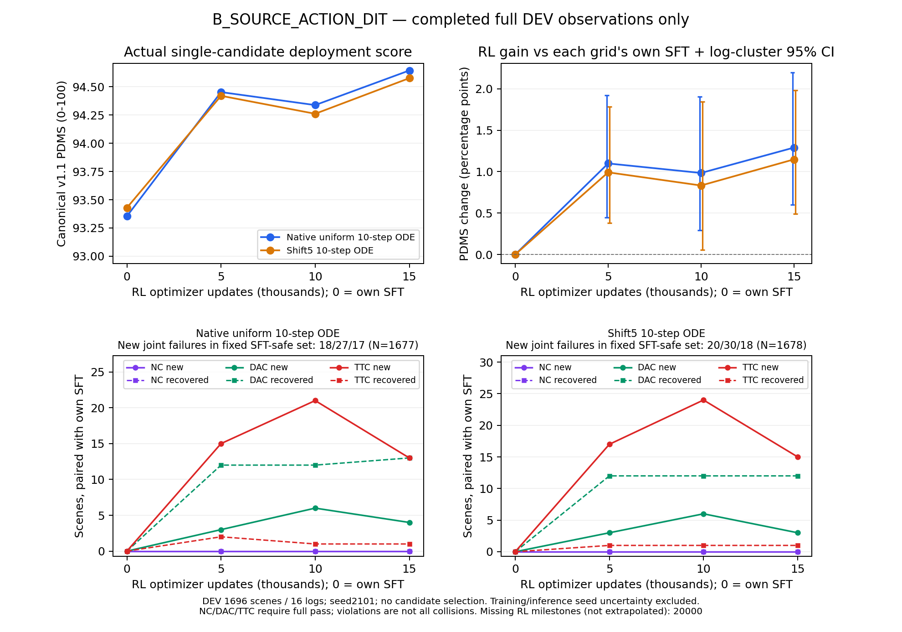

# B组15k RL：原生部署增益扩大，安全退化收窄但未消除

2026-10-17 14:38 UTC前后，B_SOURCE_ACTION_DIT的固定15,000次RL更新观察完成：完整DEV 1696场景/16 logs、TRAIN诊断512场景/343 logs，两种单候选ODE网格均完成；16个评价worker已退出。原生checkpoint、480份Adam状态及scheduler均核对到15k。B继续既定20k训练，本报告不是终点或Navtest结论。

**DEV原生PDMS为94.644405，相对自身100k SFT增加1.290240个百分点；shift5为94.576475，增加1.147845个百分点。相对10k分别增加0.306384/0.315304个百分点，两个按log配对区间均高于零。** 同时，固定SFT-safe人口的新增联合违规由10k的27/30降至17/18；但相对原SFT仍存在新增违规，安全保持尚未完成。10k之后的均分回落没有在本观察点持续，不能把中期单段变化外推到20k。



[PDF](B_RL_DEV_through_15k.pdf)及[绘图来源](B_RL_DEV_through_15k.json)仅含已完成观察点，不外推20k。没有新增诊断rollout、评分或参数更新。

## 单候选规划结果

训练seed42，评价seed2101，canonical NAVSIM v1.1。评价从原始图像、导航和合法ego状态进入部署模型；原生uniform10与shift5_10分别报告。没有训练SDE噪声、搜索、GT选轨或best-of-two。所有RL增量均相对B自己的100k SFT，分数为0—100，差值为百分点。

| 人口/网格 | 自身SFT | RL5k | RL10k | RL15k | 15k−SFT | 按log配对95%区间 |
|---|---:|---:|---:|---:|---:|---|
| DEV 原生 | 93.354165 | 94.453098 | 94.338021 | **94.644405** | **+1.290240** | [+0.599107,+2.198997] |
| DEV shift5 | 93.428631 | 94.420257 | 94.261171 | **94.576475** | **+1.147845** | [+0.490440,+1.979795] |
| TRAIN诊断 原生 | 85.860558 | 89.263857 | 89.412718 | 89.753065 | +3.892507 | [+1.548072,+6.338141] |
| TRAIN诊断 shift5 | 86.131558 | 89.614886 | 88.651530 | 90.260534 | +4.128976 | [+1.940835,+6.346205] |

15k−10k的DEV配对区间：原生[+0.117508,+0.478325]、shift5[+0.012408,+0.546595]个百分点。TRAIN诊断原生变化+0.340347，区间[−0.799098,+1.533998]；shift5变化+1.609003，区间[+0.414821,+2.884119]。定向TRAIN诊断不是全TRAIN无偏估计，不能用其较大增益替代DEV泛化。

同一15k权重的原生−shift5为+0.067930个百分点，区间[−0.034624,+0.202805]，跨零。两个网格相对各自SFT均有增益，目前收益不能仅解释为换了部署网格，也不能由这一对比宣布全部SDE/ODE迁移问题已解决。

DEV的P5分位，原生由83.486750升至85.639161，shift5由83.484654升至85.276167；P1分别由55.416667升至58.333333、58.333333保持58.333333。TRAIN诊断P5两网格由0升至58.333333，P1仍为0。分位数与下方零分、分项事件共同报告，不用一个低尾统计替代安全判断。

bootstrap按log聚类并保留场景权重，2000次重采样；统计seed42不是新增训练seed。区间不包含训练或推理seed不确定性，DEV只有16个logs。DEV仅保证RL更新未见，基模可能见过。历史Navtest使用事实不变，本轮最终Navtest尚未开始。

## 安全、收益损失与物理行为

| DEV分项，0—100 | SFT原生 | RL10k原生 | RL15k原生 | SFT shift5 | RL10k shift5 | RL15k shift5 |
|---|---:|---:|---:|---:|---:|---:|
| NC | 100.000000 | 100.000000 | 100.000000 | 100.000000 | 100.000000 | 100.000000 |
| DAC | 98.997642 | 99.351415 | 99.528302 | 99.056604 | 99.410377 | 99.587264 |
| TTC | 99.882075 | 98.702830 | **99.174528** | 99.882075 | 98.525943 | **99.056604** |
| EP | 85.641977 | 88.710779 | 88.679592 | 85.738147 | 88.620679 | 88.575522 |
| Comfort | 99.823113 | 99.764151 | 99.882075 | 99.823113 | 99.764151 | 99.823113 |
| DDC | 98.850236 | 98.850236 | 98.820755 | 98.850236 | 98.879717 | 98.879717 |

相对10k，DAC与TTC均回升，EP略降。本段改善不能简单描述成继续增加进度。以下事件均相对各自固定SFT，NC/DAC/TTC都等于1才算完全通过；NC=0.5不是完全安全，TTC违规不等于实际碰撞。

| 人口/网格 | NC新增/恢复 | DAC新增/恢复 | TTC新增/恢复 | 非零→零/零→非零 | 固定SFT-safe中新联合违规 |
|---|---|---|---|---|---|
| DEV 原生 | 0/0 | 4/13 | **13/1** | 4/13 | **17/1677** |
| DEV shift5 | 0/0 | 3/12 | **15/1** | 3/12 | **18/1678** |
| TRAIN诊断 原生 | 3/0 | 9/28 | 18/7 | 11/28 | 26/466 |
| TRAIN诊断 shift5 | 2/0 | 7/26 | 14/6 | 9/26 | 20/467 |

DEV零分由SFT的17/16变为8/7，联合安全场景由1677/1678变为1674/1673。相对10k，两个网格均无新增DAC且恢复3例；TTC新增/恢复分别为3/11和5/14。TRAIN诊断仍有3/2个新增NC不完全通过，不能将DEV的NC=100外推为全人口无安全损失。

DEV原生G+=30.919951、G−=9.037472；shift5为28.521515/9.054067，单位均为原始0—1分差的场景求和。相对10k，原生G+基本不变、shift5 G+下降，两个网格G−均明显下降；这一阶段净收益主要体现在退化损失收窄。固定SFT-safe新违规仍贡献原生全部G−、shift5约98.16%的G−。

相对SFT，达到±0.005实用幅度的改善/退化为714/17和660/19，两策略都安全且改善达到0.005的场景为700/647。相对10k，达到同一阈值的改善/下降为16/132和21/146；较少但幅度较大的恢复仍带来正净收益。0.005是单场景原始0—1分差，即0.5个百分点，不是事故阈值，不能将132/146个阈值下降解释成同等次数的安全事故。

既有模拟记录中，DEV新增TTC原生13例来自4个logs，shift5 15例来自5个logs，全部NC通过。两者分别有11/13、11/15的首次事件在物理3.7—4.0秒。在同一首次事件时刻，全部新增TTC场景都比各自SFT前进更多、前一0.1秒段速度更高：原生平均+0.543941米/+0.350402 m/s，shift5为+0.452276米/+0.292336 m/s。TRAIN新增TTC18/14例也都更向前、更快，其中2/1例NC不完全通过。物理事件时间不能映射成相同编号的Flow生成步骤；这些是描述性证据，不单独证明某个loss导致风险。

全DEV相对SFT，请求终点前进距离增加0.342583/0.258425米，模拟终点增加0.580069/0.519766米；模拟平均段速度增加0.149072/0.134050 m/s，模拟终点绝对横向距离增加0.101438/0.103276米。请求轨迹的有限差分jerk RMS由0.394921/0.436713升至2.072849/2.812789 m/s³，也高于10k的1.292783/1.806750。这是请求点离散平滑性诊断，不是官方Comfort或模拟车身连续jerk；官方Comfort本阶段反而回升，二者不可混称。各自路径90%到达时间不对应同一空间目标，不能单凭它断言更快到达。

## 源训练reward与canonical读出

同一DEV仿真反馈按源10:5:2重组，相对SFT增加1.804174/1.644765个百分点；canonical增量为1.290240/1.147845。相对10k，源读出增加0.207098/0.209286个百分点，两种读出在本阶段同向改善。10k曾出现原生源读出上涨而canonical下降，保留该历史证据，不由15k回升抹去目标差异。

相对SFT没有逐场景“源奖励正差、canonical负差”的符号翻转；源权重仍可能改变聚合收益与梯度偏好，不能由零符号翻转宣称奖励权重无影响。源10:5:2、弱纵向anchor、共享参数与固定困难人口尚未单因素隔离，本轮不据中期结果改reward、sigma、LR或anchor。

## 更新、人口与数值

- 15,000次全局optimizer更新，3,750份fresh全局rollout，30,000次场景曝光，240,000条新候选。四次inner复用同一采样，不能计为四倍新数据。
- 固定21,836场景/1,056 logs已全部覆盖。8,164次重复曝光包含4次源epoch末尾padding和8,160次正常第二epoch重访；30,000组链摘要各不相同。固定困难人口约96.06%是SFT联合安全但低分场景，不代表全TRAIN均匀采样。
- **29,866/30,000组有PG，即99.5533%**。134个等分组由40全满分、26全零分、68其他等分构成；全局anchor-only更新0。有效信号多不等于已学会充分的安全排序。
- progress-only组20,232（67.44%）；安全分项有差异组6,998（23.3267%），分母均为全部组。正优势候选132,235个联合安全、528个仍违规，后者416个同组有安全替代。
- 困难训练人口随机候选canonical均分83.923558、源奖励79.953074，联合安全93.386250%。G8有限安全最高值的场景均值90.915733，仅在29,923个含安全候选的组上定义；它不是单候选部署成绩，也不能与不同人口的DEV直接相减。
- 480份LoRA Adam状态与scheduler均15k，Adam一、二阶状态FP32。240个attention投影合并后改变，冻结上游精确保持。完整日志/链摘要和56份保存behavior payload抽查分开记录，不声称逐个重读全部原始payload。
- 第一inner数值ratio误差与PPO clip均0。第2/3/4 inner平均PPO clip为0.042917%/0.649861%/2.081111%；源逐维relative clamp命中0.032057%。源裁剪代理与精确Gaussian密度继续分别标注。

第3750份已保存批次在15k的inner4后参数上做梯度分解，old版本14996，没有新采样或更新：

| Flow生成步骤 | PG norm | beta50 anchor norm | cosine | 相对old的PPO clip |
|---|---:|---:|---:|---:|
| 7 | 0.022912 | 0.000727 | +0.272834 | 0% |
| 8 | 0.032778 | 0.002298 | −0.090523 | 1.5625% |
| 9 | 0.038537 | 0.021241 | +0.095878 | 12.5% |

末步anchor norm为PG的55.12%，方向小幅同向；10k保存批次末步cosine为负。这说明单一批次的冲突符号不能概括全程，也不能据本次同向认定anchor已解决安全保持。末步归一化动作均值偏移仍以纵向通道最大。分解与实际源总loss梯度最大差2.36e−9，分析前后LoRA精确不变。部分随机步骤及源概率裁剪是经验代理，不宣称完整混合链的无偏策略梯度。

## 成本、诊断修复与执行身份

封存15k训练循环wall为26,458.569秒（7.350小时），rank0准备22.554秒另计，平均0.566924 updates/s。rank0模型更新时间18,288.124秒，占69.12%；rollout4444.133秒，旧概率1361.414秒，评分等待482.692秒（1.82%），保存121.433秒。scorer elapsed229.320秒不是CPU核秒。八rank累计更新时间146,317.499秒是重叠worker时间，不是独占GPU时间；未覆盖或重叠的时间不强行归因。当前主要开销仍在模型更新，没有中途改变数值配置来提速。

| 本次评价 | 双网格逻辑单候选数 | 实际推理含入口检查 | job wall秒 | 累计worker wall秒 |
|---|---:|---:|---:|---:|
| DEV | 3392 | 3400 | 493.439 | 3825.484 |
| TRAIN诊断 | 1024 | 1032 | 248.295 | 1961.196 |

两者均复用0，各8份worker调用账本完整关闭。实际在授权tsinghua-zt4/zt共享运行，原真实任务保持；并行job wall不能相加当端到端时间。模型加载worker累计282.810/885.563秒，前向累计3111.571/848.935秒，评分等待累计205.299/76.058秒。

保存批次诊断首次因辅助CLI误指SFT150k资产而提前退出，dispatch-to-exit开销1.458313秒保留。修复后以独立attempt绑定正确100k SFT，真实诊断记录60.972904秒、dispatch-to-exit62.935868秒、峰值10,608,101,888 bytes，48次current和48次reference速度场前向；新候选、评分、参数更新均0。两个时间口径不重复相加。见[资产路径修复与完整失败证据](B_saved_batch_SFT_asset_fix.md)。此次仅辅助调度参数错误，正式训练、既有分数及数值评分没有改变；20k同类参数已在触发前修正，成本捕获保持原任务。

正式训练源码仍为`225b9af660cb0210208e2c46fc4216d0f151275b`，数值评价仍为`45d2318d2dec265583860a26f891d8b79bb6068a`；64份正式source_files现场hash一致。15k原生恢复点为world8、READY、next_inner0，files SHA256为`a9ce4daf440205727142d0a19b97226ccb613a65e02dc57f8578fb55f96d67ec`；合并部署权重为`e8153f52a103dee2f2b212718baaaa31f551c50d552fee9506b6fd850ad27059`。原生LoRA/Adam/RNG/数据游标保留，合并权重不代替精确恢复。

当前34/36项固定阶段评价完成，只剩B20k的DEV与TRAIN诊断。20k终点、完整预算和最终Navtest仍未完成；两组终点与必要观察完成后才打开最终Navtest。固定评价seed2101，不新增seed、训练预算或best-of-N，不将15k替代20k终点。

## 当前研究判断与下一步

B路线在原生ODE上已经出现真实IL→RL收益，15k平均收益和部分安全转移比10k更好；这进一步说明10k的短期回落不能代表整条路线无效。与此同时，剩余SFT-safe新增违规、TTC损失、TRAIN新增NC失败及请求轨迹离散平滑性恶化，都不支持宣称安全保持已达成。

A原生20k终点未保持中期增益，B目前仍是15k。两路线还同时不同于架构、初始化、SFT预算和困难人口，不能由当前绝对分数单独证明ActionDiT架构是唯一原因。下一步只完成既定B20k与锁定终点Navtest；若终点仍显示更强前进与TTC代价，再考虑一个明确的纵向保持单因素对照，本轮不启动新算法矩阵。

## 已执行入口与证据

[DEV对自身SFT](B_RL_update015000_DEV_vs_own_SFT.json)、[DEV对10k](B_RL_update015000_DEV_vs10k.json)、[TRAIN对自身SFT](B_RL_update015000_TRAIN_DIAGNOSTIC_vs_own_SFT.json)、[TRAIN对10k](B_RL_update015000_TRAIN_DIAGNOSTIC_vs10k.json)、[DEV安全转移](B_RL_update015000_DEV_safety_transitions.json)、[TRAIN安全转移](B_RL_update015000_TRAIN_DIAGNOSTIC_safety_transitions.json)、[网格差](B_RL15k_DEV_native_minus_shift5.json)、[训练前缀](B_RL_update015000_training_prefix.json)、[人口](B_RL_update015000_population.json)、[保存批次](B_RL_update015000_saved_batch.json)、[执行与成本](B_RL15k_execution.json)。四个人口/网格在均值、G+/G−和安全转移上独立交叉一致，容差1e−12。

以下分析由已登记[只读衔接](B_RL15k_analysis_handoff.md)实际完成；复核需选择新输出，不能覆盖原证据：

```bash
python -m scripts.analysis.fm_transfer.summarize_rl_prefix --run B_RL_RUN --updates 15000 --output NEW_PREFIX_JSON
python -m scripts.analysis.fm_transfer.analyze_rl_population --run B_RL_RUN --manifest B_OWN_HARD_MANIFEST --updates 15000 --output NEW_POPULATION_JSON
python -m scripts.analysis.fm_transfer.analyze_safety_transitions --evaluation EVAL_15K --reference OWN_SFT_EVAL --output NEW_SAFETY_JSON
python -m scripts.analysis.fm_transfer.analyze_evaluation --evaluation EVAL_15K --reference EVAL_10K --output NEW_PAIRED_JSON
python -m scripts.analysis.fm_transfer.analyze_grid_gap --evaluation EVAL_15K --output NEW_GRID_JSON
python -m scripts.analysis.fm_transfer.plot_rl_progress --variant B_SOURCE_ACTION_DIT --output NEW_PLOT_PNG
```

前缀入口使用e935，其余CPU分析使用8dbd；执行账本保留实际展开参数和源码路径。[完成核验脚本](reproduce_B_RL15k_completion.py)已执行，验证真实worker退出、原始观测入口、Adam/scheduler及预算；再次执行需为核验记录选择独立输出。[发布校验](B_RL15k_validation.json)保留hash、交叉核对和现场进程状态。公开证据只含汇总与hash，省略单个私有scene payload，未上传权重、缓存、原始数据或场景图片。
