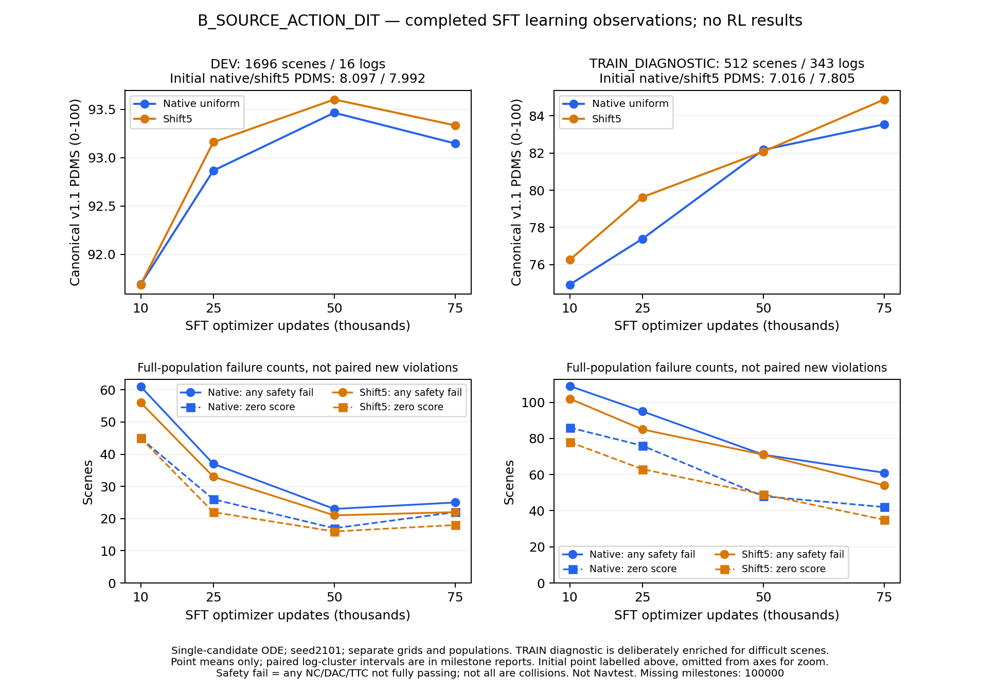

# B组75k SFT：TRAIN诊断继续提高，DEV未延续50k增益

2026-10-17，B_SOURCE_ACTION_DIT的75k固定观察点完成完整DEV1696场景/16 logs与TRAIN诊断512场景/343 logs。冻结Qwen、独立SimWAM ActionDiT、原8×4动作，没有Wan/MoT。原始观测、seed2101、单候选10步ODE、canonical NAVSIM v1.1均保持。16个评价worker已核实退出，16项原入口检查通过。

**DEV原生PDMS为93.147534，shift5为93.334612，相对50k分别−0.318288/−0.268381个百分点；两个log聚类配对区间均跨零。** TRAIN诊断分别提高1.368624/2.798291个百分点，只有shift5的区间高于零。B仍在SFT，继续固定100k终点；尚无本组正式RL或最终Navtest结论。



[独立PDF](B_SFT_learning_through_75k.pdf)和[绘图输入/hash](B_SFT_learning_through_75k.json)包含全部0/10k/25k/50k/75k记录。为显示训练后的变化，曲线从10k起，随机初始化分数在图中单列，100k明确缺失；不外推、不挑较高网格。下排是各完整人口的失败总数，不是相对50k新增违规。上排只画点均值，配对区间见下表，不能由连线认定统计显著性。

绘图复用原入口的新增`--view learning`，默认配对增益视图保持；源码`15f90a1d2e919945164701c0f85878499cc195b2`。已核对10份人口摘要、SFT/export身份和输入hash，实际绘图坐标逐项等于保存数值，终图已目视检查。中间布局及绘图格式问题在发布前修正，中间文件保留在私有analysis目录；本图未修改任何评分、模型或正式执行快照，新增推理/评分/更新均为0。

补充的[已有轨迹安全转移分析](B_SFT75k_safety_transition_analysis.md)定位到：每网格11个新增DAC分别贡献总G−的78.59%/70.87%，主要集中在3/4个logs；这些轨迹多数前进更少、平均速度更低。该分析新增推理/评分为0，不改变本报告的分数或配对区间。

## 固定观察点的单候选结果

| 人口/网格 | 25k | 50k | 75k | 75k−50k，百分点 | 95%区间，百分点 |
|---|---:|---:|---:|---:|---|
| DEV 原生 | 92.867093 | 93.465822 | **93.147534** | **−0.318288** | [−0.988904,+0.700844] |
| DEV shift5 | 93.161568 | 93.602993 | **93.334612** | **−0.268381** | [−0.839873,+0.767375] |
| TRAIN诊断 原生 | 77.387590 | 82.171598 | 83.540222 | +1.368624 | [−0.560832,+3.218374] |
| TRAIN诊断 shift5 | 79.627974 | 82.077723 | 84.876014 | +2.798291 | [+0.468682,+5.220116] |

区间按log重采样，保留场景权重，不包含训练/推理seed不确定性。TRAIN诊断含预选困难场景，不是完整TRAIN人口的无偏均分。其走势与DEV不同，是需要保留的观察；有限16个DEV logs和人口差异尚不足以单独确诊过拟合，也没有证明继续SFT能稳定改善DEV。

原F-SFT的DEV原生为93.619237，B75k低约0.471703个百分点。B从随机动作头训练，A从已有动作头继续监督训练，二者知识、参数量和监督预算不同；这不是隔离架构因果效应的对照。后续B的RL增量必须相对自己的固定100k SFT，不能用75k或50k替代正式起点。

同一75k权重的原生−shift5为−0.187079个百分点，95%区间[−0.354313,−0.042410]。两网格的观测和root seed相同；B使用源continuous sigma时间输入。这个结果支持部署网格在该权重上影响表现，不能据此认定原FM实现有错，也不是RL收益。两种成绩分别保留，不取best-of-two。

## 安全分项、低尾与转移

| 75k人口/网格 | NC | DAC | TTC | EP | Comfort | DDC | 零分 | 联合安全 |
|---|---:|---:|---:|---:|---:|---:|---:|---:|
| DEV 原生 | 100.000000 | 98.702830 | 99.764151 | 85.617760 | 99.823113 | 98.850236 | 22 | 1671/1696 |
| DEV shift5 | 100.000000 | 98.938679 | 99.764151 | 85.795522 | 99.823113 | 98.879717 | 18 | 1674/1696 |
| TRAIN诊断 原生 | 100.000000 | 91.796875 | 96.093750 | 75.769970 | 99.804688 | 98.925781 | 42 | 451/512 |
| TRAIN诊断 shift5 | 100.000000 | 93.164062 | 96.093750 | 77.061809 | 99.804688 | 98.925781 | 35 | 458/512 |

分项为0–100。联合安全要求NC/DAC/TTC都等于1；TTC违规不等于实际碰撞。下表全部相对同网格的B50k，reference-safe集合固定为50k人口，仅用于这一配对，不能冒充后续100k SFT参考集合。

| 人口/网格 | NC新增/恢复 | DAC新增/恢复 | TTC新增/恢复 | 非零→零/零→非零 | 50k安全人口中新联合违规 |
|---|---|---|---|---|---|
| DEV 原生 | 0/0 | 11/6 | 2/4 | 11/6 | 12/1673 |
| DEV shift5 | 0/0 | 11/9 | 3/4 | 11/9 | 14/1675 |
| TRAIN诊断 原生 | 0/0 | 10/16 | 1/6 | 10/16 | 10/441 |
| TRAIN诊断 shift5 | 0/1 | 15/28 | 2/7 | 15/29 | 17/441 |

DEV的NC保持100，TTC小幅净改善；DAC和EP均下降，零分从50k的17/16增至22/18。其1%分位也从47.281889/54.531406回到0，5%分位为83.312883/83.333333。不能将这次回落说成所有安全分项均恶化，也不能只看TTC改善而忽略新增越界及零分。

TRAIN诊断零分从48/49降到42/35，联合安全从441/441升至451/458；仍在原安全人口新增10/17个联合违规。均值和净恢复改善不等于逐场景安全保持。

DEV原生G+=8.245442、G−=13.643613，shift5为10.602856/15.154599，单位为原始0–1分差的场景求和。任意改善/退化为419/668和340/751；达到±0.005实用幅度为73/203和38/254。任意负差不等于事故计数。四个配对均检查了`(G+−G−)/场景数=配对平均差`，没有把候选组或seed展开当成独立场景。

## 行为描述与评价成本

DEV模拟终点前进量原生/shift5为17.583828/17.583078米，较50k的17.615118/17.643121米略低；请求点平均段速度为4.525607/4.528274 m/s。请求点离散jerk RMS为0.425020/0.695558 m/s³，相对50k的0.520613/0.647125，一个下降、一个上升。这只是请求轨迹的描述量，不是官方Comfort或模拟车辆瞬时jerk，不能单独判断安全。

| 评价人口 | 两网格逻辑候选 | 实际推理含入口检查 | job wall秒 | 累计worker wall秒 |
|---|---:|---:|---:|---:|
| DEV | 3392 | 3400 | 546.539 | 4337.294 |
| TRAIN诊断 | 1024 | 1032 | 269.212 | 2115.187 |

DEV/诊断分别在rl-zt2/tsinghua-zt4各8卡并行；这两项是既定评价，没有新增seed或算法。模型加载累计worker时间为961.767/894.311秒，前向生成累计2792.034/954.579秒，评分等待累计209.494/78.268秒。以上为worker elapsed，不能写作独占GPU计算时间或CPU核心时间；两个job wall不能相加冒充端到端墙钟。

本次DEV job比50k的434.334秒更长，记录中模型加载累计由250.445增至961.767秒，生成累计由2750.812增至2792.034秒。两次使用的主机与即时负载不同，未单独隔离加载变慢的原因。[资源调度修复](capacity_evaluation_handoff_20261017.md)此次实际让两个任务同时使用可用主机，但没有证明单次推理提速。导出和SFT训练不包含在上述评价worker表中，不能将该表当作整个研究成本。

## 身份、验收与后续

75k原生恢复点为READY、world8、cursor2,400,000；这是240万次场景曝光，不是240万个独立场景。COMPLETE中的文件清单hash与实际`files.json`一致，列出的11个原生文件均存在；本次未额外执行75k中断恢复或重新读取全部Adam张量，完整恢复等价性沿用此前已执行的资格测试。

- checkpoint文件清单SHA256：`80aec32b777c538f0beb27d1554049522ce58f40bb6b3caf77222560b5932f8a`。
- 部署导出权重SHA256：`f25b5e64c3248643f082acc644239dab0e64c4281ea0fa519b717f4dde25f998`。
- SFT源码：`4e0ce1f45b6778895648689228a5628432bd2616`；推理/评分：`45d2318d2dec265583860a26f891d8b79bb6068a`；本次配对分析源码快照：`3a23d3cdaaa7fbb86ea60f9674d350f40b440e24`。
- 冻结上游检查通过；16个worker的PID、启动时间与实际进程身份核对后确认退出；完整分母、8份/人口的关闭成本账本、raw/paired均分一致性核验通过。
- 配对和网格分析新增推理、评分、optimizer更新均为0；旧轨迹、score和50k摘要均未覆盖。

两路线已有26/36项固定阶段评价完成，B训练继续超过76k，A保持已完成20k终点。仍按登记顺序完成B100k SFT、其自身完整TRAIN筛选与真实八卡RL验收，再训练20k R_SOURCE。没有因75k DEV回落而中途调整LR、时间网格、数据清单或预算，也没有以50k替代固定终点。新Navtest尚未开始，DEV超过92不代表最终RL目标完成。

## 证据与已执行命令

[DEV完整结果](B_SFT_update075000_DEV.json)、[DEV相对50k](B_SFT_update075000_DEV_vs50k.json)、[TRAIN诊断完整结果](B_SFT_update075000_TRAIN_DIAGNOSTIC.json)、[TRAIN诊断相对50k](B_SFT_update075000_TRAIN_DIAGNOSTIC_vs50k.json)、[同权重网格差](B_SFT75k_DEV_native_minus_shift5.json)、[执行/退出/成本](B_SFT75k_evaluation_execution.json)。

下列命令已在上述分析快照、CPU-only环境执行，均读取真实已完成评价。输出已存在时会拒绝覆盖。

```bash
python -m scripts.analysis.fm_transfer.analyze_evaluation --evaluation /mnt/project/fm-transfer-20261016/evaluations/B_SOURCE_ACTION_DIT_SFT_update075000_DEV --reference /mnt/project/fm-transfer-20261016/evaluations/B_SOURCE_ACTION_DIT_SFT_update050000_DEV --output /mnt/project/fm-transfer-20261016/analysis/B_SOURCE_ACTION_DIT_SFT_update075000_DEV_paired_50k.json
python -m scripts.analysis.fm_transfer.analyze_evaluation --evaluation /mnt/project/fm-transfer-20261016/evaluations/B_SOURCE_ACTION_DIT_SFT_update075000_TRAIN_DIAGNOSTIC --reference /mnt/project/fm-transfer-20261016/evaluations/B_SOURCE_ACTION_DIT_SFT_update050000_TRAIN_DIAGNOSTIC --output /mnt/project/fm-transfer-20261016/analysis/B_SOURCE_ACTION_DIT_SFT_update075000_TRAIN_DIAGNOSTIC_paired_50k.json
python -m scripts.analysis.fm_transfer.analyze_grid_gap --evaluation /mnt/project/fm-transfer-20261016/evaluations/B_SOURCE_ACTION_DIT_SFT_update075000_DEV --output /mnt/project/fm-transfer-20261016/analysis/B_SFT75k_DEV_native_minus_shift5.json
```

新增曲线命令已在上述绘图提交执行，CPU-only；历史输出不覆盖，再次执行应指定新输出名：

```bash
CUDA_VISIBLE_DEVICES='' OMP_NUM_THREADS=1 OPENBLAS_NUM_THREADS=1 MKL_NUM_THREADS=1 \
  /mnt/project/flow-safe-improvement-20261013/venv/bin/python \
  -m scripts.analysis.fm_transfer.plot_supervised_progress \
  --variant B_SOURCE_ACTION_DIT --view learning \
  --output /mnt/project/fm-transfer-20261016/analysis/B_SFT_learning_through_75k_v3.png
```
