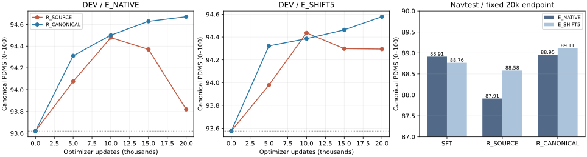

# DDP Flow Matching / Flow-GRPO 多来源分析、实现核查与诊断报告

整理日期：2026-10-16。初始分析证据提交：`e96a7459b69bd2509be8db63cb02e605357b39b3`；本次整合采用的已发布证据截止提交：`03ebcaa47c784195a118a9697ef3c4314fc57cf8`。这两个提交是证据身份，不是正式训练源码；各 run 的不可变源码见第16节。本报告汇总已收集的论文、锁定源码、正式实验和有限诊断；本次文档整合没有新增训练、评分或修改正在运行的配方。

**已有真实部署正结果，但没有达到92，也没有全面保持安全。** X1固定20k的完整Navtest已经完成，原单候选ODE为89.3817，相对SFT提高0.4701分、相对原Canonical提高0.4300分；相对SFT仍有NC/TTC净退化。末步ODE对照已单独登记并启动，本报告没有它的完整部署结果。第13节保留带时间标记的历史进展，不能把其中早期的“等待/运行中”当作X1当前结论。完整终点数据见[X1报告](../final_navtest_20261016/README.md)。

本报告要回答三个问题：其他工作中的 Flow-GRPO 为什么能有效；我们的迁移是否漏掉关键实现；DDP 原始动作表达、时间网格及探索方式是否限制了强化学习收益。结论按证据强度区分，不把实现通过验收、候选变好或训练集提分当成最终部署成功。

### 阅读索引

| 想查的问题 | 对应章节与证据 |
|---|---|
| 我们现在有没有LoRA，哪些参数在更新？ | [第4节：实际模型与LoRA](#4-本项目真正运行的模型与-lora) |
| Flow-GRPO、SimWAM、DriveWLA等到底怎样去噪、怎样更新？ | [第3节：多来源对照](#3-各来源的经验什么可以借鉴什么不能直接迁移)，固定commit和论文版本见第2节 |
| 总步数、随机窗口和训练/部署时间是否一致？ | [第5节：公式与合同](#5-正式-simwam-式配方及数学语义)、[第6节：实际网格](#6-时间网格如何改变探索与保持) |
| 动作编码或归一化有没有源头限制？ | [第7节：物理尺度、anchor与sin/cos](#7-原动作表达归一化与-anchor-的物理含义) |
| 已经有哪些完整测试集结果？ | [第8节：原两组20k](#8-两组-20k-正式训练究竟得到了什么)、[第13.4节：X1固定终点](#134-x1固定20k完整navtest真实正收益与未解决问题) |
| 末步噪声是否有直接证据，而不只是猜测？ | [第9节：配对采样](#9-配对采样探针探索和部署迁移能否分清)、[第10节：保存链反事实](#10-只移除最后一次创新的反事实) |
| 哪些代码问题已排除，哪些判断仍不确定？ | [第11节：验收与修复边界](#11-实现和工程问题是否使已有结果失效)、[第12节：瓶颈排序](#12-当前瓶颈如何排序) |
| 如何复查数字、运行入口、成本和源码身份？ | [第14节：成本](#14-实际成本和失败证据)、[第15节：复查入口](#15-复查与复现入口)、[第16节：交付索引](#16-可追溯交付索引) |

### 已完成实验与待验证实验分开阅读

| 配置 | 相对基线的科学差异 | 固定20k原ODE Navtest PDMS | 本报告中的证据状态 |
|---|---|---:|---|
| F-SFT | 原预训练策略，无本轮RL | 88.9116 | 固定单候选部署参照 |
| R_SOURCE | 锁定SimWAM公开配方的DDP适配，训练reward为10:5:2 | 87.9125 | 训练和完整Navtest均完成 |
| R_CANONICAL | 相对R_SOURCE仅训练reward改为5:5:2 | 88.9517 | 训练和完整Navtest均完成 |
| R_CANONICAL_X1 | 相对R_CANONICAL仅native anchor改为[1,1,0.5,0.5] | 89.3817 | 训练和完整Navtest均完成；总权重分母也随此配置改变 |
| R_CANONICAL_LAST_ODE | 相对R_CANONICAL仅排除最后一步随机，窗口由[7,8,9]变为[6,7,8] | **尚无完整结果** | 已验收并启动；首100更新仅有训练随机候选证据 |

主表共同使用canonical v1.1、12,146场景、seed2101、原十步均匀ODE。末步ODE对照没有叠加X1。两个后续变体属于独立命名的主动算法修改，不能合并到“原样源配方”的结果中；未完成的格子也不能用候选均分或保存链反事实填入。

## 1. 当前结论与证据强度

| 判断 | 当前证据 | 不能据此推出的结论 |
|---|---|---|
| 没有发现新的 FM 时间方向、velocity 符号、LoRA 未接入或正式概率重算错误 | 源 oracle、真实采样 mean/std 对照、LoRA 前向/合并、八卡更新和恢复验收 | 无法证明所有未检查实现均无问题，更不能推出方法必然提分 |
| 当前末步随机创新损害了本批 DDP 候选质量 | 固定已保存链，只移除最后一次创新，SFT / RL 的 PDMS 分别提高 7.4443 / 8.7832 分 | 这不是重新训练后的 ODE 收益，也不是 Navtest 新成绩 |
| 归一化空间中照搬 anchor 权重改变了物理方向平衡 | 相同米级偏移的纵向∶横向系数比，源模型约 1∶12.63，DDP 原移植约 1∶74.72 | 尚未证明这是全部安全退化的原因，也不是实际参数梯度之比 |
| ODE 能吸收部分 RL 更新 | 固定 TRAIN64 探针中，原 ODE 均分提高 3.5231 分；既有 TRAIN/DEV 也有改善 | 不能把训练人口的收益外推到完整 Navtest |
| 已有原ODE测试集增益，安全保持和92目标仍未解决 | 原R_CANONICAL为+0.0401分；后续X1为+0.4701分，但相对SFT仍有TTC新增87、恢复37 | 不能宣称所有安全分项不退化，或将单训练seed的区间当作训练重复 |
| 当前主要瓶颈已不是无优势组过多 | 两组正式训练有效 PG 组约 99.6% | 有梯度不等于梯度指向安全改善；progress-only 仍占多数 |

方向保持已有X1固定终点的部署证据；末端随机窗口仍需完成已登记的训练和部署检验。现有证据不足以否定 Flow Matching 整体，也不足以用一个超参数解释全部结果。

## 2. 版本、人口和数字口径

### 2.1 必须分开的四类证据

| 证据 | 人口与输出 | 用途 |
|---|---|---|
| 外部论文/公开代码 | 各自模型、数据、训练预算、采样和评价协议 | 说明设计选择及其已报告效果；不能直接与 DDP 分数相减归因 |
| 本项目正式评价 | Navtest 12,146 场景 / 136 logs，seed2101，单候选 ODE | 判断真实部署收益；原均匀网格和 shift5 分表 |
| 固定 TRAIN64 采样探针 | 64 场景 / 60 logs，两模型、三采样器、每场景 G8 | 配对检查随机输出均值、采样质量及学习是否被 ODE 吸收 |
| 已保存链反事实 | 同一 TRAIN64、同一 G8、两模型，只移除最后一次创新 | 隔离这一次创新的条件影响；不是新的 on-policy 训练或部署策略 |

内部 reward 为 0—1；本报告 PDMS 和分项均值表通常乘 100。PDMS 的“+0.0401 分”表示原始 score 的约 +0.0004009，不是 +0.0401 原始 score。NC 原始值可以为 0.5，因此 NC 均值与完全通过率不同。联合安全通过指 NC、DAC、TTC 均等于 1。

正式训练 seed 固定为 42，正式评价 seed 为 2101。G8 是组内候选，不是八次独立训练复现。区间采用按 log 聚类的 bootstrap，先聚合场景内候选，保留场景权重；不包含训练 seed 或独立推理 seed 的不确定性。

TRAIN64 来自既有定向 TRAIN512，不能作为完整 RL_TRAIN 的无偏估计。DEV 仅能称“RL 更新未见”，SFT 可能见过；历史 Navtest 已多次被观察，不能重新称为完全盲测。

### 2.2 已锁定来源

| 来源 | 锁定版本 | 核实边界 |
|---|---|---|
| H-EmbodVis/SimWAM | `1433ee7e06a62bd8b89da74455df0d82bda7b726` | 配置、runtime、trainer、SDE、LoRA、scheduler、reward、数据归一化与有效 optimizer 行为 |
| yifan123/flow_grpo | `879042cf5707f8b90daa98d147d7deac2317c5da` | 具体配置、Fast 采样路径、SDE 与 GRPO-Guard 代码；不是将所有配置混成一个默认值 |
| Tencent-Hunyuan/MixGRPO | `19946facaefa33eca1b565ec87c6fc7cca14e339` | 启动脚本、训练器、采样函数；区分实际启动的 SDE 与未启用的 CPS 分支 |
| IamCreateAI/FlowCPS | `b402c7a3d5b2539e6c42fed6c6c042bab9a1be05` | 实际均值、噪声与 logprob 代理代码 |
| JiaweiXu8/EponaV2 | `3068e3759ad64c923ce389715e8422426c97fb0c` | 当时官方树仅 README/LICENSE；训练细节主要来自论文 |
| DriveWLA | 论文 v1 | 未找到可核实的官方训练实现；未公开的 sigma、clip 等保持未知 |

外部文件 URL、commit、SHA 和论文链接见 [sources.json](sources.json)。SimWAM 的完整来源锁、许可和迁移差异见 [upstream_lock.json](../../ddp_simwam_recipe_20261015/upstream_lock.json) 与 [recipe_delta.json](../../ddp_simwam_recipe_20261015/recipe_delta.json)。没有下载外部大模型权重，也没有为本次比较复制新的算法训练平台。

## 3. 各来源的经验：什么可以借鉴，什么不能直接迁移

### 3.1 采样和更新设置对照

| 工作/版本 | 生成及评价步数 | 随机步骤 | 参数更新/保持 | 对当前问题的意义 |
|---|---|---|---|---|
| Flow-GRPO 论文 v1 的 SD3.5-M 实验 | 训练 10、评价 40 | ODE 转 SDE 的组相对优化 | LoRA r32 / alpha64，G24 | 训练与推理步数相同不是必要条件；图像的噪声尺度不是驾驶动作的默认值 |
| Flow-GRPO 锁定代码的部分 Fast 配置 | SD3 部分配置 10/40；Qwen-image 部分配置 10/50 | SD3 配置可在限定较早范围内选择三步，Qwen-image 部分配置窗口两步，窗口外 ODE | 依具体模型配置而定 | 总步数、随机位置和实际反传步骤应分别核实 |
| SimWAM 锁定配方 | 10 步、shift5 | 固定 [7,8,9]，末步仍随机 | attention LoRA；global reward std；均值 MSE anchor；四次 inner | 本项目迁移的明确基线；没有默认末步 ODE 清理 |
| DriveWLA v1 | 论文描述 10 步随机生成、10 步 ODE 部署，G8 | 具体实现未独立核实 | 动作 LoRA、discount 0.8、BC 0.1、困难场景 | 与 SimWAM 的无 BC、末三步设置不同，不能只用“都叫 Flow-GRPO”视为同一配方 |
| MixGRPO v3 | 主要 FLUX 实验 25 步 | 四步随机窗口、窗口逐步移动、窗口外 ODE | 在部分随机步骤上更新 | 提供检验随机窗口位置的依据，不证明某个窗口对驾驶最优 |
| Flow-CPS v1 | 重点讨论少步离散采样 | CPS 噪声随下一时刻收缩，末端为零 | 官方代码使用特殊 logprob 代理 | 提示末端噪声和离散误差值得检查；不能只替换采样公式而保留不对应的概率 |
| EponaV2 v1 | 本次未核实可执行的全部步数/噪声配置 | 不补猜 | 冻结上游，规划器 RL，奖励含模拟轨迹和模仿信息 | 说明奖励及环境反馈设计也影响收益，不能把所有增益归因采样器 |

来源：[Flow-GRPO v1](https://arxiv.org/html/2505.05470v1)、[官方具体配置](https://github.com/yifan123/flow_grpo/blob/879042cf5707f8b90daa98d147d7deac2317c5da/config/grpo.py)、[SimWAM task 配置](https://github.com/H-EmbodVis/SimWAM/blob/1433ee7e06a62bd8b89da74455df0d82bda7b726/configs/task/navsim_grpo_action_pdm_384x672_flowgrpo_lora.yaml)、[DriveWLA](https://arxiv.org/html/2610.17903v1)、[MixGRPO](https://arxiv.org/html/2507.21802v3)、[Flow-CPS](https://arxiv.org/html/2509.05952v1)、[EponaV2](https://arxiv.org/html/2605.14696v1)。

### 3.2 驾驶工作的正结果及安全分项

DriveWLA 的同论文消融提供了 Flow-GRPO 可以改善其模型的证据，同时也显示“PDMS 提高”与“所有安全分项提高”不等价：

| DriveWLA 论文消融 | PDMS | NC | DAC | TTC | EP |
|---|---:|---:|---:|---:|---:|
| SFT | 90.8 | 99.2 | 97.7 | 97.2 | 84.0 |
| 原 Flow-GRPO | 92.1 | 99.1 | 98.7 | 97.1 | 86.1 |
| 分项优势与 shrinkage 版本 | 92.3 | 99.1 | 98.8 | 97.0 | 86.4 |

其 SFT 5/10/15/20 步消融分别为 90.6/90.8/90.8/90.7，不能据此提出“统一增加去噪步数必然提分”。分项优势、重新归一化和方差 shrinkage 是该工作的另一套更新规则；它不是硬安全约束，也不会凭空给完全相同的失败组制造信号。[DriveWLA 论文](https://arxiv.org/html/2610.17903v1)

EponaV2 报告的相应消融为 PDMS 89.4→90.4、TTC 95.3→95.7、DAC 97.3→97.9、EP 83.6→84.8，NC 为 98.6。其奖励使用 GT 与实际模拟轨迹差异及模仿项，并非直接复用本项目 PDMS 目标。官方代码可见性不足时，不补造 LoRA 范围或 denoising 配置。[EponaV2 论文](https://arxiv.org/html/2605.14696v1)

### 3.3 SimWAM 的版本边界

已有核对记录区分：论文 v1 报告 91.5；锁定 GitHub README 标示 91.9；默认配置预算为 20,000 optimizer updates；README 另有 170,000 步长命令。公开模型卡有单独 revision，但未取得将当前默认配置与发布 91.9 权重一一对应的完整原训练日志身份。

因此可以说“迁移了锁定公开源码的关键配方”，不能说“已逐项复现发布权重的全部训练过程”。Wan 骨干、SFT 表征、动作归一化、数据人口及训练历史也不同。版本证据见 [version_boundaries.json](../../ddp_simwam_recipe_20261015/version_boundaries.json)。

### 3.4 阅读实现时发现的易混点

- MixGRPO 的锁定启动脚本实际设置 `sde_type=sde`，`noise_level=None` 会回退 eta=0.7；注释提到 CPS 不等于实际运行 CPS。代码还需与论文中的 shift 文字公式区分。[实际采样函数](https://github.com/Tencent-Hunyuan/MixGRPO/blob/19946facaefa33eca1b565ec87c6fc7cca14e339/fastvideo/utils/sampling_utils.py)
- Flow-CPS 官方 kernel 使用负 MSE 形式的 logprob 代理，没有标准 Gaussian 的方差归一化。它和末端零噪声必须一起理解，不能当作原 Gaussian likelihood 的直接替换。[官方 kernel](https://github.com/IamCreateAI/FlowCPS/blob/b402c7a3d5b2539e6c42fed6c6c042bab9a1be05/flow_grpo/diffusers_patch/sd3_sde_with_logprob.py)
- GRPO-Guard 研究 ratio 与生成步骤梯度不平衡，值得借鉴诊断方式，但尚未证明我们具有同样故障。精确密度比在旧分布下期望为 1；期望 log-ratio 为负本身是正常 KL 关系，不能直接称 bug。我们的 mean/clamp 代理也不是那个精确比值。[论文](https://arxiv.org/html/2510.22319v1)、[实现](https://github.com/yifan123/flow_grpo/blob/879042cf5707f8b90daa98d147d7deac2317c5da/scripts/train_sd3_GRPO_Guard.py)

## 4. 本项目真正运行的模型与 LoRA

原 DDP 仍以当前观测、导航和合法 ego 状态形成条件，动作头输出 8 个未来点的 8×4 表达。相机 processor、Qwen、history/状态编码、动作 query、位置/时间编码及原 DiT 拓扑均沿用 SFT。

本轮 R_SOURCE / R_CANONICAL / X1 **使用 LoRA**：96 个实际 attention 投影，192 个 A/B 张量，共 4,718,592 个可训练参数；r16、alpha32、scaling=2、dropout=0。实际路径覆盖动作块的 `attn1.to_q/to_k/to_v/to_out.0`，不是通过递归匹配任意子模块名 `0` 注入。

Qwen、上游、qwen_proj、action encoder/decoder、FFN、norm、时间模块及 attention base weights 冻结。永久 reference 在注入 LoRA 前从 SFT 建立。A 用源初始化，B 初始为 0；第一步 A 的任务梯度可为零，不能据此断言梯度断开。

验收记录包含实际投影调用、A/B 更新、零 LoRA 与 SFT 一致、FP32 merge 后原类加载及完整原 ODE。零初始化 ODE 最大绝对差为 0；非零 LoRA 的已测 merge ODE 误差约 1.19e-7—2.38e-7，velocity 误差约 9.54e-7—1.19e-6。具体样本和布局见 [LoRA 验收](../../ddp_simwam_recipe_20261015/qualification/lora.json)。

原 C/N 训练的是完整 action head；不能把历史 C/N 的弱收益解释为“只训练了 LoRA”。也没有证据通过再次切换全头训练就一定解决当前问题。

实际代码入口：

| 环节 | 当前真实文件 |
|---|---|
| SFT 动作头与原 Euler | [GR00T_ActionHeader.py](../../../starVLA/model/modules/action_model/GR00T_ActionHeader.py) |
| DDP 时间/速度适配 | [trainer_adapter.py](../../../starVLA/rl/simwam_recipe/trainer_adapter.py) |
| 源 SDE、保存链、概率 | [vendor/action_math.py](../../../starVLA/rl/simwam_recipe/vendor/action_math.py) |
| 源 PPO 与 reference anchor | [vendor/trainer_math.py](../../../starVLA/rl/simwam_recipe/vendor/trainer_math.py) |
| LoRA 精确路径与参数合同 | [lora_adapter.py](../../../starVLA/rl/simwam_recipe/lora_adapter.py) |
| 全局 raw reward 标准差 | [source_advantages.py](../../../starVLA/rl/simwam_recipe/source_advantages.py) |
| 采样、评分及优势提交 | [collection.py](../../../starVLA/rl/simwam_recipe/collection.py) |
| 训练奖励/正式指标双读出 | [reward_readouts.py](../../../starVLA/rl/simwam_recipe/reward_readouts.py) |

这里列出实际文件名；设计草案中的 `partial_sde.py`、`source_anchor.py` 并不是本实现的文件。源数学直接复用在 vendor 和 adapter 中，没有另写一套同名主干。

## 5. 正式 SimWAM 式配方及数学语义

### 5.1 两组共同合同

| 项目 | 实际设置 |
|---|---|
| 起点 | 同一 F-SFT、同一 LoRA 初始化；不用历史 RL 权重初始化 |
| 全局 rollout | 八卡，每卡 1 scene，G8；每份 8 scenes / 64 candidates |
| 生成 | K10，shift5，ODE 前七步，随机 [7,8,9] |
| 噪声 | rigorous score-corrected 对角 SDE，noise_level=0.1，min_std=0.001 |
| 概率经验处理 | 创新 clamp ±5；逐维 relative logprob clamp 宽度 7；之后 H/D mean |
| 优势 | 组内中心化 / 所有 rank 未筛选 raw reward 的 population std；eps=1e-8 |
| PG | tied 组 mask；discount=1；advantage clip ±5；PPO clip=0.005 |
| 保持 | 同一保存状态上的永久 SFT 转移均值 MSE，beta50，权重 [0.2,1,0.5,0.5] |
| 更新复用 | 同一 fresh rollout 四次真实 AdamW step；old 概率、链、reward、优势不变 |
| 优化器 | LR5e-5，betas=(0.9,0.95)，eps1e-8，WD0.01，warmup100 updates，之后 constant |
| 实际梯度裁剪 | effective=0；YAML max_grad_norm=1 没有在源有效 engine 路径中启用 |
| 数值执行 | 冻结前缀遵循原部署；动作/latent/velocity/probability FP32；优势小统计 FP64 |
| 分布式 | torch DDP + FP32 LoRA AdamW；find_unused_parameters=True，static_graph=False，bucket25MB |
| 总预算 | 20,000 updates = 5,000 fresh rollouts = 40,000 scene 曝光 = 320,000 新候选 |
| 未启用 | BC/GT replay、learned noise、dual、动态补样、entropy bonus、adaptive KL、merged window、KL gate |

平台、dtype、稳定 FP64 中心化和四维动作映射是已登记适配；有效 grad clipping=0 是源行为，不能在文档中写成“漏掉 clip1”。源 YAML 的 vis/eval 字段不代表其旧平台逻辑已实际执行，本项目由固定 milestone controller 完成阶段评价。

完整配置：[R_SOURCE](../../../configs/flow_rl/simwam_source_ddp.yaml)、[R_CANONICAL](../../../configs/flow_rl/simwam_canonical_ddp.yaml)、[源 Hydra resolved 配置](../../ddp_simwam_recipe_20261015/resolved_source_recipe.yaml)。

### 5.2 FM 方向与时间转换

原 DDP 的监督路径和目标为：

$$
x_t=(1-t)\epsilon+t y,\qquad v^*=y-\epsilon.
$$

原部署使用从噪声到动作的正向 Euler：

$$
x_{k+1}=x_k+\Delta t\,v_\theta(O,x_k,t_k).
$$

SimWAM 以 sigma 从 1 到 0 表示生成时间，使用相反的 velocity。适配为：

$$
t_{DDP}=1-\sigma,\quad v_{upstream}=-v_{DDP},\quad\Delta t=-\Delta\sigma.
$$

原 SFT 时间来自 Beta(1.5,1) 的既有变换，而非十个离散均匀时刻。连续时间训练与离散积分不需要采样分布完全一致。继承的 `noise_s=.999` 带来约 0.15% 轻微负时间尾部；目前没有证据证明其是 RL 弱收益主因，不把它包装成新发现的致命 bug。

### 5.3 rigorously score-corrected 分支不等于简单 Euler 加噪

令源时间步长 $\Delta\sigma<0$，则锁定实现为：

$$
g=\eta\sqrt{\frac{\sigma}{1-\sigma}},\qquad
s=\max\left(g\sqrt{-\Delta\sigma},s_{min}\right),
$$

$$
\mu=x\left(1+\frac{g^2}{2\sigma}\Delta\sigma\right)
+v_{upstream}\left(1+\frac{g^2(1-\sigma)}{2\sigma}\right)\Delta\sigma.
$$

sigma=1 使用源 guard；`s` 已包含平方根步长。采样为 $x_{next}=\mu+s\operatorname{clip}(\epsilon,-5,5)$。该分支不再叠加 bridge 的 `sample_noise_std/logprob_noise_std/anneal_noise` 公式。前七个确定性步骤仅用 ODE，不把假设可计算出的 SDE std 当成实际注入量。

### 5.4 概率和损失代理

计算顺序是逐维 Gaussian log density → 按峰值 relative clamp → 对 H/D 求 mean → new−old → exp → PPO clip。峰值为 $-\log s-\frac12\log(2\pi)$，clamp 区间为峰值减 7 至峰值。

因此需要同时区分原 Gaussian density、clamped 值、dimension-mean 与 joint sum。创新本身被裁剪且只优化保存状态上的部分随机转移，这是一套源兼容经验代理；不能声称是整条混合链的精确、无偏 likelihood ratio。0.005 也不是最终物理轨迹分布“最多改变 0.5%”的保证。

优势为：

$$
A_{sg}=\frac{R_{sg}-\overline R_s}
{\operatorname{std}_{population}(\{R_{s'g'}\}_{all\ ranks})+10^{-8}}.
$$

全局标准差用本份 fresh rollout 的原始 reward，包含 tied 组；不用 group-centered residual 的 std，也不加旧 0.01 floor。每 rank 一组时，零优势 rank 的 PG 为零，其 anchor 仍保留；跨 rank 使用源 rank-mean，不能重新归一到仅有信号的 rank。

源 reference 项实际为：

$$
L_x=\operatorname{mean}_{candidate,step}
\frac{\sum_{h,d}w_d(\mu_{\theta,h,d}-\mu_{ref,h,d})^2}
{H\sum_d w_d},\qquad L=L_{PPO}+50L_x.
$$

它不除以 std 平方，不是 Gaussian KL，也不是最终轨迹 MSE。heading-pair 权重 0.5/0.5 保留逻辑朝向组总权重，但不等价于源三维 yaw 角度 MSE。

### 5.5 训练 reward 和正式 PDMS

两组从同一份实际官方模拟反馈读取分项，每候选独立与固定 PDM reference 评分：

$$
R_{SOURCE}=NC\cdot DAC\cdot\frac{10EP+5TTC+2Comfort}{17},
$$

$$
R_{CANONICAL}=R_{metric}
=NC\cdot DAC\cdot\frac{5EP+5TTC+2Comfort}{12}.
$$

合法样本按锁定 v1.1 scorer 的分项与特殊情况处理；DDC 等保留为诊断。不能跨 candidate 改变 EP 归一化池。两种读出复用一次仿真，不做两次昂贵评分；基础设施故障与真实零分区分，不用 fallback reward0 掩盖失败。

## 6. 时间网格如何改变探索与保持

原生 ODE 使用均匀十步；shift5 使用：

$$
\sigma(u)=\frac{5u}{1+4u},\quad u:1\rightarrow0.
$$

以下是实际三步随机窗口的值，rounding 仅用于展示，代码保留原精度：

| 生成步骤 k | sigma | DDP 时间 t | DDP bucket | 正 dt | 转移 std | 每点纵向 std/m | 每点横向 std/m |
|---|---:|---:|---:|---:|---:|---:|---:|
| 7 | 0.681818 | 0.318182 | 318 | 0.126263 | 0.052016 | 0.4580 | 0.1185 |
| 8 | 0.555556 | 0.444444 | 444 | 0.198413 | 0.049801 | 0.4385 | 0.1134 |
| 9 | 0.357143 | 0.642857 | 642 | 0.357143 | 0.044544 | 0.3922 | 0.1015 |

原生 DDP Euler 实际访问 0/100/…/900 的时间 bucket；不能用另一条 sigma→bucket 转换路径中的浮点取整结果冒充原入口。两个网格都叫“十步”，其模型评估时间和末步长度却不同。共享 LoRA 会影响未直接纳入 PG 的前缀，以及原生部署的其他时间点。

在相同 velocity 偏移条件下，第9步均值 MSE 系数约为第7步的 8 倍；标准化均值敏感度 `dmu/dv/std` 分别约 2.44、4.00、8.06。这是局部标量系数分析，实际网络 Jacobian、场景和优势都参与梯度，不能仅据此认定 anchor 全程过强。

最末步创新直接进入请求动作，之后没有 Flow 去噪；既有车辆解码/后处理仍在链外。每点约 0.3922m/0.1015m 是末次创新的条件标准差，不是最大扰动，也不是最终模拟车身误差。

数据来源：[登记及完整网格](probe_registration_public.json)。完整 SDE−ODE 差异包含之前的噪声和 score correction，不能全部归因最后一次创新。

## 7. 原动作表达、归一化与 anchor 的物理含义

### 7.1 四个通道是什么

DDP 动作为当前 ego 坐标下的未来位置和朝向编码，不是八段位置增量累加：

$$
y=[x_{norm},y_{norm},\sin\psi,\cos\psi].
$$

XY 的反归一化标准差为 8.805105m、2.277741m；sin/cos 未再做相同 z-score，物理 heading 用 atan2。源 SimWAM 锁定 absolute 模式使用固定 min/max，反归一化 XY 尺度为 33.37m、21m；数据类明确忽略传入的 stats 文件，不能只读取 JSON 路径推断实际尺度。[源数据类](https://github.com/H-EmbodVis/SimWAM/blob/1433ee7e06a62bd8b89da74455df0d82bda7b726/src/simwam/datasets/navsim/navsim_dataset.py)

### 7.2 同一个权重 0.2 为什么不表示同一种方向保持

对物理位移 $\delta x,\delta y$，归一化 MSE 的 XY 相对系数为：

$$
c_x:c_y=\frac{w_x}{s_x^2}:\frac{w_y}{s_y^2}.
$$

| 配置 | x/y 反归一化尺度 | native x 权重 | 同米级偏移的 x∶y anchor 系数 |
|---|---|---:|---:|
| SimWAM locked absolute | 33.37m / 21m | 0.2 | 1∶12.6254 |
| DDP R_CANONICAL | 8.805105m / 2.277741m | 0.2 | 1∶74.7189 |
| 已登记 DDP X1 | 同上 | 1.0 | 1∶14.9438 |

这是相对方向权重，不表示 DDP 的绝对 anchor 一定更弱，也不是参数梯度比或部署 KL。源模型和 DDP 的 hidden、velocity Jacobian、population、heading 表达与总 beta 作用仍不同。

还应防止相反的误解：源模型同一末步 sigma 对应约 1.486m/0.935m 的 XY 标准差，实际比 DDP 更大。因此没有证据说“迁移后 DDP 的物理噪声比源模型更大”；已测结论是这个噪声对当前 DDP 候选确实有损害。

X1 将 native 权重和从 2.2 改成 3。归一化后纵向有效系数乘 11/3，横向及 heading-pair 系数乘 11/15。它是一个配置因素变化，不能描述为“其他方向实际保持强度完全不变”。这份物理尺度分析完成于 X1 登记和启动之后，没有用它事后修改参数。详见 [action_scale_comparison.json](action_scale_comparison.json)。

### 7.3 sin/cos 表达是否有源头问题

将 sin/cos 同时乘正数不会改变 atan2 结果，却会改变四维空间的 MSE 和概率代理。这是一种表示冗余，意味着所有 action-space 偏移并不等价于物理行为变化。

但本次实际探针中，原 ODE 的平均朝向半径绝对误差仅约 0.0025（SFT）/0.0032（RL），检查的输出没有半径低于 0.25。现有证据不支持“朝向半径塌缩导致 RL 失败”。保留这一设计限制，避免在没有证据时重做动作表示或 SFT 模型。

## 8. 两组 20k 正式训练究竟得到了什么

### 8.1 完整 Navtest 主结果

下表全部是 12,146 场景 / 136 logs，seed2101，单候选；同一网格只与同一网格 SFT 相减。每组均完成 20,000 次 optimizer 更新，没有选取中间最高点作为终点。

| 模型 | 原十步 ODE | 相对原 ODE SFT / log 聚类95%区间 | shift5 ODE | 相对 shift5 SFT / log 聚类95%区间 |
|---|---:|---|---:|---|
| SFT | 88.9116 | — | 88.7641 | — |
| R_SOURCE 20k | 87.9125 | −0.9991 [−1.5519, −0.4562] | 88.5802 | −0.1840 [−0.6266, +0.2482] |
| R_CANONICAL 20k | 88.9517 | +0.0401 [−0.2985, +0.3736] | 89.1116 | +0.3474 [−0.0075, +0.7026] |

原生 ODE 的安全和进度读出：

| 模型 | NC | DAC | TTC | EP | Comfort | DDC |
|---|---:|---:|---:|---:|---:|---:|
| SFT | 98.1640 | 96.9702 | 95.0519 | 83.0034 | 100.0000 | 98.2834 |
| R_SOURCE | 97.1719 | 97.2007 | 91.2399 | 84.4850 | 100.0000 | 98.2216 |
| R_CANONICAL | 97.6741 | 97.3572 | 93.5699 | 84.3186 | 100.0000 | 98.2669 |

| 模型/网格 | NC 新增/恢复 | DAC 新增/恢复 | TTC 新增/恢复 | SFT-safe 新增联合违规 | 非零→零 / 零→非零 |
|---|---|---|---|---|---|
| SOURCE / 原 ODE | 133 / 15 | 36 / 64 | 502 / 39 | 530 / 11213 | 168 / 70 |
| CANONICAL / 原 ODE | 70 / 12 | 23 / 70 | 219 / 39 | 242 / 11213 | 93 / 74 |
| SOURCE / shift5 | 83 / 17 | 25 / 87 | 348 / 39 | 366 / 11184 | 106 / 96 |
| CANONICAL / shift5 | 54 / 12 | 17 / 94 | 190 / 38 | 205 / 11184 | 69 / 100 |

“新增/恢复”按该分项是否完全通过统计。固定 safe 集由对应网格的 SFT、seed2101 定义，不随新模型重划，也不是所有噪声下绝对安全。

两组匹配差异是训练 reward 的 10:5:2 与 5:5:2。结果支持源 reward 在当前 DDP 上更激进：EP/DAC 改善同时 NC/TTC 退化更大。Canonical 缓解了退化，但仍未证明相对 SFT 的稳健安全净收益。

### 8.2 TRAIN、DEV 与 Navtest 的分离

| 更新 | DEV SOURCE 原/shift5 | DEV CANONICAL 原/shift5 | 定向 TRAIN SOURCE 原/shift5 | 定向 TRAIN CANONICAL 原/shift5 |
|---|---|---|---|---|
| SFT | 93.6192 / 93.5747 | 同左 | 80.3316 / 79.1099 | 同左 |
| 5k | 94.0763 / 93.9778 | 94.3121 / 94.3214 | 83.1492 / 82.2102 | 84.4715 / 83.9018 |
| 10k | 94.4791 / 94.4361 | 94.5018 / 94.3856 | 86.1072 / 86.1952 | 86.7514 / 86.9100 |
| 15k | 94.3706 / 94.2974 | 94.6291 / 94.4625 | 86.0192 / 87.0240 | 86.1652 / 86.5451 |
| 20k 固定终点 | 93.8193 / 94.2939 | 94.6719 / 94.5781 | 84.1979 / 83.7905 | 85.6523 / 85.1714 |

DEV 为完整 1,696 场景 / 16 logs；此处 TRAIN 为既有 512 场景诊断集，并非下一节新探针的 64 场景，也并非完整 RL_TRAIN。收益确实在训练人口和 DEV 出现，但没有可靠迁移到最终 Navtest。不能把 SOURCE 的 10k 峰值与 CANONICAL 的 20k 终点混成最优结果表。



原 ODE 的正向总收益 G+ / 负向总退化 G− 为 SOURCE 186.1776 / 307.5333、CANONICAL 155.9835 / 151.1147。这里是各场景原始 0—1 score 差的正/负部分求和，不是百分点，也不是同名诊断字段中已经除以场景数的均值贡献。少数大幅退化可能抵消大量微小提升，不能只统计“多少场景变好”。

### 8.3 更新有效性与训练人口

困难清单通过同一 SFT 原单候选 ODE 的 canonical score<0.9 固定筛选，22,017 场景 / 1,063 logs；完整 RL_TRAIN 为 101,592 场景。困难场景中 20,971 个属于安全但质量/进度较低，约占 95.25%。安全失败的各种联合类型另有记录。[固定清单证据](../../ddp_simwam_recipe_20261015/hard_population.json)

| 全程统计 | R_SOURCE | R_CANONICAL |
|---|---:|---:|
| 有效 PG 组 | 99.590% | 99.635% |
| progress-only 组 | 65.860% | 70.553% |
| 正优势且仍违规候选 | 859 | 460 |
| 同组存在安全候选，却给违规候选正优势 | 657 | 340 |
| 第一 inner 最大 ratio 误差 / clip fraction | 0 / 0 | 0 / 0 |
| 第二/三/四 inner 平均 clip fraction | 0.412% / 2.633% / 6.371% | 0.396% / 2.338% / 5.625% |

本轮没有 DAPO 动态补样；困难清单在采样前改变了人口。当前不能继续用“绝大多数无优势组浪费更新”解释失败，也不能把第二至第四 inner 的真实 clipping 自动判为数值 bug。

原生 Navtest 请求终点前向位移平均为 SFT 19.3036m、SOURCE 19.7127m、CANONICAL 19.5413m；实际模拟前向位移为 19.4678m、20.1014m、19.8545m。SOURCE 更向前且 EP 更高，但 TTC/NC 新违规也更多。这支持目标权衡分析，尚不证明单一 anchor 通道具有因果责任。

数据和审计入口：[完整结果](../../ddp_simwam_audit_recovery_20261015/results.json)、[两组最终报告](../../ddp_simwam_audit_recovery_20261015/README.md)、[SOURCE 训练统计](../../ddp_simwam_audit_recovery_20261015/R_SOURCE_training.json)、[CANONICAL 训练统计](../../ddp_simwam_audit_recovery_20261015/R_CANONICAL_training.json)。

## 9. 配对采样探针：探索和部署迁移能否分清

### 9.1 登记与实际执行

从固定 TRAIN512 按 hash 预选 64 场景，覆盖 60 logs。比较 SFT 与 R_CANONICAL20k，每个模型各使用原十步 ODE、shift5 十步 ODE、shift5 末三步 SDE，每场景 G8，共：

$$
64\times2\times3\times8=3072\text{ 条真实评分候选}.
$$

初始 root 在模型和采样器间配对；SDE 逐步创新使用独立于 root 的 CPU RNG，并在模型之间配对。全部候选评分，不按成功挑样，也不把候选 max 作为主成绩。

探针遵循训练接口的 FP32 root。正式 seed2101 原始观测评价的 root dtype 为 BF16，因此探针绝对分数不能冒充正式主表；配对探针内部的条件和精度保持一致。没有使用 DEV/Navtest 来选探针场景或调参数。

### 9.2 同数量候选的随机输出均值

| 采样器 | SFT PDMS | Canonical20k PDMS | RL−SFT / log 聚类95%区间 | 联合安全 SFT→RL |
|---|---:|---:|---|---|
| 原十步 ODE | 85.2075 | 88.7307 | +3.5231 [−0.7573,+8.3235] | 90.04%→92.58% |
| shift5 ODE | 85.6901 | 88.5427 | +2.8526 [+0.9740,+5.0608] | 90.63%→92.77% |
| shift5 末三步 SDE | 78.5166 | 80.0370 | +1.5204 [−0.3164,+3.4745] | 83.20%→83.40% |

同一模型的 SDE−shift5 ODE 为 SFT −7.1735 分、RL −8.5057 分。这里比较的是相同 G 的随机输出均值，没有将 SDE best-of-8 与 ODE 单样本作不对称比较。

| 模型/采样器 | NC | DAC | TTC | EP | Comfort |
|---|---:|---:|---:|---:|---:|
| SFT 原 ODE | 100.0000 | 94.9219 | 95.1172 | 77.1152 | 98.4375 |
| SFT shift5 ODE | 100.0000 | 95.1172 | 95.5078 | 77.6093 | 98.4375 |
| SFT SDE | 99.2188 | 88.2813 | 94.1406 | 71.1742 | 97.4609 |
| RL 原 ODE | 99.9023 | 96.8750 | 95.7031 | 82.3872 | 98.4375 |
| RL shift5 ODE | 99.9023 | 96.6797 | 96.0938 | 81.8188 | 98.4375 |
| RL SDE | 99.5117 | 89.0625 | 93.5547 | 74.7060 | 96.6797 |

该探针没有支持“只有 SDE 学会、ODE 完全没有继承”。两种 ODE 也改善了均值；原 ODE 的区间较宽，不能把 +3.5231 当作稳定的总体幅度。另一方面，SDE 候选在当前条件下明显更差，尤其 DAC。这提示探索生成了不少偏离可行驾驶轨迹的变化。

### 9.3 几何变化是不是有用探索

| 诊断 | SFT 原 ODE / shift5 ODE / SDE | RL 原 ODE / shift5 ODE / SDE |
|---|---|---|
| 请求轨迹 jerk RMS，m/s³ | 1.060 / 2.618 / 10.599 | 1.711 / 3.017 / 10.805 |
| pairwise ADE，m | 0.0638 / 0.1225 / 0.5012 | 0.0726 / 0.1307 / 0.5050 |

jerk 是请求点按 0.5 秒间隔作差分得到的描述性量，不是官方 Comfort，也不是模拟车身的实际 jerk。ADE 增大只能说明几何多样性变大；结合 DAC/TTC 下降，不能把它直接称为有用行为探索。

相对同一保存的最后均值，末次创新的实测请求 XY RMS 约 0.3943m / 0.1010m，heading RMS 约 0.0441rad。两模型使用相同创新；这里量化的是最后一次扰动，不是全部 SDE 效应。

完整数值与转移见 [sampler_transfer_train64.json](sampler_transfer_train64.json)，登记和身份见 [probe_registration_public.json](probe_registration_public.json)。

## 10. 只移除最后一次创新的反事实

在观察前一探针后，另行登记 1,024 次评分。使用同样 64 场景、两模型、每场景 G8 的所有已保存 SDE 链，保留前九步及最终 score-corrected 均值，仅将：

$$
x_{10}=\mu_9+s_9\epsilon_9
\quad\longrightarrow\quad
x_{10}^{CF}=\mu_9.
$$

没有新模型前向、重新采样、更新参数或筛选成功案例。反事实轨迹重新经过官方评分；不为其伪造 on-policy old probability。最终均值仍含 score correction，所以也不等于“把最后一步改成原 Euler ODE”的训练实现。

| 模型 | 原 SDE PDMS | 去末次创新 | 配对增益 / log 聚类95%区间 | 联合安全 原→反事实 |
|---|---:|---:|---|---|
| SFT | 78.5166 | 85.9609 | +7.4443 [+2.9940,+12.0683] | 83.20%→91.21% |
| Canonical20k | 80.0370 | 88.8202 | +8.7832 [+4.6984,+13.0644] | 83.40%→93.16% |

| 模型 | NC 新增/恢复 | DAC 新增/恢复 | TTC 新增/恢复 | 请求 jerk RMS 原→反事实 |
|---|---|---|---|---|
| SFT | 1 / 5 | 8 / 44 | 11 / 20 | 10.599→3.191 |
| Canonical20k | 1 / 4 | 4 / 44 | 8 / 22 | 10.805→3.536 |

每种模型安全转移分母为 512 个配对候选。仍有个别新增违规，因此不是逐场景安全保证。

这一结果给出了“末次创新损害这批候选质量”的直接条件证据，比仅比较两条独立 SDE/ODE 输出更有分辨力。它尚未回答：改变随机窗口后是否得到更好的 PG 信号；重新训练是否保留优势；收益是否能迁移到完整 Navtest。这三点不能从本表自动推出。

登记：[last_innovation_registration.json](last_innovation_registration.json)。结果：[last_innovation_counterfactual.json](last_innovation_counterfactual.json)。88.8202 必须始终标为 TRAIN 保存链反事实均分，不能列入正式部署主表。

## 11. 实现和工程问题是否使已有结果失效

### 11.1 已执行证据

| 事项 | 证据与结果 | 解释范围 |
|---|---|---|
| 上游数学 | 64 项源公式/前向/损失/梯度对照及后续有限补强 | 支持锁定配方确实被实现，不等于证明最优算法 |
| LoRA | 96 投影实际调用、冻结合同、参数更新与 merge | 排除仅注册参数却未进入实际前向的错误解释 |
| 概率数值 | 零/非零 LoRA 实际采样 mean/std 对同保存状态重算；第一 inner ratio 检查 | 支持采样和重算采用相同实现；源 clamp 仍是代理 |
| 多卡/恢复 | 连续短训与 inner 中断恢复，权重、Adam、scheduler、RNG、后续链等一致 | 证明已测恢复边界，不外推为任意硬件故障都可现场保存 |
| 正式评价 | 原观测部署、合并权重、固定 scorer；21 份完整评价 seal 复核 | 正式 metric 未因统计补丁改变 |
| 新探针配对 | 64 组模型间 root 配对、128 条记录共同前缀一致、128 条反事实记录等于保存均值 | 确认比较没有错配初始条件或替换标签 |
| 新探针评分 | 4,096 条 status 均为 OK | 没有静默删除无效评分来改善均值 |
| 正式源码保护 | 24 个 formal core 文件 hash 未变 | 本次诊断没有热修改正式训练算法 |

验证详情：[原验收](../../ddp_simwam_recipe_20261015/validation.md)、[恢复审计](../../ddp_simwam_audit_recovery_20261015/validation.md)、[探针验证](validation.json)、[本地源码 hash](local_source_hashes.json)。

### 11.2 已发现、已修复和不能混淆的问题

早期 condition cache 曾与原部署前缀精度不一致，当前配方使用已对齐的冻结 condition 合同。qwen_proj 在本轮冻结，才允许带身份地缓存其输出；这类缓存不能回用于 qwen_proj 可训练的旧 full-head 实验。

旧异常路径可能把未 finalize 的局部 rollout 当作正常 COMPLETE 推进 latest。隔离补丁将失败证据与合法恢复点分开，并加阶段、跨 rank、optimizer/scheduler 和旧链身份检查。没有证据表明已完成两组正式正常路径触发这一漏洞，不能因此否定它们的真实训练结果。

日志恢复和成本账本也已补强，历史缺失的加载、保存或重试耗时保持 UNKNOWN。重算派生统计没有改变既有动作、score 或评价人口。

新探针开发的三个 smoke 失败分别是输出目录、CPU/CUDA generator 接口、loader 返回值使用错误，均发生在正式评分前；修复后执行了完整有效诊断。原正式 trainer 已正确使用相应接口，这些不是旧 RL 实验失效证据。失败文件全部保留，见 [probe_smoke_failures.json](probe_smoke_failures.json)。

## 12. 当前瓶颈如何排序

| 假设 | 支持证据 | 尚未排除的混杂 | 当前判断 |
|---|---|---|---|
| 末端随机噪声形成无用扰动 | 保存链反事实明显提高 PDMS、安全和请求平滑性 | 改窗口还改变被优化状态；反事实不等于新训练 | LAST_ODE已独立登记并启动，尚缺完整部署结论 |
| 方向保持迁移不合适 | 物理 anchor 各向异性明显不同；X1原ODE比Canonical提高0.4300分，NC/DAC/TTC均值均改善 | X1也改变归一化分母；单seed；有限batch梯度不能完整分解因果 | 已获得匹配配置的正证据，但相对SFT仍有NC/TTC净退化 |
| 难例清单偏进度、泛化不足 | 约95.25%困难人口安全但低质量/进度；DEV与Navtest的X1/Canonical排名不同 | DEV 只有16 logs；SFT 训练覆盖；固定 seed | 原两组泛化弱，X1已有部分泛化收益；剩余安全问题未解决 |
| 部分步骤代理限制部署迁移 | 原 ODE 与 shift5 时间覆盖不同，共享参数改变确定性前缀 | TRAIN 原 ODE 同样有改善 | 可能有影响，但不能称“ODE完全没学到” |
| anchor 一直压住 PG | 第9步系数大，部分 saved-batch 方向冲突 | 不同阶段 cosine 改变，PG/anchor 梯度分布变化 | 未被证实；不能只比较 loss 标量或 beta 数字 |
| 0.005 clip 让模型不更新 | 第二至第四 inner 有 clipping | 已核实真实参数更新和学习曲线；第一 inner 数值误差为0 | 不支持“完全阻止更新” |
| FM 符号/LoRA漏接入 | 无新支持证据 | 未覆盖的实现路径仍可能有问题 | 已测路径不支持此解释 |
| sin/cos 半径塌缩 | 表达确有径向冗余 | 实测输出半径正常 | 当前不是主要证据支持的原因 |
| 无优势组浪费当前训练 | 旧 full-population 实验曾严重 | 新固定困难清单有效PG约99.6% | 已不适合作为当前主因 |

已有四阶段 saved-batch 的 PG/anchor 梯度分析可复用，但每阶段只有八个场景。第9步 SOURCE cosine 在10k/15k为 −0.417/−0.331，20k为 +0.236；CANONICAL 为 −0.040/−0.161/+0.183。这种变化不支持凭一个 batch 断言 anchor 始终有害。[逐步梯度](../../ddp_simwam_audit_recovery_20261015/gradients.json)

这里有三种不同层次的判断。符号、重算、LoRA接入与恢复属于实现正确性，已有针对性验收；末次创新和归一化权重属于具体设计的适配，有有限反事实或正式配置对照；“Flow Matching本身导致RL无法提升”则是更宽泛的命题，现有实验不支持。X1已经给出反例，但仍不足以说明FM表达、少步离散和训练人口没有进一步限制。

## 13. 已登记后续、历史进展与固定终点结果

### 13.1 X1登记与评价恢复历史

已批准 R_CANONICAL_X1 只改变 native anchor 权重为 [1,1,0.5,0.5]，其余 SFT、LoRA 初始化、清单、reward、随机窗口、LR、种子和20k预算不变。正式不可变源码为 `368aba3b3b00b877b7329b15f72645c41fcb6804`；诊断/文档提交不是正式训练源码。

2026-10-16 00:23:56 UTC 的只读快照：八个 rank 均记录 update4063、collection1016、8,128 次场景曝光、65,024 条候选；训练 launcher 存在，milestone 与最终评价 controller 存在，尚未开放 X1 Navtest。它是时间点快照，不代表读者阅读时的即时进度，也没有新策略收益结论。[本次记录](documentation_snapshot_20261016.json)

2026-10-16 11:33 UTC 补充核查：X1 已完成固定 20,000 optimizer updates；八个 rank 的原生状态、192 个 Adam 参数状态及数据账本共同确认 5,000 次 fresh rollout、40,000 次场景曝光和 320,000 条候选。有效 PG 组占比为 99.65%。原始训练源码与配方未改。[终点核查](../evaluation_recovery_20261016/endpoint.json)

5k DEV 与 TRAIN 诊断推理和评分已完整保存。旧 controller 在汇总时因新旧 evaluator 的源码哈希不同退出；差异来自已验收的日志归属与成本统计补丁。显式兼容记录绑定这两个哈希、实际 diff、既有原始观测验收及 325 个未改变的数值依赖，不修改旧 manifest、轨迹或分数。重建汇总没有重复推理或评分：DEV 原 ODE / shift5 为 94.0615 / 94.0246，TRAIN 诊断为 85.1628 / 83.8297。与匹配 5k canonical 对照相比，DEV 原 ODE 较低，TRAIN 原 ODE 较高；这不是最终 Navtest 结论。[恢复原因、验收及完整分项](../evaluation_recovery_20261016/README.md)

在11:33 UTC这个历史时间点，评价 controller 已从不可变源码 `31bdfb2350521d7f28d8ff06cf60766c49d53516` 恢复，复用完成的 5k 结果；10k 导出已完成，继续既定 10k/15k/20k 阶段。最终 Navtest controller 当时等待这些阶段完成，固定选择 20k，仍只使用 seed2101；当时尚未开放 X1 Navtest。详细派发与单 owner 记录另见[恢复执行记录](../evaluation_recovery_20261016/controller_restart.json)。后续均已完成，见第13.4节。

X1 的评价仍分别报告原十步 ODE 与 shift5，固定5k/10k/15k/20k观察及20k终点。不会从两种部署网格中挑较高者，也不增加训练 seed。

### 13.2 若下一轮只改变一个采样因素

优先候选是保持 G8、K10、shift5 和三个随机步骤，将窗口 [7,8,9] 前移为 [6,7,8]，第9步保留 ODE。上游已有 `sde_exclude_last_step` 接口，但须另建配置和 run 身份；原分析记录时尚未启动，后续登记与执行见第13.3节。

这项对照同时移除了末端创新并把一个随机步骤前移，不能把将来的所有差异都归于“只删除一个 epsilon”。应保留实际 stochastic indices，只对真实随机转移计算源概率；不能把本次反事实均值塞回旧 on-policy buffer，也不能沿用不匹配的 old logprob。

所需资产均已存在：同一 SFT、条件 cache、固定困难清单、canonical scorer、永久 reference、阶段评价与恢复工具。若沿用一个20k匹配对照，名义训练预算仍是 5,000 fresh rollouts / 40,000 scene 曝光 / 320,000 新候选，另计阶段与最终评价。实际时间应依当时 profile 和共享资源估计，不根据图像论文的加速倍数推断。

主要判断应是：训练候选是否更安全且保留有用行为差异；单位真实评分是否更有效；固定终点原 ODE 的 PDMS、TTC/NC 新违规和恢复是否改善。候选均分变高但部署不变，仍不能宣布完成。

本次只整理这一优先级，不同时启动 CPS、GRPO-Guard、更大 LR、新 reward、课程或多 seed 矩阵。

### 13.3 2026-10-16 12:13 UTC：已执行的后续与证据边界

**X1 阶段评价已经齐备。** 下表均为完整 DEV1696、相同 seed2101 的单候选评价。每列使用自己的固定网格；不会选择两个网格中较高者作为主结果。

| 更新数 | Canonical 原ODE | X1 原ODE | Canonical shift5 | X1 shift5 |
|---|---:|---:|---:|---:|
| 5k | 94.3121 | 94.0615 | 94.3214 | 94.0246 |
| 10k | 94.5018 | 94.2228 | 94.3856 | 94.1951 |
| 15k | 94.6291 | 94.2898 | 94.4625 | 94.2050 |
| 20k | 94.6719 | 94.5538 | 94.5781 | 94.4742 |

20k 原ODE的 DEV TTC 为99.9410（X1）/99.1156（Canonical），EP为87.2830/88.3917；定向 TRAIN512 PDMS为86.4722/85.6523。加强纵向保持呈现更保守的安全/进度权衡，但其 DEV 均分尚未超过匹配 Canonical。DEV 的 TTC 难度和 Navtest 不同，不能由这组安全读出推断最终测试集。完整分项、安全转移、来源哈希见[已完成阶段记录](../../ddp_simwam_terminal_ode_20261016/parent_X1_stages.json)。

X1 已锁定20k，Navtest 在两台仍授权的 Tsinghua 主机运行；12:12 UTC 的实际 PID/start-time 检查确认 controller 存活，controller 最近一次审计记录16个评价 worker存活。完整分母与结果尚未产生，不提前报告部分场景均分。[运行时间点记录](../../ddp_simwam_terminal_ode_20261016/formal_launch.json)

**末步 ODE 对照已经独立登记并启动。** `R_CANONICAL_LAST_ODE` 与原 Canonical 的唯一科学配置差异为 `sde_exclude_last_step=true`，随机步骤为[6,7,8]，最后一步调用上游普通 Euler ODE。保持原 anchor、奖励、LoRA、G8/K10、四次 inner 和20k预算，不叠加X1。正式源码为 `8b4dda71ea299e3eef53a8c0b613385d752b2907`。

源函数52项对照、真实八卡连续/inner恢复和实际采样 mean/std 核验均通过。初次八卡资格验收因旧窗口断言拒绝新窗口，在评分和更新前停止；失败保留，补齐按变体验证窗口后用新 attempt重验。没有放宽旧变体合同，也没有修改源 kernel或正常 loss。详见[实现、失败、验收与成本](../../ddp_simwam_terminal_ode_20261016/README.md)。

首100次更新的匹配 TRAIN记录：相同200次 scene曝光，各1600条新候选；初始LoRA、输入顺序、第一批root和共同六步ODE前缀一致。随机策略 PDMS由78.9342升至82.5614，NC/DAC/TTC联合通过率由90.50%升至95.375%。有PG的group比例为98.50%/97.00%，因此不能解释为单纯消除了零优势组。[匹配记录](../../ddp_simwam_terminal_ode_20261016/matched_first100.json)

这是早期候选质量的正信号，**尚无该新变体的单候选ODE部署结果**。同时PG梯度量级下降，后续需要检验候选改善是否被速度网络吸收；未据此调整LR、anchor或预算。12:12 UTC 的合法checkpoint为800更新，共同日志边界为812更新，训练与既定阶段controller存活。仍按5k/10k/15k/20k与固定20k Navtest完成评价。

这次文档补充另记录一项分析问题：旧成本脚本将未关闭的`RUNNING`记录计入`ABORTED`，并遗漏已有 preparation时间。schema3分开两类、用相同invocation的已封存窗口计算吞吐；7项回归验收通过。该修正只重算派生统计，不改变任何轨迹、score或正在运行的源码，旧摘要保留。[更正说明](../../ddp_simwam_terminal_ode_20261016/README.md#成本汇总更正)

### 13.4 X1固定20k完整Navtest：真实正收益与未解决问题

12146场景/136 logs、seed2101、固定20k、原观测单候选部署，所有记录通过完整人口、身份和payload校验；16个worker及最终controller均已退出。

| 读出 | SFT | Canonical | X1 | X1−SFT | X1−Canonical |
|---|---:|---:|---:|---:|---:|
| 原10步ODE | 88.9116 | 88.9517 | **89.3817** | +0.4701 | +0.4300 |
| Shift5十步ODE | 88.7641 | 89.1116 | 89.2677 | +0.5036 | +0.1562 |

原ODE相对SFT的log-cluster95%区间为[+0.2011,+0.7291]分，相对Canonical为[+0.2591,+0.6161]分；shift5相对Canonical的区间跨零。没有挑选较高网格。区间仍不含训练seed/推理seed不确定性。

X1原ODE相对SFT的NC/DAC/TTC新增与恢复分别为24/10、13/73、87/37，固定SFT-safe人口新增联合违规101个（原Canonical为242个）。相对Canonical三项均值都改善，但相对SFT的NC/TTC仍净下降。PDMS正收益并不等于全部安全保持。

原ODE p05由SFT49.3745、Canonical46.1177提高到X1的55.8101；零分场景为569/588/529。相对Canonical有大量小进度下降和较少但更大的安全/失败恢复，必须同时保留G+、G−与场景转移，不只展示均分。距离92仍有2.6183分。

补充四阶段真实保存batch诊断已完成：X1纵向转移均值偏移明显减少，但PG/anchor cosine随batch变化，20k末步为正。分析脚本原先写死旧通道权重，首次X1诊断前已改为读取actor实际权重；真实Canonical回归的梯度摘要不变。没有修改训练loss、概率或任何已评轨迹。[梯度、匹配与成本证据](../../ddp_simwam_terminal_ode_20261016/X1_saved_gradient/README.md)

因此，当前不能再将证据概括成“Flow-RL没有任何原ODE泛化收益”；也不能据此宣布92或全面安全成功。已有源码/LoRA/概率验收和这次部署结果共同支持继续做明确的设计适配。已在Navtest之前锁定的LAST_ODE训练继续完成，不中途混入X1、更换reward或扩大预算。[完整终点与成本](../final_navtest_20261016/README.md)

## 14. 实际成本和失败证据

| 工作 | 实际评分候选 | 新 actor rollout | optimizer updates | job 跨度 | 累计 worker wall |
|---|---:|---|---:|---:|---:|
| 配对三采样器探针 | 3,072 | 两模型×64场景×3采样器×G8 | 0 | 81.93秒 | 613.63秒 |
| 保存链末创新反事实 | 1,024 | 0，且无新 velocity forward | 0 | 49.29秒 | 136.14秒 |
| 本次文档整理 | 0 | 0 | 0 | 不计入算法训练预算 | 管理/文档工作 |

第一项累计生成 worker 时间约250.39秒，评分等待约66.32秒；worker wall 还包括加载和其他开销。第二项复用保存均值，仅执行 CPU 评分。job 跨度包含先验证一个 shard 再并行其余 shard，不是理论最优吞吐。

多个 worker 时间相加不是端到端 wall，更不能称为独占 GPU 计算小时。共享 GPU worker wall、CPU scoring wall、logical candidates 与 actual scores 分别报告。

三个失败 smoke 均为0实际评分；v2/v3 各两次调用保留约17—18秒 worker wall 及加载子项，最早目录失败的精确耗时无法追溯。不能用有效3072+1024的成本掩盖这些失败开销。

历史两组正式训练最后执行段的 rank0 wall 约4.985小时（SOURCE）/7.403小时（CANONICAL）；八worker合计39.883/59.223小时是共享 worker wall。由于共享负载及部分历史成本缺失，不用于宣称两种 reward 算法有确定吞吐差异。[历史成本账本](../../ddp_simwam_audit_recovery_20261015/costs.json)

## 15. 复查与复现入口

### 15.1 先读取已有证据，避免重复实验

在本分支根目录执行下列只读命令，可检查已有汇总和验证记录：

```bash
python - <<'PY'
import json
from pathlib import Path
root = Path("reports/ddp_simwam_x_anchor_20261015/flow_design_review")
for name in (
    "sampler_transfer_train64.json",
    "last_innovation_counterfactual.json",
    "validation.json",
    "action_scale_comparison.json",
):
    data = json.loads((root / name).read_text())
    print(name, data.get("status", data.get("scope")))
PY
```

全部诊断命令均有实际模块，并已执行有效 smoke/完整小规模诊断。帮助入口：

```bash
python -m scripts.analysis.simwam_recipe.probe_sampler_transfer --help
python -m scripts.analysis.simwam_recipe.dispatch_sampler_probe --help
python -m scripts.analysis.simwam_recipe.probe_last_innovation --help
```

### 15.2 独立重跑时使用新目录

以下环境变量必须填为新的输出目录和已核实源码目录。调度前重新读取实际服务器授权与资源，不根据本报告的历史主机名直接发任务。注册和汇总为管理操作；GPU/评分 worker 仅在当前授权主机运行。

```bash
python -m scripts.analysis.simwam_recipe.probe_sampler_transfer register --root "$PROBE_ROOT"
python -m scripts.analysis.simwam_recipe.dispatch_sampler_probe --root "$PROBE_ROOT" --source "$PROBE_SOURCE" --host "$PROBE_SFT_HOST" --model SFT --gpus 0 1 2 3 4 5 6 7
python -m scripts.analysis.simwam_recipe.dispatch_sampler_probe --root "$PROBE_ROOT" --source "$PROBE_SOURCE" --host "$PROBE_RL_HOST" --model R_CANONICAL_20000 --gpus 0 1 2 3 4 5 6 7
python -m scripts.analysis.simwam_recipe.probe_sampler_transfer summarize --root "$PROBE_ROOT"
python -m scripts.analysis.simwam_recipe.probe_last_innovation register --root "$COUNTERFACTUAL_ROOT" --parent "$PROBE_ROOT"
python -m scripts.analysis.simwam_recipe.probe_last_innovation worker --root "$COUNTERFACTUAL_ROOT" --model SFT --shard 0
python -m scripts.analysis.simwam_recipe.probe_last_innovation worker --root "$COUNTERFACTUAL_ROOT" --model R_CANONICAL_20000 --shard 0
python -m scripts.analysis.simwam_recipe.probe_last_innovation summarize --root "$COUNTERFACTUAL_ROOT"
```

反事实 worker 需在每个模型上覆盖 shard0—7，全部128份 scene 记录齐备后才能汇总。这里用新变量说明真实 CLI 参数，不代表这些变量已在任意终端配置，也不是本次重新派发的任务。

正式训练/导出/恢复另见 [既有命令清单](../../ddp_simwam_audit_recovery_20261015/commands.md) 和 [X1 登记](../registration.json)。合并导出不是 exact-resume checkpoint；不得用 merged 权重重新初始化 LoRA 并标为原 run 恢复。

## 16. 可追溯交付索引

| 内容 | 文件 |
|---|---|
| 精简诊断报告与最新阅读入口 | [README.md](README.md) |
| 多来源文件锁与论文 | [sources.json](sources.json) |
| 正式完整配方与适配差异 | [resolved_source_recipe.yaml](../../ddp_simwam_recipe_20261015/resolved_source_recipe.yaml)、[recipe_delta.json](../../ddp_simwam_recipe_20261015/recipe_delta.json) |
| 本地代码 hash | [local_source_hashes.json](local_source_hashes.json) |
| TRAIN64 登记公开摘要 | [probe_registration_public.json](probe_registration_public.json) |
| 三采样器完整汇总 | [sampler_transfer_train64.json](sampler_transfer_train64.json) |
| 最后创新反事实登记/结果 | [登记](last_innovation_registration.json)、[结果](last_innovation_counterfactual.json) |
| 物理尺度换算 | [action_scale_comparison.json](action_scale_comparison.json) |
| 诊断一致性检查 | [validation.json](validation.json) |
| 保留的失败记录 | [probe_smoke_failures.json](probe_smoke_failures.json) |
| 两组20k与正式Navtest | [最终报告](../../ddp_simwam_audit_recovery_20261015/README.md)、[机器可读结果](../../ddp_simwam_audit_recovery_20261015/results.json) |
| X1运行时间点快照 | [documentation_snapshot_20261016.json](documentation_snapshot_20261016.json) |
| 后续X1完整阶段与LAST_ODE登记、验收、早期结果 | [后续报告](../../ddp_simwam_terminal_ode_20261016/README.md)、[实际运行核查](../../ddp_simwam_terminal_ode_20261016/formal_launch.json) |
| X1固定20k完整Navtest与安全转移 | [终点报告](../final_navtest_20261016/README.md)、[结果与成本](../final_navtest_20261016/results.json) |
| 本次整合的链接、数字与文档边界复核 | [consolidation_validation_20261016.json](consolidation_validation_20261016.json)；旧版校验保留，分别绑定各自文档hash |

关键身份：

- 原两组正式训练源码：`12b8e0d75691d7bed04ab02072020e130f711a3b`。
- X1正式训练源码：`368aba3b3b00b877b7329b15f72645c41fcb6804`；原评价控制器源码：`4438222e365c8577d0dd0aa63f8101fee10bbbd9`；11:31 UTC 恢复后的评价控制器源码：`31bdfb2350521d7f28d8ff06cf60766c49d53516`。此次控制与汇总修复未改变训练源码及评价数值路径。
- SFT权重SHA256：`9a26685aa3838a2e1b89ab2d92997664afde4b259fed6683851f42781ad16eb4`。
- 评分协议身份：`2dee107a4e8358bc873530c0eb2ee16d8761e471eab1d80acc76022e789654e1`。
- TRAIN64私有完整登记SHA256：`794e68dd655e468b6b17d15a2a8eb1ce222a93642697f0db55c72bea39436825`；公开摘要有单独SHA，不冒充原私有文件。
- 反事实登记SHA256：`64222e730fafe74985fa45097fa5a1e15be3e5c8adb12833ae946796039328cc`。

公开文档只含代码、配置身份和汇总证据；私有 token 清单、完整链、原始图像、权重、cache 和密钥不上传。旧证据和旧失败不覆盖；来源当前公开配方、DDP 必要适配与后续主动算法修改保持分开记录。
