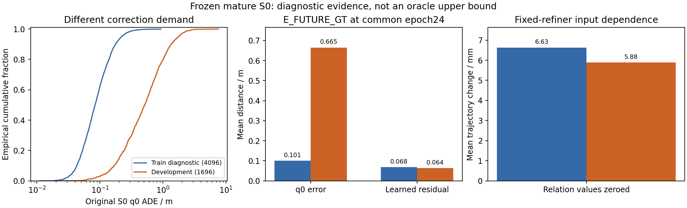
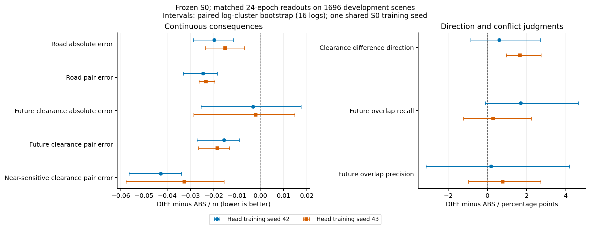
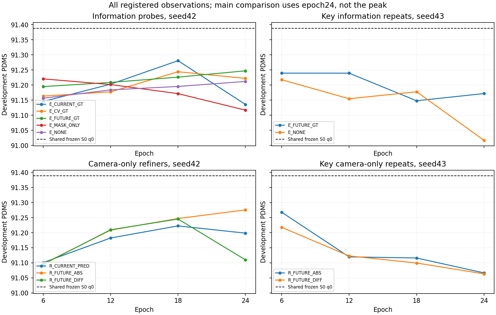
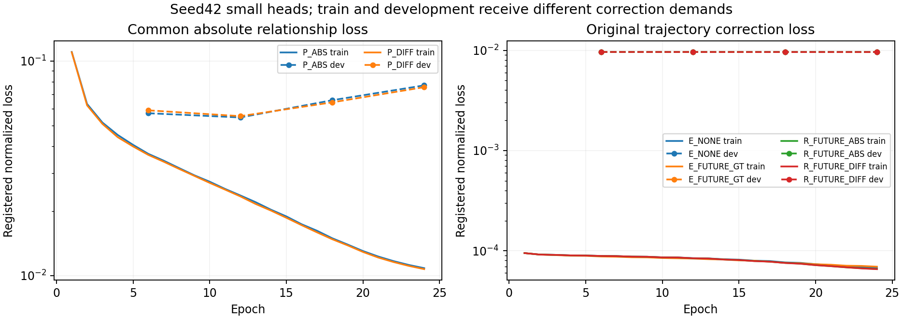
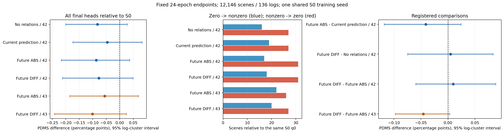

# 局部轨迹后果差异学习：实际结果与解释

本文整理本轮共同终点结果，不选择各组最佳 epoch。17个正式小头/关键复跑和4个条件两折读出训练均已完成24epoch，48次开发观察全部完成。最终六组Navtest、在线部署验证及逐场景汇总也已完成。全部结果为真实完整人口评价；关系误差收益未转成稳定规划净收益。

## 共同实验条件

所有组冻结原始 GT 训练的 S0 100k，同一个底座训练 seed。基础训练源码为 `1493deda247107efe076b9294863a6753391298a`，原生 checkpoint 指纹为 `78f870647015194798af067eefc8d8fedb6e59e6db2f3ae719c63b783871446f`。没有读取 r1/V12 或恢复暂停的大模型任务。共享 S0 历史成本为 483.481 GPU-hours，不计作本轮新增训练，但不能隐去。

正式小头使用完整 101592 训练场景、24 epoch、19056 optimizer updates、2438208 场景曝光；batch128、microbatch16、FP32、TF32关闭，AdamW 1e-4，一 epoch warmup 后 cosine。训练源码固定 `3c08240a20709b285966ce5b1dfd6d7d49be0d6c`；报告、诊断和部署检查的后续提交不替代这个身份。相同类型对照的初始化、数据顺序、两个场景绑定 proposal seed 及预算匹配。新增头 seed43 不是第二个独立 VLA 底座训练。

每场景一次冻结 S0 生成 H_A/W，原十步 DiT 生成唯一 q0。六个局部变体只用于关系查询，没有七次动作采样、scorer 选轨或 GT 驱动的修正开关。W/H_A 按已验证的 FP16 存储并在小头前转 FP32；在线同样执行该转换。q0 与底座推理保持 FP32。这不是所有中间特征都未经量化的 FP32 协议。实现、标签假设及有效参数差异见 [方法说明](METHOD_AND_IMPLEMENTATION_ZH.md)。

## E：真实未来信息的规划价值

以下是全部 1696 开发场景、16 logs、共同24epoch、canonical v1、proposal seed42 的 PDMS。三个 GT 关系模型和 mask-only 是特权探针，不能进入 camera-only 主表。

| 输出 | 信息类型 | PDMS |
|---|---|---:|
| 冻结 S0 q0 | 原相机策略 | 91.38836 |
| E_NONE | 普通相机策略修正器 | 91.21191 |
| E_CURRENT_GT | 特权当前几何 | 91.13560 |
| E_CV_GT | 特权当前状态恒速外推 | 91.22208 |
| E_FUTURE_GT | 特权日志真实未来 | 91.24709 |
| E_MASK_ONLY | 仅特权共同有效性 | 91.11675 |

E_FUTURE_GT−E_CV_GT 为 **+0.02501 个百分点**，按 log 聚类、保持场景权重的95%区间为 **[-0.00232,+0.09169]**，没有足够证据确认未来信息带来规划提升。两者零分转移均为0，未来组有一个 TTC 改善场景，NC/DAC相同。未来GT相对E_NONE为+0.03518个百分点，修复2个旧零分、引入1个新零分，仍低于原 q0。其余完整分项、双向失败转移、共同支持分组和6/12/18/24曲线在 [E终点证据](evidence/E_epoch24)。

这不是绝对 oracle 上界，更不是“未来信息无用”的结论。标签中确实存在额外信息：开发集共同支持上，真实未来相对 CV 的障碍间距绝对差均值为0.5134米；七条查询在422/1696场景存在几何重叠变化。但三源共同距离支持仅约23.55%，早期完整车身的距离支持尤其不足。真实未来指固定日志环境，不表示周车对替代ego计划的反事实响应。

修正器的输入分布和使用方式也是实测瓶颈。固定训练4096的 q0 ADE为0.10096米，开发为0.66509米；ADE超过0.5米的比例分别为0.269%和50.884%。E_FUTURE_GT在训练子集把ADE降到0.07049米，开发只降到0.66033米，平均开发残差约0.06429米。保留相同查询和有效性、仅将该模型关系数值置零，开发轨迹平均改变约0.00588米。它是输入依赖诊断，不能代替独立训练的E_NONE，但支持进一步检查“训练时修正需求过小、模型主要拟合小幅残差”的假设。不能通过放大残差或换GT输入临时改主实验。

新增头 seed43 的 E_NONE/E_FUTURE_GT 完整24epoch分别为91.01681/91.17174；未来GT相对普通修正器为+0.15493个百分点，95%区间[-0.08925,+0.31030]，修复6个零分并新增2个零分。两者也低于同一个 q0。seed43 没有另训 CV，因此不能将此复跑写成“未来超过CV的第二seed确认”。两次小头训练均未使特权未来修正超过原策略；这限定于本轮标签、修正器和残差训练分布。[第二seed证据](evidence/E_seed43_epoch24)

## P：绝对后果与差异后果学习

两个新增头训练 seed 均完成共同24epoch。下表为固定开发查询，距离单位米；重叠是派生几何标签，不是官方责任碰撞概率。

| 指标 | ABS42 | DIFF42 | ABS43 | DIFF43 |
|---|---:|---:|---:|---:|
| 道路余量绝对 MAE | 0.41640 | 0.39667 | 0.41444 | 0.39927 |
| 道路余量配对差异 MAE | 0.16338 | 0.13881 | 0.16165 | 0.13820 |
| 未来障碍间距绝对 MAE | 1.11556 | 1.11247 | 1.09520 | 1.09320 |
| 未来障碍间距配对差异 MAE | 0.29309 | 0.27754 | 0.29394 | 0.27548 |
| 近邻敏感对未来间距差异 MAE | 0.36168 | 0.31892 | 0.34381 | 0.31115 |
| 未来差异方向准确率 | 0.77620 | 0.78232 | 0.78366 | 0.80022 |
| 未来几何重叠 recall | 0.46001 | 0.47702 | 0.45060 | 0.45349 |
| 未来几何重叠 precision | 0.65414 | 0.65605 | 0.67663 | 0.68433 |

未来间距配对 MAE 的 DIFF−ABS 差值分别为−0.01555、−0.01846米，log-cluster95%区间分别为[-0.02718,−0.00901]、[-0.02652,−0.01316]米。近邻敏感对在两个seed也均改善。未来绝对间距改善的区间跨零；重叠召回和precision的区间也跨零。**连续局部后果差异的改善已复现，稳定的冲突判断改善还没有得到证明。**

1.5–1.9厘米是大量查询的平均误差变化，不是本方法获得了厘米级真实几何真值或控制精度。标签来自0.5米栅格及有限车身采样；非模糊方向和约束跨界指标单列，最后仍要由真实规划及失败转移检验其价值。

独立 query-only 的未来间距绝对/配对 MAE为2.03167/0.35400米，重叠recall仅0.03402。正常表示、置换W/H_A、固定训练均值表示均已评价，不能仅凭训练loss宣称场景理解。query-only不读取W/H_A，但它使用S0给出的q0，因此并非完全没有间接视觉信息；其视觉投影不参与计算，有效容量差异已披露。

seed42中，置换W/H_A使ABS/DIFF未来间距绝对MAE升到3.4450/3.4883米，固定训练均值表示为2.7565/2.7622米；预测器确实依赖场景表示。未来绝对误差随物理时间从0.5秒约1.07米增加到4秒约1.20米，DIFF没有消除较远时间的不确定性。横向变体的配对MAE由0.28942降到0.26644米，时间warp变体仅由0.29987降到0.29805米；这项描述性差异提示主要收益在空间对比，不能声称已解决何时通行的问题。主表关系误差按有效查询充分统计量汇总，同时保存有效人口、全场景和有支持场景指标；不以空标签场景的零loss掩盖支持缺口。

同支持比较中，学生未来预测在连续间距上优于它自己的当前保持预测，但仍逊于特权CV；对真实未来相对CV发生变化的查询，学生能恢复部分连续变化，却漏掉不少新重叠。该子集是按GT变化选择的，不能用其中CV的零召回证明学生独立击败了CV。两个seed的全体/逐时间/变化子集结果见 [P终点证据](evidence/P_epoch24)。

训练与开发差距明显，已按预登记条件完成两折读出复核：ABS/DIFF共同按1176个训练logs分折（52711/48881场景），四个小头各24epoch，再为固定4096场景逐一选取未见该log的预测器。每个场景只统计一次，不把两折输出当8192个独立样本。没有把开发集加入训练，也没有改变主R模型。

| 留出读出指标 | ABS | DIFF |
|---|---:|---:|
| 未来间距绝对 MAE / m | 1.09468 | 1.08422 |
| 未来间距配对 MAE / m | 0.28351 | 0.26450 |
| 未来几何重叠 recall | 0.48513 | 0.48151 |
| 未来几何重叠 precision | 0.68050 | 0.68490 |

配对MAE差值为−0.01901米，95%区间[-0.02095,−0.01711]，而重叠recall差值区间[-0.01069,+0.00333]跨零。差异监督的连续判断收益在留出logs仍存在，冲突漏检没有同步改善。留出预测的绝对误差和召回接近开发集，远差于训练内预测，说明R训练时接收了更准确的关系输入；这是实际输入分布风险。S0本身仍见过全部训练logs，每折小头只见半数人口；此结果不能称为完整VLA的out-of-fold，也不能纯粹分解过拟合。[完整OOF证据](evidence/OOF)

## D：距离局部性与决策敏感性

已有G1/G2/G3只读共同75k检查点，各自正常前向产生H_A/q0/Bt，再读取相同S0查询，未将S0表示灌入G的未来头。G3整体未来间距代理MAE比G2低0.09668米，但近邻敏感配对差异仅降低0.00408米，95%区间[-0.01928,+0.01973]米，证据不足。G3整体场误差改善不能直接推出关键动作区别更准确。

共同查询中近邻敏感1101对、近邻不敏感4861对，远处敏感仅37对。远近还混有横向/时间扰动类型差异，不能当作纯距离的因果比较。G3改变的是整体结构化监督查询分布；FGTR读取受监督塑造的Bt latent，不是道路/占用数值作为硬约束进入规划。G的间距来自固定占用阈值和EDT，本轮P直接预测间距，因此G与P的横排不能归因于单一监督变化。证据见 [G75k](evidence/G75k)。

## R：预测关系是否带来实际规划收益

全部共同24epoch、1696开发场景，S0 q0均为91.38836。修复/新增零分均相对同一个q0；oracle组不进入本表。

| 输出 | 新增头seed | PDMS | 相对q0 / pp | 修复旧零分 | 新增零分 |
|---|---:|---:|---:|---:|---:|
| E_NONE | 42 | 91.21191 | -0.17646 | 1 | 3 |
| R_CURRENT_PRED | 42 | 91.19848 | -0.18988 | 1 | 3 |
| R_FUTURE_ABS | 42 | 91.27557 | -0.11279 | 1 | 1 |
| R_FUTURE_DIFF | 42 | 91.10998 | -0.27838 | 1 | 4 |
| E_NONE | 43 | 91.01681 | -0.37155 | 1 | 7 |
| R_FUTURE_ABS | 43 | 91.06667 | -0.32169 | 0 | 5 |
| R_FUTURE_DIFF | 43 | 91.06348 | -0.32488 | 1 | 6 |

seed42未来ABS相对当前预测为+0.07709pp，95%区间[-0.07242,+0.20660]；修复2个当前预测组的零分且未新增零分，但有1个TTC下降场景，不能只看零分计数。DIFF相对ABS为-0.16559pp，区间[-0.35690,+0.03744]，没有修复零分，新增3个零分；三处DAC、一个TTC下降，NC无下降。DIFF相对E_NONE为-0.10193pp，区间[-0.35014,+0.10075]，修复2个并新增3个零分。

seed43的DIFF−ABS为-0.00319pp，区间[-0.16444,+0.17755]，修复1个且新增1个零分。DIFF相对同seed E_NONE为+0.04667pp，区间[-0.18392,+0.22336]；它仍低于原q0。**两次新增头训练都没有证明差异监督带来规划净收益；第一seed还出现额外道路退化。** 不能把区间跨零写成等效，也不能把P的局部误差收益直接写成驾驶改善。[seed42共同终点](evidence/ER_seed42_epoch24)、[seed43共同终点](evidence/ER_seed43_epoch24)

R_DIFF42的开发ADE由0.66509降到0.66151米，但FDE由1.40041升到1.40451米，PDMS同时下降。其平均残差0.06546米，关系数值置零平均只使轨迹变化0.00997米。学习更接近GT的平均小幅修正，并不保证边界附近安全。R_ABS42在原低进度43场景上提高约1.93pp，而原高分1242场景下降约0.23pp；完整动态进入、空间释放、静态障碍、道路边界及有效性分组见 [失败分组](evidence/physical_failure_groups)。组间可重叠，不作独立样本相加。R_DIFF42在同一高分组下降0.38406pp、引入3个零分；静止障碍邻域226场景下降0.65877pp。预登记案例抽样同时保留修复与退化：`fb2dd85945315007`从DAC=0、总分0变为DAC=1、83.03分；`1eb3057c64465de0`从100分变成DAC=0、总分0。后一例NC/TTC/Comfort仍为1，不能把道路退化误称责任碰撞。场景地图留在共享受控目录，仓库只存数值和选择清单。

## 学习曲线与共同终点

17份原生checkpoint已核验模型、optimizer、scheduler、RNG、完整数据顺序、曝光和连续19056个update记录。没有把中途暂停后的计数归零，未为DIFF换用更高的18epoch。4个OOF模型是额外的半训练人口读出诊断，另列成本和身份。

预测器训练绝对loss持续下降，开发loss在后期回升；修正器训练需求远小于开发需求，多个规划曲线后期退化。没有满足“相关头共同明显欠拟合”的延长条件，因此不自动扩展到32epoch。主表仍用预登记24epoch，不按峰值替换。

## 最终Navtest：全部六组完成

固定共同24epoch，六组各12146场景/136 logs，所有q0/q_final评分失败均为0；六份q0逐场景CSV字节完全相同，PDMS为89.527868，与历史锁定S0回放一致。最终执行仍为q_final，没有从q0与修正结果中选高分。

| 输出 | 新增头seed | PDMS | 相对S0 / pp | 修复旧零分 | 新增零分 |
|---|---:|---:|---:|---:|---:|
| 原S0 q0 | 共享底座 | 89.52787 | 0 | — | — |
| E_NONE | 42 | 89.44571 | -0.08216 | 16 | 27 |
| R_CURRENT_PRED | 42 | 89.48205 | -0.04582 | 19 | 27 |
| R_FUTURE_ABS | 42 | 89.44094 | -0.08693 | 17 | 31 |
| R_FUTURE_DIFF | 42 | 89.45057 | -0.07730 | 18 | 31 |
| R_FUTURE_ABS | 43 | 89.47232 | -0.05555 | 22 | 26 |
| R_FUTURE_DIFF | 43 | 89.42679 | -0.10107 | 20 | 27 |

三个seed42主要对比为：未来ABS−当前预测 **−0.04111pp**，95%区间[-0.11815,+0.02400]；DIFF−ABS **+0.00963pp**，区间[-0.05953,+0.08840]；DIFF−E_NONE **+0.00486pp**，区间[-0.07464,+0.08359]。seed43的DIFF−ABS为 **−0.04553pp**，区间[-0.09736,+0.00340]。新增头两seed没有稳定同向的规划收益，也没有超过普通修正容量的证据。所有最终头相对S0的均值为负，但对应95%区间均跨零；这不证明等效或普遍退化。

以下完整官方分项均乘100，保持各自定义，不与栅格重叠/道路SDF混称：

| 输出/头seed | NC | DAC | TTC | EP | Comfort | DDC |
|---|---:|---:|---:|---:|---:|---:|
| S0 q0 | 98.2340 | 97.5548 | 95.0848 | 83.6785 | 99.9918 | 98.4192 |
| E_NONE/42 | 98.2340 | 97.4642 | 95.0601 | 83.6323 | 99.9918 | 98.4357 |
| R_CURRENT_PRED/42 | 98.2216 | 97.5054 | 95.0601 | 83.6563 | 99.9918 | 98.4192 |
| R_FUTURE_ABS/42 | 98.2299 | 97.4477 | 95.0683 | 83.6186 | 99.9918 | 98.4233 |
| R_FUTURE_DIFF/42 | 98.2258 | 97.4560 | 95.0766 | 83.6259 | 99.9918 | 98.4233 |
| R_FUTURE_ABS/43 | 98.2463 | 97.5136 | 94.9695 | 83.7143 | 99.9918 | 98.4069 |
| R_FUTURE_DIFF/43 | 98.2463 | 97.4889 | 94.9119 | 83.6973 | 99.9918 | 98.4110 |

净失败不能由均分替代。DIFF42相对S0修复18个零分，却新增31个；相对ABS42修复10个并新增9个。DIFF43相对ABS43修复4个并新增7个，且有7个DAC下降、11个TTC下降场景。DIFF42/43各在原高分8929场景中引入20个新零分，高分组平均分别下降0.26997/0.31832pp。seed43中EP略增伴随TTC下降，不能用进度改善遮蔽安全分项。完整零/非零四种转移、低分组及分项变化在 [最终逐场景结果](evidence/Navtest_epoch24)。

动态进入/释放、静态障碍和道路边界的机制分组已在全部1696开发场景完成；最终Navtest只增加官方分项、基线高低分/零分转移与原生ego误差，没有为它重新生成环境oracle标签。不能把开发分组的支持人口当成Navtest人口。历史Navtest已被多轮研究观察；本轮仅在方法/终点冻结后统一跑这六组，没有用测试集选epoch或增加方法。

## 原生ego误差与部署代价

补充使用锁定NAVSIM的`Scene._build_ego_status`和`get_future_trajectory`读取原生GT，64个开发样本与既有训练ego标签对照最大差2.74e-6。NAVTEST所有12146场景保留；12110场景满足完整8步时间戳检查，36个不满足，其中5个没有任何有效未来点。ADE使用12141个有支持场景、每场景有效点均值；FDE使用12110个有效终点场景，所有组使用同一mask。它们不改变PDMS的12146分母，不能把缺支持的误差填0。

| 输出/头seed | ADE / m | FDE / m |
|---|---:|---:|
| S0 q0 | 0.849448 | 1.817764 |
| seed42_E_NONE | 0.843312 | 1.811981 |
| seed42_R_CURRENT_PRED | 0.843234 | 1.811477 |
| seed42_R_FUTURE_ABS | 0.843302 | 1.811516 |
| seed42_R_FUTURE_DIFF | 0.843481 | 1.811971 |
| seed43_R_FUTURE_ABS | 0.843411 | 1.811997 |
| seed43_R_FUTURE_DIFF | 0.843472 | 1.812165 |

ADE/FDE小幅改善并未转成PDMS收益，说明平均GT拟合不能替代规划边界检验。误差协议、136份原始log哈希和逐场景mask均已保存，不上传GT轨迹。

实际camera-only在线链路已完成六个正式权重各4场景的一致性检查，以及R_DIFF42的64场景无GT/cache文件访问运行；注册在线与缓存q0/q_final最大差均为0。64场景计算时延（剔除首场景）中位数 **1.04602秒**，包含一次S0、原10步proposal、局部query、P预测与R修正，**不含当前图像读取和冷加载**。整次64场景进程305.52秒，含权重恢复与加载；不能拿缓存小头导出的时延冒充部署时延。额外4场景实际hook确认visual/language/proposal各1次，R_DIFF峰值torch allocated约12.88GB、reserved约13.33GB；GPU上下文/系统占用不包含在这些值内。

## 成本、完成状态与结论边界

本轮17个完整人口小头/关键复跑、4个半人口两折读出、48次开发观察、两个P头第二seed、两个未来R第二seed、额外E_NONE/未来GT第二seed、G75k只读机制分析、六组最终Navtest及部署链路全部完成。没有恢复暂停的G/nuScenes研究，也没有联合微调大VLA。nuScenes只保留6步接口兼容性，未执行跨数据集新训练。

已记录新增 **71.4485 GPU进程小时**，在100小时登记上限内：完整训练S0紧凑表示提取39.3121；开发/诊断/初始提取2.5462；Navtest一次性表示4.9114；17个正式小头17.6004；两折读出与评价1.5424；G只读2.2991；其它关系/数值/部署/轨迹导出约3.2370。分项以 [成本逐收据账本](evidence/COST_FINAL_GPU.json) 为准，未计量的小额初始化/管理开销单列2小时预算余量，不伪称实测用量。进程墙钟可在同GPU重叠，不是功耗或精确物理GPU计费；共享S0历史483.4813小时另列。

六组最终Navtest调用过19张不同物理GPU，按各次空闲情况使用8/7、4/3、7/7卡分片；最多96个CPU评分worker。六组完整导出+评分从首次派发到末组结束 **661.99秒（11.03分钟）**，缓存小头导出1.11985 GPU进程小时；冻结S0的Navtest表示提取4.91136小时已经在上面单列。评分worker槽位墙钟合计12.8794小时，含等待推理，不是CPU忙时。标签worker墙钟合计33.2642小时也含依赖等待，不能视为纯几何计算核时。

紧凑训练表示63.30GB、完整Navtest表示约7.56GB；未保存全Qwen视觉DeepStack。两个临时RAM镜像各64.13GB已在所有消费者退出后释放，共享原件、原生恢复点与阶段权重保留。训练各头只用单GPU，batch128/micro16，未照搬大VLA八卡训练。

本轮能支持以下判断：

1. **真实未来具有超出当前/CV的局部信息，但其规划信息价值未被本修正器稳定实现。** 特权未来相对CV仅+0.02501pp开发，区间跨零；它不是绝对oracle上界。
2. **冻结当前表示能恢复部分环境关系，关键动态冲突仍容易漏检。** 场景置换显著变差；训练内、留出logs和开发的关系精度差距实测存在，不能据轻量读出失败否定当前观测本身的信息。
3. **局部后果差异监督改善连续配对误差，但还不足以改进执行。** 两新增头seed及两折留出均复现连续误差收益，重叠召回不稳定，R的Navtest提升既不稳定也未超过普通修正器。
4. **修正学习分布及信息使用方式是下一轮优先项。** 训练q0过于接近GT、开发需要更大纠偏；预测关系训练输入又过于准确，实际修正对关系值依赖较弱。它们是有证据的故障假设，尚未由单独因果控制完全分解，也不能倒推为全部历史C/S/G实验的统一因果解释。
5. **净收益没有证明安全不退化。** 所有最终头新增零分多于修复，尤其原高分道路边界误改；均分/小幅ADE改善不能单独放行新执行策略。

下一轮最小建议仅登记为建议，不自动启动：先对E_NONE与E_FUTURE_GT共同做一个纠偏输入分布控制（仅训练logs、固定真实模型proposal来源，明确数据曝光，检查是否覆盖开发所需误差尺度）；若未来GT价值由此显现，再对ABS/DIFF两组共同采用训练logs两折预测输入复核R接口。只有对应控制支持后，再讨论联合微调或新的辅助目标。当前不值得仅为等待分数上涨而延长同一小头配方。

本轮没有完成、也没有声称完成：第二个独立S0基础训练seed、完整基础模型OOF、使用OOF预测重新训练R、最终多proposal采样seed、nuScenes迁移或共同从头驾驶训练。它们均非此次自动扩展；冻结成熟底座的增量结果不能写成从头新方法超过基线。区间保持原场景权重按log聚类，不将scene×proposal或head seed充当独立底座复跑；未校正事后多重比较与历史测试复用。

部分机器可读汇总中的`not_yet_available`表示该表没有对应输入组，例如最终Navtest没有oracle组，并非自动排队追加这些测试。主要预登记E比较在开发集完成，camera-only最终比较在Navtest完成。
