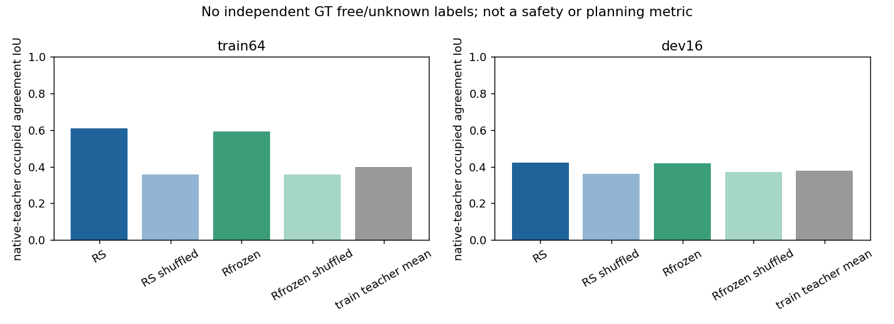

# S0 可解码空间／未来表征：实际执行结果

2026-10-19增量：同容量PCA压缩保真、训练内梯度校准、默认时间horizon核验与新学生状态见 [第二轮进展](CONTINUATION_V2_ZH.md)。下文保留首轮原结果，不用新压缩上界替换旧学生成绩。

截至 2026-10-18，本轮完成了真实 S0 身份核验、两个原生教师接口、空间压缩实验、两个 1000 步学生实验、固定独立开发日志解码、原 DiT 规划工程链路和去教师导出。**完整研究任务尚未完成；没有证据证明规划收益，也没有完成时间能力验收或正式矩阵。**

本轮分支 `research/decodable-spatiotemporal-internalization-20261018`。学生实际训练源码为 `629e0f1fe15d9bb9c2a44e862defe753720895f0`；原 S0 为 `1493deda247107efe076b9294863a6753391298a`。归档提交不替代执行身份，详见 [SOURCE_VERSIONS.json](SOURCE_VERSIONS.json)。旧工作树、训练、检查点与负结果保持不变。

## 得到了什么结果

以下是**与原生 ViGT 预测的一致性**，不是独立 GT 占用质量。两学生使用同一 64 个训练场景、相同初始化规则、1000 次单场景更新、FP32、同一损失和 seed42。开发诊断预先取原开发集每个 log 一个场景，共 16 场景；未用开发数据拟合特征均值或训练。

| 共同终点 | train64 IoU | dev16 IoU | dev16 教师占用漏检率 |
|---|---:|---:|---:|
| 冻结 Qwen，同容量读出 | 59.240% | 41.836% | 50.936% |
| 后8层 LoRA + 读出 | 60.928% | 42.328% | 50.904% |
| 训练教师均值 | 39.975% | 37.751% | 56.218% |

LoRA 相对冻结版本 dev16 IoU +0.491 个百分点；按 log 配对 bootstrap 95% 区间为 [-0.234,+1.191] 个百分点。证据不足以认定 LoRA 内化带来了稳定额外能力。两版本训练到开发均明显下降；固定图像面板显示输出偏平滑、细边界缺失，不能只凭总体 IoU 高于常量宣称已学会几何。

压缩实验进一步指出当前 16×16 双线性重建本身损失较大：教师 context 经同型瓶颈后的 IoU 一致性只有 73.55%。两次有限扩容后，32×32 patch 重建的干净源码复跑为 91.63%，边界区域为 74.67%。这些没有达到登记的严格教师保真代理线；也不是已经计算了用户要求的 GT 相对质量保护线。

## 状态不能混用

| 项目 | 状态 | 已有证据／缺口 |
|---|---|---|
| S0 身份与旧路径兼容 | PASS | 同批原 action hidden/轨迹最大差0；真实 batch1/2/4 |
| 原生教师拆分接口 | PASS | ViGT/SGDrive 各64真实场景 round-trip 最大差0；固定头输入可反传 |
| 工程整体验收 | INCONCLUSIVE | 真实2卡连续4步/独立2+2恢复、独立导出已跑；多阶段长程恢复、正式阶段仍未完成 |
| 空间教师目标域能力 | INCONCLUSIVE | 缺独立 observed-free/unknown 与高度原点核验 |
| 时间 native 能力 | INCONCLUSIVE | 接口可用；物理 horizon、原标签口径与预测前缀分布限制未解决 |
| 时间 driving 教师 | BLOCKED | 原任务含 GT 走廊裁剪/缺点置空，尚无可靠适配标签 |
| 空间学生能力 | INCONCLUSIVE | 已完成真实 tiny 及 dev16；细节和泛化证据不足 |
| 时间学生 | NOT_RUN | 未越过教师验收 |
| 正式 P2/P3／规划收益 | BLOCKED / NOT_RUN | 未运行正式表征、规划矩阵和3训练seed |
| 去教师部署 | PASS（有限范围） | 2步 reader 工程模型与1000步无reader空间模型均独立验证、差0 |

8 场景、1 log 的 canonical 工程检查为 q0 88.465 → q_final 88.200，未出现零分转换。这只验证两步 reader 的训练／导出／评分链，**不是本轮方法的效能实验**，不能据此断言方向有效或无效。正式 Navtest 没有运行。

## 主要问题与下一步

第一优先是标签与任务合同：合并 LiDAR 中有五个 sensor_id，但 identity lidar2ego 不能代替各发射器真实原点，不能把没有回波的区域造为 free；ViGT 原生高度原点仍需核验。SGDrive 发布资产未确定真实未来 horizon，原轨迹走廊二分类占用不能直接变成统一 ego(t0) 的可靠未来状态。

第二是压缩和学习：256 query 的重建丢细节；有限容量测试改善了保真，但没有通过验收。原配方中新 decode 梯度曾明显压过 DINO，应在训练内部校准后再冻结正式配方。当前数据不能区分更充分优化、空间读出容量和标签可观测性的全部影响。

下一次最小工作应先补有来源的坐标／射线语义，完成空间教师的独立质量和已有容量映射验证；时间侧只做一个明确 horizon 的 head 适配与 persistence 比较。通过后才能补全并验收全人口 P2/P3 训练器，执行 R0/RS/RT/RST；不自动增加教师、扩大网格或用 Navtest 搜索。

## 证据入口

- [基线审计](BASELINE_AUDIT.md)、[去路径的基线配置/token清单](BASELINE_IDENTITY.json)、[教师审计](TEACHER_AUDIT.md)、[数据坐标审计](DATA_COORDINATE_AUDIT.md)
- [实现与差异](METHOD_AND_IMPLEMENTATION.md)、[tiny实验](TINY_FIT_REPORT.md)、[表征结论](REPRESENTATION_REPORT.md)
- [规划工程检查](PLANNING_REPORT.md)、[独立部署](DEPLOYMENT_REPORT.md)、[测试范围](VALIDATION.md)
- [成本与资源收尾](RESOURCE_CLOSURE.md)、[实际命令与恢复](COMMANDS.md)
- [数值总表](RESULTS.json)、[证据哈希](EVIDENCE_SHA256.json)、[来源锁](external_sources.lock.json)

RGB 和场景面板只留受控共享存储。本目录提交数值、非场景曲线和可视化索引，不含权重、私有原图或大缓存。所有本轮已登记 GPU 任务正常结束，没有后台续训／恢复队列；没有恢复压力脚本。
