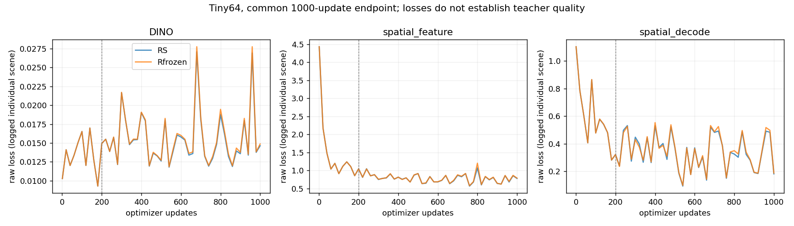

# 真实 tiny-fit 与容量实验

所有场景来自原训练划分。容量实验48训练logs/16留出训练logs；学生实验固定64训练logs，每个log一个场景。独立开发诊断另外取16个开发logs各一个场景。共同终点固定1000 updates，不按开发结果选 checkpoint。

## 原教师经瓶颈重建

| 映射 | teacher-agreement IoU | 教师占用漏检率 | 说明 |
|---|---:|---:|---|
| 16×16 pooling/投影/卷积/双线性 | 73.552% | 17.368% | 与初始学生相同重建映射 |
| 32×32 同类映射 | 82.698% | 9.812% | 第一次容量扩展 |
| 32×32 patch 映射 v1 | 91.208% | 4.890% | 第二次扩展；执行源码 overlay 身份单列 |
| 同 patch、冻结干净源码 v2 | 91.630% | 3.709% | 同seed/同容量复跑，非新训练seed |

v2 近场0–15m IoU88.635%，远场15–40m92.935%，教师低置信边界区74.665%。边界区是原生 logit绝对值<2，不是精确 GT 距离边界。区域指标里的 `unknown` 计数实际是区域筛选之外的样本，不能解释为已核验传感器 unknown。

压缩只用训练48场景拟合特征标准差、均值和映射。v2 训练1000单场景updates；没有依据Navtest扩容。32×32 patch 尚未接成经过训练的学生版本。学生下面两组仍是256 queries/16×16初始结构，不能把91.63%写成图像学生能力。

严格教师一致性代理采用IoU≥99%、教师占用漏检≤0.5%；四次执行均未达到。独立GT质量尚未建立，不能把代理FAIL说成“GT IoU下降超1pp已证实”，也不能说不存在更好的压缩学习解。

## 两个真实图像学生

两组 FP32、TF32关闭、global scene batch1、AdamW1e-4/weight_decay.001/clip1；200步warmup，同一预登记scheduler、同一seed42/数据顺序。DINO1、空间标准化feature .1、native soft-logit BCE .1。新readout只读Qwen尾部query，无第二视觉backbone。原视觉/DiT/ego/DINO head冻结。

Rfrozen 训练新query/readout，5,907,200可训练参数。RS额外在200步后开启Qwen后8层attention LoRA rank32，共9,577,216可训练参数。LoRA并不是第一步就全部更新；第203步64个LoRA矩阵已获得非零有限梯度。两组native decoder参数/buffers均未改变。

| 指标 | Rfrozen train64 | RS train64 | Rfrozen dev16 | RS dev16 |
|---|---:|---:|---:|---:|
| 教师占用一致性 IoU | .592400 | .609278 | .418361 | .423275 |
| precision | .842894 | .845395 | .739585 | .754324 |
| 教师占用 recall | .665930 | .685679 | .490637 | .490957 |
| 场景置换学生 IoU | .357788 | .356477 | .370538 | .362423 |
| 训练教师均值 IoU | .399748 | .399748 | .377513 | .377513 |
| 当前DINO MSE | .014981 | .014708 | .016836 | .016865 |

**上述任务仍只衡量教师协议下的迁移。** 没有可靠free/unknown标签，不声称是GT IoU或已校准碰撞概率。零context会导致几乎全occupied，虽漏检低但大量假阳性，故不能只按漏检判优。

RS−Rfrozen dev16 IoU差.004914，log簇bootstrap区间[-.002337,.011914]。16个scene/16logs是小诊断人口，不能代替完整1696开发集；两个新增头共享同一成熟S0，只用seed42，不能解释为跨VLA训练稳定性。

## 学习、可视化和副作用

曲线为固定间隔记录的当次场景raw loss，不是全训练集均值。没有为图形平滑丢失败点。恢复时update/scene曝光连续，没有把重复epoch当额外独立场景。

固定32个真实训练场景已生成 RGB/native teacher/frozen-Qwen/LoRA/error 的0.5m/1.5m原生高度切片。图像只留受控存储，哈希见PRIVATE_VISUALIZATION_INDEX。首个固定案例显示两个学生均过度平滑，遗漏细边界与小片占用；这个观察与压缩边界指标一致，但不能只凭该案例概括全分布。

无reader情况下，Rfrozen前8训练/前8开发场景轨迹与S0严格相同。RS相同噪声下平均xy点位改变量：train8为0.00718m，dev8为0.00925m；开发最大单分量差0.04980。量小不等于官方评分绝不退化。原始JSON字段名保留`train8`，开发报告实际人口是dev8，已在总表中说明。

损失尺度尚需修复：第201步共享query/LoRA梯度范数DINO .00425、feature .01645、decode .11159；第203步为.00350/.00893/.01700。没有事后修改权重掩盖不平衡。当前训练未证明充分拟合全部几何细节，因此不承接全量P2，也不把负结果解释为当前图像无法学习。
