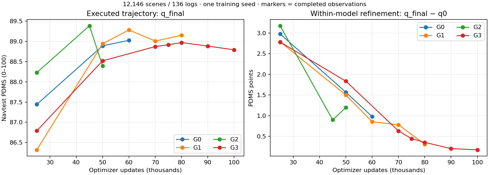

# 当前实验结果汇总：G 系列、nuScenes 与历史 C/S/A/V

**截至 2026-10-13 09:41 UTC，已有18个完整 G 系列 Navtest 权重；NAVSIM 仅 G3 完成100k，nuScenes 仅 G3 完成24 epoch。当前结果支持“NAVSIM模型内部轨迹修正确实改善 q0”，尚不支持“新增未来监督、事件目标和规划局部采样带来稳定的额外规划收益”。**

本快照汇总真实已完成结果，不启动训练或评测。最新完整 Navtest 是 G0 60k，于2026-10-13 06:49:44 UTC完成。训练日志采集时点为09:41 UTC；进行中的训练会继续变化。结果归档提交与实际训练源码分别登记。

## 1. 最新与已观察最佳权重

所有 G 组 Navtest 均为12,146场景、136个log；q0与q_final均无评分失败。PDMS及其分项采用0–100标度，主结果为最终执行轨迹q_final。

| 组 | 最新已评步数/k | q0 PDMS | q_final PDMS | 最终零分场景 | 最佳已评步数/k | 最佳 q_final PDMS |
|---|---|---|---|---|---|---|
| G0 | 60 | 88.0481 | 89.0247 | 543 | 60 | 89.0247 |
| G1 | 80 | 88.8408 | 89.1511 | 549 | 60 | 89.2823 |
| G2 | 50 | 87.1948 | 88.3943 | 635 | 45 | 89.3858 |
| G3 | 100 | 88.6159 | 88.7913 | 588 | 80 | 88.9706 |

“最佳”是各组已完成观察点中的事后最高分，不是所有训练步的最优值，也不是共同终点。G2目前最佳45k高于其它G组已观察最佳，但其50k明显回落；不能据此宣称事件目标整体获胜。G3完成100k后为88.7913，低于自身80k的88.9706。



圆点对应真实完成的观察点，连线只帮助阅读；没有用插值补出缺失成绩。G3 60k缺少可用的精确原生/导出权重，未补造结果；45k/75k是已发生的额外或早期观察点。

## 2. 共同训练步数：真正可比较的监督差异

共同50k的完整规划分项如下。NC=无责任碰撞，DAC=可行驶区域合规，TTC=规定界限内的碰撞时间项，EP=进度，DDC=行驶方向合规；均为锁定canonical evaluator的原指标。

| 组 | PDMS | NC | DAC | TTC | EP | 舒适度 | DDC | 零分场景 |
|---|---|---|---|---|---|---|---|---|
| G0 | 88.8899 | 98.1228 | 96.9373 | 95.0766 | 83.0628 | 100.0000 | 98.4233 | 588 |
| G1 | 88.9409 | 97.9993 | 97.2419 | 94.7719 | 83.0999 | 100.0000 | 98.5016 | 567 |
| G2 | 88.3943 | 98.0652 | 96.5915 | 94.8213 | 82.5461 | 100.0000 | 98.4028 | 635 |
| G3 | 88.5195 | 98.1764 | 96.5832 | 94.8954 | 82.7791 | 99.9918 | 98.4398 | 625 |

配对差值使用同一场景人口，以136个log聚类bootstrap 20,000次，保留实际场景权重。以下是未作多重比较校正的探索性95%区间；只有一个训练seed，不能替代第二次独立训练。

| 比较（q_final） | PDMS差值 | log聚类95%区间 | 修复基线零分 | 新增零分 |
|---|---|---|---|---|
| G1−G0 @25k | -1.1238 | [-2.1221, -0.2258] | 270 | 409 |
| G2−G1 @25k | +1.9084 | [1.2969, 2.5987] | 420 | 153 |
| G3−G2 @25k | -1.4376 | [-2.0053, -0.9213] | 157 | 340 |
| G1−G0 @50k | +0.0510 | [-0.3179, 0.4106] | 180 | 159 |
| G2−G1 @50k | -0.5467 | [-0.9153, -0.2030] | 155 | 223 |
| G3−G2 @50k | +0.1253 | [-0.2932, 0.5148] | 191 | 181 |
| G3−G1 @50k | -0.4214 | [-0.8941, -0.0066] | 160 | 218 |
| G1−G0 @60k | +0.2575 | [-0.0414, 0.5767] | 151 | 122 |
| G3−G1 @70k | -0.1372 | [-0.4357, 0.1606] | 140 | 149 |
| G3−G1 @80k | -0.1805 | [-0.4978, 0.1210] | 117 | 136 |

- **未来标签（G1−G0）：** 25k为负，50k接近零，60k为+0.2575但区间跨零。现有结果未显示稳定额外收益，也说明不能只用早期25k否定该方向。
- **事件组织（G2−G1）：** 25k为正，50k转负。优化历程和状态稳定性仍是问题，不能只挑一个有利观察点归因。
- **局部采样（G3−G2）：** 50k为+0.1253，区间跨零，尚未证明局部监督优于均匀监督。
- **完整监督设计（G3−G1）：** 50k为负，区间上界接近零；70k/80k仍小幅为负且区间跨零。现有证据不支持稳定优于一般未来占用监督。

本汇总每个比较独立重置bootstrap seed42，避免比较列表顺序影响重采样。旧报告及旧区间保持原样；相同均值对应的区间末位可能因抽样序列不同略有变化。所有比较原始精度与失败分项见[配对统计](data/PAIRED_COMPARISONS.json)。

## 3. 修正是否有效，以及长训中的退化

同一模型的q_final相对q0：

| 观察点 | PDMS提升 | log聚类95%区间 | 修复q0零分 | 新增零分 |
|---|---|---|---|---|
| G0 60k | +0.9767 | [0.7077, 1.2819] | 153 | 28 |
| G1 80k | +0.3102 | [0.1754, 0.4608] | 51 | 15 |
| G2 50k | +1.1994 | [0.8630, 1.5555] | 199 | 60 |
| G3 100k | +0.1754 | [0.0769, 0.2744] | 34 | 10 |

修正总体有效，但G0本身也有明显收益；这不能证明未来标签是收益来源。同一模型q0不是独立训练的原DDP baseline。

几个需要保留的退化与波动：

| 同组比较 | PDMS差值 | log聚类95%区间 | 修复旧零分 | 新增零分 |
|---|---|---|---|---|
| G0 60k−50k | +0.1348 | [-0.1729, 0.4329] | 154 | 109 |
| G1 80k−60k | -0.1312 | [-0.5169, 0.2435] | 92 | 127 |
| G2 50k−45k | -0.9915 | [-1.3331, -0.6433] | 86 | 213 |
| G3 100k−80k | -0.1793 | [-0.3400, -0.0202] | 35 | 55 |
| G3 100k−50k | +0.2717 | [-0.1071, 0.6857] | 156 | 119 |

G2 45k→50k零分场景508→635，修复86个、引入213个；其q0也从88.4864降到87.1948，不能把全部退化归咎于最后一次FGTR修正。G3 80k→100k下降0.1793，零分568→588，现有单seed未显示后20k带来收益；它已经完成预登记100k，本次没有延长或重启。

G0/G1/G2尚未完成共同终点。应先区分可重复的优化/实现问题和检查点波动；现有证据不足以宣布整个结构化监督方向无效。本次整理没有据此停止正在运行的任务。

## 4. 与历史 C/S/A/V 的关系

以下为历史各组已评权重中的最佳Navtest结果，复用[2026-10-08完整归档](../20261008/README.md)，不改写旧数据。相同名称的r1目标实验单列在CSV中，不与原始S系列混为一组。

| 系列/组 | 最佳步数/k | PDMS | 零分场景 |
|---|---|---|---|
| planning_interface/A_ACTION | 100 | 89.0933 | 551 |
| planning_interface/A_NO_MAE | 100 | 89.4826 | 494 |
| original/C0 | 100 | 89.1512 | 545 |
| original/C1 | 100 | 89.2395 | 540 |
| original/C4 | 100 | 89.2776 | 525 |
| original/S0 | 100 | 89.5279 | 500 |
| original/S1 | 100 | 89.3411 | 529 |
| original/S2 | 100 | 89.3365 | 524 |
| original/S3 | 100 | 89.4082 | 516 |
| original/S4 | 100 | 89.1293 | 550 |
| planning_interface/V_QUERY | 100 | 89.5320 | 496 |

A_W复用S0，V_NONE复用S2，V_MEMORY复用S3；它们不是独立训练seed。历史S0为89.5279，V_QUERY为89.5320，差异很小；旧辅助任务也没有形成稳定、广泛的规划提升，详细配对结论保留在历史归档。

同为50k的历史参照是S0 **88.2431**、S3 **88.5037**：G0/G1/G2/G3相对S0分别高0.6468/0.6978/0.1512/0.2764分。但新G系列增加几何分支、Bt和FGTR，并改变训练计算成本，这属于整套配方对比，不能全部归因于新监督。

同为100k，已完成的G3 **88.7913**低于S0 **89.5279**（−0.7366），也低于S3 **89.4082**（−0.6169）。当前所有G组已观察最佳也尚未超过原S0，但各组训练终点、观察次数不齐；不能用最佳对最佳替代共同终点结论。

旧r1/V12与优化轨迹目标研究保持原状态；本次没有恢复。完整历史中间权重见[88条历史Navtest记录](../20261008/data/navtest_checkpoints.csv)，历史最佳及r1独立记录见[合并最佳表](data/HISTORICAL_BEST.csv)。

## 5. nuScenes：24 epoch结果与未完成对照

有效训练样本23,230，官方val覆盖150场景/4,969个有效样本。六个当前相机、3秒六点；两组使用相同合法历史/当前传感器位姿运动状态和VAD式高层导航。导航意图由日志未来构造，作为共同协议条件披露；没有输入精确未来坐标。

24 epoch来自本轮用户预登记范围，**不是照搬某篇论文**。global batch32、FM repeat8、每epoch726更新，共17,424更新、557,520次训练曝光；另有共同几何准备阶段。与他人工作比较需同时核对ego状态、导航、时域归约、碰撞实现和训练预算，不能仅凭平均L2横排。[已有外部对比分析](../../structured_world/round1_20261008/NUSCENES_EXTERNAL_COMPARISON_20261010.md)和[训练预算核对](../../structured_world/round1_20261008/NUSCENES_TRAINING_BUDGET_20261010.md)保持其日期与来源。

主表采用锁定UniAD-v2.0-style开环协议：先平均前2/4/6个点得到1/2/3秒指标，再平均三个时域。L2单位米，box collision单位百分比，均越低越好。

| 组 | epoch | q0平均L2/m | q_final平均L2/m | q0平均box collision/% | q_final平均box collision/% |
|---|---|---|---|---|---|
| G1 | 6 | 0.7036 | 0.6652 | 0.8184 | 0.4813 |
| G3 | 6 | 0.6744 | 0.6906 | 0.9140 | 0.7614 |
| G3 | 12 | 0.6127 | 0.6157 | 0.7949 | 0.7357 |
| G3 | 18 | 0.5871 | 0.5836 | 0.5976 | 0.5484 |
| G3 | 24 | 0.5877 | 0.5848 | 0.3466 | 0.2516 |

G3 24e相对18e的L2基本持平（0.5836→0.5848），box collision继续下降（0.5484%→0.2516%）；相对自身q0，24e的平均L2改善约0.00284m。**G1只有6e完整评价，没有24e结果，因此无法形成同终点G3−G1结论。** 在双方都有的6e，G3的L2及碰撞均差于G1，不能省略这个早期负结果。

G3 24e的两种时间归约必须分开：

| 时间归约 | 1s L2/m | 2s L2/m | 3s L2/m | 三时域平均L2/m | 平均box collision/% |
|---|---|---|---|---|---|
| prefix | 0.2708 | 0.5506 | 0.9330 | 0.5848 | 0.2516 |
| endpoint | 0.3729 | 1.0104 | 1.9498 | 1.1110 | 0.5836 |

评价保持原GT自身碰撞排除规则、全部合格样本分母、固定轴对齐车身栅格与原类别映射；类别包括机动车/自行车/摩托车，不与旧MAE的“其他汽车”混称。时间归约一致不代表整套ST-P3/VAD/UniAD协议完全一致。该结果是开环规划研究指标，不是官方闭环挑战或闭环安全证据。

## 6. 场景监督学到了什么

[场景监督汇总](data/SCENE_SUPERVISION.json)保留8个已完成观察：NAVSIM G1 25k、G3 25k/50k的历史**开发集**；nuScenes G1 6e与G3 6/12/18/24e的val。没有把历史dev指标改名为Navtest，也没有本次新增开发集评测。NAVSIM共同100k的场景指标与机制探针尚未齐。

nuScenes G3 24e，在标签有效的全局cell上：道路距离MAE **1.0679m**，道路边界MAE **0.9062m**，当前占用IoU **0.5139**，未来占用IoU **0.3930**；进入事件precision/recall **0.2683/0.3298**，释放事件 **0.3912/0.5578**；静止track栅格保持recall **0.7224**。这些结果说明网络学习到了场景结构，但动态进入仍有大量漏检，不能用总体IoU直接证明规划关键区域可靠。

固定GT车身邻域共89,442个注册查询，只有43,487个道路关系有效、14,866个占用关系有效；对应MAE为0.4755m和0.05638。未知/无效区域不能当空闲，低有效覆盖限制了这些统计的解释范围。可见性分组来自相机标定/ROI几何支持代理，不是真实遮挡标注。占用/车身重叠是代理量，不是官方责任碰撞概率；SDF、占用及事件均为派生标签。

## 7. 方法与执行的准确表述

| 组 | 未来监督 | 结构化监督的查询分布 |
|---|---|---|
| G0_NO_FUTURE_LABEL | 关闭未来标签，Bt仍由最终轨迹loss训练 | 共同结构保留；不是原生Action-Only |
| G1_FULL_UNIFORM | 完整未来占用 | K=1024全局均匀 |
| G2_EVENT_UNIFORM | 条件进入/释放 | K=1024全局均匀 |
| G3_EVENT_LOCAL | 同G2 | 50% q0完整车身邻域、25%边界/事件、25%全局 |

G3的同一`sample_queries`同时作用于道路、当前占用、未来语义和车身关系，所以准确名称是 **planning-local sampling for structured scene supervision**，并非“只将未来监督局部化”。

结构化监督塑造Bt，FGTR读取同一Bt latent进行一次轨迹修正；`scene_semantics`在部署删除，没有把道路/占用数值作为硬约束直接输入执行规划。q0始终来自独立噪声开始的原10步FM采样并detach；修正梯度通过H_A/Bt/FGTR回传，不穿过q0采样链。这是既有方法合同。

正式任务仍为 **io_preserving_v1**。已有完整P0候选约2.85s/update，相对参考约3.20–3.27s有吞吐收益，但原E2完整梯度验收未通过；G1 +500步比较也尚不构成无损规划验收。保守host-only、全量视觉缓存及8→16卡方案没有完整GPU/效果证据可登记为已采用。不能把“代码已实现”“前向一致”写成“训练效果无损”。详见[执行验收状态](../../structured_world/execution_20261012/NO_REGRESSION_HOST_FAST_AND_16GPU_ZH.md)。

## 8. 六组训练、恢复与成本状态

| 数据集 | 组 | 最后日志更新 / 终点 | 完整保存边界 | 已曝光epoch | 状态 |
|---|---|---|---|---|---|
| navsim | G0 | 63,526 / 100,000 | 60,000 | 20.01 | 训练中 |
| navsim | G1 | 80,284 / 100,000 | 80,000 | 25.29 | 已恢复，重跑未保存段 |
| navsim | G2 | 55,734 / 100,000 | 55,000 | 17.55 | 训练中 |
| navsim | G3 | 100,000 / 100,000 | 100,000 | 31.50 | 已完成 |
| nuscenes | G1 | 6,647 / 17,424 | 6,000 | 9.16 | 未完成，暂缓 |
| nuscenes | G3 | 17,424 / 17,424 | 17,424 | 24.00 | 已完成 |

G1在源进程中断前记录到84,873，最近完整保存是80,000。已在vla-zt恢复模型/BN、FP32 master、Adam、scheduler、全部rank RNG和数据位置；**4,873个未保存更新必须重跑**。旧日志保留，按显式字节段选择新进度，不能取全文件最大step，也不能把两段重复曝光相加成新模型进度。恢复验证与回滚路径见[G1迁移记录](../../structured_world/execution_20261013/G1_migration_vla_zt_20261013T0850Z/MIGRATION_VERIFIED.json)。

最新策略禁止继续使用vlawm-zt、vlawm-zt2、vlawm-zt3、vlawm-zt5；历史结果中的主机名仅为历史执行证据。本次只读取共享存储，不向这些机器派发任务。当前G0在rl-zt2、G1在vla-zt、G2在vlawm-zt4；nuScenes G1暂缓。

以下是原训练日志计数器和各run最后32条记录，不是独占设备的性能A/B。已结束或暂缓任务的尾部时间也是其历史时间，不能当当前负载。

| 数据集/组 | 有效谱系曝光 | 日志GPU-hours | 尾部中位s/update | 尾部P90 s/update |
|---|---|---|---|---|
| navsim/G0 | 2,032,672 | 457.86 | 9.087 | 9.717 |
| navsim/G1 | 2,568,888 | 586.07 | 7.261 | 9.084 |
| navsim/G2 | 1,783,352 | 411.56 | 3.225 | 3.398 |
| navsim/G3 | 3,199,752 | 708.67 | 3.116 | 3.168 |
| nuscenes/G1 | 212,686 | 67.41 | 4.582 | 4.628 |
| nuscenes/G3 | 557,520 | 174.23 | 4.495 | 4.537 |

G1与既有IQE缓存生产任务共享GPU；其当前时间不代表模型独占吞吐。本次没有诊断G0当前约9s/update的具体原因，不能凭该尾窗宣称算法本身变慢。GPU-hours计数会随原生检查点恢复，不包含标签/共同准备、工程pilot、评分及所有中断废弃计算；**不能把表内数字求和作为项目总账单**。

近期完整Navtest实际成本：

| 权重 | 当次物理GPU | 登记到完整校验/min | 推理进程GPU-hours | 峰值allocated/reserved GiB |
|---|---:|---:|---:|---:|
| G1 80k | 26 | 17.637 | 5.726 | 12.548 / 13.078 |
| G2 50k | 26 | 17.557 | 5.670 | 12.548 / 13.078 |
| G0 60k | 11 | 47.790 | 7.809 | 12.548 / 13.078 |

GPU分片并行推理与CPU评分重叠；资源动态选择、主动限速为0。推理GPU-hours不含CPU模型加载和前期原生恢复，也不代表独占GPU账单；共享训练影响另计。原始定义见[26卡两组成本](../../structured_world/execution_20261013/navtest_parallel_20261013T0406Z/COSTS.json)与[G0 60k执行记录](../../structured_world/execution_20261013/navtest_g0_60k_20261013T0647Z/EXECUTION.json)。

## 9. 能支持的结论与待完成项

现有证据支持：完整模型已经真实训练并完成大规模canonical评价；FGTR修正对同模型q0有增益；场景标签可以被学习；G3后期与G2部分观察点存在退化，辅助loss降低或模型更复杂不自动转化为更好规划。

尚不能支持：未来标签稳定优于G0；事件组织稳定优于完整未来占用；局部采样稳定优于全局；跨数据来源的同终点G3−G1优势；第二训练seed的稳定性；无损快速执行或16卡更低GPU成本。

下一步最小证据是现有G0/G1/G2共同100k终点及其固定评测、nuScenes恢复研究时的G1同24e对照，再根据结果决定关键第二训练seed。机制控制仍包括同容量当前场景修正器、仅GT几何正则、不用语言/action表示，以及旧DINO/MAE互补性。它们是待决策研究，不在本次归档中自动启动。

用户要求中间权重直接评Navtest，且50k之后每10k观察；因此本轮Navtest已被反复观察，不能作为完全未触碰的最终holdout。最佳权重和多次差值均有选择偏差。所有G结果是训练seed42，采样seed或log bootstrap不能改称多训练seed。

## 10. 数据、身份与复核

- [NAVSIM全部36条轨迹结果](data/NAVSIM_NAVTEST.csv)：18个权重的q0/q_final、完整分项、零分与完成时间。
- [nuScenes全部结果](data/NUSCENES_PLANNING.csv)：5个权重、q0/q_final、prefix与endpoint分列。
- [六组训练状态](data/TRAINING_STATUS.csv)、[场景监督与协议](data/SCENE_SUPERVISION.json)、[配对与失败转移](data/PAIRED_COMPARISONS.json)。
- [来源与配置](data/SOURCE_VERSIONS.json)：原生run identity、数据/标签/DINO/几何初始化、配置、源码、外部模块锁定、评价与检查点收据hash、日志前缀及G1续写边界。
- [快照manifest](data/MANIFEST.json)：导出时间、输出hash和验证范围；[输入登记](SNAPSHOT_INPUTS.json)；[只读导出脚本](../../../tools/structured_world/export_results_summary.py)。

NAVSIM实际训练及模型评价源码为`0c54f1c49e7ed2a76b22826b654d6c72625f5b6d`；nuScenes训练源为`41da7c198cf0ac4f799aee2a27a0a8126de30230`，评价实现由其原生identity及锁定UniAD commit记录。报告在`perf/structured-world-fgtr-execution-20261011`分支，基于`d89f33a26ace855b8668bafaec7b7b066db0df48`整理；训练身份不因本次归档提交改变。

NAVSIM保持原生FP32 master恢复、FP32推理、TF32关闭、原10步FM、单候选、scene绑定seed42。导出重新核验了36份评分CSV的hash、唯一人口、136个log、均值、零分及跨权重人口一致性；不加载大权重。nuScenes验证原完成文件hash及既有归约一致性，最大归约浮点差1.412e-9，沿用既有导出器1e-7容差，未修改评价器或旧结果。

以下命令仅重新整理共享存储中已有结果；不派发GPU任务。必须使用新输出目录，队列完成数量变化时需另存新的输入登记。

```bash
python -B tools/structured_world/export_results_summary.py \
  --inputs reports/experiment_results/20261013/SNAPSHOT_INPUTS.json \
  --output /mnt/project/experiment-results-recheck-20261013
```

本次提交仅包括汇总文档、CSV/JSON、聚合曲线和只读导出脚本。原始数据、私有图像、逐场景标识、缓存、模型权重与密钥均不新增上传；旧结果和失败记录保留。
