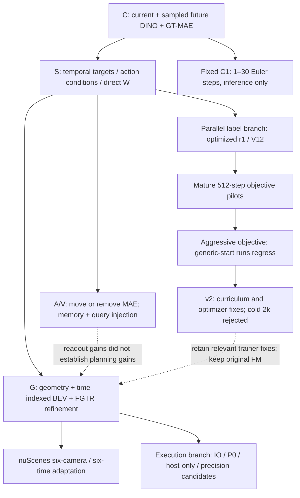
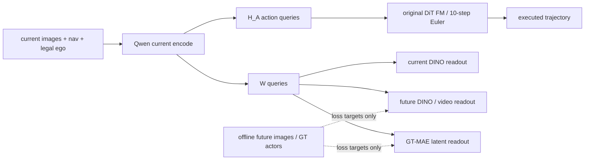
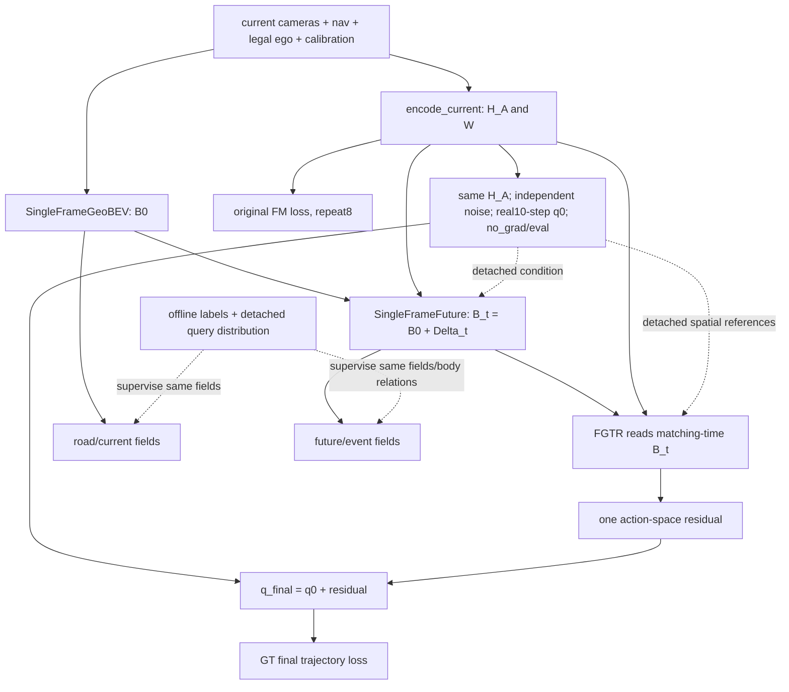

# 算法设计、实际实现与开发逻辑

本文件把研究问题、代码改动、实验和决策串起来。每个实现版本均绑定**实际执行提交**，并附选定核心文件的原样源码及差异补丁，不能只凭分支名字或当前工作区推断旧算法。结果与判断见 [METHOD_HISTORY_ZH.md](METHOD_HISTORY_ZH.md)，逐权重数据见 [RESULTS_BY_CHECKPOINT.md](RESULTS_BY_CHECKPOINT.md)。

源码包收录 15 个执行版本，原文件按 SHA256 去重存储；每版清单保留原路径、完整 commit、Git blob、SHA256、符号和行号。[机器索引](implementation/INDEX.json)能定位所有文件。补丁只比较登记范围的实现变化，不表示两提交一定是 Git 直接父子，也不表示该差异天然是单因素消融。

## 开发脉络：两条研究支线和一条执行支线



这不是每一代都优于上一代的升级链。r1 标签与 A/V 接口在 10 月 5 日并行；G 没有继承激进新目标，也没有用 S0 驾驶权重续训。性能分支改变执行组织，只有通过相应验收才允许承接科学实验。

| 时间 / 实现版本 | 当时要回答的问题 | 关键设计与实现变化 | 后续证据如何影响选择 |
|---|---|---|---|
| 9/29 [C](implementation/versions/C.md) | 当前/未来/交互表征能否帮助原 DDP？更大目标是否值得？ | spatial W、DINO共享读出、GT-MAE交互头，C0–C5分辨率/查询矩阵 | C0/C1/C4完成；分辨率收益不确定，后续固定C1 |
| 10/2 [S](implementation/versions/S.md) | 单未来时刻是否不足？视频和动作条件是否有用？ | FutureSpatiotemporalHead、ego轨迹编码、视频teacher、S4直接W条件 | S4负面；视频/动作尚未超过S0，进一步检查接口与表示依赖 |
| 10/5 [A](implementation/versions/A.md) / [V_QUERY](implementation/versions/V_QUERY.md) | 辅助任务应监督W还是动作？动作条件进入query是否更强？ | interaction_readout_source、NO_INTERACTION、memory_and_query | A_ACTION退化；A_NO_MAE/V_QUERY接近S0，未建立辅助任务因果收益 |
| 10/5 [r1 S0](implementation/versions/R1_S0.md) / [R/S3](implementation/versions/R1_R_S3.md) | 更好的离线轨迹标签能否提高规划？ | 独立ego relabel覆盖；未来辅助条件保持logged ego | 进度/道路改善伴随NC/TTC下降，转向损失/优化诊断 |
| 10/6 [axes](implementation/versions/OBJECTIVE_AXES.md) / [gain](implementation/versions/OBJECTIVE_GAIN.md) / [endpoint](implementation/versions/OBJECTIVE_ENDPOINT.md) | 纠正纵向/制动/运动学误差能否保住安全？ | 加权FM、native rollout候选、bridge端点导数、braking增益 | 成熟512步信号没有可靠外推到冷启动；50k新目标退化 |
| 10/8 [v2](implementation/versions/OBJECTIVE_V2.md) | 新目标与梯度尺度、warmup、真实LR是否不匹配？ | 小权重/规范归约、curriculum、弱rollout、实际optimizer组 | 1k改善在2k反转，停止该配方；保留实现修复，不保留被拒绝目标 |
| 10/1 [FM steps](implementation/versions/FM_STEPS.md) | 原Euler推理需要多少步？ | 固定权重，只改采样步数；独立推理实验 | 1步明显损失，更多步非单调；G正式仍10步 |
| 10/8–9 [G NAVSIM](implementation/versions/G_NAVSIM.md) | 特征重建不一定改善规划，改为结构化场景监督和局部轨迹读取是否有效？ | 成熟单帧GeoBEV、Bt、真实q0、FGTR、一次residual；四组同结构 | G组内与历史基线持续比较，未把辅助loss下降当成功 |
| 10/9 [G nuScenes](implementation/versions/G_NUSCENES.md) | 相同结构化任务是否跨数据来源成立？ | 6相机/6时刻、VAD导航、地图/框适配、独立共同几何准备 | G3 24e完成但G1不等预算，跨数据集因果证据尚不完整 |
| 10/11 [P0窗口源](implementation/versions/G_P0_WINDOW_SOURCE.md) / 10/12 [host-fast](implementation/versions/G_HOST_FAST.md) | 全算法成本增加，能否保持定义减少冗余？ | 元数据/CPU准备/日志/MLN/Fuser/查询复用；另测精度与world规模 | 性能窗口确实更快，正式无损验收仍未闭合，继续用io_preserving_v1 |

日期为研究阶段；清单中的 commit_time 是源码提交时间，二者不强行等同。所有后续“暂停”以最新用户决定为准。

## 原共同实现：一次当前编码，原动作头

`DDPForesight.encode_current` 在 tokenizer/vision 前重建 image/lang/state 白名单；`QwenOFT._build_qwen_batch` 负责真实图像grid、prompt、slots、DeepStack/mRoPE。ego projection 与 W/action query embedding 可学习，不能离线缓存；冻结visual保持eval。当前序列遵循 state → W → action 的原causal顺序，所以 action 表示能间接依赖 W，而不是“没有显式拼接就完全不用W”。

动作头实际在 `GR00T_ActionHeader.py` 的 `FlowmatchingActionHead`，核心 DiT 在 `flow_matching_head/cross_attention_dit.py`；不要因另一个文件也叫 DiT 就把实现对错。动作标准化/解码在 `foresight_dataset.py`。版本清单同时附这些基础文件，避免只附新增head而无法解释原FM。



该图是 C/S 默认接口；S4显式给动作头加W、A_ACTION把MAE输入换为H_A，其余版本不能自行套这些开关。部署去掉辅助头，仍保留W及原动作主干。

## C 的代码组织与六组配置

`DDPFullForesight` 继承 `DDPForesight`，新增 `SpatialViewEncoding`；`DINOFeatureHead` 和 `InteractionLatentHead` 读取W，loss实现负责有效元素/场景归约。`configs/foresight_resolution/c0.yaml` 到 `c5.yaml` 参数化teacher grid与W数量；真实训练配置经过训练集梯度校准后冻结在登记JSON，不能只看模板中的占位lambda。

Teacher侧复用真实30epoch GT-MAE而非一个近似同名编码器；`prepare_vehicle_trajectories.py`、`train_trajectory_mae.py`、`export_interaction_targets.py` 给出汽车类别、whole-actor masking、ego-hidden条件与目标导出。`cache_dino_targets.py` 按图像真实resize/pool写独立cache身份。训练入口 `tools/foresight/train_student.py` 和 native checkpoint组件也在源码清单。

C2只有配置/目标证据；C3短链路恢复，C5性能profile。它们不能出现在“已完成六组100k”的叙述里。

## S 与 A/V：条件放置是实际代码开关

`DDPActionVideoForesight.compute_clip_loss` 解码训练标签ego为物理x/y/sin/cos，只将其传给辅助时空头。`FutureSpatiotemporalHead` 对未来时间/空间query读W；`ego_trajectory_condition.py`处理动作条件。`video_target_encoder.py`与两种目标cache builder区分逐帧DINO和V-JEPA，二者不是互相可替代的同分布特征。

正式开关及对应实现：

| 对照 | 配置字段 | 实际路径 |
|---|---|---|
| S0/S2 | future_target_type=dino_sequence/video_clip | 时空头目标时刻/区间不同；模型主动作头不替换 |
| S0→S1、S2→S3 | future_action_condition=none/gt_ego | 辅助head增加ego action memory；部署无GT |
| S3→S4 | planner_condition_mode=action_only/action_plus_W | `build_planner_condition` 显式改变原action head条件 |
| S0→A_ACTION | interaction_readout_source=world/action | 交互latent读W或action表示 |
| S0→A_NO_MAE | enable_interaction=false、lambda_int=0 | 删除这项辅助监督，不删当前/未来DINO |
| S3→V_QUERY | future_action_injection=memory_only/memory_and_query | 动作同时注入辅助memory与query；query_scale=1 |

源码可能还包含 functional_interaction、planner_residual 等未启用接口；正式A/V配置中 `interaction_functional_loss=disabled`。**有文件不等于做过该算法实验**。正式组定义以 [冻结A/V配置](../20261008/configs/av)为准，不将所有实现过的开关合并成V_QUERY。

早期冻结C1-W的读出探针补入 [FROZEN_READOUT_PROBES.csv](data/FROZEN_READOUT_PROBES.csv)：F0/F1、V0/V1、各自action-only及P_QUERY/P_ACTION_ONLY_QUERY，共8个2000步readout。1,696个dev场景中1,694个有有效teacher。F1/V1分别测试GT动作memory，P_QUERY测试memory+query。V0/V1/P_QUERY MSE约0.30245/0.30212/0.29984，置换W明显变差；P_QUERY置换动作0.29984→0.31461，action-only约0.37325。这说明条件和W可被读出，不是规划改善证据，也不跨teacher按MSE排名。

C1-W中间层干预另在固定128dev只读评测：基准88.1752，layer9置换86.4875，layer18置换88.1415；区间均跨零，未新训策略。这个诊断和S4直接拼W的训练对照是两类证据，不能混为一谈。[探针原始汇总/身份](evidence/probes)保留。

## 标签与新目标：分清数据路由、损失数学和优化器修复

`tools/s3_optimized_training/labels.py`构建受身份校验的ego替换，`run.py`注册R/S0/S3配方；dataset同时保留原logged ego供未来头用。r1/V12只改变planner监督标签，不把优化器得到的精确未来作为部署输入。

`trajectory_objective.py`中分别定义FM通道/场景权重、bridge端点运动学与native rollout监督。早期axes、absolute gain、endpoint三个提交不是同一个目标改名：归一化通道权重会改变相对监督，absolute gain另调总尺度，endpoint把流时间的端点估计解码成物理时序导数；native rollout则实际运行原采样器。它们的参数文件一并附在各版本源码与[试验配置](evidence/objective_pilots/configs)。

v2在原函数上增加独立FM curriculum、braking规范化、较弱物理项和低频native rollout；`train_student.py`修复真正生效的分组LR和日志。这些trainer修复与科学目标是可分离的。四组2k对照的公共LR/warmup均匹配；没有把v2新loss带入G。过去objective文件能从Git恢复，不需要在G运行分支导入它来保留研究历史。

## G 的实际调用链与监督边界



`VLAStructuredFGTR.plan_from_current` 是训练/部署共用的proposal/refine路径，`forward`添加标签loss，`predict_action`不需要标签文件。GT标签被替换不能改变固定参数/显式噪声下的q0/q_final。`strip_auxiliary_heads`仅删除不参与执行的teacher/scene head，GeoBEV、future和FGTR仍必须保留。

| 模块 | 实际职责 | 不应作出的解释 |
|---|---|---|
| geo_bev.py / dataloader/structured_world/cameras.py | 当前图像预测深度、标定投影、真实BEV | W reshape就是BEV；GT深度作为输入 |
| future.py | 当前scene tokens +物理时间+H_A/模型q0生成每时刻Bt | 历史BEV差分；GT ego teacher forcing；真实反事实周车响应 |
| fgtr.py | 真实10步proposal及成熟deformable局部读取，单次residual | 普通global attention冒充FGTR；多候选scorer |
| semantics.py | 当前道路/占用及未来occupancy或conditional事件 | GT O0参与部署概率组合；语义数值已经是执行硬约束 |
| queries.py / grid.py | K查询、车身模板、物理归一化、越界标志 | 越界clamp成真边界；zero padding视作空闲 |
| losses.py | 同预测场的局部关系、scene归约、refine loss | 另一个黑箱risk head；用风险梯度直接优化q0 |
| dataloader/structured_world | 统一坐标/框/地图/有效性、3/6相机和8/6时刻 | 当前不可见等于未来空闲；地图为部署输入 |
| train_vla.py / resume_origin.py | 正式多卡、实际LR、原生状态恢复与身份检查 | 报告SHA就是训练源；仅加载模型即无损恢复 |

单帧适配复用ResWorld/GeoBEV、VAD、UniAD和nuScenes API，未重写成熟可变形算子。第三方原文件、修改和许可证已在仓库 `third_party` 与run identity锁定，本次不把复用组件宣称为原创。G3采样改的是所有结构化监督，共同p0/Bt字段被训练后由FGTR隐式使用；这与当前/未来数值直接作为硬约束的研究方案不同。

## 执行分支为何单列

P0复用同forward的MLN/TokenFuser空间mix，将CPU处理/metadata、候选索引与批量传输日志拆出重复同步；不缓存可训练表示、不减少时间/网格/K、不改变10步q0。当前保存了实际性能窗口源和host-only后续源，补丁可查哪些公共重构同时进入IO控制。时间向量化/局部BF16/16卡会另有数值或RNG边界，不和已通过IO混称“无损”。

代码实现存在与正式采用状态分开记录：只看一个函数多了fast分支，不能推断G2已在用它。G2实际仍是0c54f1c+io_preserving_v1；已执行与未通过的验收结果见[方法报告的执行部分](METHOD_HISTORY_ZH.md)。

## 如何审阅与恢复某一版本

1. 先从[方法账本](data/METHOD_LEDGER.json)找到试验/别名/只读探针身份，再看其真实配置和评测人口。
2. 打开下方版本源码入口或 `implementation/versions/<版本>.json`。相同内容复用较早快照，完整路径映射与hash保持一致，不靠文件名猜版本。
3. 差异补丁位于 `implementation/patches`，与对应immutable commit逐字核验。源码快照只提供研究核心，不含所有依赖、原图、权重、teacher/cache和环境；它不是可脱离项目直接启动训练的便携包。
4. 需要完整环境复现时，在新的共享存储路径检出确切commit，按该run冻结注册和数据/初始化hash恢复。示例只是创建只读审阅worktree，不会启动暂停实验：

```bash
git worktree add --detach /mnt/project/VLA-Drive-review-S-1493deda \
  1493deda247107efe076b9294863a6753391298a
```

5. 归档验证命令 `python reports/experiment_results/20261014/tools/verify_archive.py` 检查所有快照hash、Git blob身份和差异补丁hash；本地保有原始Git提交时，加 `--check-git` 核对原路径与补丁逐字一致。本次已执行这项额外检查。它不执行历史训练器、升级环境或恢复旧控制器。旧报告中的命令是来源证据，不是当前授权。

本次源码快照由 `tools/export_versions.py` 从本地Git对象读取，没有从运行进程加载目录修改代码，也没有合并无关历史RL/联合轨迹分支。

## 关键实现的直接源码入口

| 版本 | 原文件 | 精确源码 |
|---|---|---|
| C | `starVLA/model/framework/DDPForesight.py` | [读取](implementation/snapshots/C/starVLA/model/framework/DDPForesight.py) |
| C | `starVLA/model/framework/ddp_full_foresight.py` | [读取](implementation/snapshots/C/starVLA/model/framework/ddp_full_foresight.py) |
| C | `starVLA/model/modules/action_model/GR00T_ActionHeader.py` | [读取](implementation/snapshots/C/starVLA/model/modules/action_model/GR00T_ActionHeader.py) |
| C | `starVLA/dataloader/foresight_dataset.py` | [读取](implementation/snapshots/C/starVLA/dataloader/foresight_dataset.py) |
| S | `starVLA/model/framework/ddp_action_video_foresight.py` | [读取](implementation/snapshots/S/starVLA/model/framework/ddp_action_video_foresight.py) |
| S | `starVLA/model/modules/foresight/future_spatiotemporal_head.py` | [读取](implementation/snapshots/S/starVLA/model/modules/foresight/future_spatiotemporal_head.py) |
| A | `starVLA/model/framework/DDPForesight.py` | [读取](implementation/snapshots/A/starVLA/model/framework/DDPForesight.py) |
| V_QUERY | `starVLA/model/modules/foresight/future_spatiotemporal_head.py` | [读取](implementation/snapshots/A/starVLA/model/modules/foresight/future_spatiotemporal_head.py) |
| R1_R_S3 | `tools/s3_optimized_training/labels.py` | [读取](implementation/snapshots/R1_S0/tools/s3_optimized_training/labels.py) |
| R1_R_S3 | `tools/s3_optimized_training/run.py` | [读取](implementation/snapshots/R1_R_S3/tools/s3_optimized_training/run.py) |
| OBJECTIVE_AXES | `starVLA/model/modules/foresight/trajectory_objective.py` | [读取](implementation/snapshots/OBJECTIVE_AXES/starVLA/model/modules/foresight/trajectory_objective.py) |
| OBJECTIVE_GAIN | `starVLA/model/modules/foresight/trajectory_objective.py` | [读取](implementation/snapshots/OBJECTIVE_GAIN/starVLA/model/modules/foresight/trajectory_objective.py) |
| OBJECTIVE_ENDPOINT | `starVLA/model/modules/foresight/trajectory_objective.py` | [读取](implementation/snapshots/OBJECTIVE_ENDPOINT/starVLA/model/modules/foresight/trajectory_objective.py) |
| OBJECTIVE_V2 | `starVLA/model/modules/foresight/trajectory_objective.py` | [读取](implementation/snapshots/OBJECTIVE_V2/starVLA/model/modules/foresight/trajectory_objective.py) |
| OBJECTIVE_V2 | `tools/foresight/train_student.py` | [读取](implementation/snapshots/OBJECTIVE_V2/tools/foresight/train_student.py) |
| G_NAVSIM | `starVLA/model/framework/vla_structured_fgtr.py` | [读取](implementation/snapshots/G_NAVSIM/starVLA/model/framework/vla_structured_fgtr.py) |
| G_NAVSIM | `starVLA/model/modules/structured_world/geo_bev.py` | [读取](implementation/snapshots/G_NAVSIM/starVLA/model/modules/structured_world/geo_bev.py) |
| G_NAVSIM | `starVLA/model/modules/structured_world/future.py` | [读取](implementation/snapshots/G_NAVSIM/starVLA/model/modules/structured_world/future.py) |
| G_NAVSIM | `starVLA/model/modules/structured_world/fgtr.py` | [读取](implementation/snapshots/G_NAVSIM/starVLA/model/modules/structured_world/fgtr.py) |
| G_NAVSIM | `starVLA/model/modules/structured_world/queries.py` | [读取](implementation/snapshots/G_NAVSIM/starVLA/model/modules/structured_world/queries.py) |
| G_NAVSIM | `starVLA/model/modules/structured_world/semantics.py` | [读取](implementation/snapshots/G_NAVSIM/starVLA/model/modules/structured_world/semantics.py) |
| G_NAVSIM | `starVLA/model/modules/structured_world/losses.py` | [读取](implementation/snapshots/G_NAVSIM/starVLA/model/modules/structured_world/losses.py) |
| G_NUSCENES | `tools/structured_world/score_nuscenes.py` | [读取](implementation/snapshots/G_NAVSIM/tools/structured_world/score_nuscenes.py) |
| G_P0_WINDOW_SOURCE | `tools/structured_world/train_vla.py` | [读取](implementation/snapshots/G_P0_WINDOW_SOURCE/tools/structured_world/train_vla.py) |
| G_HOST_FAST | `tools/structured_world/run_world_scaling_node.py` | [读取](implementation/snapshots/G_HOST_FAST/tools/structured_world/run_world_scaling_node.py) |
