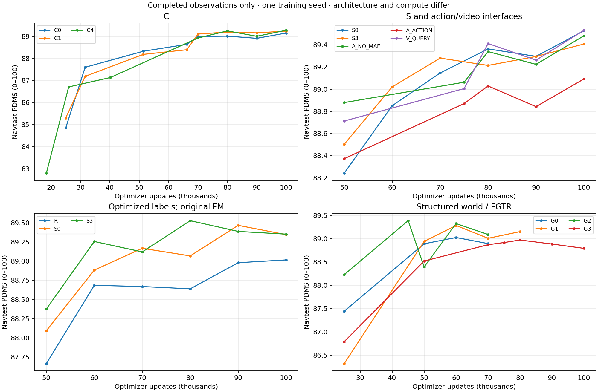

# C → S → A/V → 轨迹目标尝试 → G：增量完整归档

快照从 **2026-10-14 15:06 UTC** 开始采集。当前证据仍没有确立 G 系列超过历史 S0/V_QUERY 的规划上限：G2 已测最佳为 45k 的 **89.3858**，历史 S0/V_QUERY 各自最佳为 **89.5279/89.5320**；它们的曝光、结构、几何准备与计算量不同。G2 在 G 组内值得保留，但优势随训练阶段变化，不能用单个最佳权重证明事件目标稳定优于其它目标。

本次在 [10 月 8 日原始归档](../20261008/README.md)和 [10 月 13 日 G 汇总](../20261013/README.md)上增量补充，不改写旧结果。旧报告中的运行状态是当时快照；**当前只继续 NAVSIM G2，G0/G1 与 nuScenes 按用户要求暂停，G3 已完成**。

主要入口：

- [版本算法设计与实际源码](IMPLEMENTATION_GUIDE_ZH.md)：15个执行版本、204份去重核心源码、14份范围限定差异补丁，附模块调用关系和开发分支图。

- [完整算法演进、负结果和结论边界](METHOD_HISTORY_ZH.md)：逐项说明改了什么、为何尝试、做过哪些验证、结果能支持什么。
- [所有中间检查点的分系列表](RESULTS_BY_CHECKPOINT.md)：开发集与 Navtest 分开，缺失位置留空。
- [202 条检查点评测明细](data/ALL_CHECKPOINTS.csv)、[20 个方法/配方的已测最佳](data/BEST_NAVTEST.csv)、[同更新数 Navtest 矩阵](data/MATCHED_NAVTEST.csv)。20 项包含仅完成 50k 观测的被拒绝新目标，不等于 20 项都完成长训。
- [67 项方法、别名、短训和执行尝试账本](data/METHOD_LEDGER.csv) / [JSON](data/METHOD_LEDGER.json)。别名、工程候选与只读父权重均标明，不能按 67 个独立训练实验计数。
- [成熟权重 512 步目标筛选](data/OBJECTIVE_MATURE_PILOTS.csv)、[C1 固定权重 1–30 步 Euler 推理对照](evidence/fm_steps/RESULTS.csv)。这是此前主表未完整串联的两段历史。
- [G 组内配对及失败转移](data/PAIRED_COMPARISONS.json)、[G2 与历史基线的配对分析](data/G2_HISTORICAL_COMPARISONS.json)、[nuScenes 两种时间归约](data/NUSCENES_PLANNING.csv)、[场景监督指标](data/SCENE_SUPERVISION.json)。



## 本次新增结果与当前状态

相对 10 月 13 日新增 **G0 70k、G2 60k、G2 70k** 三个完整 Navtest 检查点。共 21 个 G 检查点、42 个 q0/q_final 结果；每个结果均为 12,146 场景、136 日志、零评分处理失败。合法 PDMS=0 场景保留。

| NAVSIM 组 | 本快照训练进度 | 当前状态 | 最新完整 Navtest：更新 / PDMS | 已测最佳：更新 / PDMS |
|---|---:|---|---|---|
| G0 | 71,052 | 用户暂停 | 70k / 88.8936 | 60k / 89.0247 |
| G1 | 84,135 | 用户暂停 | 80k / 89.1511 | 60k / 89.2823 |
| G2 | 73,775 | vla-zt2 继续至 100k | 70k / 89.0891 | 45k / 89.3858 |
| G3 | 100,000 | 已完成 | 100k / 88.7913 | 80k / 88.9706 |

训练进度来自实际接受的日志续段，不能拿最高历史日志步数或评测队列的辅助 `training` 字段代替。G2 的快照恢复点为 70k，73,775 是已记录训练步数。G2 于 65,288 优化器边界无损迁至 vla-zt2，保持 `0c54f1c` / `io_preserving_v1`、8 卡、microbatch4/global32、原 scheduler/RNG/数据位置。[迁移证据](evidence/G2_MIGRATION.json)核对加载边界所有 rank 的 master、Adam、RNG 与模型/BN；不将它说成跨设备继续训练永远逐位一致。[暂停记录](evidence/NAVSIM_PAUSE.json)与[去重后的 G2 评估队列恢复记录](evidence/G2_QUEUE_RECOVERY.json)一并保留。

| 新增检查点 | q0 | q_final | 同模型修正差值 | q_final 零分数 |
|---|---:|---:|---:|---:|
| G0 70k | 88.2708 | 88.8936 | +0.6228 | 575 |
| G2 60k | 88.3488 | 89.3232 | +0.9743 | 516 |
| G2 70k | 88.3672 | 89.0891 | +0.7219 | 554 |

G2 70k 比 60k 降 0.2341 点，配对日志簇 95% 区间为 [-0.4723, +0.0038]；修复旧零分 68 个、新增零分 106 个。不能只引用 q_final 比 q0 高分而忽略检查点之间的退化。q0 也不是独立训练的原 DDP baseline。

## 数据、协议和复算

NAVSIM 主表保持原 v1 canonical：FP32 master 恢复/推理、TF32 关闭、原 10 步 FM、单候选、场景绑定采样 seed42。训练 seed 也是 42。已按用户要求多次观测 Navtest，因此不能再把它描述为未接触的最终盲测。配对 bootstrap 保留真实场景权重；本次 G 与跨系列分析为 20,000 次、seed42、按日志聚类，区间未校正事后选优/多重比较，也不能替代第二训练 seed。

| 数据文件 | 覆盖 | 备注 |
|---|---|---|
| [历史逐场景数据](../20261008/data/scenes) | 186 组评测、1,184,880 行 | 含 88 个历史 Navtest、完整 dev、v2 短训和推理种子诊断；原文件保持不变 |
| [G_NAVTEST_SCENES.csv.gz](data/G_NAVTEST_SCENES.csv.gz) | 42 × 12,146 = 510,132 行 | 21 检查点的 q0/q_final 全分项；首次完整数值归档；匿名 ID 与历史一致 |
| [C1_FM_SWEEP_SCENES.csv.gz](data/C1_FM_SWEEP_SCENES.csv.gz) | 9 × 12,146 = 109,314 行 | 同一 C1 权重的不同采样步数；10 步重复历史基准，另表存放 |
| [OBJECTIVE_MATURE_PILOTS.csv](data/OBJECTIVE_MATURE_PILOTS.csv) | 16 行 | 每架构 1 个只读父权重 + 7 个控制/候选结果；非冷启动，不混入正式主表 |
| [ALL_CHECKPOINTS.csv](data/ALL_CHECKPOINTS.csv) | 202 行 | 历史 146 + v2 dev 8 + G Navtest 42 + G dev 6；不重复收录旧报告中的历史引用行 |
| [NUSCENES_PLANNING.csv](data/NUSCENES_PLANNING.csv) | 5 检查点 × 2 轨迹 × 2 时间归约 | 同一数据的两种归约不是两个独立试验 |

CSV 的 PDMS/分项均为 0–100；nuScenes L2 为米、碰撞为百分比。新逐场景文件只含匿名 ID 和数值，无原图、点云、轨迹权重、模型或凭据。旧标签包已存在于历史提交，本次不复制新增。训练配置、初始化/label/cache hash、外部来源、checkpoint 收据、实际 LR、曝光及日志字节边界见 [SOURCE_VERSIONS.json](data/SOURCE_VERSIONS.json)；这里的权重 hash 是已保留收据，不声称本轮重新加载了大权重。

在仓库根目录，不需要训练环境、原始数据或 GPU：

```bash
OPENBLAS_NUM_THREADS=1 OMP_NUM_THREADS=1 python reports/experiment_results/20261014/tools/verify_archive.py
```

从已归档数值重建跨系列表、配对区间和曲线：

```bash
OPENBLAS_NUM_THREADS=1 OMP_NUM_THREADS=1 python reports/experiment_results/20261014/tools/build_history.py
```

历史原包可独立校验：

```bash
OPENBLAS_NUM_THREADS=1 python reports/experiment_results/20261008/tools/verify_snapshot.py
```

实时工作区导出入口仍为 `tools/structured_world/export_results_summary.py --inputs <SNAPSHOT_INPUTS.json> --output <全新目录>`；队列/日志会继续变化，应生成新的输入快照，不覆盖本日期。新增 `resume_registration` 以原生字节边界选取接受的 G1/G2/nuScenes 续段，避免把已丢弃的重放分支当成训练进展。新辅助脚本只读取结果；本次没有新训练、推理或调参，也不会恢复已暂停任务。

本快照源码基点 `ed0725c767a888403b6a6ef3490eb0fdfc929a23`；归档分支 `analysis/c-to-g-experiment-results-20261014`。报告提交身份由 Git 记录，训练源码身份见方法报告，二者不混用。文件 hash 与校验结果见 [MANIFEST.json](MANIFEST.json)和 [VERIFICATION.json](VERIFICATION.json)。
