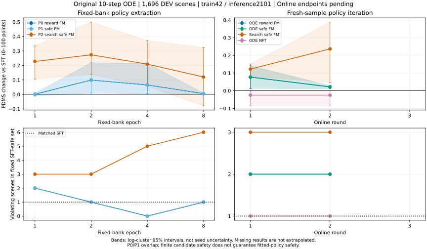

# Flow 安全策略改进研究

**当前结论：结构化搜索能发现更多安全改进，原Flow动作头也能吸收一部分均分收益，但候选安全约束尚不能保证重新采样后的策略安全。下一轮优先解决候选到策略的投影和保持问题；目前没有证据支持再开一次普通Flow-GRPO长训，或宣称NFT已经更优。**

截至2026-10-13 13:13 UTC，D1/D2/D3、P0/P1/P2共同8-epoch窗口、四条在线路线各3轮及24个完整RL_DEV评价窗口全部完成；共12,288次正式全动作头optimizer更新。所有终点TRAIN诊断和DEV v2辅助评价也已完成。六个模型的最终Navtest已锁定并实际运行，尚未完成，不能提前报告最终确认成绩。按用户最新要求，本轮只有训练seed42，后续推理seed2101；第二训练seed和新的多推理seed实验已取消，已有证据保留。

代码起点：`25f9148eb75ddf171313720e758a280b82c24f7f`；独立分支：`research/flow-safe-improvement-diagnostics-20261013`。完整时间线及早期五seed结果保存在[执行历史](execution_history.md)，当前结论以本页、封存证据与[全部24窗口](evidence/single_seed_policy_scores.csv)、[完整分项与低尾](metrics.md)为准。没有覆盖旧run或自动合并。

## 六个研究问题的回答

| 问题 | 本轮证据与判断 |
|---|---|
| 当前候选有没有可利用的安全改进？ | 有。D3随机部分≥0.005原始score的安全改进发现率，ODE 22.27%，行为搜索50.39%；困难稳定失败42场景，分别修复18与40。是有限预算机会，不是部署策略成绩。 |
| 只是局部EP排序，还是场景行为？ | 旧日志至少71.461%的有效组仅progress产生差异。新搜索学生有去共同漂移后的目标关联，但减速类目标吸收弱；不能由相关性证明场景因果推理。 |
| 如何避免NC/DAC/TTC换均分？ | 已实现分项线性约束、固定reward尺度、收益混合、公共GT replay和SFT速度保持。候选层约束成立；重新ODE采样仍有新违规，尚未解决策略层安全。P0/P1约束干预几乎不活跃，不能据二者相同宣称约束有效或无效。 |
| 原Flow能否吸收搜索轨迹？ | 三轮搜索学生在无搜索的原ODE DEV上提高0.24586分，证明部分参数策略收益；仍新增3个TTC违规，且实际训练困难集新增2个NC违规，未完整吸收安全目标。 |
| SDE/ODE迁移是否主瓶颈？ | 配对D1中旧RL相对SFT在ODE/SDE都提高，未出现“只有SDE学好”的主要证据。另发现缓存前缀与原部署混合精度不一致，这个不同性质的执行差异必须先排除。 |
| 哪条路线值得继续？ | 优先“结构化搜索＋受约束提取”，研究重点放在投影误差、行为模式保持和执行一致性。NFT三轮与普通FM差异区间跨零；潜空间搜索和新增SDE算法暂不扩展。 |

## 固定base、数据与评分合同

本轮统一使用旧F-SFT action-only frozen_visual step100000，完整权重SHA256为 `9a26685aa3838a2e1b89ab2d92997664afde4b259fed6683851f42781ad16eb4`。旧RL step8700/12912只读诊断；G系列未进入训练比较。这个选择复用了已验证的动作头、特征和导出能力，不宣称已重新证明它优于所有C/S/V/A/G模型。

训练完整action_model（含qwen_proj，359个张量），不使用LoRA，上游冻结。训练缓存是qwen_proj之前的归一化action-token states，未缓存可训练投影的输出。保持原8×4动作编码、原FM时间方向、10步ODE和后处理。正式训练前后冻结上游hash均为 `2b0ffae13641e4ddaf32d29ba5b081c3d05c204365cf610538ee96797591eb4e`。[训练与导出身份](evidence/source_export_frozen_prefix_identity.json)、[单seed切换源码审计](evidence/single_seed_training_source_audit.json)。

RL_TRAIN为101,592场景/1,176 logs；复用合法RL_DEV为1,696场景/16 logs。固定学习库4,096个TRAIN场景；诊断512场景中256随机、256定向困难，后者不作为无偏总体估计。随机诊断中仅10个进入学习库，定向256个全部进入，分析分开报告。SFT可能见过DEV，旧RL也见过该集合，因此仅称新RL更新未见。Navtest为12,146场景/136 logs，历史上多次被观察，不能称全盲测。[人口与清单](evidence/locked_cohorts.json)。

**v1.1缓存是官方规划评分所需的地图、对象/未来状态和参考规划等场景资产，和训练特征缓存是两种缓存。**本轮实际生成8,192个TRAIN场景的v1缓存约2.66 GiB，用16个CPU worker约509.7秒；不是全Navtrain构建时间。已有DEV/Navtest v1缓存复用。不同版本的场景结构、评分项和有效性语义不同，不能把v2 CSV的`pdm_score`当作v1成绩。缓存特权信息只进入搜索/评分器，不进入actor。

训练reward采用锁定canonical v1.1 PDMS，每条候选独立调用“固定官方参考＋一条候选”；批量只改变执行方式。v2 one-stage EPDMS单列辅助，不与v1平均，two-frame comfort缺失保持官方有效性与去分母权重语义，不填0。内部score均为0—1，下表乘100后称“分”。请求轨迹、原动作编码、模拟后果、原始progress、官方事件时间及评分status分开保存；仿真/基础设施异常不充当reward0。[24项合同与验证证据](validation.md)。

## D：探索、目标信号与采样差异

D1在同一固定512场景、匹配初始噪声、相同候选数下比较原10步ODE与旧正式G16/K10 SDE；额外SDE噪声使用独立RNG。随机256场景中SFT的ODE/SDE均分为93.3410/92.7475；SDE−ODE为−0.5935分，CI跨零。旧RL12912相对SFT的随机ODE/SDE改进分别为+1.2598/+1.0314分。困难部分同样两种sampler均有收益，不能解释为SDE收益完全没迁移。EP/DAC改善与TTC退化同时存在。该诊断沿用受控缓存前缀，**不是原始观测部署主表**；旧RL训练曝光也是限制。[三检查点完整D1](evidence/D1_all_checkpoints.json)。

D2复用旧真实behavior和日志：32个独立小批组中17等分、0全零，15个有效组中11个progress-only；ADE约0.129m、XY有效秩约4.18，不等于有用行为探索。完整旧训练36.204%等分，至少71.461%有效组仅progress改变奖励。SFT固定真实批上group/global/fixed-scale梯度方向并不完全一致（group/global cosine 0.857），不能只看advantage数值；旧RL8700的RL/KL梯度cosine约+0.246，不能根据KL原始norm较大就断言它压制一切学习。第一inner ratio≈1正常，第二inner平均clip fraction约0.0717%。实际裁剪后梯度norm未保存，明确NOT_AVAILABLE。[组统计](evidence/D2_legacy_groups_summary.json)、[SFT梯度](evidence/D2_SFT_gradient_summary.json)、[RL8700梯度](evidence/D2_RL8700_gradient_summary.json)、[inner记录](evidence/D2_legacy_inner_epoch_summary.json)。

旧dimension-mean surrogate不是联合轨迹概率，clip0.02不能解释成部署轨迹分布最多变化2%；SDE条件KL也不是ODE输出分布精确KL。本轮没有以放宽clip/KL或加大学习率作为默认修复。

D3每场景64个逻辑候选预算，其中4条共同SFT参考、60条新提案；自适应方法4轮×15。下表的“新发现效率”扣除了共同参考已经找到的成功场景；随机/困难部分分别报告，合并效率不能当作训练人口估计。

| 探索 | 随机安全增益≥0.005 | 困难安全增益≥0.005 | 困难稳定失败完全修复 | 新评分次数 | 每100次新评分的新发现 |
|---|---:|---:|---:|---:|---:|
| ODE独立采样 | 22.27% | 50.78% | 18/42 | 30,720 | 0.335 |
| 旧正式SDE | 41.80% | 77.34% | 39/42 | 30,720 | 0.719 |
| 受限latent CEM | 22.66% | 53.91% | 20/42 | 30,720 | 0.365 |
| 低维行为搜索/修复 | 50.39% | 75.78% | 40/42 | 23,158 | 1.032 |

每种方法另公平计入2,048条共同参考的逻辑评分成本。行为搜索7,562个非法物理提案消耗预算、保留原因，未计作新评分或reward0；不能以较少真实评分掩盖提案失败。随机部分有可行解的比例均为100%；困难部分ODE/SDE/latent/behavior分别90.63%/98.83%/91.41%/99.22%。**只在有可行候选场景上定义的G_safe均值**，随机为0.01289/0.01535/0.01298/0.02190，困难为0.18327/0.23995/0.18533/0.24820原始score；不要与将负值/不可行场景置零的`safe_gain_nonnegative`辅助统计混淆。[完整D3、分组与真实成本](evidence/D3_all_methods.json)。

搜索复用固定iCEM的精英复用、分布更新与方差下限思路，CVPO/REPS仅提供有限目标分布思想；[上游commit与来源锁](../../configs/flow_safe_improvement/upstream_lock.json)和许可证保留。没有迁入MuJoCo环境或完整长时序actor-critic。

行为搜索被选为后续候选来源，因为安全发现和评分效率改善；latent搜索未显示足够优势。SDE增加覆盖但速度场调用337,000次，ODE/latent各29,800次，行为搜索9,320次，不能只按逻辑候选数称全计算预算相同。共同参考、非法提案与实际forward另列。有限候选最高值不是理论oracle，没找到也不证明场景不可解。

## P：固定库学习与重新采样

BANK_ODE与BANK_EXPLORE均为4,096×32，4条相同参考＋28条候选，包含失败和无改进场景。q_ref是四参考经验分布；u=0.5 q_ref＋0.5候选经验分布，去重正确合并质量。P0仅奖励约束；P1/P2另分别约束NC/DAC/TTC成本不超过永久SFT参考。FP64求解，eta=0.005，最大primal残差≤2.53e−10，零预算排除违规候选质量。普通与安全组的u、收益混合、GT replay和reference保持完全一致。

q_target=(1−alpha)q_ref＋alpha w；alpha=0.5·clip(DeltaR/0.005,0,1)，不用场景内std放大微小EP差异。P0/P1混合前/后平均候选收益为0.010785/0.005209，平均alpha0.07785、ESS4.341；P2为0.023043/0.011420、alpha0.29138、ESS7.328。无改进场景分别1,362/1,362/1,004。[目标分布](evidence/P_fixed_target_summary.json)。

每组同一起点、LR1e−6、global scene batch16、8个完整epoch/2,048 updates；每场景按非负目标权重抽标签，独立FM插值噪声、8次repeat。GT replay系数0.1，固定SFT安全轨迹上的velocity保持系数1.0，由TRAIN梯度校准一次。新目标是结果驱动策略提取，不是精确CVPO、无偏policy gradient或策略安全保证。未共同延长到16 epoch，因“全组明显未学会”的预登记触发条件没有成立。

| 方法 | PDMS | 相对SFT差值及log 95%CI（分） | NC / DAC / TTC差值（分） | 固定参考联合安全集违规数 | v2 one-stage EPDMS |
|---|---:|---:|---:|---:|---:|
| 固定SFT | 93.61924 | — | — | 1 | 93.67596 |
| P0普通FM，8 epoch | 93.62435 | +0.00511 [+0.00255,+0.00904] | +0.00000 / +0.00000 / +0.00000 | 1 | 93.74608 |
| P1安全FM，8 epoch | 93.62435 | +0.00511 [+0.00255,+0.00904] | +0.00000 / +0.00000 / +0.00000 | 1 | 93.74608 |
| P2搜索安全FM，8 epoch | 93.73918 | +0.11995 [-0.07946,+0.32343] | +0.00000 / +0.11792 / -0.23585 | 6 | 93.86921 |

P0/P1独立训练的终点完整权重和配置逐字节相同，目标最大L1差约1.59e−12、32,768次标签抽样完全相同。这是**本候选库上的安全约束缺少有效干预**，不提供约束的因果效果估计；相同结果不算训练seed重复。[身份核对](evidence/P0_P1_epoch8_identity.json)、[目标干预](evidence/P0_P1_target_intervention.json)。

P2−P1终点为+0.11483分，CI [−0.08637,+0.31855]。P2对SFT新增1个DAC和4个TTC违规、恢复3个DAC；零分13→11，但新增1、恢复3。不能只展示P2第2 epoch的高点或零分净减少。[匹配差](evidence/P2_minus_P1_epoch8_seed2101.json)、[P2终点](evidence/P2_epoch8_DEV_seed2101.json)。

## O/N：三轮真实策略迭代与NFT

四组各执行3轮；每轮同一4,096人口重新生成当前behavior候选、真实评分、重新求目标，再更新2 epoch/512步。永久SFT参考不滚动放宽。普通ODE组4参考＋28当前ODE；搜索组4参考＋12当前ODE＋16行为搜索。NFT仅使用28条真实当前ODE样本，不给外部修复轨迹附上虚假on-policy概率。每轮刷新边界共同重置AdamW和两epoch scheduler；轮内完整恢复optimizer/RNG/游标，这个共同选择与连续保留Adam moments并不等价。

| 方法 | PDMS | 相对SFT差值及log 95%CI（分） | NC / DAC / TTC差值（分） | 固定参考联合安全集违规数 | v2 one-stage EPDMS |
|---|---:|---:|---:|---:|---:|
| 固定SFT | 93.61924 | — | — | 1 | 93.67596 |
| 普通ODE FM | 93.60759 | -0.01164 [-0.04036,+0.01807] | +0.00000 / +0.00000 / -0.05896 | 2 | 93.73743 |
| 安全ODE FM | 93.60759 | -0.01164 [-0.04036,+0.01807] | +0.00000 / +0.00000 / -0.05896 | 2 | 93.73743 |
| 搜索安全FM | 93.86510 | +0.24586 [+0.11491,+0.39654] | +0.00000 / +0.23585 / -0.17689 | 4 | 93.93323 |
| ODE NFT | 93.64924 | +0.03000 [-0.08422,+0.10814] | +0.00000 / +0.05896 / -0.05896 | 1 | 93.71057 |

第三轮匹配比较：搜索−ODE安全提取 **+0.25750分，CI [+0.10000,+0.39528]**；NFT−普通FM **+0.04165分，CI [−0.10001,+0.14720]**。搜索学生均分提高，安全目标未实现；NFT与普通FM没有明确优劣证据。第二轮NFT−FM显著为负，终点区间跨零，必须保留这一区别。[搜索终点配对](evidence/search_minus_ODE_safe_round3_seed2101.json)、[NFT终点配对](evidence/NFT_minus_reward_FM_round3_seed2101.json)。普通/安全ODE的三轮差异仅约1.88e−9原始score，安全约束依然缺少实际干预。

搜索第三轮对SFT零分13→9，恢复4、无新增零分；全人口仍新增3个TTC违规，固定参考联合安全集违规1→4。第二、三轮TTC违规总数都是4，但逐场景是新增1、恢复1、持续3，不能说“没有新退化”。普通ODE第三轮较第二轮下降约0.03336分；没有无限加轮数直到超越旧分数。[全部轮次与置信区间](evidence/single_seed_policy_scores.csv)、[搜索逐场景转移](evidence/EXPLORE_round3_minus_round2_seed2101.json)。

NFT固定[官方commit `cbb14f84b8312b620390dfcbe2fab69c1383b104`](https://github.com/NVlabs/DiffusionNFT/tree/cbb14f84b8312b620390dfcbe2fab69c1383b104)，核对实际训练代码的forward-process、旧behavior、正负目标、时间采样和归一化；适配s=1−t、DDP velocity取图像符号反向。采用场景奖励中心化、全局reward std与clip5、beta1，不是负advantage乘普通MSE，也不是exp(−MSE)伪似然。每步FM与NFT计算不同：每轮forward噪声实例数分别262,144与327,680。首轮4096组中954等分（20全零），3142有效组中2997仅EP变化；这是离线信号诊断，不是已证明保持loss压住NFT的全头梯度分解。[信号](evidence/NFT_round1_advantage_signal.json)、[真实完整动作头学习资格](evidence/full_head_learning_qualification.json)、[NFT连续/恢复一致](evidence/NFT_exact_resume_qualification.json)。

## 吸收与安全失真的具体证据

P2在实际更新过的困难256场景中新增2个NC违规；在线搜索第三轮也新增2个NC违规，而该人口参考NC成本预算为零。故问题已经出现在训练曝光人口，不能仅归因DEV泛化。困难场景的单输出到有限目标的能量差异，P2终点增加0.02704m，在线搜索增加0.02971m；这不是完整策略分布距离，也不能由单seed量化模式坍缩。[P2分层](evidence/P2_epoch8_TRAIN_stratified_seed2101.json)、[在线分层](evidence/EXPLORE_SAFE_FM_round3_TRAIN_stratified.json)、[投影](evidence/EXPLORE_SAFE_FM_round3_TRAIN_projection.json)。

P2困难场景中目标要求终点前进增加≥0.1m时98/107方向一致，要求减少时仅10/26一致，实际平均仍增加0.0195m，目标为减少0.2993m。在线搜索对应减速组仅4/13一致，实际仍增加0.0783m；不同轮的目标刷新，不能把26与13当同一组。去全局均值/前进距离分箱后存在正的目标关联，但主要支持部分场景相关响应，尚未证明可靠的减速修复。[P2方向](evidence/P2_epoch8_TRAIN_context_seed2101.json)、[在线方向](evidence/EXPLORE_SAFE_FM_round3_TRAIN_context.json)。

**未排除的重要混杂：训练缓存前缀为全BF16执行，而原VLAAgent是Qwen BF16、history/action模块FP32。**同权重、同原始输入并不产生完全相同的归一化condition。2个真实TRAIN隔离场景的请求轨迹差约0.0465/0.0764m；全BF16原始编码与旧缓存则精确一致。所有策略主表已统一用无特征缓存的原始部署路径重新评价，不能继续用缓存采样结果充当原部署成绩。训练、候选库和固定安全reference保留原身份，该精度差仍可能影响目标投影；GT replay/保持竞争也是未排除因素。[精度调查](execution_history.md)、[验证映射](validation.md)。

## 已锁定的最终确认

| 方法 | PDMS | 相对SFT差值及log 95%CI（分） | NC / DAC / TTC差值（分） | 固定参考联合安全集违规数 | v2 one-stage EPDMS |
|---|---:|---:|---:|---:|---:|
| 固定SFT | 93.61924 | — | — | 1 | 93.67596 |
| DEV合格选择：P0 epoch4 | 93.68433 | +0.06509 [+0.00402,+0.21218] | +0.00000 / +0.05896 / +0.00000 | 0 | 93.79090 |

按既有DEV有限安全规则选出P0 epoch4，完整锁定文件为[FINAL_SELECTION_LOCK](evidence/final_selection_lock.json)，SHA256 `58da302db394f78c0fa4c01ee33a781b0098ad80ecd8651dcb828ad3e548efd3`。它与四条在线固定三轮终点、永久SFT共同构成六个不同导出；不把DEV中途最佳点替代终点主表。选择规则是在首epoch已观察后登记，最终范围在第三轮DEV前登记，时间如实保留。[有限范围](../../configs/flow_safe_improvement/final_confirmation_v1.json)。

六组Navtest正在四台获授权Tsinghua服务器上实际执行：原始观测、原10步ODE、单候选2101，无teacher/cache/search/GT选择或新scorer进入actor。官方v1评分与推理并行；v2对同一请求轨迹重新评分。32个独立GPU UUID，最多48个模型进程共享，物理GPU不能记作48张。额外模型在前一模型八个worker均已分配显存并封存场景后才准入，原Base/G/IQE工作保留。[实际启动记录](evidence/final_navtest_launches.json)。**此处尚无完整Navtest成绩，最终确认待完成。**

最终安全转移按匹配SFT2101单输出定义，未新增四seed Navtest参考；DEV既有固定四seed安全集不重新划分。单seed下任意seed失败、全部seed失败、场景均分零三种事件在数值上重合，不用这个重合冒充多seed稳定性。log bootstrap只估计场景/log差异，不含训练或推理seed不确定性。

## 下一轮方向与边界

| 归类 | 匹配证据与尚未排除因素 | 下一步只改变的因素及资产/预算 |
|---|---|---|
| CASE_C：优先 | 安全候选目标满足约束，但P2和在线学生在TRAIN新增NC、DEV新增TTC。缓存/部署前缀精度与保持梯度仍混杂。 | 首先只对齐冻结前缀执行：固定现有动作标签、权重、数据顺序、LR、保持和2-epoch窗口，对缓存condition重建与原部署一致的版本。对实际候选/GT/保持token并集先profile；FM可复用已评分外部标签，新增候选评分可为0；DEV每模型1696次单候选评分。NFT若改变behavior condition必须重新采样，不能沿用旧on-policy身份。 |
| CASE_B：部分支持 | 行为搜索提高发现效率，三轮学生均分有真实收益，但安全保持失败。 | 在执行一致性先解决后，再只改变减速/修复模式保持或状态相关保持中的一个因素，复用现有候选库作匹配控制；不同时加大噪声、LR和搜索预算。 |
| CASE_A / CASE_E：有限支持 | ODE已有机会；P0/P1固定终点变化很小、在线终点未提高。候选安全约束在本库未形成有效干预。 | 先查看目标到速度场的方向和保持冲突；若要研究约束效应，需预先定义有约束干预的TRAIN分析人口，不能拿当前P0=P1当充分对照证据。 |
| CASE_D：目前不支持为主因 | 旧RL在匹配ODE/SDE下均有收益，未见只有SDE提高。 | 暂不启动新的采样一致性算法矩阵；出现新的匹配SDE-only证据后再分支。 |
| CASE_F：尚未确证 | TRAIN/DEV点估计不同，但TRAIN随机部分大多未实际更新，训练困难集自身也有新失败。 | 先分开实际曝光与未曝光人口，再分析泛化；不无限拟合原库。 |
| CASE_G：不符合现有证据 | 搜索安全机会并不弱。 | 暂不据此要求新世界模型或断言Flow不适合RL。 |

这是一项受约束有限候选策略迭代的Flow适配，NAVSIM按当前上下文到完整轨迹处理；未伪造动作导致的日志下一状态、TD bootstrap或长时序MDP学习。创新是否成立仍取决于同预算安全发现、行为吸收与新增违规控制的匹配证据，不能仅凭均分或方法动机决定。

G系列后续仅保留迁移合同：先冻结refiner与上游，Flow输出tau0、refiner输出tau_final，真实canonical reward评价tau_final；标签/behavior身份仍正确关联tau0，不能把tau0概率冒称tau_final精确概率。先检查安全候选经refiner是否保留，再考虑方法迁移，本轮没有新增G系列训练。

## 验证、成本与交付范围

[24项针对性验证](validation.md)包含评分独立性、动作往返、去重质量、零成本边界、求解器oracle、非负FM、reference冻结、全头梯度、恢复和NFT官方小张量对齐。初始33项和后续37项测试有重叠，不能相加成70项独立验证。实际完整头资格中359张量有有限非零FP32梯度，335个出现可见BF16参数变化，24个没有可见BF16变化；不写成全部都有可见变化。FM与NFT连续/恢复模型、optimizer/RNG/游标检查通过。原缓存/原导出等价检查曾失败，结果保留且主评价已纠正，不能笼统写“所有数值验证PASS”。

正式训练12,288次更新、196,608次候选训练场景曝光；GT replay与安全reference保持各另196,608次。候选人口4096，GT replay仍使用登记的RL_TRAIN人口；不能将32候选和8个FM噪声repeat误算独立场景。全部rank optimizer循环记录约67.15 rank-hours，包含共享GPU重叠且不含加载/保存，**不是唯一物理GPU-hours**。采样、评分、候选库、缓存、资格学习与历史多seed成本见[成本分表](costs.md)及[实际成本快照](evidence/execution_cost_snapshot.json)分别列出；Navtest仍运行，快照不是最终总成本。旧GRPO profile与新reward/人口不同，不能据时间直接宣称NFT或FM加速若干倍。

保留旧最终结果：v1.1 PDMS +0.1722分、v2 EPDMS +0.2126分；NC/TTC下降、DAC均值小幅提高，新增零分多于恢复。并非“完全无平均收益”或“所有安全项下降”。旧工程已经训练完整动作头/qwen_proj、冻结上游、GT replay、global-batch标准化、相关噪声、noisy-Euler和discount；本轮没有把这些重新包装成新方法，也没有再次实现完整Qwen/DiT/评分平台。[旧最终报告](../ddp_flow_grpo_final_report_20261013/README.md)、[弱收益分析](../ddp_flow_grpo_transition_batch/weak_gain_analysis/README.md)、[数值协议](../ddp_flow_grpo_transition_batch/numerical_protocol.md)。

尚未完成项：锁定后的完整Navtest和最终总成本；多seed稳定性因用户取消不再执行；单seed无法测量输出多样性/模式坍缩，旧实际裁剪后梯度没有记录。无这些证据时不补造结论。所有私有数据、权重、缓存和场景图片留在实际运行目录；Git只提交代码、聚合证据和报告。真实命令与恢复入口见[执行记录与命令](commands.md)，最终队列入口为`run_locked_navtest`，相同身份恢复使用`--resume`，若旧子进程仍活跃会拒绝重复派发。
