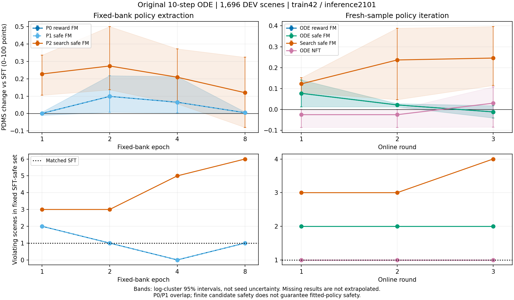

以下是阶段执行日志，保留当时状态；当前结论见 [主报告](README.md)。

# Flow 安全策略改进研究

当前状态是 **进行中**。本轮固定使用 F-SFT `frozen_visual step100000`，完整权重 SHA256 为 `9a26685aa3838a2e1b89ab2d92997664afde4b259fed6683851f42781ad16eb4`。它提供了已验证的冻结上游缓存、完整动作头和原 ODE 部署入口，适合作为本轮隔离探索、目标、更新和采样迁移因素的共同起点。本轮没有重新进行 C/S/V/A/G 全家族排名，不能据此称它是所有模型中绝对最优的 base。G 系列继续原有工作。

代码起点是 `25f9148eb75ddf171313720e758a280b82c24f7f`，分支为 `research/flow-safe-improvement-diagnostics-20261013`。截至 2026-10-13 12:43 UTC，D1/D2/D3、两份完整候选库与三个目标库已完成；**P0/P1/P2 均已完成共同8-epoch终点、完整DEV原ODE评价和终点TRAIN诊断**。四条在线路线均已完成第三轮候选库；搜索路线完成三轮终点训练、完整DEV v1/v2及TRAIN诊断，NFT完成三轮训练和DEV v1、正在补TRAIN/v2，两条ODE路线的最后一轮训练已过半。其余两条在线终点评价和锁定后的 Navtest 尚未完成。**按用户最新要求，取消第二训练 seed 和后续多推理 seed 实验；后续统一训练 seed42、原导出单候选评价 seed2101。**固定SFT四参考候选属于目标分布与安全集合定义，保留原身份。下文带时间的段落及五seed结果是已完成历史证据，不代表仍在派发多seed复测。

当前固定库终点比较如下，均为完整1696场景、无搜索/GT筛选的原始单候选10步ODE；每组2048次全动作头更新。单位为0—100分，区间按log聚类计算，不包含训练/推理seed不确定性。

| 固定预算终点 | PDMS | 相对SFT差值与95%CI | NC / DAC / TTC差值 | 固定SFT安全集联合违规场景 |
|---|---:|---:|---:|---:|
| 匹配SFT | 93.61924 | — | — | 1 |
| P0/P1 epoch8 | 93.62435 | +0.00511 [+0.00255,+0.00904] | 0 / 0 / 0 | 1 |
| P2 epoch8 | 93.73918 | +0.11995 [−0.07946,+0.32343] | 0 / +0.11792 / −0.23585 | 6 |

[P0/P1身份与独立执行核对](evidence/P0_P1_epoch8_identity.json)、[P2终点](evidence/P2_epoch8_DEV_seed2101.json)、[全部已完成窗口及缺失项](evidence/single_seed_policy_scores.csv)。P0/P1安全保持但收益很小；P2早期收益到终点减弱并出现新的安全失败，尚无安全合格的搜索策略。下图保留所有已完成窗口，空白位置表示尚未完成；不以候选最优值替代策略分数。

第二轮在线比较仍是中途窗口，四组均已累计1024次更新，每轮重新生成当前behavior候选并真实评分；它不能代替尚未完成的三轮固定预算终点。

| 在线第二轮 | v1.1 PDMS | 相对SFT差值与95%CI（分） | NC / DAC / TTC差值（分） | 固定安全集联合违规 | v2 one-stage EPDMS |
|---|---:|---:|---:|---:|---:|
| 匹配SFT | 93.61924 | — | — | 1 | 93.67596 |
| 普通ODE加权FM | 93.64096 | +0.02172 [+0.01260,+0.02805] | 0 / +0.05896 / −0.05896 | 2 | 93.79562 |
| ODE安全提取 | 93.64096 | +0.02172 [+0.01260,+0.02805] | 0 / +0.05896 / −0.05896 | 2 | 93.79562 |
| 搜索安全提取 | 93.85596 | +0.23672 [+0.04697,+0.38876] | 0 / +0.23585 / −0.17689 | 3 | 93.94293 |
| ODE NFT | 93.59433 | −0.02491 [−0.08570,+0.00007] | 0 / 0 / −0.05896 | 1 | 93.65463 |

搜索−ODE安全提取为+0.21500分，CI [+0.03189,+0.36731]；NFT−普通FM为−0.04663分，CI [−0.10303,−0.01334]。[搜索配对](evidence/search_minus_ODE_safe_round2_seed2101.json)、[NFT配对](evidence/NFT_minus_reward_FM_round2_seed2101.json)。搜索继续表现为均分收益伴随TTC退化；NFT的固定安全集联合计数虽未增加，但全人口仍新增1个TTC违规，因此不能写成“没有安全退化”。v2保留单独协议与two-frame有效性，不能用这一列覆盖v1的安全结论。

新增[24项合同验证映射](validation.md)、[NFT连续/断点恢复实证](evidence/NFT_exact_resume_qualification.json)和[实际成本快照](evidence/execution_cost_snapshot.json)。本快照有10,240次正式optimizer更新，全部rank记录的optimizer循环时间合计57.10 rank-hours，包含共享GPU上的重叠任务，**不是57.10个唯一物理GPU-hours，也不包含加载/保存成本**。进程区间并集另列，缺少结束时间的15项明确保留；不以不完整总量宣称方法加速。P0/P1共用候选库成本只计一次，缓存/参考筛查及历史多seed工作单列。NFT每轮的速度场forward噪声实例数为327,680，普通FM为262,144，即使更新数相同也不是等计算量。



2026-10-13 后续进度：已完成 8,192 个 RL_TRAIN 场景的四 seed SFT 参考采样、32,768 次真实 v1.1 评分和逐时刻车身几何审计；随后锁定 512 场景诊断集及 4,096 场景学习集。D1 SFT 的原 ODE/旧 SDE 配对运行已启动。完整动作头的正权重 FM、公共保持和 NFT 训练入口已接入原 ZeRO-2/检查点基础，但此处尚没有更新后策略的重新采样成绩。[执行成本](evidence/reference_screen_execution.json)、[清单身份与安全集合计数](evidence/locked_cohorts.json)。

07:15 UTC 阶段更新：真实八卡 FM 和 NFT 各完成 8 次完整动作头更新；FM 另从第 4 次更新恢复并完成到第 8 次。连续与恢复运行的最终模型、8 个 optimizer 分片和8个 RNG/数据游标文件的发布 SHA256 全部相同。两种目标的 359 个应训练张量均取得有限、非零的实际 FP32 optimizer 梯度；冻结上游 hash 不变。FM 短窗口有 335 个动作张量出现可见 BF16 参数变化，另外 24 个没有可见 BF16 数值变化；这不应写成“所有张量都有可见变化”。[真实学习资格与恢复证据](evidence/full_head_learning_qualification.json)。这些窗口验证执行、数值和恢复，不能用于宣布方法效果。正式 P/O/N 仍须完成。

共同温度已按预登记的 256 场景训练集规则选为 **eta=0.005（原始 0—1 score 单位）**，最大 primal 残差为 3.19e-11；公共安全参考速度保持系数为 **1.0**。保持系数使用短训后完整动作头的原生梯度观察校准，BF16 叶梯度和 FP64 范数归约与实际 ZeRO FP32 optimizer 梯度分别标注。两个校准都没有使用 DEV/Navtest。[温度](evidence/common_eta.json)、[保持系数](evidence/common_retention.json)。P0/P1/P2 继续共用 alpha_max=0.5、delta_useful=0.005、GT replay=0.1、LR=1e-6 和同一训练人口。

D1 的 SFT 完整 512 场景配对结果已完成。随机 256 场景中，ODE/SDE 单候选随机输出均分为 93.3410/92.7475；SDE−ODE 为 −0.5935 分，按 log bootstrap 的 95% CI 为 [−1.3381, 0.1400]。定向困难部分为 67.8067/65.3931，差 −2.4136 分；16 候选预算下有联合安全候选的场景分别为 227/250。这里显示更大的候选覆盖可与更差的随机均值并存；旧 RL 两个检查点的匹配诊断尚未齐备，不能据此归因旧 RL 的 ODE/SDE 迁移。[D1 SFT 完整表](evidence/D1_SFT.json)。

D3 的 LATENT 和 BEHAVIOR 两个自适应搜索已完成相同的 512×64 逻辑预算，ODE/SDE 对照仍在运行。随机部分发现至少 0.005 原始分安全收益的比例分别为 22.656%/50.391%，定向部分为 53.906%/75.781%。BEHAVIOR 的 30,720 次新提案中有 7,562 次未通过预登记物理限制，计入预算并保留；没有将其填成官方 reward 0。完整收益、共同参考成本和新增发现效率见[两个搜索的阶段比较](evidence/D3_adaptive_partial_comparison.json)。这些是候选机会，不是更新后策略成绩；固定库吸收和重新采样仍是主任务。

多 rank 首次候选采集因 tuple 搜索边界写成 JSON list 后的身份比较失败，未提交任何完整场景 bank；失败目录和日志保留。修复只统一身份序列化，不改变边界、噪声、奖励或搜索规则，随后两个 512 场景搜索已成功完成。真实 4,096 场景 BANK_ODE 和完整 DEV 的独立五 seed ODE 评价已经启动，DEV 四 seed 固定安全参考分别保存。依据用户新增授权，zt2/zt3/zt4 的可用容量也用于本轮有限实验，与既有 IQE 工作共存；没有停止 G/Base/IQE 任务。

参考筛查人口中，四个固定 seed 均满足 NC/DAC/TTC 的场景为 8,069；81 个场景间歇失败，42 个场景四次均未联合通过。分别稳定通过 NC、DAC、TTC 的场景为 8,192、8,108、8,151。这里只定义有限采样参考集合，不代表所有噪声都安全，也不是 DEV/NAVTEST 表现。定向清单依次覆盖不稳定、低分、几何近边界、低进度；所用几何距离和重叠面积与官方责任碰撞/TTC 标签分别保存，不作为首轮新增 reward。

v1.1 缓存是官方仿真输入，独立于候选、模型和 Qwen 特征缓存。这批 8,192 场景缓存由 tsinghua-zt2 的 16 个 CPU worker 完成，实测 509.735 秒，文件逻辑大小 2,851,892,056 字节（2.66 GiB），实际分配 2,868,588,544 字节。后续轨迹仍逐条真实评分，缓存不提供“已知策略分数”。已有 DEV v1 缓存继续复用，旧 v2 缓存没有覆盖或转换。

历史同一批模型输出上，SFT 的 v2−v1 总均分差为 −0.6361 分，但按场景先平均五 seed 后，绝对差均值为 4.6157 分，23.3986% 场景相差超过 5 分；旧 RL 对应 −0.5958、4.7295 和 23.5551%。这说明均分接近不代表奖励信号等价，不能用固定偏移换算两个版本。[历史描述性统计](evidence/historical_scoring_version_difference.json)。v2 扩展项及违规过滤见[官方指标文档](https://github.com/autonomousvision/navsim/blob/main/docs/metrics.md)；本轮主奖励仍是锁定的真实 v1.1。

独立 CPU 评分传输已使用四条真实原 ODE 轨迹核对，返回分数与先前封存结果完全一致。[资格结果](evidence/scoring_queue_qualification.json)。固定 CPU 队列把自适应搜索评分留在 tsinghua-zt2，八卡 RL 主机只负责本任务的模型计算。所有基础设施错误均停止受影响的更新，不替换为 reward 0。

物理搜索的训练集预检使用预登记校准集前 32 场景、480 个未评分的参数提案，389 个通过固定速度/加速度/曲率/转弯限制；91 个未通过，全部保留，主要限制为低速曲率。这只是提案可行性检查，不是安全发现率或候选奖励收益。[预检记录](evidence/behavior_physical_profile.json)。正式 D3 会把非法提案计入逻辑预算；固定库训练入口拒绝悄悄丢弃它们、改变先验质量或填造零分。

新增搜索边界测试与既有合同测试共 37 项通过。另保留了两次执行问题：几何缓存内部 polygon 容器为 list，首次审计因数组索引失败，修复后完整审计成功；首次手工分配 D1 进程遗漏 distributed rendezvous 环境，模型尚未加载即失败，随后改用原有 torchrun 启动。没有评分结果或正式训练权重因这些问题被覆盖。ODE 候选批量加速另有真实轨迹及官方分数阈值验证，尚未以旧 BF16/ZeRO2 资格替代新布局验证。

候选 ODE 批量校验现已完成：32 个预登记训练校准场景、每场景 16 个相同 root，共 2,048 次独立官方评分；chunk1/4/8/16 分别测得 178.015/44.893/22.719/11.180 秒的 ODE 前向累计时间。chunk16 的动作最大绝对差为 1.43e-6、请求轨迹为 7.63e-6、原始 score 为 1.26e-7，NC/DAC/TTC 逐项一致，均在事先登记阈值内。[完整资格结果](evidence/ODE_exploration_batch_qualification.json)。本资格仅用于 ODE 候选探索与固定库，部署/参考入口保持 chunk1，旧 SDE 与训练数值配置没有被重新解释为任意布局等价；该窗口的约 15.9 倍不是完整训练或端到端速度倍数。

已只读复用旧 pilot/resume 的实际 behavior buffers，去掉 16 次重复链后得到 32 组：17 组等分、0 组全零、15 组有效，其中 11 组仅 progress 不同，2 组有安全分项差异。平均 pairwise ADE 为 0.1286 m。[小样本诊断](evidence/D2_legacy_groups_summary.json)。这只是保存下来的局部窗口，不取代完整训练日志的 36.204% / 71.461% 统计；梯度竞争与每生成步骤贡献仍需真实模型测量，不能由几何方差或 loss 数值代替。

旧结果见[已完成的 DDP Flow-GRPO 报告](../ddp_flow_grpo_final_report_20261013/README.md)。最终 v1.1 PDMS 提高 0.1722 个百分点、v2 EPDMS 提高 0.2126 个百分点；v1 NC/TTC 下降，DAC 均值小幅提高，新增零分场景多于恢复场景。平均收益存在，但未证明稳定全面提升。36.204% 组等分不等于全部失败；至少 71.461% 有效优势组仅由 progress 区分。旧 reward 已逐条使用“官方 PDM 参考＋一条候选”，不归因于不存在的批量 EP 归一化错误。

复用内容包括 `action_head_policy.py`、原动作 DiT 和 `qwen_proj`、原 action-only 优化器分组、SDE 转移及 dimension-mean 定义、保存转移评估、冻结特征缓存、独立 SFT reference、原推理入口、数值配置和恢复工具。旧工程已做的完整动作头训练、359 张量梯度验证、global-batch 标准化、时间相关噪声、noisy-Euler、去噪 discount 和 GT replay 不作为本轮新方法。旧条件 KL 不是部署 ODE 的精确 KL，clip 0.02 也不是最终轨迹分布的 2% 变化上限。

本轮新增有限候选 FP64 权重求解：共同 `u=0.5 q_ref+0.5 empirical`、真实奖励下限和独立 NC/DAC/TTC 成本预算；零预算通过限制支持集处理，KL 始终相对原始 u。混合规则使用绝对收益和共同 `delta_useful=0.005`，不除以组内标准差。原始 SLSQP oracle 在小权重边界出现错误收敛，已保留失败记录并改用独立 [Clarabel 指数锥求解](https://clarabel.org/stable/examples/py/example_expcone/)，快速路径仍为低维 dual。它是有限候选上的受约束提取，不声称严格策略安全或精确 CVPO 复现。[CVPO 原文](https://proceedings.mlr.press/v162/liu22b.html)与[FSRL](https://github.com/liuzuxin/FSRL)仅提供相关目标分布背景。

FM 使用非负、按场景归一化的候选抽样，插值噪声与候选 root noise 分离。保留原 SFT 的时间分布，包括 `noise_s=0.999` 带来的很小负时间尾部，没有静默截断。NFT 核心取自[官方 DiffusionNFT](https://github.com/NVlabs/DiffusionNFT/tree/cbb14f84b8312b620390dfcbe2fab69c1383b104)，实际执行其训练代码中的小张量算术并比较梯度；图像方向到 DDP 的映射为 `s=1-t, v_DDP=-v_image`。官方非 LoRA reference 分支尚有 `assert False`，后续动作头实验使用原工程独立冻结 reference，并明确记录差别。当前只完成核心对齐，尚无 NFT 真实学习结论。

| 已执行验证 | 结果 | 证据 |
|---|---|---|
| 新增合同、去重、约束边界、FM 和官方 NFT 数值测试 | 33 通过 | [测试输出](evidence/contracts_tests.txt) |
| 两个真实训练场景，原导出 ODE 与新适配接口 | 最大绝对差 0 | [GPU 验证](evidence/action_adapter_qualification.json) |
| 独立旧源代码动作头 ODE | 最大绝对差 0 | 同上 |
| 旧 G16/K10/rho0.8 SDE 与新独立 RNG 接口的同样本核对 | chain 和 logprob 逐值一致 | 同上 |
| 完整动作头反传 | 359 个张量、819,503,620 参数；梯度有限且非零，上游无梯度 | 同上 |
| 外部请求轨迹编码往返 | 最大绝对差 4.77e-7 | 同上 |
| 真实 v1 缓存与逐候选正式评分 | 2 场景、12 次评分；顺序、切分和其他候选不影响同一候选 | [评分协议及结果](evidence/v1_reward_qualification.json) |
| 完整八卡 NCCL | 8 ranks 全部通过 | [资源记录](evidence/resources.json) |

这些是资格验证，不是学习结果。FM 计时约 0.226 秒的探针包含两次前向和一次反向；ODE 两场景前向约 0.390 秒；真实评分中位数约 0.031 秒/候选。样本很少，且未计入完整优化器、搜索和并行通信，不能用它们宣称总体加速倍数。完整成本登记将在正式训练前补齐。

数据复用既有合法完整 log 划分：RL_TRAIN 101,592 场景/1,176 logs，RL_DEV 1,696 场景/16 logs；不是重新凑出 1,696，也不是新抽出的 10%—15% logs。F-SFT 可能见过 RL_DEV，旧全量 RL 见过它；仅本轮 RL 更新未见。旧 Navtest 已反复观察。固定 reference seeds、独立评价 seeds、训练 seeds 和预登记子集见[人口及种子合同](evidence/population.json)。定向诊断和困难学习部分将在固定 SFT 参考反馈后、候选搜索前锁定，定向部分单独报告。

用户最新资源安排已落实：`training-vlawm-tsinghua-zt` 八卡供 RL 验证和训练独占，tsinghua 缓存集中到 `training-vlawm-tsinghua-zt2`，保留其 GPU0 上的 IQE 工作。分配时两台均没有活跃缓存生产进程，因此没有假称迁移了不存在的任务。只释放了已确认的压力填充进程，并保存其私有恢复记录；Base/G 未收到停止信号。资源路由与科学合同分开保存。

完整实验边界见[预登记配置](../../configs/flow_safe_improvement/registration_v1.yaml)，上游 commit 和代码 hash 见[来源锁](../../configs/flow_safe_improvement/upstream_lock.json)。P 组共同 4,096 场景、global scene batch 16、8 epochs；在线至少三轮，固定 SFT 安全预算；最终仍需新噪声下的单候选原 ODE 成绩。有限候选 best-of-N 将只作为机会诊断。

以下入口已实际执行。路径下的原始场景、请求、模拟状态、缓存、权重和私有恢复信息留在共享运行目录，不上传到 Git。`--output` 使用新的目录以保留既有证据；尚在构建中的缓存命令应等待或使用已记录恢复入口，不能并发重复启动同一任务。

```bash
cd /mnt/project/VLA-Drive-flow-safe-improvement-20261013
SFI_PY=/mnt/project/flow-safe-improvement-20261013/venv/bin/python
SFI_RUN=/mnt/project/flow-safe-improvement-20261013

$SFI_PY -m scripts.analysis.flow_safe_improvement.make_splits \
  --source /mnt/project/DriveDreamer-Policy-paired/runs/paired_full_assets_v1/split_manifest.json \
  --navtest-csv /mnt/project/DriveDreamer-Policy-full-navtrain/runs/full_navtrain_epoch1/evaluation/sft_navtest_seed42_pdms_v1/sft.csv \
  --output "$SFI_RUN/population"

OMP_NUM_THREADS=1 OPENBLAS_NUM_THREADS=1 MKL_NUM_THREADS=1 \
OFFICIAL_NFT_SOURCE="$SFI_RUN/upstream/DiffusionNFT/scripts/train_nft_sd3.py" \
  $SFI_PY -m pytest -q tests/safe_flow_improvement

# 在已授权 RL 主机运行；当前实例的输出是 adapter_attempt3。
CUDA_VISIBLE_DEVICES=0 CUBLAS_WORKSPACE_CONFIG=:4096:8 FLASH_ATTENTION_DETERMINISTIC=1 \
  $SFI_PY -m scripts.analysis.flow_safe_improvement.qualify_action_adapter \
  --config configs/flow_grpo/frozen_action_head_batched_single8_epoch1.yaml \
  --source-config /mnt/project/DriveDreamer-Policy-flow-grpo/artifacts/action-only-source/checkpoint_code/action-only-checkpoints-v1/configs/frozen-visual-step100000-config.yaml \
  --population "$SFI_RUN/population/manifest.json" --output "$SFI_RUN/validation/adapter_NEW"

# 在已授权缓存主机运行；当前已完成的资格缓存为 2 场景。
CUDA_VISIBLE_DEVICES= $SFI_PY -m scripts.analysis.flow_safe_improvement.build_v1_cache \
  --population "$SFI_RUN/population/manifest.json" --cohort calibration_tokens --limit 2 \
  --workers 2 --cache-root "$SFI_RUN/metric_cache_v1" --output "$SFI_RUN/validation/v1_build_NEW"

CUDA_VISIBLE_DEVICES= $SFI_PY -m scripts.analysis.flow_safe_improvement.qualify_v1_reward \
  --requests "$SFI_RUN/validation/adapter_attempt3/requests.npz" \
  --population "$SFI_RUN/population/manifest.json" --cache-root "$SFI_RUN/metric_cache_v1" \
  --output "$SFI_RUN/validation/v1_score_NEW"
```

保留的失败包括 SLSQP oracle 边界不收敛、新 worktree 缺少相对资产路径、模型构造会原地补充 DiTConfig 导致缓存身份计算时机错误，以及一个恢复合同测试调用方式错误。已分别修正独立数值 oracle、显式只读源配置路径、构造前身份绑定和测试调用；没有放松原数值阈值、替换旧缓存或覆盖旧正式 run。

截至 2026-10-13 07:30 UTC，完整 DEV 五 seed 基线和独立四 seed 参考已封存，[基线统计](evidence/SFT_DEV_baseline.json)。三种已完成的 D3 比较显示，行为搜索相对独立 ODE 的随机子集安全收益机会增加 0.00901 原始 score，按 log 的 95% 区间为 [0.00728, 0.01100]；困难定向子集增加 0.08017，[0.04866, 0.11463]。这些是有限候选机会，仍须真实策略提取与新噪声 ODE 评价。[三方法配对诊断](evidence/D3_ODE_adaptive_comparison.json)；SDE 探索参照尚在执行。

P2 采用同边界行为搜索。物理非法提案保留原动作、轨迹与失败原因，占用原候选名额，并以 scene 绑定的预登记均匀规则返回四条固定 SFT 参考中的一条；不新增评分、不算新发现。q_ref 仍为原四条参考，候选经验分布按实际重复频率精确合并。[登记](evidence/behavior_bank_policy.json)。真实库前 16 场景的安全目标求解通过，另有两个回退身份/去重质量测试通过。

[实际完整动作头梯度诊断](evidence/D2_SFT_gradient_summary.json)测得 group 与 global-batch 归一化梯度 cosine 0.8571，group 与固定尺度为 0.8668；group 与 GT replay 为 0.1198，global-batch 与 replay 为 −0.0935。这是固定 16 场景 SFT behavior 的 native 梯度观察，不是 ZeRO FP32 累加验证，SFT 与其自身 reference 的 KL 梯度为零是预期结果。旧 RL 非零 reference 梯度窗口另行实际执行。

[有限预算及实测 profile](evidence/formal_budget_profile.json)在正式训练前锁定。共享盘约余 1.1 TB，新优化器/RNG 完整恢复点存放在已授权训练主机的本地盘，导出权重与报告存共享目录；每个 run 的 storage_identity.json 记录主机和实际路径，不删除任何旧资产。普通 FM 与 NFT 的实测时间含不同资源竞争，只作排期依据，不声称相对加速倍数。

在线阶段的候选和恢复合同已完成真实动作头短验证：3 个场景均为 4 条永久 SFT 参考、12 条当前已更新模型的 ODE 样本、16 条行为搜索候选；搜索中心来自当前 12 条 ODE 中的安全优先选取。外部候选无法通过 NFT on-policy 身份检查，安全权重求解通过。[实际验证](evidence/online_current_behavior_qualification.json)。[三轮登记](evidence/online_registration.json)明确每轮继承前轮完整动作头、重新采样评分并更新两 epoch；四个变体统一在外层刷新边界新建 AdamW 和两 epoch scheduler，轮内恢复保留完整优化器/RNG/数据进度。这不是携带 Adam moments 的连续优化轨迹，该共同选择须作为最终结果的实现限制记录。

D1 三模型、相同 512 场景和 16 个初始噪声的配对诊断已完整完成。[全部结果](evidence/D1_all_checkpoints.json)。随机训练子集上，step12912 相对 SFT 的 ODE/SDE 原始 PDMS 分别增加 0.01260 / 0.01031；困难定向子集分别增加 0.08349 / 0.04795。最终旧 RL 的 ODE 仍优于自身 SDE，当前证据不支持“只在 SDE 学好而未迁移 ODE”为主要解释。EP/DAC 增长伴随 TTC 下降；这些是旧 RL 见过的训练场景，定向集合也不是总体无偏估计，不能替代新方法 DEV/NAVTEST 结果。

[D2 旧 RL step8700 全动作头梯度](evidence/D2_RL8700_gradient_summary.json)中，原始 RL surrogate / reference 条件 KL / SFT replay 梯度 norm 为 0.9733 / 5.3318 / 0.4194，各 loss 系数尚未乘入。RL 与 KL 梯度 cosine 为 +0.2462，不能据原始 loss 大小声称 KL 完全压住 RL；global-batch 会改变与 KL/replay 的相对方向，但本轮不为此另开长训。[旧完整训练的 first/second inner 及裁剪摘要](evidence/D2_legacy_inner_epoch_summary.json)直接复用已归档真实日志统计，未重复运行旧控制器。

08:24 UTC 更新：D3 四个方法均完成 512 场景、每场景 64 个逻辑候选名额。[完整机会与成本表](evidence/D3_all_methods.json)。随机子集 ODE/SDE/LATENT/BEHAVIOR 的 ≥0.005 原始分安全改进发现率分别为 22.27%/41.80%/22.66%/50.39%；定向困难子集为 50.78%/77.34%/53.91%/75.78%。SDE 的安全候选覆盖显著高于 ODE，但仍是候选机会，不能替代随机单候选成绩。行为搜索发现效率较高，继续作为已锁定 P2 候选来源，不依据后到的 DEV 结果改搜索边界。

实际候选采集用到的 7/12/15 个 ODE 同批样本另完成 32 场景、1,600 次真实评分核对：请求轨迹最大差 ≤7.63e-6，原始 score 最大差 ≤1.26e-7，NC/DAC/TTC 逐项相同。[实际批形状验证](evidence/ODE_actual_search_shapes_qualification.json)。这是初始候选运行后的补充验证，不能改写成所有批形状事先都已验证；没有改变阈值或训练布局。

P0/P1 的关键干预诊断已完成：同一 BANK_ODE 上目标分布最大 L1 差为 1.59e-12，8 epoch 的 32,768 次实际候选抽样全部相同。[权重与抽样比较](evidence/P0_P1_target_intervention.json)。两组均真实完成 256 次全动作头更新，全部 359 张量记录到梯度，逐更新 loss 与全局梯度 norm 一致，首个导出 SHA256 也相同。[学习身份核对](evidence/P0_P1_epoch1_identity.json)。该候选库上普通奖励目标已满足安全预算，因此不能从这两组归因安全约束的因果收益；保留已登记的普通在线控制。

首个 epoch 的完整 DEV 五 seed 独立单候选 ODE（BF16 训练缓存执行，尚不能作原导出部署主结果）：P0/P1 PDMS 均为 93.6698，对应 SFT 93.6915，差 −0.0217 分，按 log 的 95% CI 为 [−0.1008, 0.0886]。NC/DAC 均值不变，TTC 下降 0.0354 分；任意 seed 零分场景从15变14，五个 seed 全零场景从7变8，这两种事件不可混用。[P0](evidence/P0_epoch1_DEV.json)、[P1](evidence/P1_epoch1_DEV.json)。尚无有效策略收益证据，未触发预登记安全暂停边界，继续共同 8-epoch 窗口。

P0 首个导出已经通过原始观测的原 VLAAgent 推理：两条固定 TRAIN 场景仅给 image/lang/state/token，运行原 10 步 ODE。Python 文件访问守卫禁止访问冻结特征、SFT teacher 权重、bank/targets/奖励缓存，访问尝试为0，输出有限。[无研究资产部署核验](evidence/P0_epoch1_uncached_deployment.json)。这是部署接口核验，不是两场景规划成绩或稳定时延基准；缓存与原始编码的逐值比较另行记录。

相同 SFT DEV 五 seed 输出的官方 v2 one-stage 辅助评价也已完成，EPDMS=93.7867，单独保留中间 pdm_score，未伪装成 v1。8,480 行中 7,135 行有有效 two-frame comfort，缺失项保持官方不可用和权重移除语义。[v2 辅助基线](evidence/SFT_DEV_auxiliary_v2.json)。

08:33 UTC 部署精度修正：独立原始观测核验发现原 VLAAgent 与 BF16 训练缓存并不逐值等价。[保留的两场景失败证据](evidence/P0_epoch1_uncached_cache_mismatch.json)。隔离实验显示原始 FP32 历史投影使冻结 action-token states 最大差0.375/0.75；全 BF16 原始模型与旧缓存则逐值一致，同缓存仅动作头精度变化的动作差约2.2e-5。[隔离结果](evidence/deployment_numerical_isolation.json)。此前“原导出入口”资格将特征缓存安装进同一 BF16 模型，漏掉了原导出默认模块精度这一边界；如实保留该限制，不能用原资格掩盖。

新增原 VLAAgent 原始观测评价入口，保持其 FP32 history/action、BF16 Qwen、原十步 ODE、scene绑定初始噪声及后处理。SFT 和已保存策略均按相同原导出口径重评，最多25个既定 DEV 模型窗口；同完整权重 hash 的 P0/P1 可复用封存结果，复用与实际评分成本分别计入。[一次修正登记](evidence/deployment_evaluation_correction.json)。旧缓存分数归为独立执行诊断，不修改已运行训练、候选、安全成本预算、保持设置或学习率。固定四 seed SFT 安全集保持原成员和 BF16 有限采样定义；原导出策略均值、配对变化和零分转移使用新原导出 SFT 对照，不能混减。最终 Navtest 和关键第二 seed 将直接采用正确原导出精度。

08:52 UTC：原 F-SFT 文件与首个新导出的 630 个冻结上游张量已逐张量核对，dtype 均为 BF16，数值完全不变；部署差异来自 VLAAgent 构造的计算模块 dtype，而非上游权重被更新。[源权重直接核对](evidence/source_export_frozen_prefix_identity.json)。完整原导出 SFT DEV 五 seed PDMS 为93.5703；同口径 P0/P1 首 epoch 为93.5821，配对差+0.0118分，95% CI [−0.0081, 0.0422]，仍无明确有效提升。NC不变、DAC+0.0354分、TTC−0.0118分。[原导出基线](evidence/original_export_SFT_DEV.json)、[首 epoch 配对结果](evidence/original_export_P0_epoch1_DEV.json)。不能与旧 BF16 缓存基线交叉相减。

首 epoch 的训练诊断几何分析显示：随机/困难子集相同 root 的平均轨迹漂移约1.31/1.48厘米，五 seed 内 pairwise ADE 各减少约0.74/0.72厘米，目标分布能量距离尚无明确下降。[几何与有限目标吸收诊断](evidence/P0_epoch1_TRAIN_projection.json)。512诊断场景中，实际进入固定4096学习库的随机部分仅10个，定向部分256个；分别给出计数，不能把全部随机训练人口诊断称为已训练样本拟合结果。这些数据使用训练的 BF16 缓存执行口径，仅用于同口径投影分析；原导出完整评价独立报告。


09:20 UTC 阶段证据：以下主表使用**原始观测、原 VLAAgent 默认模块 dtype、原10步ODE、五个独立单候选、完整1696场景DEV**。分数为0—100；差值按先场景内平均推理seed、再按log cluster bootstrap计算，未包含训练seed不确定性。

| 检查点 | v1.1 PDMS | 相对SFT差值及95%CI（分） | NC / DAC / TTC差值（分） | v2 one-stage EPDMS（独立列） |
|---|---:|---:|---:|---:|
| 固定SFT | 93.5703 | — | — | 93.6849 |
| P0/P1 epoch1 | 93.5821 | +0.0118 [−0.0081, +0.0422] | 0 / +0.0354 / −0.0118 | 93.7538 |
| P0/P1 epoch2 | 93.6848 | +0.1145 [+0.0242, +0.2230] | 0 / +0.1297 / +0.0118 | 93.8540 |
| P2 epoch1 | 93.8233 | +0.2530 [+0.1472, +0.3385] | 0 / +0.1769 / −0.0118 | 93.9441 |

[普通/安全提取epoch2](evidence/original_export_P0_epoch2_DEV.json)、[搜索安全提取epoch1](evidence/original_export_P2_epoch1_DEV.json)、[v2 SFT](evidence/original_export_SFT_DEV_v2.json)、[v2 P0 epoch1](evidence/original_export_P0_epoch1_DEV_v2.json)、[v2 P0 epoch2](evidence/original_export_P0_epoch2_DEV_v2.json)、[v2 P2 epoch1](evidence/original_export_P2_epoch1_DEV_v2.json)。P0/P1 两个已重评检查点的完整导出与config逐hash一致，训练是独立真实执行，评价复用不当作独立训练重复。

P2−P1首epoch的匹配差为+0.2412分，95%CI [+0.1437,+0.3044]；这是候选来源/搜索整体差异，不能单称优化器收益。[配对比较](evidence/original_export_P2_minus_P1_epoch1.json)。P2的五seed全零场景10→2，但任意seed零分场景17→19，其中新增4、恢复2；固定SFT参考安全集中的联合违规7→10，TTC均值亦略降。因此有平均收益与部分恢复，**尚不是安全保持成功**。P0/P1 epoch2固定安全集合联合违规7→4，任意seed零分17→14，但仍有1个场景新变成五seed全零；全部转移保留，不能只报总数净改善。

[完整目标分布统计](evidence/P_fixed_target_summary.json)显示，P0/P1混合前/后的候选期望收益为0.010785/0.005209原始score，平均alpha=0.07785、目标ESS=4.341；P2为0.023043/0.011420，alpha=0.29138、ESS=7.328。P0/P1有1362个场景无超出1e-9数值容差的奖励改进，P2有1004个。三组最大primal残差≤2.53e-10。P2目标的NC/DAC/TTC平均成本均不高于固定reference，但这仅成立于候选混合分布，不能推导拟合模型安全。

[原导出P2首epoch训练诊断](evidence/original_export_P2_epoch1_TRAIN.json)与[目标吸收分析](evidence/original_export_P2_epoch1_TRAIN_projection.json)完整保留512个固定诊断场景及其定向性质。困难256场景目标能量距离变化−0.00085m，CI跨零，目标整体吸收尚不清晰。实际进入固定学习库的随机部分只有10场景，不能把其较宽区间推广到全训练人口。

[事后场景方向分析](evidence/P2_epoch1_context_alignment.json)进一步区分共同前进漂移与目标相关变化：困难场景中，要求终点前进距离增加至少0.1m的107场景有101场景方向一致；要求减少至少0.1m的26场景只有1场景一致，平均实际仍增加0.081m。横向负/正目标的方向一致率为77.97%/61.25%。去掉全局均值与固定SFT终点距离分箱均值后仍存在正的目标关联，但这是事后关联诊断，不是因果场景推理证明；尤其没有证明减速类修复已学会。继续用相同分析入口检查共同训练终点，不据此临时修改LR或clip。

开发选择规则现已明确记录：[有限样本安全合格条件](evidence/original_export_selection_rule.json)。该文件在首epoch结果已观察后形成，时间如实记录；要求NC/DAC/TTC均值不下降、固定安全集合各项及联合违规场景数不增加，且PDMS有正收益。固定预算终点与开发选择结果分开，有限样本合格不等于安全保证。当前没有锁定Navtest检查点。

资源最新变更：用户撤回 `vlawm-zt/zt2/zt3/zt5`，共享调度规则已禁止新任务、重试与评价；本任务只使用名字不同且仍获授权的四台 `vlawm-tsinghua-zt/zt2/zt3/zt4`。[撤回记录](evidence/exact_host_withdrawal.json)。未停止Base/G/IQE真实工作。后续在线评分队列仅把同机文件传输从共享盘改到各训练主机本地盘，模型/候选/评分代码、预算、RNG与命令保持不变；完成后归档全部请求和失败记录。128次重复评分的[存储传输profile](evidence/scoring_transport_storage_profile.json)结果完全一致，中位往返0.421→0.304秒；这不是端到端训练加速结论。

新增入口均已实际执行：`summarize_target_banks`、`diagnose_policy_projection`、`diagnose_context_alignment`、`compare_policy_evaluations`、`profile_scoring_transport`；[有限原导出评价队列](evidence/original_export_finite_queue.json)由 `run_original_evaluation_queue` 执行，仅追踪已登记的剩余19个DEV模型窗口，对完整导出与配置均相同的P0/P1保留显式复用receipt。原始场景/权重/缓存及完整运行身份继续只留在运行目录，不上传Git。


09:48 UTC 用户缩减重复预算：执行“**不用做多seed实验**”。[覆盖登记](evidence/single_seed_override.json)保持原 population、候选 quota、SFT reference、奖励、动作头训练、优化器/RNG/数据进度不变；只将后续策略评价固定为2101，取消第二训练seed和最终五seed复测。旧五seed样本与分数保留；从完整旧结果按seed身份提取2101，未完成部分只补同一个seed，不按分数选seed。所有旧多seed派发父进程已退出，部分评价中断明确记为用户取消并保留封存场景，不写成失败轨迹或reward0。七个新单seed控制器已接续实际任务；此前已进入第二轮的NFT/探索候选生成保留原behavior、RNG和评分身份继续执行。

[训练源码不变审计](evidence/single_seed_training_source_audit.json)核对正式训练保存的源码快照与当前文件逐字节一致。新增5项针对性测试通过，覆盖seed身份选择、reference不重划、异常和缺场景不能从分母消失；6个入口完成CLI smoke，单seed原导出评价及控制器正在实际执行。单seed结果不提供推理seed或训练seed稳定性证据，后续表格与旧五seed均值分开，不混减。

取消前已完成的后续原导出五seed结果保留：[P0/P1 epoch4](evidence/original_export_P0_epoch4_DEV.json) PDMS93.6524，相对匹配SFT +0.0821分，95%CI [−0.0027,+0.1893]；[P2 epoch2](evidence/original_export_P2_epoch2_DEV.json) 93.8858，+0.3155分，[+0.1843,+0.4958]；[在线探索首轮](evidence/original_export_EXPLORE_SAFE_FM_round1_DEV.json) 93.7921，+0.2218分，[+0.1188,+0.3673]。这些仍是中途检查点，须结合逐项安全与固定预算终点，不能据均分宣布最终成功。

新恢复入口为 `run_learning_window_single_seed` 与 `run_online_iteration_single_seed`：参数沿用各运行 `single_seed_launch.json` 中完整命令，首次接管用 `--adopt-existing`，之后恢复改用 `--resume`，必传 `--evaluation-override /mnt/project/flow-safe-improvement-20261013/resources/single_seed_override/REGISTRATION.json`。控制身份写入独立 `single_seed_*` 文件，旧控制身份不覆盖；训练恢复仍读取原 `train/latest_checkpoint.json` 和同主机的完整optimizer/RNG分片。原样重新执行启动命令前先确认没有相同输出的活跃控制器。


10:00 UTC 单seed首轮配对结果：原SFT2101 PDMS=93.6192；普通ODE加权FM=93.6964（+0.0772分），ODE安全提取=93.6964（+0.0772），搜索安全提取=93.7418（+0.1225），NFT=93.5943（−0.0249）。四组均真实训练512次、在完整1696 DEV重新执行原始单候选ODE，训练seed42和评价seed2101一致。[当前完整表与缺失项](evidence/single_seed_progress.json)、[CSV](evidence/single_seed_policy_scores.csv)。

[NFT−普通ODE加权FM](evidence/NFT_minus_reward_FM_round1.json)为−0.1021分，log bootstrap95%CI [−0.1615,−0.0139]；[在线搜索−在线ODE安全提取](evidence/search_minus_ODE_safe_round1.json)为+0.0453分，[+0.0062,+0.0933]。这是第一轮而非三轮终点；NFT没有显示首轮优势。固定四seed参考安全集合中，SFT2101联合违规为1场景，普通/安全ODE为2、探索为3、NFT为1；NFT在该集合之外也出现新增TTC违规，所以不能只凭固定集合计数不变称完全无退化。NC均值均未下降；FM的主要新增问题是TTC，不能写成所有安全分项都退化。

[P2第4个epoch](evidence/P2_epoch4_DEV_seed2101.json)PDMS=93.8280，差+0.2088分，95%CI [+0.0565,+0.3716]，固定参考安全集合联合违规1→5。比第2个epoch均分收益收窄且安全迁移恶化，继续按已登记8-epoch终点与安全暂停边界执行，不临时放大LR/clip或挑中间最高分。当前最清楚的证据支持“安全候选到参数策略的拟合误差/保持不足”这一研究问题，尚不构成完整方法成功。

单seed诊断明确不再估计场景内多seed多样性：`diagnose_policy_projection --evaluation-override ...` 对单输出将该项标为不可用，单样本目标能量只作为输出到有限目标的差异，不能声称识别完整策略分布或模式坍缩。`summarize_direction` 已实际读取完整结果和训练日志，缺失窗口保留 NOT_YET_COMPLETE。锁定后单seed Navtest 的 `sample_locked_navtest`、`evaluate_locked_navtest` 已通过CLI smoke及禁止未锁定/扩展seed测试，**尚未启动Navtest**，不会以准备代码替代最终确认。后续Navtest安全转移将以同一个SFT2101输出定义，明确不是新建四seed稳定安全集合。

10:45 UTC 固定预算终点：P0/P1 均真实完成2048次全动作头更新、32768次场景曝光。两组最终完整权重SHA256均为 `4595209eae61d22e982ece8156f9f64cc19e427c0becd171ee61742a9b4f2ff6`；各自重新执行的完整DEV单候选2101评价，在均值、配对差、固定安全集合、零分转移和高分下降统计上完全一致。[独立训练与评价身份](evidence/P0_P1_epoch8_identity.json)、[P0终点](evidence/P0_epoch8_DEV_seed2101.json)、[P1终点](evidence/P1_epoch8_DEV_seed2101.json)。最终PDMS=93.62435，匹配SFT=93.61924，差 **+0.00511分**，log bootstrap95%CI [+0.00255,+0.00904]；NC/DAC/TTC/DDC/Comfort均值及安全事件计数不变，仅EP有很小变化。该终点远小于中途epoch2的+0.09866分，必须保留这一收益衰减。有限样本中安全保持，但实用总收益很小；可作为CASE_E的局部证据，不能宣称全面RL成功。P0/P1目标几乎相同，因此这个结果仍不能识别安全约束的因果收益。

P0终点另外真实运行512场景TRAIN诊断，P1因完整权重和配置一致复用其身份，不新增模型或评分调用。[分层规划结果](evidence/P0_epoch8_TRAIN_stratified_seed2101.json)中，随机256场景PDMS差仅+0.00046分，95%CI [−0.00759,+0.00901]；定向困难256场景为+0.19912分，[−2.50623,+2.85198]，区间很宽，不能称训练人口已显著提升。随机部分只有10场景实际进入学习库，定向部分256场景均进入；该诊断并非4096训练场景的全量拟合评价。[几何分析](evidence/P0_epoch8_TRAIN_projection_seed2101.json)显示随机/困难平均请求轨迹漂移约1.75/2.00厘米；困难部分单输出到有限目标的能量差下降约0.01273米。[场景方向分析](evidence/P0_epoch8_TRAIN_context_seed2101.json)的去均值目标关联区间跨零；整体不足以证明有用的场景相关修复已被吸收。单seed不能估计场景内多样性，输出更接近目标也不等于完整策略分布已匹配。

[NFT首轮真实目标信号](evidence/NFT_round1_advantage_signal.json)覆盖4096组、114688条当前ODE样本：954组等分，其中20组全零；3142个非等分组中2997组仅EP变化，约95.4%；135组有NC/DAC/TTC差异（与等分计数不要求互斥）。官方转换采用场景内奖励减均值、全局reward std=0.12432和clip5，已保存advantage与独立重建最大差为0。样本绝对advantage中位数0.00576；progress-only组平均绝对advantage为0.01204，有安全差异组为1.82415。该观察提示信号主要集中在少数安全差异组，但它是离线目标信号诊断，**不是实际全动作头梯度分解**，不能据此证明replay/保持压制NFT，或临时改归一化、LR。首轮NFT劣于普通FM的结论仍只适用于共同512次更新窗口，三轮终点继续运行。

同一批首轮单候选输出的官方v2 one-stage辅助分数为：SFT93.67596、普通ODE FM93.84458、安全ODE FM93.84458、探索安全FM93.86760、NFT93.65465。[普通FM](evidence/ODE_REWARD_FM_round1_DEV_seed2101_v2.json)、[安全FM](evidence/ODE_SAFE_FM_round1_DEV_seed2101_v2.json)、[探索FM](evidence/EXPLORE_SAFE_FM_round1_DEV_seed2101_v2.json)、[NFT](evidence/ODE_NFT_round1_DEV_seed2101_v2.json)。它们仅作辅助，未进入v1训练reward或与v1均分混合；完整logs与相邻帧缺失语义保持官方定义。

新增三个入口均已有实际执行结果：`diagnose_nft_signal`读取完整真实NFT目标库，`stratify_training_evaluation`分开随机/定向与实际训练曝光，`archive_scoring_queue`在评分器完成并释放锁后归档全部原始请求/结果/失败记录，再解压逐文件字节比较。[探索第二轮评分归档](evidence/EXPLORE_round2_scoring_archive.json)通过，共39160文件、3.52GB逻辑数据，压缩后0.98GB；源文件未删除。归档仅留私有共享运行目录，Git中只保存摘要与代码。原冻结训练/优化器/动作编码/评分源码未因这些分析入口改变。

10:55 UTC P2共同8-epoch终点已完成，完整导出SHA256为 `a15a4ddb289a8f0c55abed18413451bd21635374f31df0c7abb50789a37e83c7`。[P2−P1同预算配对差](evidence/P2_minus_P1_epoch8_seed2101.json)为+0.11483分，95%CI [−0.08637,+0.31855]；NC不变、DAC提高、TTC下降，不能写成全部安全项都下降。相对SFT，P2新增1个DAC、4个TTC违规场景，恢复3个DAC场景；固定参考联合安全集合中的违规1→6。单seed零分场景13→11，其中新增1、恢复3，零分净减少并未消除新增安全失败。该终点支持CASE_C的研究问题，不能据中途高点把P2称为安全成功。

P2原始ODE的[终点TRAIN分层评价](evidence/P2_epoch8_TRAIN_stratified_seed2101.json)中，随机256场景PDMS差+0.44339分，CI [+0.09799,+1.12788]；其中实际进入4096学习库的只有10场景。定向256场景差+1.26536分，CI [−1.82950,+4.48066]。因此不能把随机人口提升直接解释为已训练样本拟合，也不能仅凭TRAIN/DEV点估计之差宣布CASE_F已证明。[目标吸收诊断](evidence/P2_epoch8_TRAIN_projection_seed2101.json)显示随机/定向请求轨迹平均漂移约4.79/5.29厘米，定向部分单输出到有限目标的能量差反而增加0.02704米，CI [+0.01643,+0.03738]；这限制了“目标已经被完整吸收”的解释。

[场景方向诊断](evidence/P2_epoch8_TRAIN_context_seed2101.json)中，定向集合去全局均值后的目标关联为正；进一步去SFT前进距离分箱均值后仍有正关联，但这仍是事后关联，不能当作因果场景推理证明。要求终点前进距离增加至少0.1m的107场景，98场景方向一致；要求减少至少0.1m的26场景，只有10场景一致，平均实际仍增加0.01954m，而目标平均减少0.29927m。横向负/正目标方向一致率为67.80%/63.75%。已有部分场景相关响应，但保守减速与安全修复吸收不足。缓存BF16编码与原导出模块精度的已知差异仍是投影分析的混杂，下一轮不能把所有误差都归因FM优化器。

[在线探索第二轮](evidence/EXPLORE_SAFE_FM_round2_DEV_seed2101.json)完成4096场景全新当前behavior候选、真实评分、512次更新和完整DEV评价：PDMS=93.85596，相对SFT+0.23672分，CI [+0.04697,+0.38876]；NC不变，DAC+0.23585分、TTC−0.17689分。固定SFT安全集合联合违规为3（SFT为1），全人口新增3个TTC违规、未恢复TTC。它已进入预登记第三轮，未因均分提高放松永久SFT安全预算。

新增 `plot_research_results` 已使用封存汇总实际执行，生成[SVG](evidence/policy_learning_curves.svg)和PNG，只画完整原ODE结果，保留尚未完成窗口及log区间。[绘图输入身份](evidence/policy_learning_curves_source.json)。已完成的辅助v2结果继续单列：[SFT seed2101](evidence/SFT_DEV_seed2101_v2.json)、[P0/P1 epoch8](evidence/P0_epoch8_DEV_seed2101_v2.json)、[P2 epoch2](evidence/P2_epoch2_DEV_seed2101_v2.json)、[P2 epoch4](evidence/P2_epoch4_DEV_seed2101_v2.json)。训练入口、学习窗口和所有已登记目标均未改变。

11:56 UTC 后续执行边界：新增 `run_endpoint_diagnostics` 仅串接已有原始观测推理、官方评分及 TRAIN 分层/几何分析。四台获授权 Tsinghua 主机上的[有限操作进程](evidence/endpoint_diagnostic_launches.json)已完成 CLI smoke 并等待各自第三轮正式控制器完成，随后各补固定512场景的同一个2101输出与DEV v2评价；不训练、不改候选预算。NFT不套用普通FM目标分布距离或场景目标方向结论。搜索第三轮的本地评分请求及响应已[完整归档并逐字节核对](evidence/EXPLORE_SAFE_FM_round3_scoring_archive.json)，原文件保留。

最终确认范围在第三轮DEV结果之前作了[有限登记](../../configs/flow_safe_improvement/final_confirmation_v1.json)：SFT、四条在线第三轮固定预算终点，以及按已有DEV安全规则选择的一个检查点，最多六个不同完整导出；完全相同权重和配置显式复用。三组固定库的所有DEV终点仍完整报告，但不将每个中途检查点扩展成Navtest矩阵。`lock_final_evaluation` 的 CLI smoke 和4项最终入口测试已通过，[验证输出](evidence/final_selection_gate_tests.json)；有任一已登记DEV窗口未完成便拒绝最终选择。此时**尚未创建最终权重锁，也未启动本轮Navtest**。后续不会按Navtest成绩改选方法或seed。

12:30 UTC 搜索在线路线完成预登记三轮：共1536次全动作头更新，每轮4096场景重新采样、评分和构造目标。最终原ODE DEV PDMS=**93.86510**，相对SFT **+0.24586分**，log CI [+0.11491,+0.39654]；NC不变、DAC+0.23585分、TTC−0.17689分。固定SFT联合安全集违规1→4，全人口新增3个TTC违规；零分13→9，恢复4、无新增零分。均分收益已体现在无搜索的参数策略中，但未达到本轮安全合格标准。[v1终点](evidence/EXPLORE_SAFE_FM_round3_DEV_seed2101.json)、[v2独立辅助](evidence/EXPLORE_SAFE_FM_round3_DEV_seed2101_v2.json)（93.93323）。

第三轮−第二轮的PDMS差仅+0.00914分，CI [−0.04037,+0.09518]。两轮都是4个TTC失败，但逐场景是1个恢复、另新增1个，只有3个两轮都失败；因此总数持平不能解释为没有新的退化。[配对转移](evidence/EXPLORE_round3_minus_round2_seed2101.json)。`compare_policy_evaluations --paired-single-seed-transitions` 已在该真实窗口执行，拒绝由多seed均值推断单次事件。

搜索三轮终点的[TRAIN分层](evidence/EXPLORE_SAFE_FM_round3_TRAIN_stratified.json)：随机256场景PDMS+0.44850分，CI [+0.10519,+1.13001]，其中仅10个实际进入4096学习库；困难256场景均实际更新，差+1.19168分但CI [−1.13180,+3.60630]较宽。困难部分NC参考安全256场景新增2个NC违规，不能被DAC恢复或联合集合净数抵消。[目标吸收](evidence/EXPLORE_SAFE_FM_round3_TRAIN_projection.json)中的单输出到目标差异仍增加0.02971m；[场景方向](evidence/EXPLORE_SAFE_FM_round3_TRAIN_context.json)仍有局部关联，但要求减少终点前进距离的13个场景只有4个方向一致，平均实际反而增加0.078m。在线候选每轮刷新，这13个场景不与固定P2的26个目标当作同一组。

固定P2终点也在实际学习的困难256场景中新增2个NC违规，NC参考安全集全部256场景的候选预算均为零；联合固定安全集则为2→5。[固定P2分层证据](evidence/P2_epoch8_TRAIN_stratified_seed2101.json)。这支持候选约束不能自动穿过FM拟合、公共保持和部署过程，而不是纯粹“训练未见场景才出错”。原缓存与原导出前缀计算精度不一致、GT replay/保持梯度竞争仍是未排除因素，不能把问题唯一归因于FM或泛化。

固定库终点的完整DEV同root请求漂移，P0平均ADE/FDE为1.89/2.27厘米，P2为5.11/13.19厘米；P2平均终点前进距离增加10.38厘米。[P0几何](evidence/P0_epoch8_DEV_geometry.json)、[P2几何](evidence/P2_epoch8_DEV_geometry.json)。这是现有单seed输出的几何变化，不是新增多seed实验，也不能据此量化模式坍缩或完整策略分布距离。

12:43 UTC NFT 完成三轮共1536次全动作头更新和完整原ODE DEV终点评价：PDMS=**93.64924**，相对SFT **+0.03000分**，CI [−0.08422,+0.10814]，尚无明确均分收益证据。NC不变、DAC+0.05896分、TTC−0.05896分；全人口仍有1个新增TTC违规，位于固定参考TTC安全集之外。零分13→12，恢复1、无新增。它不满足既定安全合格规则；最终与普通ODE加权FM的匹配比较须等待后者第三轮完成，不能沿用第二轮差值充当终点结论。[NFT终点](evidence/ODE_NFT_round3_DEV_seed2101.json)。所有四条路线第三轮的本地评分队列均已完成归档、逐字节比较并保留原目录，没有删除失败或模拟反馈。

四条在线路线的第二轮本地评分队列已全部原样归档到共享运行目录，并通过解压字节比较；原队列仍保留。[NFT](evidence/NFT_round2_scoring_archive.json)、[ODE安全FM](evidence/ODE_SAFE_FM_round2_scoring_archive.json)、[普通ODE FM](evidence/ODE_REWARD_FM_round2_scoring_archive.json)、[探索安全FM](evidence/EXPLORE_round2_scoring_archive.json)。以下分析命令对应本轮真实执行入口；新的输出目录可避免覆盖既有证据。模型/评分分析在当前获授权Tsinghua主机运行，纯汇总和绘图可在控制工作区执行。

```bash
SFI_PY=/mnt/project/flow-safe-improvement-20261013/venv/bin/python
SFI_RUN=/mnt/project/flow-safe-improvement-20261013
cd /mnt/project/VLA-Drive-flow-safe-improvement-20261013
$SFI_PY -m scripts.analysis.flow_safe_improvement.summarize_direction \
  --run-root "$SFI_RUN" --output "$SFI_RUN/diagnostics/status_NEW"
$SFI_PY -m scripts.analysis.flow_safe_improvement.plot_research_results \
  --summary "$SFI_RUN/diagnostics/status_NEW/report.json" \
  --output "$SFI_RUN/diagnostics/curves_NEW"
$SFI_PY -m scripts.analysis.flow_safe_improvement.diagnose_nft_signal \
  --targets "$SFI_RUN/online/ODE_NFT_seed42/round1/targets" \
  --population "$SFI_RUN/population/manifest.json" \
  --output "$SFI_RUN/diagnostics/NFT_signal_NEW"
```
