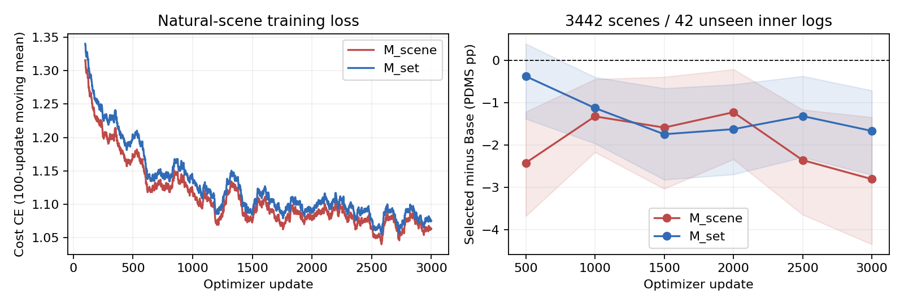

# Fixed-K4 cost-sensitive selection: completed study evidence

The fixed Query70k Base plus road/interaction/safe-progress candidates have
Oracle95.3517 on the1696-scene exploratory development set. Neither newly
trained direct decision head improves mean PDMS over Base in this run.
Candidate-set conditioning is substantially better than scene-only routing,
but does not solve selection or reduce tail failures versus the existing R00.

| Same fixed dev population | PDMS /100 | Gain versus Base pp | High→0 |
|---|---:|---:|---:|
| Base | 90.5302 | 0 | 0 |
| Road alone | 77.5541 | −12.9761 | 210 |
| Interaction alone | 85.1406 | −5.3896 | 96 |
| Progress alone | 81.4423 | −9.0879 | 128 |
| Fixed K4 Oracle | 95.3517 | +4.8215 | 0 |
| Existing R00 | 90.6960 | +0.1658 | 11 |
| M_scene, raw argmax | 88.3982 | −2.1319 | 41 |
| M_set, raw argmax | 90.4538 | −0.0764 | 16 |
| M_scene margin | 90.5302 | 0; always-Base | 0 |
| M_set margin | 90.5304 | +0.000253; 1 switch | 0 |

Development is previously observed, not blind Navtest. All policies use the
same actual Base, candidates, official labels and scene denominator. R00's
historical checkpoint-selection procedure differs. No new Navtest, generator
updates, external scoring weights or ACTIVE change occurred.

Implemented and executed: strict binding/canonical joins; full D_S log split;
R00 signed-error and post-hoc subpool analysis; two scratch3000-update
diagnostics; two independent64-scene/300-update fitting checks; prelocked
full-D_S scratch refits of2524 and631 updates; fixed external evaluation;
logit-margin calibration; real-image true-prerouting/set deployment; strict
bundle save/load; current-state diagnostic2000 updates; and same-device
real-image timing. Every trained head uses the native IQE optimizer/checkpoint
and consumed-sampler infrastructure. No old experiment was restarted.

Internal split:13139 scenes /169 logs fit,3442 /42 validation, from full
D_S16581 /211. Base and R00 previously saw D_S; the new heads' internal
validation logs were held out from their diagnostic training. Final refits
see all D_S, and their last endpoints are fixed before external results.
All new-model hyperparameters and budgets remain as registered.

The plot's held-out status applies to the new selection heads, not to Base or
R00. Shading is the2000-repetition paired log-bootstrap interval. Loss is a
100-update moving mean; all six scheduled validation points are retained.

The conditional P_current diagnostic fits its2048 scenes (+3.1527pp) but loses
5.8557pp on512 held-out scenes. More explicit current geometry did not provide
a transferable remedy in this bounded test. It is privileged, nondeployable,
and does not prove an information-theoretic limitation or justify unfreezing VLM.

Read [NEXT_STEP_DECISION.md](NEXT_STEP_DECISION.md) for the supported conclusions,
[SELECTION_REGRET_AND_TAIL_RISK.md](SELECTION_REGRET_AND_TAIL_RISK.md) and
[EXTERNAL_COMPARISON.csv](EXTERNAL_COMPARISON.csv) for all denominators, risks and
intervals, [EXISTING_ERROR_INTERPRETATION.md](EXISTING_ERROR_INTERPRETATION.md)
for expert/subpool costs, and [CURRENT_STATE_PROBE.md](CURRENT_STATE_PROBE.md)
for the current-state boundary and matched comparisons.

[REGRESSION_AND_RESUME.md](REGRESSION_AND_RESUME.md) records602 CPU-suite passes
and the three separately passed NCCL tests, including the two preserved
resource-admission retries. Both new heads also passed exact recovery on real
cached scenes. [INFERENCE_CALL_AUDIT.md](INFERENCE_CALL_AUDIT.md) and
[LATENCY_AND_PARAMETERS.md](LATENCY_AND_PARAMETERS.md) give actual trained
image-path calls, fresh-process equality and measured end-to-end cost.

On the same A800 80GB, batch1 and 100 real images after10 warmups:

| Path | Mean / p50 / p95 ms | New decision parameters |
|---|---:|---:|
| Base | 891.74 / 897.77 / 967.32 | 0 |
| K4 + R00 | 910.66 / 916.82 / 966.89 | 3301639 |
| M_scene true prerouting | 876.98 / 887.98 / 933.27 | 3299588 |
| K4 + M_set | 918.74 / 920.29 / 972.44 | 4090881 |

Each path executes the visual and language modules once. Small timing differences
between sequential modes are not proof of a causal speedup; the complete online
path includes image IO and preprocessing. No image-cache timing is substituted.
[EXECUTION_AND_RESOURCES.md](EXECUTION_AND_RESOURCES.md) records actual budgets,
parallel resource use and verified process exit on the nine allowed hosts.

[RUNBOOK.md](RUNBOOK.md) contains the actual commands and complete recovery
paths. The authoritative runtime root is
`/mnt/project/iqe-cost-sensitive-selection-20261015/main_v1`.
The audit parent is `1375ad2f67ed841f44bc7e6ec42bcc0f6d301bf0`; the isolated
branch is `research/iqe-cost-sensitive-selection-1375ad2` in IDayday/VLA-Drive.
Bindings, initialization hashes, launch source identities and full logs are
archived alongside these reports. Weights, raw images and metric caches are
runtime dependencies and are not committed. This study does not auto-push.
