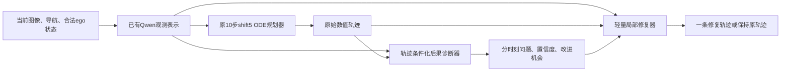

# Qwen-Flow：轨迹条件化诊断与修复

当前主线是学习 **“看见场景和一条具体轨迹，预测这条轨迹的后果、定位可改进位置，并输出经过验证的修改”**。先实现显式修复，再检验这项能力能否进入原规划表示。此前潜策略、物理搜索＋FM、存档约束三条研究路线已由用户暂停，包含尚未启动的随机窗口扩展；保留全部证据，不继续其训练或评价。

本文件区分已完成的代码/数据检查与建议的模型实验。**目前没有训练出新的诊断器或修复器，没有新的Navtest提升结果。** 本轮实际新增反馈合同、TRAIN覆盖检查和临时资源时间合同；原规划器、GRPO、评分数学和已有结果没有改变。

## 1. 设计选择：数值轨迹为主，场景表示为条件

建议统一建模，而不是把“先规划后修复”和“内化修复”发展成两套互不相干的系统。

第一版输入为当前部署可得观测O，以及原规划轨迹τ₀的**具体数值**。使用已有Qwen特征Z，不再跑一遍Qwen。τ₀保持原生8×3、局部坐标、0.5–4秒的x/y/heading；另用小型轨迹编码器编码位置、物理时间、速度和曲率等特征。诊断特征可以使用sin/cos避免角度周期不连续，但不更改原动作3维编码或Flow概率合同。

只输入DiT隐表示不适合作为起点：它依赖生成时间、噪声和checkpoint，未必能稳定指出“第几秒哪个位置越界”。当前runner最后的hidden也对应最后一个速度预测的输入状态，不等于干净终点轨迹。后续可把已有hidden作为附加输入，不能以它替代明确的几何轨迹和时间。



诊断器和修复器是学习模块；部署不调用真实评分器、不读取GT地图/未来对象，不用候选oracle挑输出。可解释建议由结构化预测和修改参数生成，例如“预计2.1秒开始越界；从1.2秒起减小右向偏移”，而不是让自由文本自行编造风险原因。

## 2. 诊断器要回答哪些问题

以实际模拟执行轨迹的0.1秒物理时间为监督轴，t=0单独保留，行动相关损失主要覆盖未来40个时刻。原8点请求轨迹与41状态的模拟执行轨迹分别保存；部署不能把真实未来模拟状态作为已知输入。

|问题|监督来源|输出及边界|
|---|---|---|
|哪里发生责任碰撞|官方NC分支、对象/责任类别、首次时刻，新增完整事件记录|时间/位置/类型及置信度；几何重叠不冒充责任碰撞|
|哪里越界|官方实际车身越界mask|完整越界时间段；几何道路并集余量另列|
|哪里违反TTC规则|官方投影和对象筛选逻辑|规则触发时刻与投影对象；不是“最小TTC秒数”|
|哪里接近道路或对象|同一物理时刻的实际车身与地图/对象几何|命名明确的连续代理；不称事故概率/官方TTC|
|哪里还有进度提升空间|官方EP/原始进度＋同场景经过评分的可行反事实|改进机会及证据；慢、停车、低EP本身不等于错误|
|应该从哪里开始修改|成功修改的起始控制参数和修改前后评分|修改起点可以早于事件时刻；不是由首个事件直接推断因果|

官方DAC检查车身角点是否落在指定可行驶多边形内；几何“整个车身在道路并集内”和与其边界的距离是补充标签，不能静默替换官方DAC定义。相邻车道内部接缝不作为道路外边界，孔洞和跨界仍需正确处理。

官方TTC在每个物理时刻检查前向投影与对应未来对象，包含停止阈值、前后方及路口判断。现有`official_first_ttc_infraction_seconds`是**首次规则违规发生的物理时刻**，不能用距离/速度代替或把它称为最小TTC。

连续间距需要区分“明确没有查询范围内对象”和“数据缺失”。目前现有几何工具能够从cache和实际车身补提道路余量、越界面积、同刻对象距离；它们尚未进入本次候选bank，不能直接宣称标签齐全。

“进度慢”的正确监督是：同一场景下，确实存在一条经过官方独立评分、符合预定义可行条件且有更高真实分数/EP的轨迹。反事实搜索未找到更好轨迹只表示当前预算没有证据，不标成“无须改进”或“绝不可能改进”。需要保留正确停车的样本，避免模型将所有低速都改成前冲。

## 3. 已实际检查的反馈覆盖

读取已封存的共同TRAIN候选bank，只访问TRAIN的512场景/344 logs，5条参考＋32条候选/场景，共18,944条记录。核验bank索引、payload hash、checkpoint、场景/评分身份、请求轨迹一致性；没有新增模型前向、评分、GPU任务或参数更新。这是旧诊断人口，**不是完整101,592场景TRAIN的无偏普查**。

|已有记录|数量|
|---|---:|
|请求8×3轨迹、模拟41×11状态、原生分项、逐时刻越界、首事件、原始进度字段|18,944|
|NC/DAC/TTC完全通过|18,665|
|零分 / 满分|160 / 7,210|
|发生责任碰撞的候选 / 涉及场景|9 / 2|
|发生TTC违规的候选 / 涉及场景|128 / 15|
|未来越界时间格，跨候选累计|1,930|
|同场景池中有安全且至少高0.005原始分数的替代候选的原始记录|9,605|
|上述替代候选同时有更高EP的原始记录|9,493|
|完整碰撞/TTC事件mask、连续几何余量、已验证的局部修改方向|均尚未提供|

“首事件字段存在”包含null表示官方未发现事件，不能把18,944条字段覆盖解释为18,944次事件。候选数不是独立场景数；9,605条机会也不是9,605个可修复场景或新模型收益。池内可能存在物理上重复/接近的轨迹，本统计计记录，不声称唯一行为数量。

这次检查揭示一个具体数据风险：只用当前bank训练，碰撞诊断主要只有2个场景，极容易学成进度预测器。下一步先从**已有TRAIN**失败链、候选和搜索记录中补充多类型失败，保留行为checkpoint和评分身份；对缺失字段的轨迹进行有限、版本化补提。不得从Navtest失败记录构造训练集。

原始聚合证据：[feedback_coverage_TRAIN512_v3.json](feedback_coverage_TRAIN512_v3.json)。原轨迹、scene token和大bank不提交git。

## 4. 修改监督：不能只知道“有问题”

需要记录 `(O, τ₀, f₀, u, τ₁, f₁, Δmetrics)`：原轨迹及其后果、修改参数、修改后的轨迹及重新评分、收益与代价。标量PDMS或一次诊断不能唯一给出该向左还是向右、该减速还是等待。

复用现有平滑轨迹工具，以4–6个连续参数表达到达时间/平滑减速、制动起点、侧向偏移和曲率形状；约束初始位置/速度连续，是否保持加速度必须明确验证，不默认声称全部连续。实际控制器执行后的动态量和官方反馈才是验收依据。不能独立抖动8个waypoint。

优先利用已有、确实评分的同场景替代轨迹；能够落入统一局部修改器的样本形成方向监督。对不足的失败类型做有限局部扰动、重新独立官方评分，以获得可验证方向。保存失败修改和没有改善的尝试，不能只存成功案例。

第一版每个原轨迹只选一种连贯、低修改幅度的合格目标。左右绕行都可行时，不把两条轨迹平均成穿过障碍物的一条；多模态编辑留到单模式能力建立后。编辑可行与模型能预测其后果仍需分别检验。

更好的同场景候选只证明存在替代，不自动成为“这个时间点应该怎样修”的标签。事件位置、编辑起点与可归因的收益分别记录。局部扰动得到的是有限反事实证据，不称为官方PDMS精确梯度。

## 5. 第一种形式：先规划，后修复

冻结已验证的成熟CANONICAL50k规划器（共同bank身份`cfc3a0c949237a7ff59c9b63132a0fc82ec7b7cd154160813007ac1d279fab20`，历史seed2101 Navtest90.513164）。不从旧P/S失败checkpoint开始，不与另一个正在训练的IL77k父模型混用控制。

诊断器D接收场景token和轨迹编码，输出40个未来时刻的问题及置信度。可用小型2–4层cross-attention，并使用可用性mask训练各任务。标注覆盖不同，缺失项不填0；首次事件标签不能展开成完整持续时长。

修复器R接收同一场景、原轨迹和**预测**诊断，输出平滑编辑参数、保持/修改门控和建议修改区间。零编辑初始化应严格复制原轨迹。对本来好的轨迹加入保持原样监督，所有损失按登记的人口和场景归约，不能让失败样本过采样隐形改变主评价口径。

训练分两步：先用真实标签训练诊断器；再主要经预测诊断路径训练修复器，真实反馈输入只作为单列的能力上界。不能训练时总给真实事件、部署时才第一次换成预测事件。初期冻结已训练诊断器，防止修复器通过改变评价特征获得虚假改善。

采用真实修复目标的非负监督、好轨迹保持、编辑平滑/幅度及门控监督。首版不直接对学习出来的风险预测器无限做梯度下降；那会产生评分模型利用，而不一定提高真实PDMS。遇到局部修复空间之外的情况允许低置信度/保持原轨迹，但不能将“保持”叫作完成修复。

部署增加的是轻量诊断＋编辑网络：Qwen一次、原DiT十步一次，再输出一条修改后的轨迹；不再完整跑第二次30层DiT×10步，不在线做评分/GT选轨。实际额外延迟和显存仍需profile，不能只按参数少推断便宜。

## 6. 第二种形式：把修复能力内化到原规划前向

显式修复成功后，增加共享的轻量残差表示适配A，位置在Qwen观测特征进入原动作专家之前。A以恒等/零残差初始化，先冻结Qwen、训练A和原动作attention LoRA。它满足“动作头之前的表征确实接收诊断梯度”，不需要第一轮就反传整个Qwen，也不重新引入8个query压缩。

建议先使用以下明确耦合：

```text
Z = A(Qwen(O))
L = L_source_FM(policy(Z), verified_repaired_target)
  + lambda_diag * L_diagnosis(D(Z, stopgrad(original_trajectory)), true_feedback)
  + lambda_keep * L_retention
```

源FM继续使用当前3维编码、连续时间、shift5、原training_weight和`epsilon-action`速度目标。改进标签来自已验证的修复轨迹；诊断分支让同一Z学习道路、交互与轨迹后果。保持项来自固定TRAIN好轨迹/父策略，系数只在TRAIN少量批次校准后锁定。

关键约束：

- 诊断监督对应的原轨迹必须固定/stopgrad。不能一边改变轨迹，一边沿用旧轨迹的事件标签。
- 只有诊断loss回传到Z并不证明原策略学会修复；还需要修复目标的动作学习及重新生成评价。
- 若以后直接使用预测风险作为actor的可微目标，必须冻结诊断参数和它使用的观测特征路径，或限制actor无法改变它们。单独冻结D权重、却让actor随意改共享Z，仍可能隐藏风险。
- A/provider开始训练后，禁止复用它输出的跨update缓存；只缓存更上游确实冻结的Qwen表示。同batch可复用当前有梯度的condition。
- 在部署删除D和R，保留A＋原单候选10步ODE；此时必须重新证明收益，没有“诊断准确所以规划一定提升”的推论。

不要一开始在每个去噪步调用风险头、反传全部ODE或加风险梯度引导。带噪状态不等于物理轨迹，Flow时间不等于驾驶时间。若未来要预测clean轨迹，需要按当前源符号使用`x_sigma - sigma * velocity`，并单独验证其分布与诊断器训练支持，而不是直接把x_sigma当车辆轨迹。

## 7. 与以前“搜索＋FM”的区别及必要对照

旧S3把搜索得到的目标直接用于FM，完整Navtest五seed均值90.389706，成熟BASE90.471774，未形成净收益。那项负面证据保留，不能因为现在换了名称就忽略。

本路线新增的是 **(场景、这条原轨迹)→分时刻后果→针对性的编辑**，同时监督不该修改的好轨迹。显式形式先检验“给定这条轨迹能不能修”，不要求学生仅从场景一次重新生成就先学会所有修复；内化阶段再检验这一迁移。

最小实验按阶段执行，不一次启动大矩阵：

1. 显式阶段：固定原规划器；对比无诊断分支的直接轨迹编辑，与同容量/曝光的诊断＋编辑。少量打乱同场景轨迹或反馈对应关系，检查模型是否真在看轨迹及过程信息。
2. 内化阶段：仅在显式能力成立后，对比同一修复标签的普通FM吸收，与FM＋共享表示诊断监督。其余保持、曝光和优化预算一致。

诊断器分项精度、可表达性和训练拟合只是工程/机制证据，不作为方法有效性判据。候选oracle、真实反馈输入的修复上界与部署预测反馈输出分表。外部修复轨迹不携带伪造的GRPO old概率；后续若接RL，应从更新后的actor重新生成真实链。

## 8. 评价及最小启动顺序

主评价继续完整12146场景/136logs的canonical NAVSIM v1.1，单输出、source shift5十步ODE、固定seed2101，与同父策略逐场景配对、按log聚类bootstrap。遵守用户要求：**只有完整Navtest净PDMS改善才支持方法有效性或性能提升**；DEV/TRAIN仅用于数据、数值及学习链检查。Navtest标签/候选不得回流训练，也不据测试调阈值。

必须同时报告原好→新失败、原坏→修复、NC/DAC/TTC、进度、G+与G−、净PDMS、增加延迟和费用。一次只输出一条轨迹，不以best-of、预测评分重排或GT选轨达到目标。

实际推进顺序：

1. **已完成**：暂停旧三路线；建立隔离分支、反馈合同、TRAIN512覆盖检查及绝对资源时间合同。
2. 补齐TRAIN失败人口、官方事件轨迹记录及有限修改前后配对；新导出只增加诊断，不改变评分数学；与原评分器对照全部分项、模拟状态及候选隔离。
3. 用冻结Qwen特征训练轻量D/R；训练前profile并锁定人口、预算和固定检查点，验证原始观测部署、完整恢复及临时主机退出。没有真实标签/模型前向的CPU测试不替代这些验收。
4. 锁定显式模型后完成全Navtest；再决定是否进行共享表示内化。不启动潜策略/存档/窗口扩展。

新阶段训练预算尚未锁定，没有把旧三路线256步或50k长训直接当作新任务授权预算。已保存候选的历史构建费用仍应计入数据来源，本次检查只新增约18秒CPU读取/校验，没有新增评分。

## 9. 临时资源与无损续训边界

用户本次九小时窗口：2026-10-25 **14:38:22–23:38:22 UTC**，即北京时间当日22:38:22–次日07:38:22。不是从每个worker启动时另算九小时。

固定迁移目标：`vla-zt`、`tsinghua-zt`、`tsinghua-zt3/4/5`。其余已识别zt容器仅在临时任务授权下候选可用，需要现场检查连接、GPU UUID、显存、占用与任务owner。`vla-zt3`具有别的任务临时scope，不因此变成永久目标；`tsinghua-zt6`继续只用1–7卡。

|UTC绝对时间|操作|
|---|---|
|22:38:22|停止临时主机新任务准入|
|22:53:22|要求训练提交完整native checkpoint并退出|
|23:08:22|目标完成迁移，转固定主机共享资源|
|23:37:22|临时worker必须全部退出，留一分钟余量|
|23:38:22|授权结束，临时主机完全不再使用|

迁移必须包含权重、Adam、scheduler/scaler、CPU/CUDA/自定义RNG、数据游标、待完成batch/inner、源码/数据/标签身份和成本账本。固定目标若暂时放不下，完整保存后在固定目标等待；不能为了连续运行越期。迁移允许短暂停顿，“无损”指训练状态与后续采样可恢复，不承诺无停顿。

本次只读现场检查发现`vlawm-zt`和`tsinghua-zt6`有空闲GPU；部分其他主机连接失败或有不可见owner占用，不能把低显存或空进程列表当作空闲证明。固定`vla-zt`的SSH别名无法解析，但本机正是其worker，需走本地执行或修复明确别名，不误判主机不存在。

**当前新主线未部署GPU训练，所以尚无新的临时训练需要迁移。** 活策略仍将新训练准入锁在“deadline guard＋native恢复验收”之前；已实现的`lease.py`是经过边界测试的时间合同，**不是已安装的训练watchdog，也不是迁移验收完成**。九小时上限也已登记到本项目相关任务的资源到期覆盖记录；对现有临时`vla-zt3`训练登记了native迁移owner交接，不把原任务许可解释成永久资源。不因这次授权直接修改其他真实IL/RL/DINO算法或随意发送停止信号；应由各自owner沿native恢复路径迁移。见[公开时间摘要](resource_window.json)，私有交接路径在摘要中。

## 10. 相关经验与可迁移范围

- [ELF-VLA](https://arxiv.org/html/2603.01063v1)与本问题最接近：为失败轨迹提供结构化反馈，再生成修正。其教师反馈可访问GT轨迹，使用文本/动作生成及额外奖励，不能把其token概率处理或成绩直接当成本项目连续Flow/canonical v1.1结果。这里借鉴“明确指出失败并学习修正”，改为官方过程标签和部署可用的学习诊断器。
- [Hydra-MDP](https://arxiv.org/abs/2406.06978)展示了将规则教师的规划评价知识蒸馏进模型的路线；它支持分项监督的动机，不自动证明时间定位或方向修复有效。
- [Diffusion-ES](https://arxiv.org/abs/2402.06559)可作为有限黑盒反事实采集的参考；在线搜索成绩不是本项目的部署输出。本轮不迁移其完整平台或增加一条搜索长训。

以上为来源经验；D/R结构、共享A、梯度隔离、门控及阶段控制是本项目提出的适配，需要实际实验。不会以已有论文或模块可运行代替Navtest证据。

## 11. 已执行命令与当前交付

工作目录：`/mnt/project/VLA-Drive-qwen-flow-trajectory-repair-20261025`；私有资产：`/mnt/project/qwen-flow-trajectory-repair-20261025`。

```bash
CUDA_VISIBLE_DEVICES='' /mnt/project/flow-safe-improvement-20261013/venv/bin/python \
  -m unittest discover -s tests/trajectory_repair -v

CUDA_VISIBLE_DEVICES='' /mnt/project/flow-safe-improvement-20261013/venv/bin/python \
  -m scripts.analysis.trajectory_repair.audit_feedback \
  --bank-root /mnt/project/qwen-flow-three-routes-20261024/common_bank \
  --output /mnt/project/qwen-flow-trajectory-repair-20261025/feedback_coverage_TRAIN512_v3.json

/usr/bin/python3 -m scripts.analysis.trajectory_repair.lease_status \
  --authorization /mnt/project/qwen-flow-trajectory-repair-20261025/resources/AUTHORIZATION.json
```

审计命令拒绝覆盖已存在结果；重跑使用新的output版本。检查脚本不会启动actor/评分、不会写旧bank。已执行4场景smoke及完整512检查，新增测试覆盖缺失标签、事件语义、动作/时间形状、相同分数、慢速不误标、canonical读出和临时期限。具体证据见[validation.json](validation.json)。

当前不公布尚未实现的`train_repair`或部署CLI，也不将设计中的D/R称为已训练功能。下一项实际实现是版本化事件导出及修改配对，然后进行真实模型训练。
