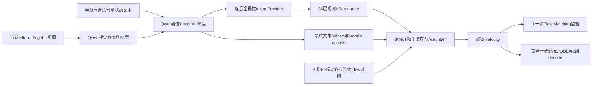

# Qwen-Flow当前架构与训练、部署时间评估

本报告回答“模型现在是什么结构、为什么每次更新约4.6秒”。这是实际结构和计算效率评估，**不代表新模型已获得NAVSIM规划提升**；当前没有正式新IL/RL Navtest分数。

正式训练固定源码为`d4d0012769540af8378e013c072d6d8053d9f275`。本次只在隔离副本上增加计时与trace，没有修改正在运行的IL、优化器、RNG、数据顺序或预算。正式run绑定的90个源文件逐一重新核对，hash全部一致。隔离诊断源码为`75409d1`。

## 1. 结论与证据边界

1. **当前4.64秒是完整模型的IL更新，不是GRPO更新。** 每步全局32个场景、96张当前相机图像；每卡microbatch1、累积4次前向/反向，最后做一次optimizer更新。IL每个场景只抽一次FM噪声和时间，没有展开十步ODE，也不调用PDMS评分器。
2. **模型实际33.48亿参数。** 通用Qwen约21.28亿，完整动作专家约10.21亿，观测provider约2.00亿。它的动作侧也很大；“Qwen 2B＋一个很小的动作输出层”不能描述当前模型。
3. **主要时间在完整反传和重复的模型前向。** 单卡、四次累积的真实场景诊断中，反传约56.8%，Qwen前向13.5%，动作侧前向14.3%，provider前向2.5%。这些是隔离单卡的内部占比，不能直接拼成八卡正式训练的时间分解。
4. **FP32完整副本和microbatch1限制吞吐。** 当前IL采用PyTorch DDP，每卡保留全模型、梯度和Adam状态，没有ZeRO分片。完整八卡训练峰值约75.0GB/卡。内存压力使每卡四个场景串行累积，难以用较大microbatch摊薄小矩阵和kernel launch成本。
5. **数据和Adam有优化空间，但不是数倍加速的来源。** 正式数据/processor计时每卡每更新约0.341秒；诊断Adam约0.171秒。即使理想消除，也不足以把4.6秒变成1秒。
6. **部署是另一种瓶颈。** 单场景在线前向约0.962秒，其中十步FP32动作ODE约0.821秒，占约85%。Qwen和provider只前向一次；没有把Qwen重复十次。

正式八卡结果来自连续500步日志；单卡分段结果来自两次warmup后的六次真实全参数更新。单卡诊断在另一台授权、允许共享的A800上执行，**不把4.64−4.06秒解释成NCCL耗时**。完整八卡各阶段的通信重叠和等待比例仍没有直接trace，不伪造这一分项。

## 2. 当前实际模型



### 输入与Qwen

- 官方通用Qwen3-VL-2B-Instruct，保留官方processor、chat template、mRoPE、DeepStack与因果decoder。
- 输入是当前同步的left/front/right三视图、导航、当前速度/加速度等合法状态；不输入历史专用槽、未来图片、GT轨迹、地图对象或评分反馈。
- processor固定目标面积`384×672`，实际保持长宽比并做原生取整。本次真实场景每张图`image_grid_thw=[1,22,42]`，对应`352×672`处理后像素与924个合并前patch；三图共2772个视觉patch，合并后共**693个视觉token**。不能把384×672当成本次每张图实际像素形状。
- 本次样本有109个有效非视觉文本token，总序列802；其他实测样本为802/803。提取embedding及28层hidden，不生成文字，不计算LM词表logits或语言CE。

### QwenConditionProvider

- Qwen层数28、动作层数30，固定映射`j(l)=1+floor(l*27/29)`。30层分别读取所映射Qwen层的**全部当前视觉token**；没有8个观测摘要query。
- 共享`2048→1024`视觉bridge。由于映射到28份不同深度的hidden，这个bridge在每个场景应用28次，两个重复层复用已经计算的bridge结果；不是把同一Qwen完整前向重复28次。
- 每个动作层拥有独立的观测LayerNorm/K/V/RMSNorm，K/V投影为`1024→3072`。这些参数从通用初始化后的源动作模块复制，和可训练action参数没有alias。
- K使用源RoPE，当前时刻坐标均为0，三相机横向tile区分位置；不是BEV配准。Qwen自己的mRoPE不改。
- 最终文本hidden通过`2048→4096`bridge。当前8维proprio通过源形式的linear编码，append为一个额外context token。本次context为`[1,110,4096]`，再经过源ActionDiT的text embedding。

### 源动作专家

| 项目 | 实际值 |
|---|---|
| 动作 | 未来0.5至4秒的8个局部绝对`x/y/heading`，形状`[B,8,3]` |
| 动作归一化 | 源absolute min/max；不使用旧z-score或sin/cos |
| 主hidden / FFN | 1024 / 4096 |
| 动作层数 | 30 |
| attention空间 | 24 heads × 128 = 3072，不等于hidden1024 |
| 每层 | 动作self/mixed attention、对观测K/V读取、文本/状态cross-attention、源norm/gate/FFN |
| 时间 | 连续`sigma*1000`浮点值，无整数bucket |
| 输出 | 源实际使用的Linear head，8×3 velocity |
| 初始化 | 官方通用Wan转换的动作backbone；在线不加载Wan视频专家 |

动作mixed attention只有8个action query，读取693个观测K/V加8个action K/V。它**不是在动作专家里对701个token执行完整701×701视觉自注意力**。不过30层宽投影、cross-attention和小序列FFN仍有实际时间与参数成本。

IL沿用源定义：`u~Uniform(0,1)`、`sigma=5u/(1+4u)`、`x_sigma=(1-sigma)*action+sigma*epsilon`、目标velocity为`epsilon-action`，使用源时间权重。部署从同一噪声先验进行10步shift5 ODE，最终3维动作在链外反归一化。

### 实际参数规模

| 模块 | 参数量 | 总量占比 |
|---|---:|---:|
| Qwen视觉，含merger等视觉模块 | 406,957,056 | 12.16% |
| Qwen语言侧，含输入embedding，无LM输出头 | 1,720,574,976 | 51.39% |
| 新condition provider/bridges/proprio | 199,547,904 | 5.96% |
| 完整源动作专家 | 1,020,877,827 | 30.49% |
| **总计** | **3,347,957,763** | **100%** |

共1605个参数张量，正式IL参数存储全部FP32，前向autocast为BF16，Adam状态FP32。前1000步只训练接口与源随机action encoder/head；当前已进入完整模型训练，Qwen、provider及动作专家都有梯度。

结构对应：[模型](../../starVLA/model/modules/qwen_sourceflow/model.py)、[Qwen输入与提取](../../starVLA/model/modules/qwen_sourceflow/qwen_encoder.py)、[provider](../../starVLA/model/modules/qwen_sourceflow/condition_provider.py)、[MoT runner](../../starVLA/model/modules/qwen_sourceflow/cached_action_runner.py)、[源动作专家](../../starVLA/model/modules/qwen_sourceflow/vendor/action_dit.py)。

## 3. 正式八卡：4.64秒究竟处理多少内容

观测时间为2026-10-19 00:22:36 UTC，使用updates **5428—5927**，每步取八rank日志中最大wall，保留全部500步，没有挑最快窗口。

| 实测 | 值 |
|---|---:|
| 每次完整optimizer更新平均wall | 4.63997秒 |
| 中位数 / p95 | 4.48919 / 5.03138秒 |
| 全局scene batch | 32 = 8卡 × 每卡1scene × 累积4次 |
| 全局吞吐 | 6.8966 scenes/s，即约20.69张当前相机图像/s |
| 数据读取、processor、状态/target准备 | 平均每rank每更新0.34062秒 |
| GPU峰值allocated | 75,014,944,256 bytes/卡，约69.86GiB |
| 最近完成5000步checkpoint保存wall | 78.0913秒 |

数据计时是各rank平均值，不能直接把它当作全局关键路径的精确独占比例；量级约为更新wall的7.3%。日志内每步wall不包含步骤之间的checkpoint、stop-flag collective等开销，端到端成本应另计。

**一次IL更新包含：**

1. 每卡顺序读取4个场景及其三视图、processor与合法状态/GT准备。
2. 对每个场景执行一次当前有梯度的Qwen＋provider、一次随机时间的FM动作前向、一次反传。
3. 前三个microbatch使用DDP `no_sync`累积，第四个参与同步；完成一次梯度检查/clip1和一次AdamW更新。
4. Qwen与源动作post-block使用activation checkpoint；反传需要重算相关前向。

这里没有PDMS仿真、GT replay、BC、候选搜索、G8 rollout或inner4。不能将上一轮RL评分瓶颈套用到当前IL。

100000更新上限对应320万次scene曝光，约完整TRAIN的31.5遍，含接口稳定期。按最近完整阶段速度粗略外推，仅更新就约5.4天/约1031 GPU-hours占用量级（8×wall，未计其他共享任务的成本），另加保存与评价；不是整个数据集只遍历一次。这个上限已登记，本轮没有自行缩短或延长。

依据：[正式窗口JSON](efficiency_formal_window_20261019.json)、[IL循环](../../scripts/analysis/qwen_sourceflow/train_il.py)、[IL配置](../../configs/qwen_sourceflow/il.yaml)。

## 4. 隔离的分段计时和算子证据

使用正式IL 5000步的固定副本，另一授权A800上的单GPU，完整相同模型和训练精度；每次累积4个真实TRAIN场景。新建一次性Adam，不加载正式optimizer，不写训练模型或修改正式run。两次warmup后六次更新：平均**4.06153秒**、中位数4.00570秒、范围3.90890—4.51284秒。

| 部分 | 每更新平均stream elapsed | 占诊断wall |
|---|---:|---:|
| 数据、processor与target准备 | 0.27894秒 | 6.87% |
| Qwen前向 | 0.54697秒 | 13.47% |
| Provider前向 | 0.10002秒 | 2.46% |
| 动作专家前向与FM loss | 0.57965秒 | 14.27% |
| **全部反传，含checkpoint重算** | **2.30650秒** | **56.79%** |
| 梯度检查与clip | 0.04965秒 | 1.22% |
| AdamW | 0.17150秒 | 4.22% |
| zero-grad | 0.00329秒 | 0.08% |

其余为区域间Python、同步和计时开销。CUDA event测量同一stream上区域之间的elapsed，包含CPU提交间隙；数据区域也以此记录，它不是纯GPU kernel执行时间。单卡没有DDP同步、场景与正式窗口不同、GPU可共享，不能把这些比例当作正式八卡逐项耗时，也不能将正式与单卡的差值归因于通信。

另外对**一个microbatch＋一次全模型Adam更新**采集独立Kineto trace。trace不进入上述六次计时：

- 实际51907个GPU kernel事件，51780次`cudaLaunchKernel`，287次`cudaStreamSynchronize`。这表明小算子、转换、优化器和Python/autograd调度值得优化；不能把GPU利用率低直接解释成“没有计算”。
- Qwen视觉attention forward为144次，即24层×3图×原前向/重算；backward72次。语言attention forward56次、backward28次，同样反映28层checkpoint重算。
- 源动作mixed attention forward30次；文本cross-attention forward60次、backward30次，对应post-block重算。实际backend包含Qwen FlashAttention和动作memory-efficient SDPA，**不是所有attention都落在未优化的朴素实现上**。
- 一个代表性语言MLP矩阵为`[802,2048]×[2048,6144]`；观测memory涉及693-token宽投影；动作本体则是8-token小矩阵。三种计算的吞吐特征不同。
- trace自身wall约1.830秒，kernel duration总和约0.601秒。profiler有明显开销、kernel可以重叠，该比值**不能用来宣布正式训练有67%空闲或预计3倍加速**。

普通forward post-hook在非reentrant checkpoint提前停止重算时不一定再次触发；原始`module_forward_calls`是完成hook计数。上面的重算结论使用实际attention算子次数，不用post-hook计数误判Qwen没有重算。

这次有限诊断worker总wall150.95秒，其中模型加载/严格校验与setup约82.08秒。加载开销没有算入每次更新。它是共享worker占用，不能写成独占GPU计算时间。

完整小型证据：[单卡计时、结构与算子摘要](efficiency_profile_20261019.json)。原始152MB trace保存在私有诊断目录，不提交仓库。

## 5. 内存和全视觉memory的代价

每卡完整FP32参数约13.392GB；FP32梯度约13.392GB；Adam两个FP32动量约26.784GB。四者合计约**53.567GB**，尚未包含DDP bucket、BF16算子权重转换、激活、checkpoint bookkeeping和临时张量。

当前是完整副本DDP，不是参数/optimizer分片。单卡诊断峰值61.64GB、正式八卡峰值75.01GB，后者还包含分布式缓冲与不同执行布局。这只是实际峰值对照，不将差值当作精确DDP内存归因。

本次观测memory每层为：

- `K=[1,693,3072]`、FP32、8,515,584 bytes；源RMSNorm参数参与的dtype提升和RoPE后保留该dtype。
- `V=[1,693,3072]`、BF16、4,257,792 bytes。
- 30层K/V共**383,201,280 bytes/scene**，约365.45MiB；这还不是整个训练激活。
- RL/部署进入FP32动作边界后，K/V总量约510,935,040 bytes/scene。

如果将全TRAIN 101592场景的这30层K/V全部落盘，当前混合dtype约**35.41TiB**，FP32动作边界约**47.21TiB**，均未加文本、索引、文件和冗余。因此没有构建全量dense KV cache是合理选择；IL时Qwen/provider在更新，本来就不能跨更新复用旧hidden。

该代价来自“逐层全视觉读取”的明确设计，但provider前向只占本次诊断约2.5%。不能仅看到cache大，就把它说成4.6秒的主要时间瓶颈。

checkpoint文件实测模型13,392,370,565 bytes、optimizer26,785,012,259 bytes。最近完整保存约78秒，每1000步一次相对约4640秒更新成本约1.7%；有必要保留恢复点，也不应将其解释为每步训练都在写40GB。

## 6. 部署与后续RL和当前IL不能混用计时

当前部署保持一次Qwen/provider前向，之后用该condition执行十步shift5 ODE。真实TRAIN图像的一次warmup后，同一场景测三次：

| 部分 | 平均时间 |
|---|---:|
| Qwen，BF16 autocast | 0.11249秒 |
| Provider，BF16 autocast路径 | 0.02764秒 |
| 十步源动作ODE，FP32动作边界 | 0.82115秒 |
| 总forward wall | **0.96210秒** |

这里不包含原始JPEG读取、processor、模型加载、PDMS评分；是小样本共享GPU诊断，不是全Navtest吞吐承诺。ActionDiT/ODE是当前部署主要开销：30层、每步都进行动作相关计算，十步合计300层动作执行；连续时间与均值更新必须顺序进行。

部署中condition K/V已复用，Qwen不运行十次。不过源`pre_dit`文本embedding和action cross-attention的文本K/V当前仍随每次velocity调用计算；在冻结部署模型的生命周期内，它们存在缓存机会，须验证完整ODE输出一致性。

正式RL尚未开始。它将冻结Qwen/provider和动作base，只训练action attention LoRA；每scene一次prefill后用于G8×K10及reference。RL仍包含真实评分、3个随机转移重算和四次inner，不能用当前IL的4.64秒推算RL更新速度。已有16步资格profile费用见[中期记录](interim_IL005000.md)，不冒充正式RL实测。

## 7. 提速优先级：依据当前证据

| 优先项 | 为什么值得做 | 边界 |
|---|---|---|
| 内存分片后扩大microbatch，保留global32 | 每卡FP32模型/Adam完整复制使microbatch1、四次串行累积；更大的microbatch可能摊薄动作小矩阵和launch成本 | 尚未实测加速比。需要相同显式FM噪声/时间与数据顺序下的loss/梯度、optimizer和恢复资格；不能直接把旧ZeRO验收移植为新模型PASS |
| 减少执行层小kernel和重复只读计算 | trace有约5.2万kernel/单micro＋Adam；动作8-token路径的小矩阵与FP32执行不能只靠增加理论FLOPs解释 | 优先固定RoPE/mask和合法context投影生命周期；每项验证实际数值收益，不进行全仓CUDA重写 |
| CPU预取、JPEG/processor流水化 | 当前同步读取位于关键路径，正式每卡约0.34秒/更新 | 同人口、模板、像素、RNG与数据顺序；量级最多约7%，不会单独产生数倍加速 |
| 验证foreach/fused Adam与梯度归约 | 当前`foreach=False,fused=False`逐tensor处理1605个参数张量 | Adam本次约4.2%，理想上限也较小；FP32状态、decay、eps、clip与恢复必须对照，不能宣称bitwise无损 |
| 冻结部署的文本embedding/文本K/V缓存 | 十步ODE占单场景forward约85%，重复只读投影值得减少 | action LoRA变化后缓存失效；禁止跨inner更新缓存可训练cross-attention K/V；先验证完整10步轨迹 |

不将“减少层数/视觉token、冻结Qwen、减少Flow步数或改变训练人口”列作本轮无损优化，它们会改变已登记模型或学习问题。也不直接启用TF32、改变动作BF16/FP32边界、移除checkpoint后继续称为原数值合同。

目前最值得验证的执行路线是**先降低完整副本的optimizer/梯度内存压力，再保持global32扩大microbatch，实测摊薄串行和launch成本的效果**。这是有证据的优化优先级，仍不是已获得的加速结果。本次没有为安装补丁而中断正式IL，也没有对正式配方做热修改。

## 8. 已执行入口与复核

实际诊断命令如下，输出目录已存在、入口拒绝覆盖；重测须使用新目录并重新检查当前授权和实际GPU/RAM：

```bash
cd /mnt/project/qwen-sourceflow-native-20261018/snapshots/efficiency_diagnostic_20261019
CUDA_VISIBLE_DEVICES=0 CUBLAS_WORKSPACE_CONFIG=:4096:8 \
  OMP_NUM_THREADS=8 MKL_NUM_THREADS=8 OPENBLAS_NUM_THREADS=1 \
  TOKENIZERS_PARALLELISM=false \
  /mnt/project/flow-safe-improvement-20261013/venv/bin/python -u \
  -m scripts.analysis.qwen_sourceflow.profile_efficiency \
  --checkpoint /mnt/project/qwen-sourceflow-native-20261018/qualification/IL_formal005000_parent \
  --output /mnt/project/qwen-sourceflow-native-20261018/performance_20261019/single_GPU_v1 \
  --trace
```

实际主机为`training-vlawm-tsinghua-zt3`；派发前两次检查物理GPU UUID、可用显存和可见owner，未停止任何既有任务。profile完成退出，无模型权重、optimizer或cache发布。CLI帮助与Python编译检查均已执行；真实八次IL更新、单micro trace与四次完整ODE前向全部完成。

私有收据位于`performance_20261019/`，包括资源检查、派发参数、PID/start identity、原始分段计时、完整trace与COMPLETE。仓库只保存本报告、小型结构/统计JSON和真实可运行的[计时脚本](../../scripts/analysis/qwen_sourceflow/profile_efficiency.py)。
