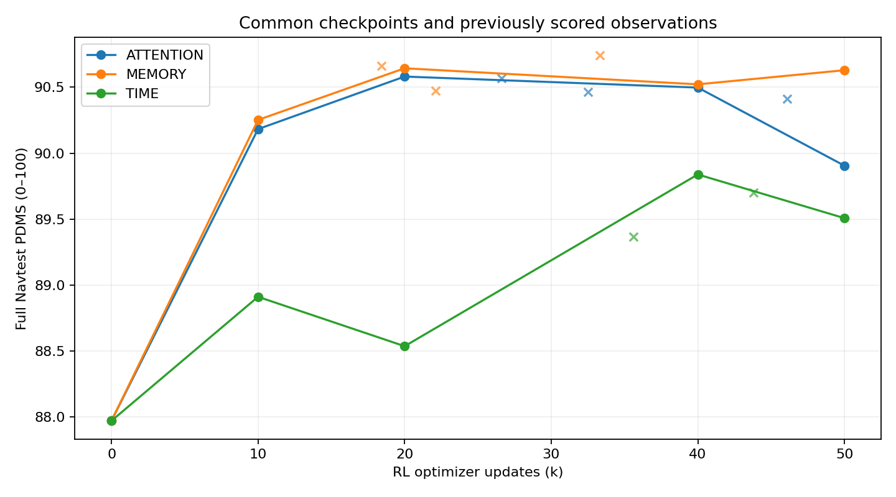

# Qwen-World RL：中间权重完整Navtest

三条路线均从同一IL40k父模型开始。此次预先固定10k/20k/40k，各新增3个检查点，共9次完整12146场景评测。canonical v1.1、单候选clean-x十步shift5 ODE、seed2101；无新训练、额外seed、best-of-N或部署选轨。50k终点和已完成的非整数历史补点直接复用。Test历史已反复观察，不称盲测。

| 路线 | IL父模型 | RL10k | RL20k | RL40k | RL50k | 50k−IL |
|---|---:|---:|---:|---:|---:|---:|
| ATTENTION | 87.972382 | 90.182716 | 90.580893 | 90.497375 | 89.905612 | +1.933230 |
| MEMORY | 87.972382 | 90.252348 | 90.643672 | 90.521862 | 90.628892 | +2.656510 |
| TIME | 87.972382 | 88.911957 | 88.537707 | 89.838968 | 89.508000 | +1.535618 |

实线为事先锁定的共同步数，叉号为历史已有补点。不能把稀疏曲线的最高点称为训练全过程最高点。

| 路线 | 更新区间 | 净变化PDMS点 | 配对95%区间 | G+ | G− | 新增零分 | 零分恢复 |
|---|---|---:|---|---:|---:|---:|---:|
| ATTENTION | 0k→10k | +2.210333 | [+1.572860, +2.803128] | +4.189333 | -1.979000 | 106 | 439 |
| ATTENTION | 10k→20k | +0.398177 | [+0.128438, +0.705125] | +1.336313 | -0.938136 | 88 | 77 |
| ATTENTION | 20k→40k | -0.083518 | [-0.393419, +0.199022] | +1.053769 | -1.137287 | 82 | 85 |
| ATTENTION | 40k→50k | -0.591763 | [-0.930249, -0.248103] | +1.377216 | -1.968979 | 140 | 121 |
| MEMORY | 0k→10k | +2.279966 | [+1.608213, +2.898439] | +4.133579 | -1.853613 | 97 | 432 |
| MEMORY | 10k→20k | +0.391324 | [+0.057243, +0.753315] | +1.610327 | -1.219003 | 113 | 86 |
| MEMORY | 20k→40k | -0.121810 | [-0.448593, +0.167207] | +1.187457 | -1.309267 | 89 | 87 |
| MEMORY | 40k→50k | +0.107030 | [-0.327354, +0.525394] | +1.450285 | -1.343255 | 87 | 128 |
| TIME | 0k→10k | +0.939574 | [+0.649926, +1.285270] | +1.992570 | -1.052995 | 64 | 188 |
| TIME | 10k→20k | -0.374250 | [-0.787870, -0.025229] | +0.672697 | -1.046947 | 97 | 45 |
| TIME | 20k→40k | +1.301261 | [+0.877451, +1.752389] | +2.074855 | -0.773594 | 71 | 220 |
| TIME | 40k→50k | -0.330968 | [-0.780843, +0.167866] | +1.415270 | -1.746237 | 89 | 136 |

区间按物理log聚类bootstrap，保留场景权重；不把G8候选当作训练复现，不包含训练/推理seed不确定性。NC/DAC/TTC新增违规与恢复保存在每个区间JSON；不能只以均分或零分净数量判断安全保持。

新评测逻辑预算109314条单候选场景，另有9次native/export一致性检查。实际耗时、重试及共享GPU worker成本保留在各模型evaluation/jobs收据；共享GPU worker时长不等于独占GPU计算时间。未重跑历史已完成轨迹和评分。

新检查点的逐组原生一致性、完整子项与相对IL配对报告见同目录各模型JSON。复现入口为queued_snapshot_owner与PINNED.json；本工作区模型、采样器和官方评分计算未修改。
