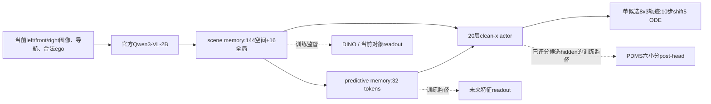

# 当前Qwen-World的实际模型与训练合同

## 与前序模型的区别

旧DDP使用其原动作DiT、8×4/z-score/sin-cos及action-query观测接口。此前原生Qwen-Flow移植了30层源ActionDiT及velocity FM监督。**当前Qwen-World改为新建20层clean-x actor和scene/predictive memory**，不再是原30层SimWAM动作网络的完整复现，也没有加载DDP驾驶权重或Wan动作权重初始化当前World actor。

三帧＋DINO是另一项已暂停实验：输入三视图的三个真实连续时刻。当前World部署只用当前三视图，predictive memory不是把历史或真实未来图片送入actor。未来teacher所需历史/未来仅用于离线监督。

## 在线前向

- Qwen原生前向读取层8/16/28、merger视觉表示和文本；模型通用身份见原始IL初始化收据。
- scene provider两层，输出144个空间＋16个全局1024维token。
- predictive provider两层、内部512维，4个间隔各8token，输出32个1024维token；与scene合计192个condition token。
- actor20层、hidden1024、16heads、FFN4096；8个未来动作token、每点3维，continuous sigma/AdaLN，dropout0。
- 所有8个点联合预测，不是逐点自回归。“前面一个点的误差一定递推到后点”不是该网络的计算定义；物理执行仍会产生跨时刻耦合。

部署只保留Qwen、两类memory、actor和既定动作解码。没有未来teacher、GT地图、候选bank、PDMS scorer、post-head选轨或后置轨迹修复。

## 动作与IL目标

未来0.5–4秒共8点，当前ego后轴局部坐标的绝对x/y/heading，x前、y左、heading弧度。沿用源3维min/max映射，未改成旧DDP z-score或sin/cos。归一化一单位分别对应33.37m、21m、1.765rad，不能把一个归一化L1单位解释成统一厘米数。

令`sigma=5u/(1+4u), u~Uniform(0,1)`，`x_sigma=(1-sigma)y+sigma*epsilon`。当前actor预测clean `y`，主监督是有效元素FP32 mean L1；它不是此前源velocity MSE或其时间权重。总损失：

`10*L_x + L_DINO + 0.5*L_future + 0.1*L_object + 0.2*L_post`。

前1000次是已计入100k总预算的接口阶段；随后全量训练Qwen语言/merger、低LR视觉、全部memory/actor/readouts。LM词表头不参与。global32、每卡micro4、FM_repeat1；AdamW(0.9,0.95)、eps1e-8、wd0.01、clip1，3%warmup＋cosine。语言/merger1e-5，视觉1e-6，动作/memory/aux1e-4。BF16前向，FP32参数/optimizer及动作状态/统计。

完整IL训练Qwen/provider，不能跨optimizer更新复用冻结Qwen hidden或完整K/V。当前实际源码snapshot与Git d54617b3的50文件逐hash匹配，见[源检查](formal_IL_source_check.json)。

## 四类辅助任务与候选的含义

| 任务 | 目标 | 梯度与部署边界 |
|---|---|---|
| 当前DINO | 冻结DINO ViT-L16当前视觉特征 | 训练学生scene/Qwen；teacher不部署 |
| 未来特征 | 离线WA-JEPA teacher的未来表征 | 训练predictive/scene/Qwen；actor不看GT未来 |
| 当前对象 | 合法当前可见对象的监督读出 | 不把GT对象/地图作为actor输入 |
| PDMS post-head | 已真实评分候选的NC/DAC/TTC/EP/Comfort/DDC | 候选clean输入actor取得hidden；梯度回actor及memory/Qwen，不经最终action_output；不是直接轨迹修复标签 |

这里的IL候选bank用于训练后果readout。它没有作为GRPO旧概率样本冒充on-policy。RL候选另由当前behavior现场生成完整链并真实评分。新优化标签组只替换主规划轨迹标签，未来video teacher仍是真实日志监督，没有虚构优化轨迹对应的未来视频。

## 三条当前RL的差异

共同父模型是用户指定IL40k，Navtest87.972382，记录其Test已被观察。永久reference始终固定此模型。

| 范围 | 训练参数 | 冻结部分 | LR |
|---|---|---|---|
| ATTENTION | 160个self/cross q/k/v/o投影LoRA；r16/alpha32；320张量，5242880参数 | Qwen、scene/predictive、动作base | 5e-5 |
| MEMORY | 相同attention LoRA＋完整scene/predictive；458张量，52707840参数 | Qwen、动作base、独立reference | attention5e-5，memory5e-6 |
| TIME | Time MLP、20block和末端AdaLN的LoRA；r32/alpha32；46张量，4816896参数 | Qwen、memory、ego MLP、其他动作base | 5e-5 |

Time模块输入融合time与ego，属于本架构AdaLN适配，不冒称其他论文pure-time AdaRMS的逐字节复现。r/缩放也与attention对照不同。

G8、K10、shift5，前7步ODE、随机步骤[7,8,9]。源rigorous score-corrected SDE、noise_level0.1、min_std0.001、创新clamp±5，逐维relative logprob clamp width7后H/D mean；PPO clip0.005。组内中心化、fresh rollout跨rank原始reward共同population std；tied组mask PG、anchor保留；固定旧链/old概率/优势做4次真实inner更新。

`v=(FP32_state-FP32_pred_x0)/FP32_sigma`在正sigma处转换一次。anchor是同状态current/reference随机转移均值weighted MSE，beta50、3维权重[0.2,1,1]，不除以std²。没有BC、GT replay、critic、dual或learned noise。当前World有效gradient clip明确为1，区别于旧SimWAM源engine的有效clip0；没有暗称完全相同。

源裁剪密度与部分随机步更新属于经验代理，不是最终轨迹精确边缘概率比或无偏全链梯度。部署仍是单候选ODE，训练SDE均分或best-of-G不替代主成绩。当前LoRA部署保留wrapper以维持已测BF16原生一致性；不能默认认为合并与未合并逐值相同。

Memory组只缓存冻结Qwen特征；当前memory和动作KV每个inner重建且有梯度。reference读取自己的冻结IL40k memory，不读取当前学后的memory冒充固定参考。

## 数据与评分

| 集合 | 场景 | log切片 | 物理log |
|---|---:|---:|---:|
| TRAIN | 90890 | 1041 | 147 |
| DEV | 1696 | 16 | 15 |
| Navtest | 12146 | 136 | 44 |

三个集合物理log交集均为0。当前RL公开hard-list与本地TRAIN交集15171，不套用旧DDP101592或此前模型17037的数量。DEV用于训练诊断，当前方法性能以用户要求的完整Navtest读出；Test反复观察的历史保留。

canonical v1.1逐候选保持`[固定PDM参考,一条候选]`，批执行不能改变EP归一化池。请求轨迹与模拟执行状态分开，基础设施故障不填reward0。完整原生子项和invalid状态保留。内部0–1，报告PDMS乘100；NC均值不是事故率。

主部署协议锁定当前输入、单候选、clean-x10步shift5、seed2101、同一后处理。按44物理log配对bootstrap，保留场景权重，不把G8或scene×seed当独立训练复现。
