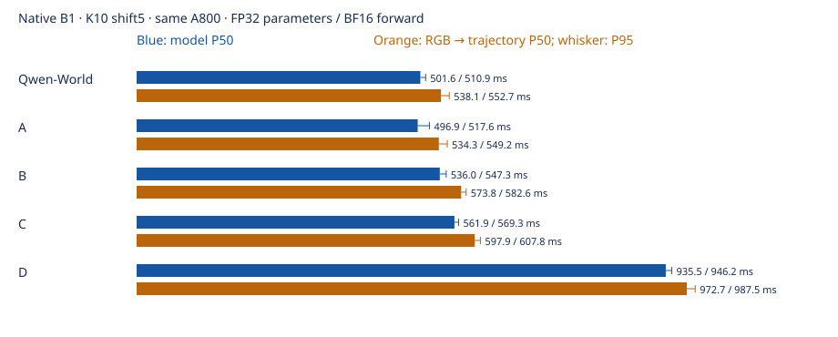

# Qwen-World / A / B / C / D：原生部署延迟实测

本报告比较五个框架的单轨迹部署成本，独立于训练每步耗时和 PDMS 评测。结果以同一物理 A800 上实际执行的原生 `model.predict()` 为准。

## 实测结果

完整五组于 UTC 2026-11-03 01:23 完成，原始结果 seal 与 160 次场景级路径一致性检查通过。单位为毫秒。

| 框架 | IL 权重 | 模型 P50 / P95 | RGB→CPU 轨迹 P50 / P95 | 峰值 allocated GiB |
|---|---:|---:|---:|---:|
| Qwen-World | 70k | 501.59 / 510.93 | 538.08 / 552.72 | 10.04 |
| A | 46k | 496.94 / 517.63 | 534.33 / 549.19 | 10.00 |
| B | 62k | 535.98 / 547.29 | 573.80 / 582.57 | 10.00 |
| C | 44k | 561.89 / 569.28 | 597.86 / 607.81 | 10.19 |
| D | 50k | 935.55 / 946.20 | 972.69 / 987.51 | 8.54 |



分段诊断的均值如下。D 的完整原生 Qwen 文本 C/P 计算在“前缀”列，因此比较当前条件总开销时需要合看编码与前缀。

| 框架 | 观测编码 | 前缀 | 编码＋前缀 | K10 去噪 | 每步去噪 | 部署参数 B | 冷加载 s |
|---|---:|---:|---:|---:|---:|---:|---:|
| Qwen-World | 106.36 | 7.23 | 113.59 | 388.72 | 38.87 | 2.6421 | 43.71 |
| A | 101.96 | 7.33 | 109.29 | 388.52 | 38.85 | 2.6326 | 41.17 |
| B | 101.65 | 45.66 | 147.31 | 388.32 | 38.83 | 2.6327 | 78.41 |
| C | 101.82 | 55.88 | 157.70 | 404.18 | 40.42 | 2.6837 | 231.96 |
| D | 43.68 | 118.17 | 161.85 | 771.37 | 77.14 | 2.1909 | 405.70 |

### 结论

- Qwen-World 与 A 都在约 0.5 秒模型延迟，K10 去噪均值几乎相同，约 389 ms。此次几毫秒的总延迟差距不宜解释为稳定的架构速度优势。
- B 相对 A 的主要额外开销在 P32 前缀：45.66 vs 7.33 ms；其缓存后的 K10 主链依然约 388 ms。
- C 在线保留世界流，前缀约 55.88 ms，K10 约 404.18 ms；额外成本同时落在世界前缀和动作层读取世界 K/V。
- D 的完整模型 P50 为 A 的约 1.88 倍；其 K10 约 771 ms，单步约 77 ms。D 每次动作去噪经过原生 28 层、宽 2048 的 Qwen 文本主干，实际额外开销集中在这十次动作计算。部署参数为 2.19B、峰值 allocated 8.54 GiB。
- processor 均值约 34–36 ms。主机图像预处理贡献约几十毫秒；当前主要模型耗时在十步动作去噪。
- 冷加载包含文件完整性检查、模型构造、严格加载与 H2D，受存储缓存影响很大。本次 C/D 有明确的 Lustre 读等待，分别耗时约 232/406 秒；这些等待已与单帧推理分开。无需评分器、辅助 readout 或未来 teacher 才能完成部署前向。

这里没有比较新旧精度、编译或量化方案，也没有据此推算 G16 训练吞吐。参数精度、部署步数及原生计算路径均保持。

## 证据与成本

- [原始全部计时与硬件采样](evidence/RESULTS.json)、[结果完整性 seal](evidence/COMPLETE)、[必要检查](evidence/VALIDATION.json)。
- [汇总 CSV](latency_summary.csv)、[分段表](PHASE_TABLE.md)、[执行协议](evidence/protocol.json)、[场景/输入记录](evidence/INPUT_PREFLIGHT.json)、[源文件与资产 hash](evidence/SOURCE_ASSETS.json)。
- [硬件与主机记录](evidence/HOST_WM2.json)、[成本边界](evidence/COST.json)。成功尝试中，每组 197 次原生 `predict()` 加 32 次完整分段前向，共 229 条轨迹前向当量；五组共 1,145 次、11,450 次去噪调用、scorer 调用 0。
- 成功 driver 从 identity 到完成约 1,567 秒，单卡独占监测段约 0.435 小时，其中约 801 秒为五次冷加载。这是持卡墙钟口径，不是 CUDA kernel 活跃 GPU 时间。早先中断尝试另保留，其完整墙钟成本没有精确重建；没有从本报告成本中暗中声称它们免费。

## 固定协议

- 一张 NVIDIA A800-SXM4-80GB，vlawm-zt2，GPU UUID `GPU-f7653835-479b-07e2-0adf-2b34baf826fe`。五组串行执行，持有六个现有 GPU 调度锁命名空间，每场景及每组结束检查实际 CUDA owner 数量。
- B1、单候选、clean-x ODE、K10、shift5、原 ActionCodec、固定 seed2101。每个场景重新计算当前条件与动作前缀，不跨推理复用模型 hidden/KV。
- 同一官方 processor、当前 left/front/right 三视图、导航与合法当前 ego 状态；不读取未来监督或评分。32 个 NAVTRAIN 物理 log 各取一个当前场景，选择 seed42，依据 log/token 取样，不依据分数。
- processor 的目标面积为 `384×672`，按源合同保持图像比例并做官方 smart resize。本批三视图均完整，实际 `image_grid_thw=[1,22,42]`，patch16 对应每视图 `352×672`；空间 merge2 后共 693 个视觉 token，加文本后每场景 802–803 token。没有把目标面积误作实际固定尺寸。
- FP32 参数，原生 BF16 autocast 前向，FP32 latent/ODE；原确定性设置、TF32 关闭、4 个 Torch CPU 线程。不使用编译、量化或额外算法修改。
- 每模型 5 次 warmup 后，32 场景各重复 3 次：模型计时 96 次、RGB→轨迹计时另 96 次，分段诊断另 32 次。P50/P95 为每个计时序列的经验分位数，不是硬实时延迟保证。
- 使用已封存、已裁剪训练组件的 IL 部署：Qwen-World70k、A46k、B62k、C44k、D50k。没有 RL LoRA；本次是框架计算成本比较，不是这些 checkpoint 的性能排名。
- C 仅执行本次用户要求的推理测速，其终止训练状态保持。

## 计时边界

1. **模型延迟**：输入 tensor 与 root noise 已在 GPU，CUDA 同步后调用原生 `model.predict()`，输出后同步。包含本次观测编码、动作无关前缀、完整十步去噪和原轨迹解码。
2. **RGB→轨迹**：从已解码的三张 RGB 图开始，包含官方 processor 的 resize/tokenize、输入传输、原生模型与物理轨迹传回 CPU。不在内部人为增加分段同步。
3. **分段诊断**：另一次前向在 observation encoding、prefix、K10 边界同步。逐场景要求诊断路径与原生完整 `predict()` 的归一化和物理轨迹均逐值一致。分段中位数不能相加冒充主延迟。
4. **加载 / 文件读取**：模型检查、构造、权重加载与搬运单列；JPEG/NAS 读取单列一次观测值。二者不计入稳定态模型延迟。评分、仿真、训练后置 R/readout 均不属于部署计算。

共享的是主机 CPU/文件系统，测速 GPU 独占；因此 RGB 预处理和加载结果仍受到主机调度与文件缓存影响。

原轻量场景选择清单的 `role` 字符串曾写为 `TRAIN`，实际封存数据人口和生效 driver 均为 `NAVTRAIN`；这一纯元数据标签差异保留在 [POPULATION_NOTE.json](evidence/POPULATION_NOTE.json) 中。没有修改选定的 32 个场景、顺序或观测，也没有从中使用训练标签。

## 源码和结构

模型科学源码统一为 `fdaff809652370328e45c0d996ad706e1af2fc0c`，使用其实际 scorer-approved deployment loader。A/B/C/D 的 17 个 runtime source 文件通过封存导出校验；Qwen-World 的 14 个模型 source 文件额外对其 IL parent 收据逐一核对。没有关闭 source 或 library 检查。

| 框架 | 当前条件与部署前缀 | 每个动作去噪步 |
|---|---|---|
| Qwen-World | 原生 Qwen → C160 → predictive32，actor context 共 192 token | 独立 20 层、宽 1024 的 clean-x actor |
| A | 原生 Qwen → C160；训练世界分支已裁掉 | 独立 20 层、宽 1024 的 actor |
| B | 原生 Qwen → C160 → 共享决策主干 P32 的逐层前缀 | 共享 20 层、宽 1024 的主干处理 A8 |
| C | 原生 Qwen → C160 → 在线 20 层、宽 384 的 W32 世界前缀 | 20 层、宽 1024 的 actor，读取逐层世界 K/V |
| D | 原生视觉/merger → 原生 Qwen 文本 C/P32 前缀 | 同一套 28 层、宽 2048 的 Qwen 文本层处理双向 A8 与时间 FiLM；没有独立 DiT |

特别注意：D 的 `encode_current()` 主要准备视觉/embedding，原生文本 C/P 计算还在 `prepare_prefix()`；其编码一列不能直接与 A/B/C 的完整 Qwen 编码一列比较，应合看两者。

## 可执行入口

源码入口为 [benchmark.py](../../tools/latency_five_frameworks/benchmark.py)、[exclusive.py](../../tools/latency_five_frameworks/exclusive.py) 和 [summarize.py](../../tools/latency_five_frameworks/summarize.py)。计时 driver 与模型科学源码分别锁定。

实际运行配置、场景清单、输入检查与结果索引随完成报告封存；权重和图片不进入 git。`exclusive.py` 只等待空闲或正常场景边界释放，不对训练进程发送信号。

```bash
env PYTHONPATH=/mnt/project/qwen-world-four-frameworks-20261029/runtime/formal_fdaff80 \
  WORLD_COMPARE_TASK=qwen_world_latency_20261103 \
  WORLD_COMPARE_ROOT=/mnt/project/qwen-world-latency-20261103 \
  /usr/bin/python3 tools/latency_five_frameworks/exclusive.py \
  --config /mnt/project/qwen-world-latency-20261103/config_v4.json \
  --output /mnt/project/qwen-world-latency-20261103/attempt004

/usr/bin/python3 tools/latency_five_frameworks/summarize.py \
  --input /mnt/project/qwen-world-latency-20261103/attempt004 \
  --output reports/qwen_world_five_framework_latency_20261103
```

## 资源恢复

本次用户恢复最近六台临时节点的不限时使用：vlawm-zt4、rl-zt2、vlawm-tsinghua-zt2、vlawm-zt、vlawm-tsinghua-zt3、vlawm-zt2。全局策略与当前 Compare/Safety/D44 任务收据已于 UTC 2026-11-03 00:34:30 原子更新，原撤销记录保留。其他已终止实验和另行撤销的主机不因这一操作恢复。实际收据位于 `/mnt/project/server-resource-restorations/six_unbounded_20261103T003430Z/APPLIED.json`。

一个正在运行的 Navtest 分片在自身场景边界让出测速卡，已评分结果保留，原评测 owner 负责剩余分片恢复；没有中断 B/D IL 或其他训练。

该分片为 `S0_FAST_PACK4_u001616/NAVTEST/rank13_attempt001`。普通人工边界停止不会被旧 owner 自动当作资源重试，因此按其严格审核边界处理：验证 EXIT0、场景边界状态、固定 source/world/rank/seed、SPEC/identity 与 **153 个既有 OK 场景的完整 hash**，保存前后状态及 operator receipt，仅对该分片重新排队。CPU 调度 owner 在正常退出后用同一 `ops_v9` 源码启动，其他 GPU worker 一直保留；`rank13_attempt002` 已实际继续。没有补写分数、回填 COMPLETE 或重写原失败记录。审核证据保存在 `/mnt/project/qwen-world-latency-20261103/EVALUATION_REQUEUE_REVIEW/`。

## 未完成尝试保留

- attempt001：输入人口实际为 `NAVTRAIN`，旧 driver 误写成 `TRAIN`，数据合同在模型加载前拒绝。修正 benchmark 的显式 role；数据/模型科学源码均未改。
- attempt002：只等待资源的自有 CPU admission 被准确识别并取消，没有启动 GPU 子进程。
- attempt003：rl-zt2 同一 GPU 上 Qwen-World 完成 96 次后，A 加载期间出现一个容器内不可见的外部 CUDA owner。独占检查主动拒绝，未发布完整比较；该尝试的有效 World 记录和失败日志保留，不拼入换卡后的主表。不对外部 owner 发信号。
- attempt004：在另一台已授权服务器的一张空闲卡上，从头测量全部五组，保持同卡比较。
