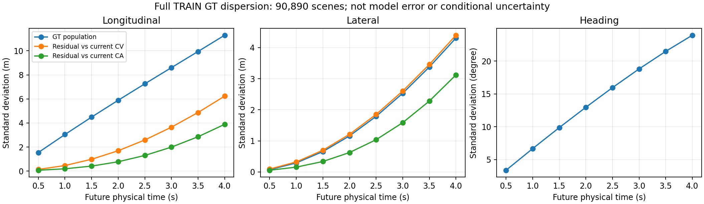

# Qwen-World：GT分布随预测时域变化

用户指出：0.5秒与4秒GT本身的分布不同，损失设计应将其与模型误差区分。本报告实际读取当前版本完整TRAIN manifest的90890场景；不是早期DDP约101592人口。原数据准备按完整物理log隔离DEV/Navtest，分析重新验证清单、数据hash与log隔离。没有改变训练人口，没有读取DEV/Test拟合权重，没有任何模型前向、评分或optimizer更新。

## 三个需要分开的量

1. GT跨场景的边际分布尺度：包含速度、直行/转弯等本来可由当前输入预测的变化。
2. 给定当前观测后的条件不确定性：每个场景只有一条GT时，不能直接用跨场景标准差估计。
3. 当前模型的残差与控制后果：和前两者不同；不能以总体GT方差替代碰撞/越界/TTC/进度敏感性。

下面全部是GT分布或简单运动基线的残差标准差，不是当前网络的MAE。原8点0.5–4秒、后轴局部坐标、x前/y左；单位分别米、米、度。每个未来点沿用训练原有timestamp有效mask，不把错时标签填0；不同点有效数明确列出。

| 时间 s | 有效场景 | GT纵向标准差 m | GT横向标准差 m | GT航向标准差 ° | 恒速残差纵向标准差 m | 恒加速度残差纵向标准差 m |
|---|---:|---:|---:|---:|---:|---:|
| 0.5 | 90807 | 1.5453 | 0.0713 | 3.366 | 0.1378 | 0.0715 |
| 1.0 | 90730 | 3.0423 | 0.2905 | 6.663 | 0.4627 | 0.1921 |
| 1.5 | 90656 | 4.4886 | 0.6558 | 9.866 | 0.9826 | 0.4145 |
| 2.0 | 90575 | 5.8887 | 1.1585 | 12.969 | 1.6930 | 0.7764 |
| 2.5 | 90493 | 7.2539 | 1.7878 | 15.961 | 2.5860 | 1.2993 |
| 3.0 | 90412 | 8.5995 | 2.5313 | 18.815 | 3.6498 | 1.9915 |
| 3.5 | 90333 | 9.9416 | 3.3759 | 21.490 | 4.8699 | 2.8543 |
| 4.0 | 90265 | 11.2948 | 4.3087 | 23.952 | 6.2290 | 3.8850 |



恒速CV仅用合法当前vx/vy，p(t)=v0*t；恒加速度CA再加0.5*a0*t²。它们使用固定当前坐标，不是完整车辆动力学，不是修复轨迹，也不参与部署或训练。0.5秒x标准差从1.545m降到CV残差0.138m，说明大量边际变化可由当前速度解释；CA进一步到0.072m。远期残差仍增加，但里面也包含导航、道路与交互差异，不能全部称为不可约噪声。

## 当前可见状态分层

| 人口 | 场景数 | 0.5秒横向GT标准差 m | 4秒横向GT标准差 m |
|---|---:|---:|---:|
| current_speed_lt0.5 | 7472 | 0.0065 | 1.1524 |
| current_speed_0.5_to5 | 43816 | 0.0586 | 4.0091 |
| current_speed_5_to10 | 33060 | 0.0936 | 5.2814 |
| current_speed_ge10 | 6542 | 0.0518 | 2.3676 |
| navigation_go straight | 57887 | 0.0355 | 1.5020 |
| navigation_turn left | 22667 | 0.0772 | 4.4863 |
| navigation_turn right | 10336 | 0.0785 | 4.0316 |

这些分层条件均来自当前ego速度和导航，没有按未来GT是否转弯划分。完整JSON还提供均值、median/MAD、5/95%分位、XY协方差、航向圆周统计及24维跨时间相关矩阵。0.5秒与4秒的x相关约0.903、y约0.878；这是跨场景统计相关，不能解释成当前网络是自回归或前点导致后点。

## 对损失设计的具体含义

- 不应把8点等权自动当成物理重要性相同，也不应看到远点GT方差大就直接除以总体std。按横向GT的std倒数会使0.5秒相对4秒的权重比达到约60.4，这可能使模型忽视远期转弯与制动。
- 当前使用L1而非MSE。较大残差并不会自动产生按幅值线性增加的输出梯度；共享网络中的主导方向仍应看实际梯度，而不是仅比较loss标量或方差。
- 后续时间权重可以考察TRAIN中扣除当前可预测运动后的稳健尺度、标签精度与控制重要性，并保留物理容差下限与远期监督下限；Coarse分层或CV残差仍不是完整条件不确定性估计。
- 若做数据驱动时间权重，先仅改变loss，不同时更改动作normalizer、root prior或SDE。逐时刻白化动作会连生成噪声对应的物理幅度一起改变，应另立完整概率合同。
- 固定sigma与统一归一化噪声下，不同时域的GT方差意味着各坐标的边际signal/noise尺度不同。JSON给出sigma=.2/.5/.8的方差比诊断；它不是条件SNR，也不能据“低SNR”断言近点更难，因为近点可能更容易由当前状态预测。驾驶物理时间与Flow噪声时间仍是两条轴。

当前已登记CONTROL/PHYSICAL实验保持8点时间权重全1，先隔离坐标权重。此次GT统计不回头调整该实验参数，不追加算法矩阵；后续若测试时间权重，必须另立同起点、同预算对照。性能结论以固定终点完整Navtest的canonical单候选PDMS及净安全/进度变化为准，TRAIN统计仅用于分析。

## 执行与费用

```bash
CUDA_VISIBLE_DEVICES='' OMP_NUM_THREADS=1 OPENBLAS_NUM_THREADS=1 /mnt/project/flow-safe-improvement-20261013/venv/bin/python -m tools.qwen_world_postcot.analyze_gt_horizon_distribution --output <新的输出目录>
```

实际输出根：`/mnt/project/qwen-world-postcot-20261025/coordinate_loss_20261028/gt_horizon_distribution`。CPU分析wall 16.811秒，模型前向/评分/训练更新均0；未包括人工审阅、绘图和单测时间。两项合成测试验证“边际方差随时域增长但恒速条件残差可为0”和timestamp无效值不被当成0标签。只发布汇总，不上传场景记录、图片或轨迹。
