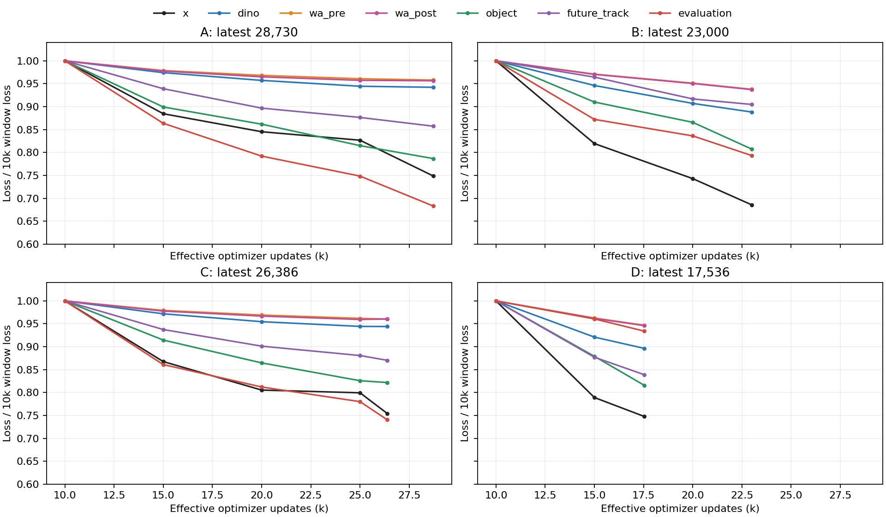

# ABCD IL辅助任务：长期loss、预测基线与资源核查

2026-10-31。用户明确关心**IL辅助任务**，本报告不以RL训练问题解释IL学习曲线。

## 1. 八rank长期曲线

实际读取四个原生训练根的八rank有效更新日志，核对场景游标、optimizer step、skipped=0和更新连续性。各任务的loss先按原global有效分母还原，再对八rank取均值；每个点取500个有效更新，排除interface/aux warmup。不是选一个rank或单步截图。

相对10k窗口的下降幅度如下。各组终点不同，只用于判断各自学习趋势，不构成架构排名。

| IL组 | 最新共同update | 轨迹x | DINO当前 | WA前置未来 | 当前对象 | 未来track | WA事实后置 | 候选评价组合 |
|---|---:|---:|---:|---:|---:|---:|---:|---:|
| A | 28,730 | 25.1% | 5.8% | 4.2% | 21.3% | 14.3% | 4.3% | 31.7% |
| B | 23,000 | 31.4% | 11.2% | 6.2% | 19.3% | 9.5% | 6.3% | 20.7% |
| C | 26,386 | 24.6% | 5.6% | 4.0% | 17.8% | 13.0% | 3.9% | 25.9% |
| D | 17,536 | 25.2% | 10.4% | 5.3% | 18.4% | 16.1% | 5.4% | 6.6% |



最慢且共同出现的平台在WA未来特征任务。对象、track和A/B/C候选评价仍在明显下降。D候选评价较慢。A/C的前后置WA曲线非常接近，值得检查后置分支是否有效使用动作，但两条曲线本身不证明它忽略动作。

原始窗口见[JSON](IL_AUX_TRENDS.json)、[CSV](loss_windows.csv)。SVG/PDF同目录可单独导出。日志是持续变化的TRAIN场景、噪声和候选，不是冻结模型在同一批数据上的精确学习曲线。

## 2. 当前loss分别代表什么

- **DINO当前**：432个空间位置、1024维特征的有效位置MSE。其绝对数值不能与WA512维特征或物理坐标误差直接比较。A/C的W/P只有32×384 latent，B为32×1024，D为32×2048；读出器解码高维密集目标，压缩造成的预测难度需要实测，不用latent维数宣布信息论不可能。
- **WA前置未来**：当前三视图/导航/合法ego条件下的未来特征MSE。冻结WA教师的目标包含历史与真实未来视频信息，学生输入没有这些未来；部分不确定性无法由当前观测唯一确定。MSE最优预测可以是条件均值。
- **WA后置**：只有实际记录轨迹有合法视频未来标签。一个场景只有一个事实动作时，模型可能依靠场景预测未来而较少使用动作。给偏离记录的候选配同一个视频未来标签是错误做法，本诊断和正式训练均不这样做。
- **当前对象**：existence BCE、class CE、归一化box SmoothL1之和，不能把0.34读成34%错误率或厘米误差。未来track也是按物理尺度归一化的SmoothL1，需要对应物理误差/有效track覆盖判断准确率。
- **候选评价**：`factor + .5 total + .5 rank + .5 event`。factor允许NC=0.5等soft target，其最小BCE包含目标熵，不能要求所有合法soft-label损失趋近0。event有明显none类人口偏好，应与always-none比较，不能只报总体准确率。

正式loss权重、掩码、数据与架构都未改变。当前500更新窗口四组的preclip global norm均超过1；这说明既定clip1持续生效，**不能由此或loss标量大小判定哪项梯度压制动作**，更不能直接调大LR或删除clip。

## 3. 固定场景预测诊断

已实现`tools/il_report/probe_il_auxiliary.py`，锁定真实完整IL A28k/B22k/C26k/D17k的训练head和全部模型参数。从同一合法TRAIN选择32个probe场景，另64个不重叠TRAIN拟合按相机/时间/空间位置的教师均值。保持原native micro布局、FP32模型、BF16前向；无optimizer更新、无新PDMS评分。

诊断输出：

1. DINO、WA前/后置的MSE/cosine，以及相对位置均值和零预测的误差。
2. 六分项Brier/BCE、soft-target entropy floor和总是通过的基线。
3. NC/DAC/TTC首次事件准确率、实际事件数、always-none准确率。
4. 同一场景换事实/两个bank候选后，R与预测未来的变化。非事实未来只作敏感度，不与事实GT比较准确率。

资产根：`/mnt/project/qwen-world-il-research-20261030/maintenance/training_resource_review_20261031T223301Z/IL_AUX_PROBE`；`PLAN.json`绑定checkpoint/hash、TRAIN清单、probe/calibration成员和固定query采样update。`LAUNCH.json`指向实际运行的受控worker。该32场景/8个事实后置场景诊断不代表独立泛化或稀有事故检出能力。

一次初始worker参数错误在CUDA子进程前被拒绝，另一次共享lease忙被明确拒绝，两者无模型前向；保留失败证据后使用合法primary槽、相同headroom检查，与已知评测共享一张卡。没有抢占或停止任何模型。运行副本按script hash冻结，正式训练源码未动。

结果完成后写入本目录的`probe_results/`。在输出全量完成前，不把“诊断已启动”写成“模型已优于均值”。

### A28k已实际完成的中间诊断

[A真实输出](probe_results/A_RESULT.json)已完成，其他三组仍由同一个有限worker继续。模型参数未变、无optimizer更新/新评分。

| 任务 | 预测MSE | 位置均值MSE | 相对均值误差降低 | 有效场景 |
|---|---:|---:|---:|---:|
| DINO | 0.027702 | 0.033995 | 18.51% | 32 |
| WA前置 | 0.122183 | 0.146704 | 16.71% | 32 |
| WA事实后置 | 0.119172 | 0.148038 | 19.50% | 8 |

这说明特征读出超过固定位置均值预测。前置32场景与后置8场景分母不同，不作两分支优越性的配对结论。换candidate时，R RMS变化均值0.8632、预测未来RMS变化0.02070，说明有非零动作响应；没有反事实视频GT，不能据此认定预测的后果正确。

六个factor的Brier均低于always-one基线，但每项只有24条候选。NC/DAC各只有1条非完全通过，TTC只有3条。三项event总体准确率分别95.83%/95.83%/87.50%，恰与always-none准确率相同，尚无超越简单事件基线的证据；不推断所有预测都为none，也不以这个小样本宣布事件头无效。应优先用现有bank覆盖更多真实违规样本，报告召回和首次时刻误差。

本结果更支持“部分辅助信息确实学到，但事件/动作后果的驾驶价值仍需验证”。不支持把WA非零loss直接判作均值塌缩或训练失败。

## 4. 资源检查发现

22:33 UTC对当前授权13台主机取两次真实GPU/UUID/owner/CPU/RAM/四类lease样本；12台可连接，`training-vlawm-zt5` SSH拒绝。六组IL均在正常更新，保留原位：

| 训练 | 主机 | 分配 |
|---|---|---|
| A IL | tsinghua-zt6 | 八卡 |
| B IL | tsinghua-zt | 八卡 |
| C IL | tsinghua-zt4 | 八卡 |
| D IL | vla-zt | 八卡，既有全命名空间保护 |
| TIME_RESIDUAL | vla-zt3 | 八卡 |
| HUBER | tsinghua-zt2 | 八卡 |

当时清华zt3、zt5、vlawm-zt4各有整机八卡空闲；随后新评测陆续占用部分卡，不能把这个快照当成永久空闲。rl-zt2存在不可见owner，vlawm-zt2 GPU6有无法归属的占用，均保留，不清理或驱逐。

新ABCD RL四组实际完成1k后全部在1k→5k恢复入口失败；这造成阶段性闲置。CPU完整重建身份已证明114个旧源码文件均未变化，差异仅为父模型source-diff的tuple被JSON存为list，内容fingerprint相同。[最小复现](RL_IDENTITY_REPRODUCTION.json)不涉及GPU。另一个现有恢复负责人随后登记`/mnt/project/qwen-world-abcd-rl-best-20261031/recovery/20261031T2232`，本分支检测到后停止自身恢复准备，未改其RUNS/STATE或重复派发。隔离的备用修复`974fd38`通过29项测试，包括READY和inner1/2/3的Adam/RNG/旧链等价性；它不是本次正式IL训练源码，也未由本操作部署。

本次资源处理只运行有限只读诊断，不重启已终止旧实验，不搬动正常IL。新任务T1/T2/T3仍有离线target/DVGT/native候选依赖；不能为了占满GPU跳过这些前置条件。

## 5. 当前判断

已确认：未来特征任务后期收益弱，D后置组合任务下降较慢；全组辅助loss完全不学习不符合八rank长期数据。

尚未确认：特征任务是否仅在预测均值、后置分支是否充分用动作、辅助梯度是否与规划目标冲突。全参数梯度存在不等于这些任务有驾驶价值；辅助loss下降也不证明Navtest上升。

优先依据同场景均值基线与动作敏感度诊断判断任务质量，再考虑一个针对明确问题的修改。现有四组正式IL100k配方保持；不因中期波动热改loss、不新增架构矩阵，也不预设更长训练或更大模型必然突破。

```bash
# 已实际执行的只读日志汇总；输出路径须未存在
/usr/bin/python3 -m tools.il_report.summarize_il_auxiliary \
  --root /mnt/project/qwen-world-four-frameworks-20261029 \
  --output /path/to/new_auxiliary_trends.json

# 已实现并经资源worker执行的冻结模型诊断
python tools/il_report/probe_il_auxiliary.py \
  --plan /mnt/project/qwen-world-il-research-20261030/maintenance/training_resource_review_20261031T223301Z/IL_AUX_PROBE/PLAN.json \
  --output /path/to/new_disposable_aux_probe
```
