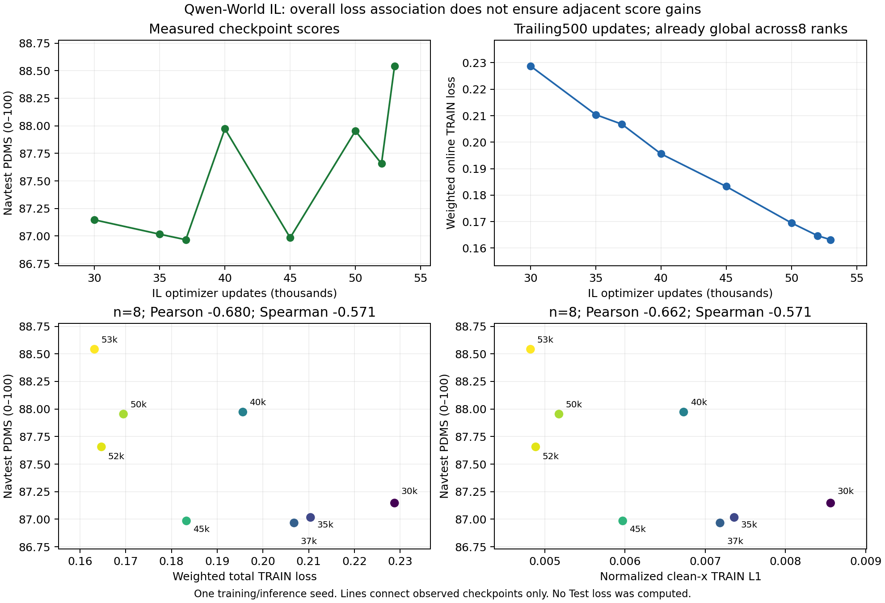

# Qwen-World IL训练loss与Navtest PDMS

**八个已测检查点呈总体负相关，但loss下降不能可靠预测相邻权重的PDMS提高。** 若“正相关”指“loss越低、性能越高”，整体有这个倾向；数学上应称loss数值与PDMS负相关。

主统计取每个检查点之前500个已提交optimizer更新（包含该步）的在线TRAIN全局均值。加权总loss与全量Navtest PDMS：Pearson **-0.680212**，Spearman **-0.571429**。轨迹clean-x L1的Pearson为-0.661543。

| IL更新数 | 重建加权总loss | 轨迹clean-x L1 | Navtest PDMS |
|---|---:|---:|---:|
| 30,000 | 0.228761 | 0.008563 | 87.146897 |
| 35,000 | 0.210402 | 0.007361 | 87.016552 |
| 37,000 | 0.206804 | 0.007185 | 86.966585 |
| 40,000 | 0.195608 | 0.006732 | 87.972382 |
| 45,000 | 0.183279 | 0.005972 | 86.984807 |
| 50,000 | 0.169512 | 0.005177 | 87.953895 |
| 52,000 | 0.164701 | 0.004887 | 87.656609 |
| 53,000 | 0.163175 | 0.004823 | 88.542266 |



## 相邻变化不支持可靠的性能代理

总loss在7次相邻检查点比较中全部下降，PDMS只有3次升高、4次下降。相邻Δloss与ΔPDMS的Pearson为0.116236，Spearman为0.107143，本组观察中看不到可靠的局部对应关系。观察间隔不等长，且仅7个变化，不将其解释为已证明统计独立。

- 40k→45k：总loss0.195608→0.183279，但PDMS87.972382→86.984807，下降0.987575点。
- 50k→52k：总loss0.169512→0.164701，但PDMS87.953895→87.656609，下降0.297286点。
- 52k→53k：总loss0.164701→0.163175，PDMS87.656609→88.542266，提高0.885657点。

这些反例说明训练loss可用于学习/数值收敛诊断，不能单独替代用户要求的完整Navtest PDMS作性能判定。当前最低训练loss与最高PDMS恰好同在53k，也不能消除其它相邻点的反例。

## 分项与窗口敏感性

| Loss分项 | Pearson(loss, PDMS) | Spearman |
|---|---:|---:|
| total | -0.680212 | -0.571429 |
| x | -0.661543 | -0.571429 |
| dino | -0.665720 | -0.571429 |
| future | -0.684979 | -0.571429 |
| object | -0.695408 | -0.500000 |
| post | -0.708400 | -0.571429 |

| 向后窗口（更新数） | 总loss Pearson | 总loss Spearman |
|---|---:|---:|
| 100 | -0.676099 | -0.571429 |
| 500 | -0.680212 | -0.571429 |
| 1000 | -0.680459 | -0.571429 |

100/500/1000更新窗口的总体相关方向一致，不是只取一个噪声较大的末步loss得到的结论。各辅助分项均随训练进展下降，这个共同时间趋势可能解释其与PDMS的相关；不据相关系数大小认定某项loss驱动了提升或应增加其权重。

## loss定义与可解释边界

`L_total = 10 L_x + L_DINO + 0.5 L_future + 0.1 L_object + 0.2 L_post`。L_x为归一化3维动作上的clean-x L1，不是旧DDP的velocity FM MSE。post_factor/post_pair是post内部诊断，sigma_mean不是loss，都没有再加进总loss。30k以后辅助warmup已完成，五项权重固定；总loss由日志已归约的分项按原权重以FP64重建，可能与原FP32计算顺序存在末位舍入差异。

这是**在线训练loss与检查点Navtest分数的相关分析，不是测试集loss分析**。窗口里的模型、场景、Flow噪声/时间都在变化，并非对每个冻结检查点在同一个固定样本集上重新计算的loss。checkpoint均来自同一次训练，n=8；不能把500训练步、12146测试场景或8张卡当成8个以上独立模型实验。这里只给描述性相关，不声称统计显著、因果关系或可泛化的选点规则。

训练loss衡量监督轨迹/表征/辅助后果拟合；PDMS衡量完整ODE生成、物理解码与控制器仿真后的碰撞、越界、TTC、进度等后果。更低的监督误差不直接约束这些部署后果。该目标差异可解释为何不应期待一一对应，但本次相关分析未证明哪一个机制造成了具体分数变化。

post监督还使用周期更新的候选库。500步窗口内各点均只有一个bank，但30/35k、37/40/45k、50/52/53k分别来自3个bank版本。hash和计数保存于analysis.json，不能假装总loss是在完全相同候选目标上测得。轨迹/DINO等分项单列，避免把后果候选分布变化全归于轨迹拟合。

## 实际核验与复现

评分输入验证每个SUMMARY/registration的seal、checkpoint更新数、COMPLETE及全部worker退出、12146完整场景/零无效、统一score协议/人口/seed2101。TRAIN有效日志1..53000连续且cursor=32×update；窗口内均joint、optimizer计数匹配、跳步0。8个rank的全局loss逐更新逐分项精确一致，使用一份已归约数值，不进行二次求和或伪增样本量。8份读到53000步的原始日志前缀hash/字节数保存在analysis.json，读入更新范围固定，不受后续训练追加影响。

Pearson同时由numpy与scipy实现交叉核验；正向/反向/常数/样本不足四个算术小例实际通过。未重新推理、未重新评分、未修改IL/RL权重或训练配方，也没有向actor加入任何Test信息。

```bash
CUDA_VISIBLE_DEVICES='' OMP_NUM_THREADS=1 OPENBLAS_NUM_THREADS=1 \
/mnt/project/flow-safe-improvement-20261013/venv/bin/python \
-m tools.qwen_world_postcot.analyze_il_loss_pdms \
--run /mnt/project/qwen-world-postcot-20261025/runs/IL_full_seed42 \
--scores /mnt/project/qwen-world-postcot-20261025/IL_loss_PDMS_20261028/SCORES.json \
--output /mnt/project/qwen-world-postcot-20261025/IL_loss_PDMS_20261028/analysis
```

该命令实际已执行，已有输出目录会拒绝覆盖；重算使用新的output路径。绘图入口为`tools.qwen_world_postcot.plot_il_loss_pdms --analysis <analysis.json> --output <existing-output>`，实际已生成独立PNG与SVG。CSV为主500步表，JSON保留全部分项、窗口与输入身份。所有产物只含聚合数据、hash与实际资产索引，不上传日志原场景、图片、缓存或权重。
