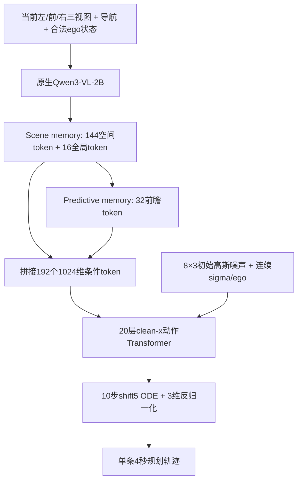

# 当前Qwen-World：轨迹loss、动作前与动作后

本文依据当前IL/RL实际使用的World源码与原生IL身份核对，不把早期30层SimWAM ActionDiT或旧DDP当作当前模型。

## 用户关注的轨迹loss

轨迹项为`L_x`：对归一化8×3真实未来轨迹加噪后，直接预测干净轨迹，使用有效坐标上的L1。

```text
u ~ Uniform(0,1)
sigma = 5u/(1+4u)
a_sigma = (1-sigma)*a_GT + sigma*epsilon
predicted_clean_action = actor(current_condition, a_sigma, sigma)
L_x = valid_mean(abs(predicted_clean_action - a_GT))
```

其单位是归一化动作坐标，三个通道为ego局部绝对x/y/heading；8个未来点、0.5秒间隔、4秒。它是随机噪声/时间下的训练去噪重建误差，不是完整10步ODE生成后的米制ADE/FDE。

对已经完成全量Navtest的8个IL检查点，取此前500个optimizer更新的全局平均：

| IL更新 | 轨迹L1 | Navtest PDMS |
|---|---:|---:|
| 30k | 0.008563 | 87.146897 |
| 35k | 0.007361 | 87.016552 |
| 37k | 0.007185 | 86.966585 |
| 40k | 0.006732 | 87.972382 |
| 45k | 0.005972 | 86.984807 |
| 50k | 0.005177 | 87.953895 |
| 52k | 0.004887 | 87.656609 |
| 53k | 0.004823 | 88.542266 |

Pearson(loss,PDMS)=-0.661543，Spearman=-0.571429。100/1000步窗口的Pearson分别-0.660012/-0.673917，整体负相关方向一致。但7次相邻观察中轨迹loss每次下降，PDMS仅3次上升、4次下降；相邻Δ轨迹loss与ΔPDMS的Pearson为+0.249260（n=7），不足以据此预测下一权重会提分。比如40k→45k轨迹loss0.006732→0.005972，但PDMS下降0.987575点。

这里只分析在线TRAIN重建loss与Navtest分数的描述性关联。不是Test loss、不是固定输入/噪声下的冻结模型loss实验；8个检查点共享一条训练轨迹，不是8次独立训练。

## 部署主链



**这是当前时刻三视图输入，不是三个连续时刻输入。** 场景memory也不等于历史帧缓存。历史/未来图像出现在离线WA-JEPA教师目标构建时，不作为学生部署输入。

Qwen使用官方通用Qwen3-VL-2B-Instruct初始化。scene/predictive memory、clean-x动作专家及辅助readout都是这版新建学生模块；原生训练身份声明其初始化方式，没有加载旧DDP驾驶动作头或Wan动作backbone。当前World已不再是前版原生SimWAM30层ActionDiT。

## 动作前：场景与前瞻表征

1. **Qwen观测编码。** 同一次原生多模态前向读取第8/16/28层语言block表示、同次视觉merger特征及有效文本。保留相机ID、图像网格位置与有效mask；导航来自当前文本与合法ego命令。
2. **Scene memory。** 2048→1024投影，2层带self/cross-attention的read blocks；三相机各6×8个空间query，共144个空间token，加16个全局token。空间query带相机/位置语义，全局query汇聚当前视觉、文本、ego。
3. **Predictive memory。** 仅由scene memory产生；2层、内部512维、4个未来区间×8个query，输出回1024维，共32个token。
4. **动作读取。** 拼接144+16+32=192个条件token，为动作Transformer的20层各自准备cross-attention K/V，同一条10步ODE复用这份观测条件。ego还通过独立embedding进入动作层的时间/状态调制。

前瞻memory没有接收候选动作，它是基于当前观测预测未来表征的模块；不能因此称它是已验证的动作条件世界模拟器。

## 动作专家

- 20层、hidden1024、16个attention heads、FFN4096、dropout0。
- 输入8个带噪轨迹token，线性3→1024及可学习轨迹位置编码。
- 连续sigma的sin/cos时间编码与ego embedding相加，调制self-attention和FFN的AdaLN；cross-attention读取192条件token。
- 最后线性输出8×3干净动作`x0`，IL用上述L1。
- 部署从高斯噪声开始，用10步shift5网格。由clean-x预测计算相应ODE更新；最后一步直接取预测干净动作，再进行源3维反归一化。

动作专家不是额外生成文本CoT的语言模型，也不需要未来图片、teacher、候选bank或真实评分器才能部署。

## 四项辅助监督

| 任务 | 学生读什么 | 真实监督目标 | 对主模型的训练作用 |
|---|---|---|---|
| 当前DINO对齐 | spatial memory | 冻结DINOv3 ViT-L/16的当前三视图dense特征，池化至每视图9×16×1024 | 约束空间表征保留局部视觉内容 |
| 未来特征预测 | scene/global/predictive memory | 冻结公开WA-JEPA target encoder及其已训练projector得到的未来特征，3视图×4未来tubelets×8×16×512；训练分层抽取128个查询位置 | 监督前瞻表征包含未来变化信息 |
| 当前对象readout | spatial+global memory | 当前可见对象的存在性、7类分类与3D框；最多32个query，带有效性/可见性mask与匹配 | 约束场景表征保留对象结构 |
| 动作后果预测 | 同一个动作专家在已评分clean候选上的hidden | canonical NC/DAC/TTC/EP/Comfort/DDC六分项，外加同场景NC/DAC安全边界配对 | 让共享动作hidden与观测memory学习区分不同轨迹的后果 |

WA-JEPA教师处理12帧2Hz片段（4历史+8未来），只取未来tubelet目标；学生在线仅见当前三图。DINO和WA教师冻结，输出detach，已缓存为训练目标，不把教师特征或GT对象当作actor当前输入。

总IL目标为`10*L_x + 1*L_DINO + 0.5*L_future + 0.1*L_object + 0.2*L_post`；轨迹项与这些辅助项分开报告。IL前1000更新暂冻Qwen用于接口稳定，之后真实损失回传训练Qwen、memory、全部动作专家及辅助头。

## 动作后究竟做了什么

PostActionHead为2层、512维、8头的小型decoder，6个metric query读取一条候选的8个动作hidden token。训练时为选中的场景取两条**已经实际评分的请求轨迹**，按原3维动作编码，以sigma=0重放到共享动作专家；重放只取`forward_features`，不执行其最终动作输出投影。

六分项使用BCE/软标签（NC=0.5仍保留软标签）；额外的配对softplus只用于真实标签相反的NC/DAC安全边界，pair内部系数0.25。默认均匀抽一半scene参与这项辅助，复用同一次有梯度的当前观测condition，不额外重跑Qwen。

```text
真实已评分候选 + 当前场景condition
    → 共享动作专家的clean-candidate hidden
    → 六分项后果预测 / NC-DAC配对loss
    → 梯度回到动作专家、scene/predictive memory、Qwen（联合IL阶段）
```

这条路径实现了“用轨迹后果监督塑造动作前表征和共享动作特征”。但当前输出仍是每条候选六个汇总分项，**没有逐时刻碰撞/越界定位输出，也没有轨迹修改量或修复建议输出**。它没有在部署时先规划再修复，更没有替代canonical scorer。

四个辅助readout头都在部署导出时移除；scene/predictive memory保留。实际部署只运行Qwen、memory、动作专家与原ODE解码，直接输出单条轨迹。

## 与当前RL和研究结论的关系

当前三条RL保持相同World部署结构：attention LoRA；attention LoRA再训练scene/predictive memory；Time MLP/AdaLN LoRA。Qwen均冻结。GRPO不把IL四个辅助readout loss继续混入，也没有把post head充当critic。

目前验证了完整框架可以学习、后果监督梯度路径存在、能够按单候选部署；但尚没有匹配“去掉某一辅助任务”的完整消融，因此不能把整个模型分数提高分别归因给DINO、WA、对象或post某一项。

主要源码：`model.py`的forward/predict/deployment_state_dict，`memory.py`，`actor.py`，`flow.py`，`readouts.py`，`post_action.py`，以及`teachers/TRAIN_resolved_v3/IDENTITY.json`和原生IL的`IDENTITY.json`。均为当前World命名空间；本次只读核对与记录，没有修改训练或部署源码。
