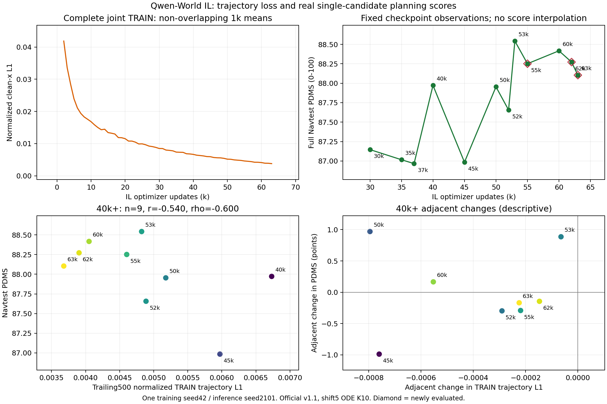

# Qwen-World IL中后期轨迹L1与完整Navtest

所有新请求均已全量完成：canonical NAVSIMv1.1，12146场景，单候选clean-x十步shift5 ODE，seed2101。训练seed42不变。新增55k/62k/63k，复用其余九个已封存结果；Test已被多次观察。

## 训练L1是否持续降低

训练有效日志预先固定到63k：8rank逐更新L1副本完全一致、cursor=32×update、optimizer计数连续且skipped0。这不是把8rank当8次独立训练平均。统计为原始归一化8×3 clean-x L1，乘总loss系数10之前；不是速度MSE，也不是米制最终轨迹误差。

30k到63k的非重叠1000步窗口：33次下降，0次上升。完整joint阶段仍有2个上升窗口，不能说每一步都下降。

| IL更新 | 末500步轨迹L1 | 完整Navtest PDMS | 本轮新增 |
|---|---:|---:|---|
| 30000 | 0.008562919 | 87.146897 | 复用 |
| 35000 | 0.007361490 | 87.016552 | 复用 |
| 37000 | 0.007185198 | 86.966585 | 复用 |
| 40000 | 0.006731799 | 87.972382 | 复用 |
| 45000 | 0.005972215 | 86.984807 | 复用 |
| 50000 | 0.005177416 | 87.953895 | 复用 |
| 52000 | 0.004887311 | 87.656609 | 复用 |
| 53000 | 0.004822835 | 88.542266 | 复用 |
| 55000 | 0.004603793 | 88.250834 | 是 |
| 60000 | 0.004051194 | 88.416776 | 复用 |
| 62000 | 0.003904329 | 88.271964 | 是 |
| 63000 | 0.003679942 | 88.103883 | 是 |

## 相关性：分开看水平值与相邻变化

预登记主区间40k–63k，补充30k–63k及50k–63k。Pearson/Spearman为负表示低loss伴随高PDMS；相邻变化另算，用来减少仅因训练时间共同变化产生的表面关联。样本点少且依赖，不使用独立样本p值宣称因果。

| 起始更新 | n | 水平Pearson | 水平Spearman | 相邻变化Pearson | L1下降且分数升/降 |
|---|---:|---:|---:|---:|---:|
| 30000 | 12 | -0.785089 | -0.755245 | 0.079494 | 4 / 7 |
| 40000 | 9 | -0.539584 | -0.600000 | 0.070451 | 3 / 5 |
| 50000 | 7 | -0.329289 | -0.357143 | 0.257323 | 2 / 4 |

主区间8个相邻变化中，L1下降且PDMS上升3次，L1下降但PDMS也下降5次。因此不能用训练L1替代Test评价或保证继续续训必然提分。

100/500/1000更新窗口的全部敏感性分析见trajectory_correlations.json。它们只改变日志汇总窗口，不改变模型或评测。在线TRAIN重建误差来自变化中的权重、样本、噪声；不称固定检查点Test监督loss，也不能单凭它证明过拟合或归因某个辅助任务。

## 身份、预算与缺失检查点

新评测总计36438条单候选场景、额外3条native恢复/导出一致性；原有九个评分直接复用，不重新计为新增评分。各新模型JSON保留真实分项、相对IL40及预登记前点的配对log bootstrap、安全/零分转移和实际worker成本。固定训练仍按100k预算继续，本轮不改变优化器/数据/损失，不自动更换RL父模型或追加新seed。

原生54k、56–59k及61k当前不在保留检查点或已核实的导出清单中；不从相邻权重插值、不重训伪造。全部可用且未评测的中后期原生55k/62k/63k已在新分数产生前锁定。私有原始日志、轨迹、权重均不上传。

入口：tools.qwen_world_postcot.freeze_il_loss_journals、analyze_il_loss_pdms及latest_snapshot_owner；request.json登记真实路径与恢复身份，loss_analysis.log和各GPU invocation完整记录保留在资产根。
