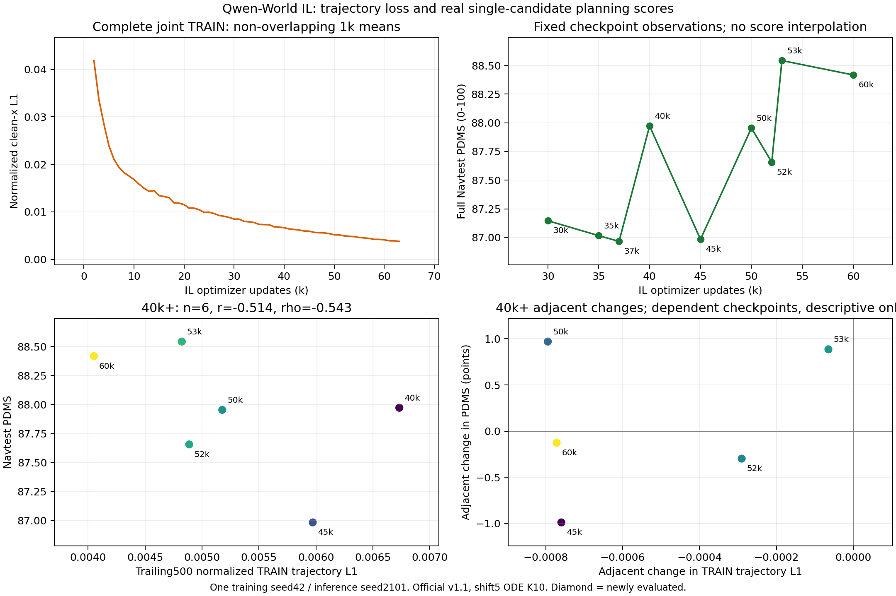

# Qwen-World IL中后期轨迹L1与Navtest：补测登记

已核实：30k–63k非重叠1000步轨迹L1均值连续33个区间下降。完整joint阶段62个窗口有59降/2升，不能称单步严格单调。以下L1为原归一化clean-x重建目标，乘系数10之前。

补测55k、62k、63k，固定候选集合和63000更新的完整8rank有效日志均已在新Test结果前封存；既有9点直接复用。其他中间原生权重当前不在已核实的checkpoint/导出清单，不伪造。新评测尚未完成，待真实GPU推理与评分。

| IL更新 | 末500步训练轨迹L1 | canonical Navtest PDMS |
|---|---:|---:|
| 30000 | 0.008562919 | 87.146897 |
| 35000 | 0.007361490 | 87.016552 |
| 37000 | 0.007185198 | 86.966585 |
| 40000 | 0.006731799 | 87.972382 |
| 45000 | 0.005972215 | 86.984807 |
| 50000 | 0.005177416 | 87.953895 |
| 52000 | 0.004887311 | 87.656609 |
| 53000 | 0.004822835 | 88.542266 |
| 55000 | 0.004603793 | 待补测 |
| 60000 | 0.004051194 | 88.416776 |
| 62000 | 0.003904329 | 待补测 |
| 63000 | 0.003679942 | 待补测 |

既有9点（30k–60k）L1-PDMS Pearson=-0.74318、Spearman=-0.68333；仅40k起的6点Pearson=-0.51377。相邻8次L1都下降，但PDMS仅3升5降。相关系数为负表示低loss伴随高分，不能把水平时间趋势当因果或loss选模规则。

新3点完成后自动汇总全部12点；主区间40k–63k，补充30k–63k和50k–63k；100/500/1000步窗口敏感性、相邻变化相关性及独立图表一并发布。

每次新评测均全Navtest12146场景、seed2101、单候选clean-x十步shift5 ODE、canonical v1.1；新增36438候选评分＋3native/export一致性预测。无DEV选点，无best-of-N，无新训练seed、无IL/RL配方或父模型变更。只用固定五台授权主机，保留其它真实任务。

入口：`python -m tools.qwen_world_postcot.freeze_il_loss_journals --help`、`python -m tools.qwen_world_postcot.analyze_il_loss_pdms --help`、`python -m tools.qwen_world_postcot.latest_snapshot_owner --help`。实际冻结日志/已有九点分析已执行，完整命令和资产路径见request.json。原始日志/样本/权重不上传。

