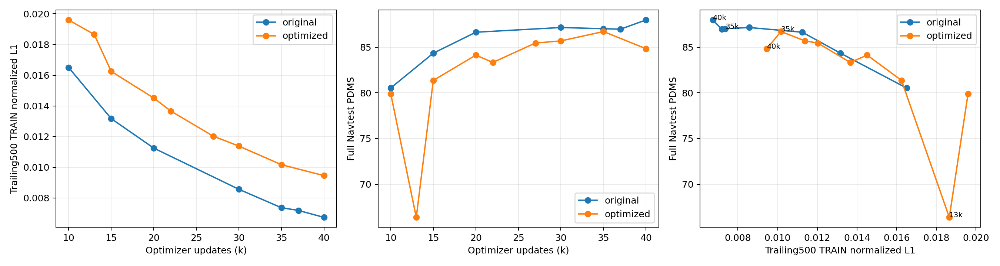

# 优化轨迹标签：L1拟合、Navtest与抗扰动容差

本次为只读CPU分析：不训练、不新增模型前向或评分。复用两版有效训练日志、完整Navtest及30k已保存TRAIN候选。分析资产：`/mnt/project/qwen-world-postcot-20261025/label_loss_PDMS_analysis_20261030T023830Z`。

## 结论

优化轨迹版确实学到了更快前进：同预算30/35/40k的实际模拟进度分别比原轨迹版多约2.39/2.00/2.20米，EP更高；但NC/TTC降低抵消了收益。当前证据尚未支持标签的抗扰动优势已完整迁移到学生。不能用标签历史98分或TRAIN候选均分替代单候选Navtest，也不能据尚未完成的优化标签100k训练宣布最终无效。

## 轨迹L1的定义与同预算结果

以下是各checkpoint前500个有效optimizer update的、已全局归约的归一化clean-x L1，**未乘主损失系数10**，不是总loss，也不是固定模型完整ODE的轨迹误差。模型在带目标成分的noisy action上训练；部署从独立噪声迭代生成。单个聚合L1不能唯一换算成厘米或角度。

八rank逐值核对通过。各匹配窗口的全局32场景顺序、sigma_mean和有效动作坐标分母完全相同；相同坐标codec与loss权重。10/15k辅助candidate bank相同，20k以后两版各自刷新bank，因此后期不能宣称只有标签一个因素不同。

| update | 原GT L1 | 优化标签L1 | L1相对增加 | 原GT Navtest | 优化标签Navtest |
|---:|---:|---:|---:|---:|---:|
| 10000 | 0.016498 | 0.019601 | +18.81% | 80.531938 | 79.904274 |
| 15000 | 0.013168 | 0.016245 | +23.36% | 84.337362 | 81.359718 |
| 20000 | 0.011247 | 0.014513 | +29.04% | 86.631877 | 84.126274 |
| 30000 | 0.008563 | 0.011379 | +32.89% | 87.146897 | 85.682545 |
| 35000 | 0.007361 | 0.010168 | +38.12% | 87.016552 | 86.704773 |
| 40000 | 0.006732 | 0.009453 | +40.42% | 87.972382 | 84.828738 |

优化版35k→40k：L1下降7.03%，Navtest下降1.876035点。13k也是反例：L1低于10k，但PDMS从79.904274降至66.369502。低L1不能替代真实部署评价。

## 相关性及边界

原版26个已测点（10k—100k）Pearson=-0.918907，Spearman=-0.913162；优化版9个点（10k—40k）Pearson=-0.735652，Spearman=-0.866667。负相关表示loss越低总体分数越高。两组点数/阶段不同，不能用系数大小判方法优劣。

这是同一训练过程的相关checkpoint，受共同训练时间影响，不是独立训练复现或因果证据。每个点的loss仍是变化参数、变化batch/noise上的在线TRAIN统计，不是冻结模型的固定数据L1。100/500/1000窗口敏感性和相邻变化统计保留在两个loss_analysis.json中。

## 同预算完整Navtest：进度与安全

全部12146场景、canonicalv1.1、单候选clean-x K10shift5、seed2101。按44物理log配对bootstrap2000次，保留场景权重；仅一个训练/推理seed。

| update | 优化−原GT PDMS | 95%区间（点） | G+ | G− | 原零分恢复 | 新增零分 |
|---:|---:|---|---:|---:|---:|---:|
| 30000 | -1.464352 | [-2.672784, -0.372687] | +5.541374 | -7.005726 | 330 | 627 |
| 35000 | -0.311778 | [-1.965861, +1.216907] | +6.020837 | -6.332616 | 445 | 540 |
| 40000 | -3.143644 | [-4.677972, -1.812662] | +5.292166 | -8.435810 | 352 | 772 |

| 40k指标 | 原GT | 优化标签 | 差值（点） |
|---|---:|---:|---:|
| PDMS | 87.972382 | 84.828738 | -3.143644 |
| NC | 98.061090 | 94.096822 | -3.964268 |
| DAC | 96.220978 | 96.747901 | +0.526922 |
| TTC | 94.730776 | 84.966244 | -9.764532 |
| EP | 82.141152 | 85.345047 | +3.203895 |
| Comfort | 99.991767 | 100.000000 | +0.008233 |
| DDC | 98.468632 | 97.912893 | -0.555739 |

40k实际模拟raw progress均值：原GT20.2225米，优化标签22.4243米。这支持进度行为发生变化；不等于所有轨迹前进都是错误。DAC也略高，不能概括为所有安全项下降。主要损失在NC/TTC，净结果低3.1436点；35k差值区间跨0，不能把其−0.3118点解释为已确定劣化。

## 抗扰动目标为何尚未保证学生收益

训练子集90890场景中82753条标签发生修改、7956条回退原GT；目标overlay只替换主规划标签，原观测、未来teacher及其他loss保留。当前没有把可行域半径、局部方向/时序容差作为loss输入或监督。但**单点L1也可能受益于更宽的目标可行域**，不能仅因未显式训练扰动loss就判设计无效。实际收益取决于学生误差是否落入已验证邻域。

完整TRAIN标签几何核对：优化标签4秒点平均前移1.755米，约77.54%的有效末端点更前；平均绝对标签编辑为纵向0.824米、横向0.235米、航角1.813°。这些是标签修改，不是模型误差，也不是新的评分。

发布V12源记录的原始配置量级为横向0.2米、纵向0.3米、时间0.1秒、航角0.5°，扰动族为anchored_kinematic_control_residual_v1。该发布是混合历史证据；新增1692条采用相对GT非退化的验证，允许残余失败，不是全数据统一绝对安全证明。训练子集历史名义标签PDMS98.1147／原GT94.9791尚未逐条按当前canonical backend重新评分，不能当作当前学生匹配上限。

为检查学生误差，按token固定hash取512个TRAIN场景，从两版30k封存bank中各取两个当前模型ODE输出，共1024条。native权重hash与各自30k Navtest绑定一致；全部候选齐全，无新增前向或评分。这是TRAIN小切片、两个推理root，不是新训练seed，不是主表Test分数。

| 对自身监督标签的实际ODE误差 | 原GT版 | 优化标签版 |
|---|---:|---:|
| 纵向平均绝对误差（cm） | 41.582 | 43.202 |
| 横向平均绝对误差（cm） | 13.712 | 14.449 |
| 航角平均绝对误差（°） | 0.869 | 1.335 |
| 纵向点误差95分位（cm） | 130.711 | 124.352 |
| 横向点误差95分位（cm） | 55.596 | 50.208 |
| 航角点误差95分位（°） | 3.367 | 4.190 |

所有有效点同时落在上述简单坐标包围盒内的候选比例：原GT6.05%，优化标签0.39%。这只是范围诊断，不是严格扰动族成员资格，不含timing、控制相关性或逐场景幅度，也不是安全率；不能把0.39%解释成只有0.39%轨迹安全。真实原生NC/DAC/TTC全部通过的比例分别为97.17%和90.33%。

该TRAIN切片候选PDMS原版92.7993／优化版93.3258，优化版虽然均分略高但安全通过比例更低；完整Test30k却更低。它提示进度取舍与泛化也需分析，不能把问题全部归结为训练拟合误差。

40k其他辅助loss并无同幅度恶化：DINO0.01713→0.01699、future0.09605→0.09674、post0.18867→0.18096；仅比较标量不能据此排除梯度冲突。

## 最小下一步

优先在固定TRAIN样本上，把学生真实残差投影到原来的纵向/横向/航角/时间与控制扰动参数，再用同一canonical scorer重放，明确区分“误差已超容差”“误差结构未覆盖”“容差内仍失败”。在这个定位完成前，不把单纯降低L1当作解决方案，不新增一组未经归因的loss/模型矩阵；当前100k标签实验配方保持。



## 已执行命令与成本

```bash
python -m tools.qwen_world_postcot.analyze_il_loss_pdms --run <original_or_optimized_run> --scores <sealed_score_plan.json> --output <analysis_output>
python -m tools.qwen_world_postcot.analyze_optimized_label_fit --analysis-root /mnt/project/qwen-world-postcot-20261025/label_loss_PDMS_analysis_20261030T023830Z
```

实际原始/优化run、score plan、前缀hash和成本保留在JSON中。首次命令两版均已执行；详情分析CPU墙钟约371.6秒，另有日志核对和绘图开销。新增模型前向0、评分0、optimizer update0；未改变任何训练或评价结果。
